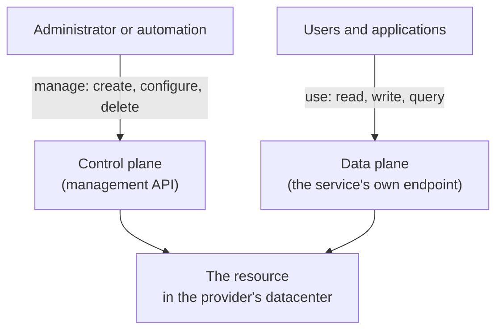

# What the Cloud Is

> **Foundation primer.** Module 0A is not exam content. It gives you the minimum
> background the SC-500 lessons assume, so you can follow them without leaving the
> Academy. Each primer names the official objectives it supports.

## Why this matters for security

Every control in SC-500 protects something that runs on computers you will never see
or touch. You cannot lock a server room, unplug a cable, or walk over to a machine that
is behaving strangely. **In the cloud, almost every security control is a setting**,
and a setting can be wrong without anything looking broken.

So before you can secure the cloud, you need a clear picture of what you are actually
renting, who manages which part of it, and how it gets created and changed.

## In plain English

The cloud is renting computing from a provider instead of buying and running it
yourself. You can rent a whole virtual computer, a place to keep files, a database, or a
finished application such as email. You create these things in minutes, through a
website or a command, and you pay while they exist or while you use them.

The provider owns the buildings, the hardware and the cables. You own what you put on
top: your data, your settings, and who is allowed in.

## Words you need to know

- **Cloud provider** - the company that owns the datacenters and rents out capacity.
  For this exam, Microsoft.
- **Service** - one thing you can rent: a virtual machine, a storage account, a
  database, an application.
- **Resource** - one specific instance of a service that you created, such as "the
  storage account called `stfinance01`".
- **Region** - a geographic location of datacenters where a resource lives, such as
  Canada Central.
- **IaaS (infrastructure as a service)** - you rent virtual machines, disks and
  networks, and you manage the operating system and everything above it.
- **PaaS (platform as a service)** - you deploy an application or use a managed service
  without managing the operating system underneath it.
- **SaaS (software as a service)** - you use a finished application that the provider
  runs entirely, such as Microsoft 365.
- **Control plane** - the management side of a resource: create it, configure it,
  delete it.
- **Data plane** - the using side of a resource: read the file, query the database,
  fetch the secret.

## Mental model

A teaching model, not a product diagram: every cloud resource has two doors.

Keep the two doors apart in your head. Many SC-500 questions are really asking "which
door is this control guarding?"

## Microsoft cloud translation

| The generic idea | What Microsoft calls it | Where you meet it |
| --- | --- | --- |
| Cloud provider | Microsoft | Everywhere |
| Infrastructure you manage | Azure Virtual Machines, Azure Disk Storage, virtual networks | Domain 3, servers and VMs |
| Platforms you configure | Azure App Service, Azure Functions, Azure SQL Database, Azure Storage | Domains 2 and 3 |
| Finished applications | Microsoft 365, Dynamics 365 | Domain 3, AI security |
| The control plane | Azure Resource Manager (ARM) | Every Azure lesson |
| The data plane | Each service's own endpoint, for example `<vault-name>.vault.azure.net` for Key Vault | 01-02, 02-01, 02-02 |
| A location | An Azure region | Lab setup, data residency questions |

## How it works

**Three service models, one rule.** Microsoft describes cloud workloads as IaaS, PaaS or
SaaS. Azure Virtual Machines and virtual networks are IaaS: you patch the operating
system. Azure App Service, Azure Functions, Azure SQL Database and Azure Storage are
PaaS: Microsoft runs the operating system, and you configure the service and your code.
Microsoft 365 is SaaS: Microsoft runs the application, and you configure how your
organisation uses it. Many real solutions mix all three.

**Everything is created through an API.** Whether you click in the portal, run a
PowerShell command or deploy a template, the request goes to the same management API.
That is what makes the cloud fast: a resource exists seconds after you ask for it. It is
also why one wrong template can create the same weakness a hundred times.

**Resources start with defaults.** A new resource arrives with settings already chosen.
Some defaults are protective; some are convenient. For example, a new key vault and a new
storage account both start reachable from all networks until you restrict them, as you
will see in 01-02 and 02-01. Reading the defaults is part of the security job.

**You pay by the meter.** Many resources bill by the hour from the moment they exist,
whether or not anyone uses them. That is why Module 0B puts budgets and teardown before
any lab.

## Why security cares

**Without the control**

1. A resource is created with its default network setting
2. The default allows access from all networks
3. Anyone on the internet can reach the service endpoint
4. Only a password, key or token stands between the data and the world

**With the control**

1. The default is reviewed and restricted when the resource is created
2. The endpoint accepts only the networks you chose
3. An attacker needs a network path and a valid credential
4. One mistake no longer exposes the data on its own

**What it does not solve.** Restricting the network does not decide who is *allowed*
once they arrive. That is identity's job (0A-04 and 0A-05).

**Depends on.** Knowing which door a setting guards. A network rule on the data plane
does not stop someone changing the resource's configuration through the control plane.

## Common misunderstandings

| What people assume | What is actually true |
| --- | --- |
| "The cloud provider secures everything." | Microsoft secures the datacenter, hardware and platform. You always remain responsible for your data, identities, accounts and configuration. See 0A-13. |
| "If it is in the cloud, it is on the public internet." | Many services can be made reachable only from your private networks. See 0A-08. |
| "Managing a resource and using its data are the same permission." | They are separate doors with separate rules - although a few services let control-plane rights lead to data access, which SC-500 tests directly (01-02, 02-01). |
| "Deleting a resource always stops the bill." | Some charges, such as Defender plans, are set on the subscription and continue until you turn them off. See 00-01. |

## Where SC-500 uses this

- **Control plane versus data plane** decides the answers in
  [01-02 Key Vault](../01-identity-access-governance/01-02-key-vault-secrets-and-keys.md),
  [01-03 resource locks](../01-identity-access-governance/01-03-governance-and-regulatory-compliance.md)
  and [02-01 storage](../02-storage-databases-networking/02-01-storage-account-security.md).
- **IaaS** is the subject of
  [03-04 servers and VMs](../03-secure-compute/03-04-servers-and-virtual-machines.md).
- **PaaS** is the subject of
  [03-06 serverless, web and APIs](../03-secure-compute/03-06-app-platform-serverless-web-and-apis.md).
- **Defaults and posture** are what
  [04-01 Defender for Cloud](../04-security-posture/04-01-defender-for-cloud-posture.md)
  measures across everything you deploy.

## Teach it back

In three or four sentences, explain to a colleague who has never used Azure: what you
rent in IaaS compared with PaaS, who patches the operating system in each, and why a
firewall rule on a service's data plane does not stop someone changing that service's
settings.

A strong answer mentions: the operating system is yours in IaaS and Microsoft's in PaaS;
the control plane and data plane are separate doors; network rules on the data plane do
not guard the control plane.

## Key takeaways

- The cloud is rented computing. The provider owns the hardware; you own your data,
  identities and settings.
- IaaS, PaaS and SaaS move more of the stack to Microsoft, but never your data,
  accounts or configuration.
- Every resource has a control plane (manage it) and a data plane (use it). Ask which one
  a control guards.
- Defaults are a starting point, not a decision. Some are convenient rather than safe.
- Many resources bill while they exist. Budgets and teardown come first.

## Sources

- Shared responsibility in the cloud: <https://learn.microsoft.com/azure/security/fundamentals/shared-responsibility>
- Azure resource management fundamentals: <https://learn.microsoft.com/entra/architecture/secure-resource-management>
