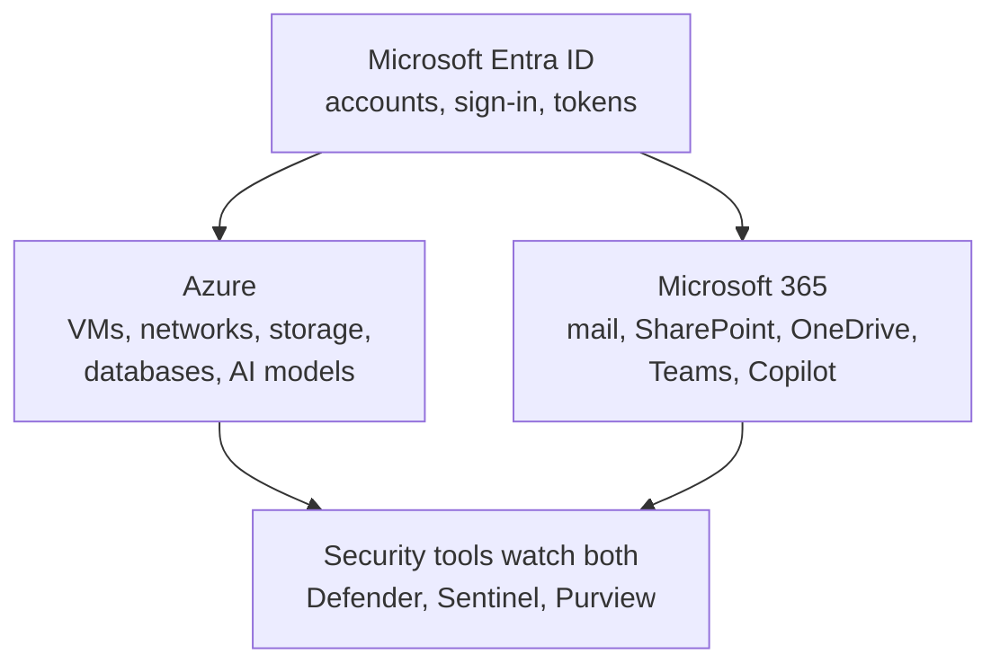

# Azure and Microsoft 365

> **Foundation primer.** Not exam content. SC-500 spans two Microsoft clouds that
> share one identity system. This primer tells them apart and shows where each one is
> managed.

## Why this matters for security

SC-500 asks you to secure a storage account in Azure in one question and a SharePoint
site in Microsoft 365 in the next. They are protected by different settings, in
different admin centers, by people who often sit in different teams. What joins them is
the identity system: **one compromised account can reach both**. A security engineer has
to know which cloud a piece of data lives in before choosing the control that protects it.

## In plain English

**Azure** is Microsoft's cloud for building things: virtual machines, networks,
databases, storage, and AI models that your organisation deploys and runs.

**Microsoft 365** is Microsoft's cloud for working: email, files, chat and meetings, run
entirely by Microsoft. You configure it; you do not build it.

**Microsoft Entra ID** sits underneath both. It holds the accounts, checks who people
are, and issues the proof they carry into Azure and Microsoft 365 alike.

## Words you need to know

- **Azure** - Microsoft's infrastructure and platform cloud. Mostly IaaS and PaaS.
- **Microsoft 365** - Microsoft's productivity suite delivered as SaaS: Exchange Online
  (mail), SharePoint Online and OneDrive (files), Teams (chat and meetings).
- **Microsoft Entra ID** - Microsoft's cloud identity service. Formerly Azure Active
  Directory.
- **Admin center** - a web console where one area of Microsoft's cloud is configured.
- **Microsoft Graph** - the API that applications use to reach Microsoft 365 and Entra
  data, such as mail, files and users.
- **Microsoft 365 Copilot** - an AI assistant that works over Microsoft 365 content
  through Microsoft Graph, using the signed-in user's own permissions.
- **Microsoft Defender portal** - the security operations console where Defender XDR
  alerts and incidents, and Microsoft Sentinel, are worked.

## Mental model

A teaching model: two clouds, one front door for identity.

## Microsoft cloud translation

| What you want to change | Where it is configured | Where SC-500 teaches it |
| --- | --- | --- |
| Accounts, sign-in rules, app identities | Microsoft Entra admin center (`entra.microsoft.com`) | 01-01, 03-02 |
| Azure resources: VMs, networks, Key Vault, storage | Azure portal (`portal.azure.com`) | Domains 1 to 3 |
| Microsoft 365 users, licences, agents | Microsoft 365 admin center (`admin.microsoft.com`) | 03-02 |
| SharePoint sharing and oversharing reports | SharePoint admin center | 03-01 |
| Data security and compliance, audit | Microsoft Purview portal (`purview.microsoft.com`) | 03-01, 04-04 |
| Alerts, incidents, Sentinel, Purview Audit search | Microsoft Defender portal (`security.microsoft.com`) | 03-02, 04-02 to 04-04 |
| Copilot Studio agents and environments | Power Platform admin center | 03-02 |
| AI models and agents you build | Microsoft Foundry portal | 03-03 |
| Security Copilot | Security Copilot portal (`securitycopilot.microsoft.com`) | 04-05 |

You do not need to memorise every console. You need to know that **a control lives in
the console of the thing it protects**.

## How it works

**One identity, many resources.** When someone signs in, Entra ID checks who they are
and issues a token. That token is then presented to Azure Resource Manager, to
SharePoint, to Exchange or to any other service. Each service makes its own decision
about what the token's holder may do. That is why identity controls (Domain 1) reach
everything, and why a stolen session is so dangerous.

**Azure permissions and Microsoft 365 permissions are different systems.** Azure uses
Azure role-based access control on subscriptions and resources. Microsoft 365 uses its
own sharing and permission model - SharePoint site membership and sharing links, mailbox
permissions - plus directory roles in Entra ID. An Azure Owner is not automatically
anyone in SharePoint, and a SharePoint site owner has no rights in Azure.

**AI sits in both clouds.** Microsoft 365 Copilot reasons over Microsoft 365 content and
can only see what the signed-in user can already open (03-01). Applications and agents
you build yourself run in Azure, usually in Microsoft Foundry (03-03). The controls are
different because the ownership is different.

**Security operations sit across both.** Microsoft Defender XDR, Microsoft Sentinel and
Microsoft Purview collect signals from Azure and Microsoft 365 together, which is how an
incident that starts with a phished mailbox and ends in a storage account can be seen as
one story (Domain 4).

## Why security cares

**Without the control**

1. An Azure-focused team hardens every storage account
2. A SharePoint site holding the same data stays shared with the whole organisation
3. Microsoft 365 Copilot can surface that site to anyone who asks the right question
4. The data leaks through the cloud nobody was watching

**With the control**

1. The team maps where each kind of sensitive data lives
2. Azure data is protected with Azure controls, Microsoft 365 data with SharePoint and Purview controls
3. Identity controls apply to both, because both trust Entra ID
4. The same data is protected wherever it sits

**What it does not solve.** Knowing which cloud holds the data does not fix the data's
permissions. That is still the work of the specific lesson.

**Depends on.** An accurate inventory of where sensitive data lives - which is exactly
what the discovery tools in 03-01 and 04-01 exist to provide.

## Common misunderstandings

| What people assume | What is actually true |
| --- | --- |
| "Azure and Microsoft 365 are the same thing." | They share Entra ID for identity, but they are separate clouds with separate permission models and separate admin centers. |
| "Global Administrator in Entra means I own every Azure subscription." | Directory roles and Azure roles are separate. A Global Administrator can elevate their own access to manage Azure subscriptions, but that is a separate, deliberate step - not something the directory role grants by itself (00-02, 01-03). |
| "Copilot has its own access to our files." | Microsoft 365 Copilot works with the signed-in user's existing permissions. It surfaces what the user could already reach (03-01). |
| "Security tools only watch Azure." | Defender XDR, Sentinel and Purview collect signals from Microsoft 365 too, and correlate them with Azure. |

## Where SC-500 uses this

- Identity that spans both clouds:
  [01-01 Microsoft Entra ID](../01-identity-access-governance/01-01-entra-id-secure-access.md).
- Microsoft 365 data and AI:
  [03-01 AI data exposure](../03-secure-compute/03-01-ai-data-exposure-and-purview-dspm.md) and
  [03-02 agent governance](../03-secure-compute/03-02-ai-agent-identity-and-governance.md).
- Collecting both clouds into one view:
  [04-02 Sentinel workspaces](../04-security-posture/04-02-sentinel-workspace-roles-and-content.md).
- AI as a security tool across both:
  [04-05 Security Copilot](../04-security-posture/04-05-security-copilot.md).

## Teach it back

Explain why a security engineer who only knows the Azure portal could miss the biggest
data exposure in the organisation, and name the one system that connects Azure and
Microsoft 365.

A strong answer covers: Microsoft 365 data (SharePoint, OneDrive, mail) is governed in
different admin centers with a different permission model; Copilot makes existing
Microsoft 365 oversharing easier to reach; Entra ID is the shared identity system that
connects both.

## Key takeaways

- Azure is the cloud you build on; Microsoft 365 is the cloud you work in.
- Microsoft Entra ID is the identity system for both. Identity controls reach everything.
- Each cloud has its own permission model. Azure RBAC does not govern SharePoint.
- Controls live in the console of the thing they protect.
- Defender, Sentinel and Purview watch across both clouds.

## Sources

- Shared responsibility in the cloud (service models and examples): <https://learn.microsoft.com/azure/security/fundamentals/shared-responsibility>
- Agent management in the Microsoft 365 admin center: <https://learn.microsoft.com/microsoft-365/admin/manage/agent-365-overview>
- Understand authentication in Microsoft Security Copilot: <https://learn.microsoft.com/copilot/security/authentication>
