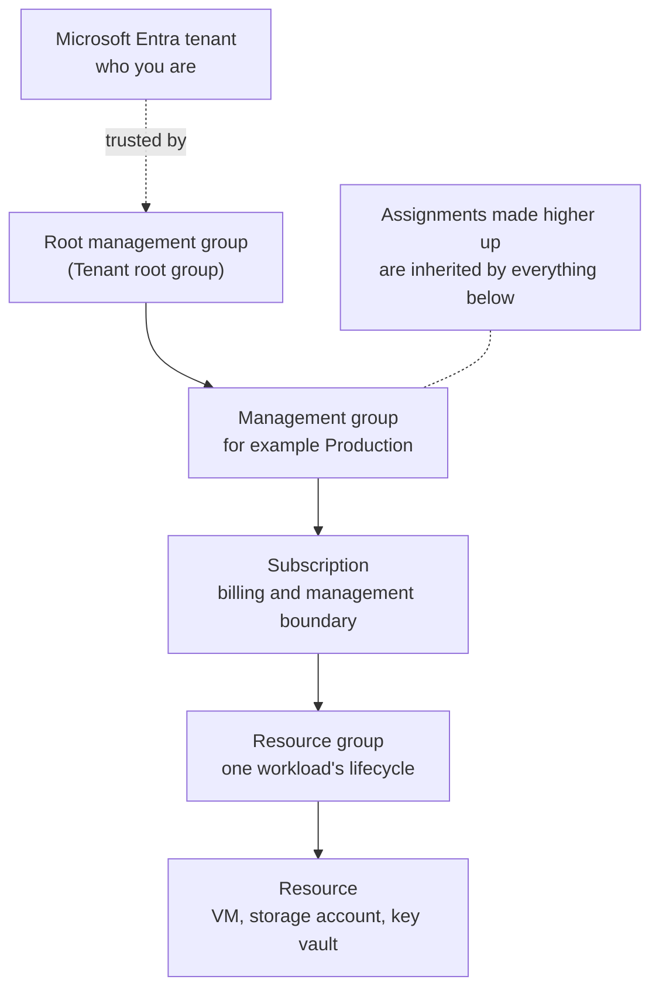

# Tenants, Subscriptions, and Resources

> **Foundation primer.** Not exam content. Almost every SC-500 control is assigned "at a
> scope". This primer explains the scopes, because the scope you choose decides how far
> a control - or a mistake - reaches.

## Why this matters for security

When you grant someone a role, assign a policy, or switch on a Defender plan, you do it
**at a scope**. Choose a scope too high and you hand out far more than you meant to.
Choose it too low and the next resource someone creates is unprotected. Several of the
most common exam traps are scope traps: a charge that survives deleting a resource group,
a role assignment inherited from two levels up, a policy that does not reach a new
subscription.

## In plain English

Your organisation's Microsoft cloud is a set of nested boxes. The outer box is your
organisation's identity directory. Inside it you create billing boxes for Azure. Inside
those you group related things. And inside those are the actual things you rent.
Anything you set on a box applies to everything inside it.

## Words you need to know

- **Tenant** - your organisation's dedicated instance of Microsoft Entra ID: its users,
  groups, apps and directory settings. Also called the directory.
- **Subscription** - an Azure billing and management container. It trusts exactly one
  Entra tenant to authenticate people and services.
- **Management group** - a container for subscriptions, used to apply policy and access
  to many subscriptions at once. Every tenant has one root management group.
- **Resource group** - a container for related resources that share a lifecycle, such as
  one application's VM, network and database.
- **Resource** - one manageable thing: a virtual machine, a storage account, a key vault.
- **Scope** - the level at which something is assigned: management group, subscription,
  resource group, or resource.
- **Inheritance** - an assignment at a scope applies to everything beneath it.

## Mental model

A teaching model: nested boxes, with inheritance flowing down.

## Microsoft cloud translation

| The generic idea | Microsoft's term | What you assign there in SC-500 |
| --- | --- | --- |
| The organisation's identity directory | Microsoft Entra tenant | Conditional Access, directory roles, consent settings |
| Policy and access across many billing units | Management group | Azure Policy, Azure role assignments, Defender plans by policy |
| A billing and administrative boundary | Subscription | Defender for Cloud plans, Sentinel workspaces, policy, roles |
| A workload's container | Resource group | Role assignments for a team, locks, teardown in labs |
| One thing you rent | Resource | Firewalls, private endpoints, data-plane roles |

## How it works

**A subscription trusts one tenant.** A subscription trusts exactly one Microsoft Entra
tenant to authenticate users, services and devices. A tenant can have many
subscriptions. That trust is why identity decisions in Entra ID shape access to every
Azure resource.

**Management groups give you one place to govern many subscriptions.** You arrange
subscriptions in a tree of management groups, and everything assigned to a management
group cascades to every subscription in it, including subscriptions added later. A
management group tree can be up to six levels deep, not counting the root and the
subscription level. New subscriptions land under the root management group by default.

**The root is special.** Each tenant has one root management group, shown as "Tenant root
group". Anything assigned there applies to every subscription and resource in the tenant,
which is why assignments at the root should be "must have only". By default nobody has
access to manage it; a Global Administrator can elevate their access to do so.

**Resource groups are lifecycle tools.** Group the things that live and die together.
Deleting a resource group deletes every resource in it, which is how every lab in this
Academy tears itself down - and also why some things are deliberately *not* in a lab's
resource group (Module 0B keeps the budget and monitoring in their own).

**Not everything lives in a resource group.** Defender for Cloud plans, many policy
assignments and some role assignments sit on the subscription itself. Delete a resource
group and they keep running - and some keep billing.

## Why security cares

**Without the control**

1. A role is assigned at subscription scope "to save time"
2. Every resource group in the subscription inherits it
3. The account is phished
4. The attacker can act on every resource in the subscription, not just one workload

**With the control**

1. The role is assigned at the resource group the person actually works in
2. Other resource groups do not inherit it
3. The account is phished
4. The damage stays inside one workload

**What it does not solve.** A narrow scope limits reach. It does not stop misuse of the
access that remains - that needs least privilege on the role itself and monitoring.

**Depends on.** Effective permissions being the union of every assignment at that scope
and above. One broad assignment higher up silently cancels careful narrow ones (01-03).

## Common misunderstandings

| What people assume | What is actually true |
| --- | --- |
| "Tenant and subscription mean the same thing." | The tenant is the identity directory. A subscription is an Azure billing container that trusts one tenant. |
| "Deleting the resource group removes everything the lab created." | Subscription-scoped settings such as Defender plans and many policy and role assignments survive it (00-01, 00-03). |
| "A role assigned on a resource group stays inside it." | It does - but a role assigned higher up flows down into it too. Effective access is the sum of both. |
| "Policies have to be assigned to each subscription." | Assign once at a management group and every subscription beneath it, present and future, inherits it. |

## Where SC-500 uses this

- Policy and role scopes:
  [01-03 governance and compliance](../01-identity-access-governance/01-03-governance-and-regulatory-compliance.md).
- Defender plans enabled per subscription:
  [04-01 Defender for Cloud](../04-security-posture/04-01-defender-for-cloud-posture.md).
- Workspace placement and roles at resource group scope:
  [04-02 Sentinel](../04-security-posture/04-02-sentinel-workspace-roles-and-content.md).
- Why lab teardown has a subscription bucket:
  [00-03 teardown checklist](../00-lab-safety/00-03-teardown-checklist-template.md).

## Teach it back

Explain to a colleague why "assign it at the management group" and "assign it at the
resource group" are different security decisions, using one example of each going wrong.

A strong answer covers: inheritance flows down; too high gives more access or wider
policy than intended; too low leaves new resources or subscriptions uncovered; effective
access is the union of all assignments.

## Key takeaways

- Tenant (identity) → management groups → subscriptions → resource groups → resources.
- Anything assigned at a scope is inherited by everything below it.
- A subscription trusts exactly one Entra tenant.
- Assign governance as high as it is universally true; assign access as low as it works.
- Deleting a resource group does not remove subscription-scoped settings or charges.

## Sources

- Azure resource management fundamentals: <https://learn.microsoft.com/entra/architecture/secure-resource-management>
- What are Azure management groups: <https://learn.microsoft.com/azure/governance/management-groups/overview>
