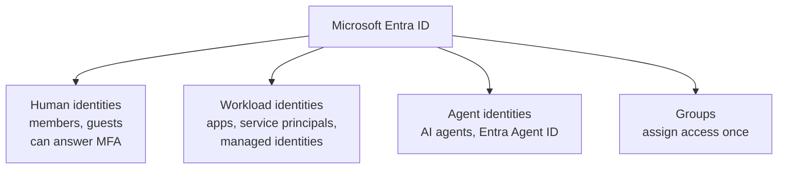

# Users, Accounts, and Identities

> **Foundation primer.** Not exam content. SC-500 talks about users, groups, service
> principals, managed identities, workload identities and agent identities. This primer
> sorts them into one picture.

## Why this matters for security

Every request in the cloud is made by *something* the directory recognises. If you
cannot say what kind of identity is asking, you cannot choose the right control: a
human can answer an MFA prompt, an application cannot, and an AI agent can be talked
into misusing its own access. **Most cloud intrusions use a real identity with real
permissions**, which is why Domain 1 starts here.

## In plain English

An identity is a name the directory knows, plus a way to prove it. People have
identities. So do applications, automated scripts and, now, AI agents. Each one can be
given permissions. Each one, if misused, can do whatever those permissions allow.

## Words you need to know

- **Identity** - an object in Microsoft Entra ID that can be authenticated and given
  access.
- **User** - an identity for a person. A **member** belongs to your organisation; a
  **guest** is someone from outside invited in.
- **Group** - a collection of identities. Assign access to groups, not individuals, so
  it can be reviewed and removed in one place.
- **Workload identity** - an identity for software rather than a person: an application,
  a service, a script.
- **Service principal** - the identity an application uses inside your tenant.
- **Managed identity** - a service principal for an Azure resource whose credential Azure
  creates, holds and rotates. You never see it.
- **Agent identity** - an identity for an AI agent, managed with Microsoft Entra Agent ID.
- **Privileged account** - any identity holding powerful roles. The prime target.
- **Break-glass account** - an emergency administrator account kept out of normal policies
  so the tenant can be recovered if a policy locks everyone out.

## Mental model

A teaching model: four families of identity, each asking for access in its own way.

## Microsoft cloud translation

| The generic idea | Microsoft's term | Where SC-500 uses it |
| --- | --- | --- |
| A person's account | User (member or guest) | Conditional Access, PIM, MFA (01-01) |
| An application's account in your tenant | Service principal, shown as an enterprise application | App identity and consent (01-01) |
| An application's definition | App registration | App identity (01-01) |
| A resource's own identity with no secret to manage | Managed identity, system-assigned or user-assigned | Key Vault, SQL, storage, policy remediation |
| An AI agent's identity | Agent identity, from an agent identity blueprint (Microsoft Entra Agent ID) | 03-02 |
| An emergency recovery account | Emergency access (break-glass) account | Excluded from every Conditional Access policy (01-01) |

## How it works

**Identities are objects; access is a separate decision.** Creating an identity grants
nothing by itself. Access comes from role assignments, permissions, group membership and
sharing. Enabling a managed identity, for example, creates a principal; you then have to
assign it a role before it can touch anything. That two-step shape repeats across the
whole exam.

**People and software prove themselves differently.** A person signs in with a password,
a passkey, an authenticator app or another method, and can be asked for more proof. An
application proves itself with a client secret, a certificate, or a federated credential.
A managed identity proves itself with a credential Azure holds and rotates for it. An
AI agent acquires tokens through its own agent identity.

**Each family needs controls that fit it.** Conditional Access can require MFA from a
person. It cannot require MFA from software, because nobody is there to answer.
Microsoft's guidance for agents is to write separate, agent-specific Conditional Access
policies; for agent identities the available grant control is block (03-02).

**Groups make access manageable.** Assigning access to a group means one change adds or
removes it for everyone, and one review covers everyone. Assigning to individuals scatters
access that nobody can see in one place.

**Every identity is a door.** Unused accounts, guest accounts nobody reviews, application
credentials that never expire, agents whose creator has left - each keeps working until
someone removes it.

## Why security cares

**Without the control**

1. An application is given a client secret that never expires
2. The secret is copied into a configuration file
3. The file leaks in a code repository
4. Anyone holding the secret signs in as the application, from anywhere

**With the control**

1. The workload uses a managed identity instead
2. There is no secret to copy or leak
3. The identity can only be used from the Azure resource it belongs to
4. Stealing the configuration file gives the attacker nothing to sign in with

**What it does not solve.** A managed identity can still be over-privileged. Anything
running on that resource can request its token, so its permissions still need to be
minimal (01-01).

**Depends on.** The service supporting managed identities, and someone assigning the
identity only the role it needs.

## Common misunderstandings

| What people assume | What is actually true |
| --- | --- |
| "Identity means people." | Applications, managed identities and AI agents are identities too, and they often hold more access than people. |
| "Creating an identity gives it access." | Access is granted separately, through roles, permissions or sharing. |
| "MFA protects every identity." | MFA protects people. Software cannot answer a prompt; it needs different controls. |
| "An agent is just another application." | Agents get their own identity type in Entra Agent ID, with their own Conditional Access targeting and governance (03-02). |

## Where SC-500 uses this

- Users, apps, consent and managed identities:
  [01-01 Microsoft Entra ID](../01-identity-access-governance/01-01-entra-id-secure-access.md).
- Roles and overprivileged identities:
  [01-03 governance](../01-identity-access-governance/01-03-governance-and-regulatory-compliance.md).
- Agent identities:
  [03-02 AI agent identity and governance](../03-secure-compute/03-02-ai-agent-identity-and-governance.md).

## Teach it back

Explain why a Conditional Access policy that requires MFA is the right control for a
person and the wrong control for a background application, and what you would use for the
application instead.

A strong answer covers: people can answer MFA and software cannot; workloads prove
themselves with secrets, certificates or platform-held credentials; a managed identity
removes the secret; agents need their own targeted policies.

## Key takeaways

- An identity is an object the directory can authenticate. People, applications, managed
  identities and AI agents all have one.
- Creating an identity grants nothing. Access is a separate assignment.
- People can answer MFA; workloads and agents cannot. Choose controls that fit.
- Managed identities remove the secret from the problem.
- Assign access to groups so it can be reviewed and removed in one place.

## Sources

- Conditional Access: users, groups, agents and workload identities: <https://learn.microsoft.com/entra/identity/conditional-access/concept-conditional-access-users-groups>
- What are managed identities for Azure resources: <https://learn.microsoft.com/en-us/entra/identity/managed-identities-azure-resources/overview>
- Conditional Access for agents: <https://learn.microsoft.com/entra/identity/conditional-access/agent-id>
