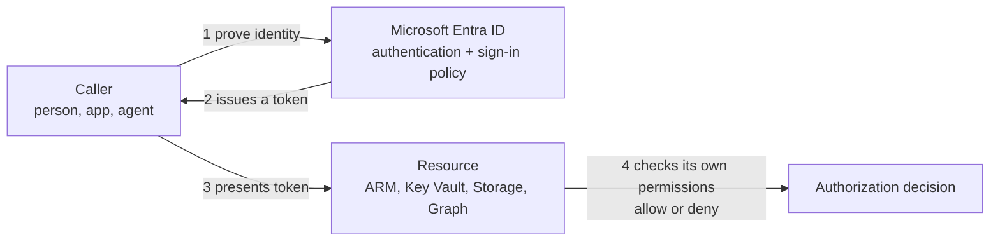

# Authentication and Authorization

> **Foundation primer.** Not exam content. Almost every SC-500 scenario hides one
> question: is this an authentication problem or an authorization problem? This primer
> separates the two, and shows the token that carries the answer between them.

## Why this matters for security

"Who are you?" and "what may you do?" are different questions, answered by different
controls. Multifactor authentication makes the first answer more trustworthy. It does
nothing about the second: a user who passes MFA with a role that is far too broad is
still far too powerful. Exam scenarios regularly offer an authentication control for an
authorization problem, or the other way round. Telling them apart is the skill.

## In plain English

**Authentication** is proving who you are - showing your badge at the door.

**Authorization** is deciding what you may do once inside - which rooms your badge opens.

In the Microsoft cloud, you prove who you are to Microsoft Entra ID once, and it gives
you a short-lived pass. You show that pass to each service you use, and **each service
decides for itself** what the pass allows.

## Words you need to know

- **Authentication (AuthN)** - proving that you are who you say you are.
- **Authorization (AuthZ)** - granting an authenticated party permission to do something:
  which data it can reach and what it can do with it.
- **Multifactor authentication (MFA)** - proving identity with more than one kind of
  evidence, such as a password plus an authenticator app or passkey.
- **Token** - a signed, time-limited piece of data that Entra ID issues after
  authentication. Services read it to make decisions.
- **Access token** - the token an app presents to a resource, such as an API, to call it.
  It names the caller and the permissions it carries.
- **Refresh token** - a longer-lived token used to get new access tokens without signing
  in again.
- **Scope / permission** - a named thing an app is allowed to do, such as `User.Read`.
- **Delegated access** - an app acting on behalf of a signed-in user.
- **App-only access** - an app acting as itself, with no user signed in.
- **Consent** - the act of approving the permissions an app asks for.

## Mental model

A teaching model: prove once, carry a pass, let every door decide.

## Microsoft cloud translation

| The generic idea | Microsoft's implementation | Where SC-500 uses it |
| --- | --- | --- |
| The identity provider that checks who you are | Microsoft Entra ID (the Microsoft identity platform) | 01-01 |
| Rules about *how* and *when* someone may sign in | Conditional Access, MFA, authentication strengths | 01-01 |
| Who may manage Azure resources | Azure role-based access control (Azure RBAC) | 01-03 |
| Who may read secrets inside a key vault | Azure RBAC data-plane roles, or legacy access policies | 01-02 |
| Who may read blobs inside a storage account | Entra ID with Azure RBAC, shared access signatures, or account keys | 02-01 |
| Who may query a database | Entra-only authentication with database permissions | 02-02 |
| Who may run directory tasks | Microsoft Entra roles | 01-01, 01-03 |
| What an app may do in Microsoft 365 | Microsoft Graph delegated or application permissions, granted by consent | 01-01 |

## How it works

**Two protocols, one platform.** The Microsoft identity platform uses OpenID Connect for
authentication and OAuth 2.0 for authorization. You will rarely configure either
directly, but the words appear in the portals.

**Authentication happens at Entra ID; authorization happens at the resource.** Entra ID
checks the credentials, applies sign-in policy such as Conditional Access, and issues an
access token. The resource - Azure Resource Manager, Key Vault, Storage, Microsoft Graph
- reads that token and then applies **its own** permission system. Microsoft lists
several of them: Entra built-in roles, Azure RBAC, Exchange RBAC and more. That is why a
person can sign in perfectly well and still get "access denied" from one service.

**Tokens expire, and that has consequences.** By default an Entra access token lasts a
random 60 to 90 minutes. Access tokens are generally not revocable once issued; the
exception is services and clients that support Continuous Access Evaluation, which can
reject a token early after events such as an account being disabled. Refresh tokens and
sign-in sessions last much longer and are revocable, which is why they are the most
valuable thing to protect.

**Delegated and app-only access are different risk shapes.**

- With **delegated** access, the app can do only what the signed-in user can do *and*
  what the app was granted. The user's own permissions cap it.
- With **app-only** access, the app acts as itself. An application permission such as
  `Files.Read.All` lets it read **every** file the permission covers in the tenant. Only
  an administrator can consent to application permissions.

**Many data services have more than one door.** A storage account can accept an Entra
token, a shared access signature, or the account key. A database can accept Entra
identities or SQL logins. Hardening identity does little if an older door - a shared key
or a SQL password - is still open. SC-500 tests this repeatedly (02-01, 02-02).

## Why security cares

**Without the control**

1. A user passes MFA
2. The user holds the Owner role across a whole subscription "for convenience"
3. The user's session token is stolen from their device
4. The attacker inherits Owner on every resource - MFA was never asked again

**With the control**

1. The user passes MFA
2. The user holds a narrow role on one resource group, activated only when needed (PIM)
3. The same session token is stolen
4. The attacker inherits a small, time-limited set of permissions

**What it does not solve.** Strong authentication does not shrink permissions, and least
privilege does not stop a stolen token being used. You need both, and monitoring to
notice misuse.

**Depends on.** Every alternative door being closed. If a resource still accepts keys or
local passwords, Entra-based authorization can be walked around.

## Common misunderstandings

| What people assume | What is actually true |
| --- | --- |
| "MFA controls what users can do." | MFA strengthens authentication. What users can do is authorization - roles and permissions. |
| "If you can sign in, you can get in." | Signing in proves identity. Each resource then makes its own authorization decision. |
| "Disabling an account cuts access instantly." | Already-issued access tokens can remain valid until they expire, unless the service supports Continuous Access Evaluation. |
| "An app with delegated permissions can read everything the permission names." | Delegated access is capped by what the signed-in user can access. Application permissions are not. |
| "Turning on Entra authentication turns off the old methods." | Keys, SAS tokens and local passwords usually keep working until you disable them. |

## Where SC-500 uses this

- Conditional Access, MFA, app permissions and consent:
  [01-01 Microsoft Entra ID](../01-identity-access-governance/01-01-entra-id-secure-access.md).
- Data-plane authorization for secrets and keys:
  [01-02 Key Vault](../01-identity-access-governance/01-02-key-vault-secrets-and-keys.md).
- Azure RBAC and least privilege:
  [01-03 governance](../01-identity-access-governance/01-03-governance-and-regulatory-compliance.md).
- Closing the shared-key door on storage:
  [02-01 storage account security](../02-storage-databases-networking/02-01-storage-account-security.md).
- Entra-only authentication for databases:
  [02-02 database security](../02-storage-databases-networking/02-02-database-security.md).

## Teach it back

A colleague says: "We turned on MFA for everyone, so our storage accounts are safe." Explain
what MFA did and did not change, and name two things you would still check.

A strong answer covers: MFA strengthens authentication only; authorization still depends on
the roles each identity holds; storage may still accept shared keys or SAS tokens that
never touch MFA; workloads using app-only access are not covered by MFA at all.

## Key takeaways

- Authentication proves who; authorization decides what.
- Entra ID authenticates and issues tokens. Each resource authorizes with its own model.
- Access tokens are short-lived but usually cannot be recalled early.
- Delegated access is capped by the user; app-only access is not.
- Close the older doors - keys, SAS, local passwords - or identity controls can be bypassed.

## Sources

- Authentication vs. authorization: <https://learn.microsoft.com/entra/identity-platform/authentication-vs-authorization>
- OAuth 2.0 and OpenID Connect in the Microsoft identity platform: <https://learn.microsoft.com/entra/identity-platform/v2-protocols>
- Permissions and consent overview: <https://learn.microsoft.com/entra/identity-platform/permissions-consent-overview>
- Understanding tokens in Microsoft Entra ID: <https://learn.microsoft.com/entra/identity/devices/concept-tokens-microsoft-entra-id>
