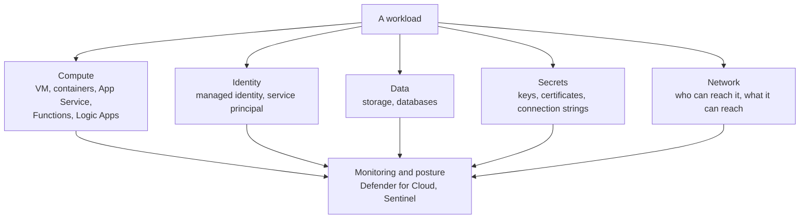

# Applications and Workloads

> **Foundation primer.** Not exam content. The exam title says "cloud and AI
> workloads". This primer explains what a workload is, and the main ways Azure runs one,
> so that the compute lessons in Domain 3 have something to hang on.

## Why this matters for security

You cannot protect what you have not described. A workload is never one resource: it
is code, the platform that runs it, the data it reads, the identity it uses and the
network it sits on. An attacker looks for the weakest of those pieces. SC-500 Domain 3
asks you to secure each kind of compute - virtual machines, containers, web apps,
functions, AI services - and the controls differ because **who maintains what** differs.

## In plain English

An **application** is software that does a job: a website, an API, a nightly report,
a chatbot.

A **workload** is everything that application needs to run and deliver its result:
the application itself, plus its servers or hosting service, databases, storage,
secrets, network and identities.

Azure offers several ways to run the code part. Some give you a whole machine to look
after. Others let you hand over just your code and let Microsoft run everything beneath
it.

## Words you need to know

- **Workload** - a collection of application resources, code, AI models, data and
  infrastructure that work together for a business outcome.
- **Compute** - the hosting model your code runs on.
- **Virtual machine (VM)** - a full computer in the cloud. You manage its operating
  system.
- **Container** - a packaged application with everything it needs to run, started from
  an **image**.
- **Container registry** - a store for container images, such as Azure Container
  Registry.
- **Orchestrator** - software that starts, scales and heals many containers. Kubernetes
  is the common one; Azure Kubernetes Service (AKS) is Microsoft's managed version.
- **App Service** - a managed service for hosting web apps and APIs.
- **Serverless** - you supply code; the platform provides and scales the servers. Azure
  Functions is the main example.
- **Logic Apps** - a service for building automated workflows with little or no code.
- **Front end / back end** - the part users talk to, and the services behind it that do
  the work and hold the data.

## Mental model

A teaching model: one workload, five things to protect.

## Microsoft cloud translation

| How much do you manage? | Azure service | You still secure | Where SC-500 teaches it |
| --- | --- | --- | --- |
| The whole machine | Azure Virtual Machines | OS hardening, patching, disk encryption, admin access | 03-04 |
| A cluster of containers | Azure Kubernetes Service (AKS) | Cluster access, node and pod settings, images | 03-05 |
| Containers without managing a cluster | Azure Container Apps, Azure Container Instances | Image source, ingress, identity, secrets | 03-05 |
| Where images come from | Azure Container Registry | Who can push and pull, image scanning | 03-05 |
| A web app or API | Azure App Service | Authentication, network access, TLS, secrets | 03-06 |
| Event-triggered code | Azure Functions | Authentication, network access, identity | 03-06 |
| Automated workflows | Azure Logic Apps | Trigger access, connections, identity | 03-06 |
| AI models and agents | Microsoft Foundry | Model access, guardrails, gateway, monitoring | 03-03 |

## How it works

**The more Microsoft manages, the less you can misconfigure - but never nothing.** A VM
leaves the operating system, its patches and its open ports to you. App Service and
Functions take the operating system away, but you still decide who can call the app,
from which networks, with which identity. Containers sit between: the platform runs
them, but you choose the image, and an image can carry vulnerabilities.

**Workloads talk to each other, and every call is a trust decision.** A web app calls an
API; the API reads a database; a function writes to storage; an AI agent calls a tool.
Each call needs an identity (0A-04), authorization (0A-05) and a network path (0A-07,
0A-08). Securing a workload means securing each of those links, not just the front door.

**Containers add a supply chain.** A container image is built once and run many times.
If the image contains a vulnerable library, every copy does. That is why SC-500 covers
the registry, image scanning and runtime protection together (03-05).

**APIs are how workloads expose themselves.** Most modern workloads offer an API. API
Management can sit in front of back-end APIs to enforce authentication, limits and other
policy in one place (0A-10, 03-06).

## Why security cares

**Without the control**

1. A team deploys a web app and its database
2. The database password sits in the app's configuration
3. The app is reachable from the whole internet, and its database is too
4. One leaked configuration file exposes the data directly

**With the control**

1. The app uses a managed identity to reach the database
2. There is no password in configuration to leak
3. The database accepts traffic only from the app's network path
4. A leaked configuration file contains nothing an attacker can use from outside

**What it does not solve.** If the app itself has a vulnerability, an attacker can use
the app's own identity and path. That is what web application firewalls, vulnerability
scanning and workload protection plans are for.

**Depends on.** Knowing every part of the workload. Unlisted pieces - a forgotten test
VM, an old storage account - are the ones nobody hardens.

## Common misunderstandings

| What people assume | What is actually true |
| --- | --- |
| "Workload just means a virtual machine." | A workload is the whole set: code, compute, data, identities, secrets and network. |
| "Serverless means there is nothing to secure." | You no longer patch servers, but you still control who can call the code and what its identity can do. |
| "A container is safe because it is isolated." | A container is only as safe as its image and its settings. Vulnerable images run vulnerable code. |
| "The front end is the only thing exposed." | Back-end APIs, databases and storage often have their own public endpoints unless you close them. |

## Where SC-500 uses this

- Virtual machines and hybrid servers:
  [03-04 servers and virtual machines](../03-secure-compute/03-04-servers-and-virtual-machines.md).
- Containers, AKS and registries:
  [03-05 containers](../03-secure-compute/03-05-app-platform-containers.md).
- App Service, Functions, Logic Apps, WAF and API Management:
  [03-06 serverless, web and APIs](../03-secure-compute/03-06-app-platform-serverless-web-and-apis.md).
- AI workloads in Microsoft Foundry:
  [03-03 AI platform and workload protection](../03-secure-compute/03-03-ai-platform-and-workload-protection.md).
- Workload identities:
  [01-01 managed identities](../01-identity-access-governance/01-01-entra-id-secure-access.md).

## Teach it back

Pick one simple web application with a database. List its five parts - compute,
identity, data, secrets, network - and for each one, name one thing that could go wrong.

A strong answer covers: an unpatched VM or vulnerable image; an over-privileged or
secret-based identity; a database open to the internet; a password in configuration;
a public endpoint that should be private.

## Key takeaways

- A workload is code plus compute, identity, data, secrets and network.
- The hosting model decides how much you manage - and therefore how much you can get
  wrong.
- Every call between workload parts is an identity, authorization and network decision.
- Containers bring a supply chain: the image is part of the attack surface.
- Back ends often have their own public doors. Close them deliberately.

## Sources

- Azure Well-Architected Framework workloads: <https://learn.microsoft.com/azure/well-architected/workloads>
- Choose an Azure compute service: <https://learn.microsoft.com/azure/architecture/guide/technology-choices/compute-decision-tree>
- Choose an Azure container service: <https://learn.microsoft.com/azure/architecture/guide/choose-azure-container-service>
