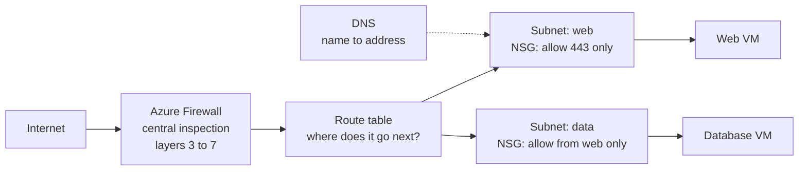

# Networks: Addresses, Subnets, Routing, DNS, and Firewalls

> **Foundation primer.** Not exam content. Domain 2 is the heaviest-weighted domain, and
> its networking objectives assume you can read an address range, follow a packet and
> tell a filter from a firewall. This primer gives you exactly that much.

## Why this matters for security

Network controls decide **who can reach what**. A storage account with perfect
permissions is still exposed if anyone on the internet can try to sign in to it; a
virtual machine with a strong password is still at risk if its remote-login port is
open to the world. Network controls do not replace identity, but they shrink the number
of places an attacker can even knock. Most exam networking questions come down to: where
does this traffic come from, which path does it take, and which control on that path can
stop it?

## In plain English

Every device on a network has an **address**. Addresses are grouped into **ranges**.
In Azure you rent a private network, split it into smaller **subnets**, and put your
resources in them. **Routes** decide which way traffic goes next. **DNS** turns names
like `contoso.blob.core.windows.net` into addresses. **Filters and firewalls** sit on the
path and allow or block traffic according to rules.

## Words you need to know

- **IP address** - a number that identifies a device on a network, such as `10.0.1.4`.
- **Private address** - an address from ranges reserved for internal networks
  (`10.0.0.0/8`, `172.16.0.0/12`, `192.168.0.0/16`). Not reachable directly from the
  internet.
- **Public address** - an address reachable from the internet.
- **CIDR notation** - a way of writing a range. `10.0.1.0/24` means "the 256 addresses
  starting at 10.0.1.0". A smaller number after the slash means a bigger range.
- **Port** - a numbered door on a device for one kind of service. 443 is HTTPS, 22 is SSH,
  3389 is Remote Desktop.
- **Virtual network (VNet)** - your private network in Azure.
- **Subnet** - a slice of a virtual network's address range.
- **Route / route table** - instructions for where traffic to a destination goes next.
- **DNS** - the Domain Name System, which translates names into IP addresses.
- **Network security group (NSG)** - Azure's basic stateful packet filter: allow or deny
  rules on source, destination, port and protocol.
- **Application security group (ASG)** - a label for a set of VMs, so NSG rules can say
  "web servers" instead of listing addresses.
- **Azure Firewall** - a managed, stateful firewall service that can filter traffic from
  network layer up to application layer, with threat intelligence.
- **Inbound / outbound** - traffic arriving at, or leaving, a resource.
- **North-south / east-west** - traffic entering or leaving your network, versus traffic
  moving between resources inside it.

## Mental model

A teaching model: a building with corridors, a directory and guarded doors.

## Microsoft cloud translation

| The generic idea | Azure's implementation | Where SC-500 uses it |
| --- | --- | --- |
| A private network | Azure Virtual Network (VNet) and subnets | 02-03 |
| A simple allow/deny list on a door | Network security group (NSG) | 02-03 |
| Naming groups of servers in rules | Application security group (ASG) | 02-03 |
| Network rules enforced from the centre for many VNets | Azure Virtual Network Manager security admin rules | 02-03 |
| A central inspecting firewall | Azure Firewall (Basic, Standard, Premium) | 02-04 |
| Forcing traffic through the firewall | User-defined routes (route tables) | 02-04 |
| Filtering web attacks such as SQL injection | Azure Web Application Firewall | 03-06 |
| Seeing which rules actually apply | Azure Network Watcher (effective security rules, IP flow verify) | 02-03 |
| A resource's own allow-list | Service firewalls on Storage, Key Vault, SQL | 01-02, 02-01, 02-02 |

## How it works

**Address space and subnets.** When you create a virtual network you give it a private
range such as `10.0.0.0/16`. You then carve subnets out of it - `10.0.1.0/24` for web,
`10.0.2.0/24` for data. Subnets are the unit you attach most network controls to.

**Routing happens automatically - including to the internet.** Azure creates a route
table for every subnet with system routes. Traffic between subnets in the same VNet is
routed by default. A default route sends anything else (`0.0.0.0/0`) to the internet;
traffic to Azure services' public addresses stays on Microsoft's backbone. You can
override these with **user-defined routes**, for example to send all outbound traffic
through Azure Firewall for inspection. Whether a VM actually has a way out to the
internet also depends on outbound connectivity: subnets created in the portal, and
subnets in new virtual networks created with current API versions, are private by
default and need an explicit outbound method such as a NAT gateway.

**DNS decides where a name goes.** By default a VNet uses Azure-provided DNS. Private DNS
zones let names resolve to private addresses for networks linked to that zone. This
matters enormously for private endpoints (0A-08): if the name still resolves to the
public address, traffic goes the public way.

**NSGs are evaluated in priority order, and stop at the first match.** Each rule has a
priority from 100 to 4096; lower numbers are checked first. Every NSG also has default
rules you cannot delete, at the lowest priority: allow traffic within the VNet, allow
Azure Load Balancer inbound, deny all other inbound; allow within the VNet, allow
outbound to the internet, deny all other outbound. In other words, **an empty NSG blocks
unsolicited internet traffic in, but lets traffic out to the internet**.

**NSGs can sit on a subnet, a network interface, or both.** For inbound traffic the
subnet NSG is evaluated first, then the NIC's. Traffic must be allowed by both.

**NSG and Azure Firewall do different jobs.** An NSG is a basic stateful filter on
address, port and protocol. It does not inspect application content. Azure Firewall is
a managed firewall service you place centrally; depending on the tier it adds
application rules by domain name, threat-intelligence filtering, and in Premium, TLS
inspection and intrusion detection and prevention. Organisations commonly use both.

## Why security cares

**Without the control**

1. A VM is created with a public IP address
2. A rule allows port 3389 (Remote Desktop) from any source "to test something"
3. Automated scanners find the open port within hours
4. Attackers try thousands of passwords against it, from everywhere

**With the control**

1. The VM has no public IP address
2. The NSG allows administrative ports only from a specific management subnet
3. Administrators connect through Azure Bastion or just-in-time access (03-04)
4. There is nothing on the internet to scan or attack

**What it does not solve.** Network rules do not check *who* is connecting, only from
where. A compromised machine inside an allowed range passes straight through. Identity
controls and monitoring are still needed.

**Depends on.** Correct routing and DNS. A perfect firewall that traffic never passes
through protects nothing.

## Common misunderstandings

| What people assume | What is actually true |
| --- | --- |
| "Private address means protected." | Private addresses are not reachable from the internet directly, but anything allowed inside the network still is. |
| "An NSG with no custom rules blocks everything." | Default rules allow traffic inside the VNet and outbound to the internet; they deny other inbound traffic. |
| "The first rule I wrote wins." | The rule with the lowest priority number that matches wins. Order of creation does not matter. |
| "NSG and Azure Firewall are the same thing." | An NSG filters by address, port and protocol. Azure Firewall is a central, stateful firewall service with application-level rules and threat intelligence. |
| "If the rule exists, the traffic is blocked." | Only if traffic actually reaches the rule. Check effective rules and routes with Network Watcher. |

## Where SC-500 uses this

- NSGs, ASGs, Virtual Network Manager, Network Watcher:
  [02-03 network segmentation and connectivity](../02-storage-databases-networking/02-03-network-segmentation-and-connectivity.md).
- Azure Firewall, private endpoints, Private Link:
  [02-04 private access and perimeter](../02-storage-databases-networking/02-04-private-access-and-perimeter.md).
- Service firewalls on data services:
  [01-02 Key Vault](../01-identity-access-governance/01-02-key-vault-secrets-and-keys.md) and
  [02-01 storage](../02-storage-databases-networking/02-01-storage-account-security.md).
- Removing public admin ports:
  [03-04 Bastion and JIT](../03-secure-compute/03-04-servers-and-virtual-machines.md).

## Teach it back

Explain to a colleague why an NSG with only a single custom rule - "allow 443 inbound
from Internet at priority 100" - does nothing to restrict the VM's outbound traffic to the
internet, and what you would change if outbound traffic had to be inspected.

A strong answer covers: inbound and outbound rules are separate sets; the default
`AllowInternetOutBound` rule allows outbound internet traffic; to inspect outbound
traffic, route `0.0.0.0/0` to Azure Firewall with a user-defined route and add outbound
restrictions.

## Key takeaways

- A VNet is your private address space; subnets slice it up; routes move traffic between
  them.
- Azure routes to the internet by default. Override with user-defined routes.
- DNS decides which address a name reaches - public or private.
- NSGs: lowest priority number wins, first match stops, default rules allow outbound.
- NSG filters; Azure Firewall inspects centrally. They complement each other.

## Sources

- What is Azure Virtual Network: <https://learn.microsoft.com/azure/virtual-network/virtual-networks-overview>
- Virtual network traffic routing: <https://learn.microsoft.com/azure/virtual-network/virtual-networks-udr-overview>
- Network security groups overview: <https://learn.microsoft.com/azure/virtual-network/network-security-groups-overview>
- What is Azure Firewall: <https://learn.microsoft.com/azure/firewall/overview>
- Azure DNS overview: <https://learn.microsoft.com/azure/dns/dns-overview>
