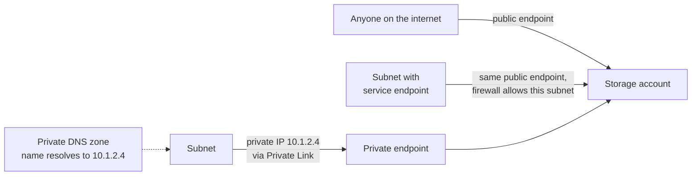

# Public and Private Connectivity

> **Foundation primer.** Not exam content. Many Azure services - storage, Key Vault,
> SQL, AI services - are reachable from the internet the moment you create them. This
> primer explains the ways to change that, so that private endpoints, service endpoints,
> VPNs and Entra Private Access stop sounding interchangeable.

## Why this matters for security

A **public endpoint** is a door on the internet. Even if it asks for a key, anyone,
anywhere, can walk up and try. Removing that door - or making it accept only traffic
from your own network - takes a whole class of attack off the table: password spraying,
stolen-key reuse from outside, data pulled out to an attacker's laptop. SC-500 asks you
to pick the right way to make access private, and the options differ in ways that matter
for the exam.

## In plain English

Platform services such as Azure Storage live on Microsoft's side, not inside your
network. By default, you reach them over their public address.

You have three broad choices:

1. **Keep the public door, but only let your network through it.** That is what a
   service endpoint plus a firewall rule does.
2. **Bring the service into your network with a private address,** then close the
   public door. That is a private endpoint.
3. **Connect people and offices to your private network** securely, so they can use
   those private addresses: a VPN, ExpressRoute, or Microsoft Entra Private Access.

## Words you need to know

- **Public endpoint** - the internet-facing address of a service.
- **Service firewall** - a service's own allow-list: "accept only these networks and
  addresses".
- **Service endpoint** - a subnet setting that lets a service recognise traffic as
  coming from that subnet, so its firewall can allow just that subnet. The service still
  uses its public address.
- **Private endpoint** - a network interface with a private IP address in your virtual
  network, connected to one specific resource through **Azure Private Link**.
- **Private Link service** - your *own* service, published so that other networks can
  reach it through private endpoints.
- **Private DNS zone** - a DNS zone, such as `privatelink.blob.core.windows.net`, that
  makes a service's normal name resolve to its private endpoint's address.
- **VPN gateway** - an Azure gateway that creates encrypted tunnels over the internet:
  **site-to-site** for an office network, **point-to-site** for one device.
- **ExpressRoute** - a private connection from your network to Microsoft that does not
  travel over the public internet.
- **Microsoft Entra Private Access** - a Zero Trust network access service that gives
  users per-app access to private resources, controlled by Conditional Access, without a
  traditional VPN.

## Mental model

A teaching model: three ways to reach the same storage account.

## Microsoft cloud translation

| The requirement | Azure's answer | Where SC-500 uses it |
| --- | --- | --- |
| "Only our subnets may reach this storage account, simplest setup" | Service endpoint plus a virtual network rule on the service firewall | 02-01, 02-04 |
| "The service must have a private IP inside our network; disable public access" | Private endpoint (Azure Private Link) plus private DNS zone | 02-04, 01-02, 02-02 |
| "Partners must reach *our* application privately" | Private Link service | 02-04 |
| "Connect our office network to Azure" | Site-to-site VPN, or ExpressRoute | 02-03 |
| "Connect remote users' devices to Azure" | Point-to-site VPN | 02-03 |
| "Replace the corporate VPN with per-app access controlled by Conditional Access" | Microsoft Entra Private Access | 02-03 |
| "Many sites and VNets, one managed hub" | Azure Virtual WAN | 02-03 |

## How it works

**Service endpoints keep the public address.** Enabling a service endpoint on a subnet
tells Azure to carry that subnet's traffic to the service over the Azure backbone and to
present it with the subnet's identity. You then add a virtual network rule to the
service's firewall. The service is still reached at its public address; you have only
limited who can use it. Two consequences: service endpoint traffic takes its own route,
so it is **not** sent through Azure Firewall even if you force other traffic there; and
a resource locked to virtual networks this way is not reachable from on-premises unless
you also allow your on-premises public addresses through its firewall. Microsoft now
recommends private endpoints for private access to Azure platform services.

**Private endpoints bring one resource into your network.** A private endpoint is a
network interface with a private IP from your subnet, linked to a single resource - one
storage account, one key vault. Clients in the same VNet, peered VNets, and on-premises
networks connected by VPN or ExpressRoute can reach it. Connections can only be started
by the client side; the service cannot reach back into your network through it.

**DNS is what makes a private endpoint work.** Applications keep using the normal name,
such as `contoso.blob.core.windows.net`. A private DNS zone linked to your VNet makes
that name resolve to the private IP. If DNS is wrong, the name still resolves to the
public address and traffic goes the public way - or fails once public access is off.

**The public door stays open until you close it.** Creating a private endpoint does not
disable the public endpoint. Disabling public network access on the resource is a
separate step, and the one that actually removes the internet door.

**People need a way in, too.** If storage is reachable only privately, administrators and
users need a path into the private network: a point-to-site or site-to-site VPN,
ExpressRoute, or Entra Private Access. Entra Private Access differs from a traditional
VPN in that users get access to specific applications, not the whole network, and each
connection is governed by Conditional Access (it requires licensing).

## Why security cares

**Without the control**

1. A storage account holding customer exports keeps its public endpoint
2. A shared access signature is accidentally pasted into a support ticket
3. Anyone who finds it can download the data from anywhere on the internet
4. Nothing on the network path notices or stops them

**With the control**

1. The storage account is reached through a private endpoint
2. Public network access is disabled
3. The same leaked signature is useless from outside the private network
4. An attacker would also need a foothold inside your network

**What it does not solve.** Private connectivity does not check permissions. Anyone or
anything already inside the network, with valid credentials, can still use the private
path. Identity and authorization controls still apply.

**Depends on.** Correct private DNS, and someone actually disabling public access.

## Common misunderstandings

| What people assume | What is actually true |
| --- | --- |
| "A service endpoint gives the service a private IP." | It does not. The service keeps its public endpoint; your subnet's traffic is identified and allowed through it. |
| "Creating a private endpoint makes the resource private." | It adds a private path. The public endpoint stays open until you disable public network access. |
| "Private endpoints work without DNS changes." | The service name must resolve to the private IP, usually through a private DNS zone. |
| "Service endpoints and private endpoints both go through my firewall." | Service endpoint routes take precedence over user-defined routes, so that traffic bypasses Azure Firewall. |
| "Entra Private Access is just another VPN." | It gives per-application access governed by Conditional Access, rather than full network access. |

## Where SC-500 uses this

- Private endpoints, Private Link services and Azure Firewall:
  [02-04 private access and perimeter](../02-storage-databases-networking/02-04-private-access-and-perimeter.md).
- VPN, Virtual WAN and Entra Private Access:
  [02-03 network segmentation and connectivity](../02-storage-databases-networking/02-03-network-segmentation-and-connectivity.md).
- Storage firewall and network rules:
  [02-01 storage account security](../02-storage-databases-networking/02-01-storage-account-security.md).
- Key Vault firewall and private access:
  [01-02 Key Vault](../01-identity-access-governance/01-02-key-vault-secrets-and-keys.md).
- Database network access:
  [02-02 database security](../02-storage-databases-networking/02-02-database-security.md).

## Teach it back

A requirement says: "The SQL database must be reachable from the on-premises data centre
and must not be reachable from the internet." Explain why a service endpoint does not
meet it and what does.

A strong answer covers: service endpoints work only from Azure subnets and keep the
public endpoint; a private endpoint gives the database a private IP reachable over VPN or
ExpressRoute; public network access must then be disabled; private DNS must resolve the
name for on-premises clients too.

## Key takeaways

- Most platform services start with a public endpoint.
- Service endpoint: keep the public address, allow only your subnets.
- Private endpoint: give one resource a private IP in your network, then turn off public
  access.
- DNS decides whether the private path is actually used.
- VPN, ExpressRoute and Entra Private Access are how people and offices reach the private
  network.

## Sources

- What is a private endpoint: <https://learn.microsoft.com/azure/private-link/private-endpoint-overview>
- Virtual network service endpoints: <https://learn.microsoft.com/azure/virtual-network/virtual-network-service-endpoints-overview>
- Azure Private Link FAQ: <https://learn.microsoft.com/azure/private-link/private-link-faq>
- What is Azure VPN Gateway: <https://learn.microsoft.com/azure/vpn-gateway/vpn-gateway-about-vpngateways>
- Learn about Microsoft Entra Private Access: <https://learn.microsoft.com/entra/global-secure-access/concept-private-access>
