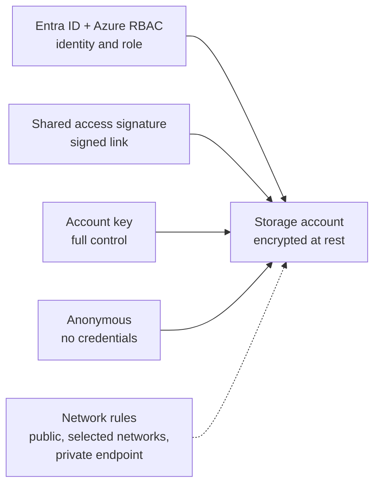

# Storage and Databases

> **Foundation primer.** Not exam content. Data is usually what an attacker is after.
> This primer explains where data lives in Azure, the several ways in to it, and why
> "it's encrypted" is rarely the end of the conversation.

## Why this matters for security

Storage accounts and databases hold the things breaches are reported for: customer
records, exports, backups, files. In Azure they are platform services with their own
public endpoints, their own authorization options and their own audit logs. A data
service is only as safe as **its weakest way in** - and most offer several. SC-500's
storage and database objectives are about closing the extra doors, choosing the right
authorization method, encrypting appropriately, and watching for misuse.

## In plain English

A **storage account** is a container Azure gives you for unstructured data: files,
images, backups, logs. A **database** stores structured data in tables you query.

Both are run by Microsoft. You decide **who can manage the service, who can read the
data inside it, from which networks, and with which keys it is encrypted**. Those are
separate decisions.

## Words you need to know

- **Storage account** - an Azure resource that holds blob containers, file shares,
  tables and queues.
- **Blob** - an object such as a file, stored in a **container**.
- **Shared key (account key)** - a master key for a storage account. Anyone holding it
  can do anything to the data.
- **Shared access signature (SAS)** - a signed URL that grants limited, time-bound access
  to storage data.
- **Anonymous access** - reading blobs with no credentials at all.
- **Azure SQL Database** - a managed SQL database service. Databases sit on a **logical
  server** that holds shared settings such as firewall rules and the administrator.
- **Control plane** - managing the resource (create, configure, delete). Goes through
  Azure Resource Manager.
- **Data plane** - using what is inside (read a blob, query a table, read a secret).
- **Encryption at rest** - data is encrypted while stored on disk.
- **Encryption in transit** - data is encrypted while moving over the network (TLS).
- **Customer-managed key (CMK)** - an encryption key you hold in Key Vault, instead of a
  key Microsoft manages for you.

## Mental model

A teaching model: one storage account, several doors.

## Microsoft cloud translation

| The risk | The Azure control | Where SC-500 teaches it |
| --- | --- | --- |
| A master key leaks | Disable shared key authorization; use Entra ID and RBAC | 02-01 |
| A link is shared too widely or lives too long | User delegation SAS, short expiry, stored access policies | 02-01 |
| Data readable by anyone on the internet | Disallow anonymous (public) blob access | 02-01 |
| Reached from anywhere | Storage firewall, private endpoint, disable public access | 02-01, 02-04 |
| Malware upload or unusual access | Microsoft Defender for Storage | 02-01 |
| Database passwords and local logins | Microsoft Entra-only authentication | 02-02 |
| Nobody knows who queried what | Azure SQL auditing | 02-02 |
| Database attacks such as SQL injection | Microsoft Defender for SQL (Defender for Databases) | 02-02 |
| You must control the encryption key | Customer-managed keys in Key Vault | 01-02, 02-01, 02-02 |

## How it works

**Managing a resource and reading its data are different permissions.** Azure separates
the **control plane** (configure the storage account) from the **data plane** (read the
blobs). An identity can be allowed to change settings without being allowed to read the
data - and, through some older paths, the reverse can surprise you: anyone who can list
the account keys can read all the data with them. SC-500 tests this distinction for both
storage and Key Vault.

**Storage offers several ways to authorize data access.** Entra ID with Azure RBAC data
roles, shared access signatures, the account keys, and - if allowed - anonymous read.
New storage accounts allow account-key access by default; Microsoft recommends disabling
it so every request is tied to an identity. Anonymous access needs to be allowed at the
account level *and* set on a container before it exposes anything; Microsoft recommends
disallowing it at the account level.

**Encryption at rest is always on, and that is not the whole story.** Azure Storage
encrypts all data at rest automatically, and you cannot turn it off. New Azure SQL
databases are encrypted at rest by default with transparent data encryption (TDE). What
you choose is **who controls the key**: Microsoft, or you through customer-managed keys
in Key Vault. Encryption at rest protects against someone getting the raw disks or
backup files. It does **not** stop someone who signs in through the normal access path -
the service decrypts the data for any authorized caller.

**Encryption in transit is a setting too.** Storage accounts require HTTPS by default and
default to TLS 1.2 as the minimum version. Keep both.

**Databases have their own logins unless you remove them.** Azure SQL can accept SQL
logins with passwords as well as Microsoft Entra identities. Enabling Microsoft
Entra-only authentication turns the password door off, so Conditional Access and MFA
apply to every human sign-in.

## Why security cares

**Without the control**

1. A developer copies a storage account key into a script
2. The script is committed to a public code repository
3. The account still allows shared key authorization and public network access
4. Anyone who finds the key can read, change or delete every blob, from anywhere

**With the control**

1. Shared key authorization is disabled on the account
2. Applications use managed identities with narrow data roles
3. Public network access is disabled; access is through a private endpoint
4. There is no key to leak, and no public door to use it on

**What it does not solve.** An identity that legitimately holds a data role can still
misuse it. Defender for Storage and logging are how you notice unusual access.

**Depends on.** Every application having been moved off the account key before you
disable it - otherwise those applications break.

## Common misunderstandings

| What people assume | What is actually true |
| --- | --- |
| "It's encrypted, so it's protected." | Encryption at rest stops offline theft of disks and backups. Authorized - or stolen - credentials still read the data in clear. |
| "Owner of the storage account can't read the data unless given a data role." | Roles that can list account keys can read all data with those keys, unless shared key access is disabled. |
| "A SAS is safe because it expires." | A SAS works for anyone who holds it until it expires or its key is rotated. Long-lived ones are a common leak. |
| "Using Entra ID for SQL turns off SQL passwords." | SQL authentication keeps working until you enable Entra-only authentication. |
| "Customer-managed keys are more secure for everyone." | They give you control over the key and its revocation - and the responsibility to manage and protect it. |

## Where SC-500 uses this

- Storage authorization, firewall, Defender for Storage:
  [02-01 storage account security](../02-storage-databases-networking/02-01-storage-account-security.md).
- Azure SQL authentication, auditing, Defender for Databases:
  [02-02 database security](../02-storage-databases-networking/02-02-database-security.md).
- Keys for customer-managed encryption:
  [01-02 Key Vault](../01-identity-access-governance/01-02-key-vault-secrets-and-keys.md).
- Private endpoints for data services:
  [02-04 private access and perimeter](../02-storage-databases-networking/02-04-private-access-and-perimeter.md).

## Teach it back

Your manager says: "Our storage is encrypted with our own keys, so nobody can get at the
data." Explain what customer-managed keys protect against, and name two ways the data
could still be read.

A strong answer covers: CMK gives control and revocation of the key protecting data at
rest; the service still decrypts for any authorized request; a leaked account key or SAS,
or an over-privileged identity, can still read the data; network exposure and anonymous
access are separate settings.

## Key takeaways

- Storage accounts and databases are platform services with their own public doors.
- Managing a resource (control plane) and reading its data (data plane) are separate.
- Storage has several authorization doors: Entra ID, SAS, account keys, anonymous. Close
  the ones you do not need.
- Encryption at rest is on by default; your choice is who controls the key.
- Entra-only authentication removes database passwords from the picture.

## Sources

- Introduction to Azure Storage: <https://learn.microsoft.com/azure/storage/common/storage-introduction>
- Azure Storage encryption for data at rest: <https://learn.microsoft.com/azure/storage/common/storage-service-encryption>
- Create a storage account (default security settings): <https://learn.microsoft.com/azure/storage/common/storage-account-create>
- Azure SQL Database security capabilities: <https://learn.microsoft.com/azure/azure-sql/database/security-overview>
- Azure control plane and data plane: <https://learn.microsoft.com/azure/azure-resource-manager/management/control-plane-and-data-plane>
