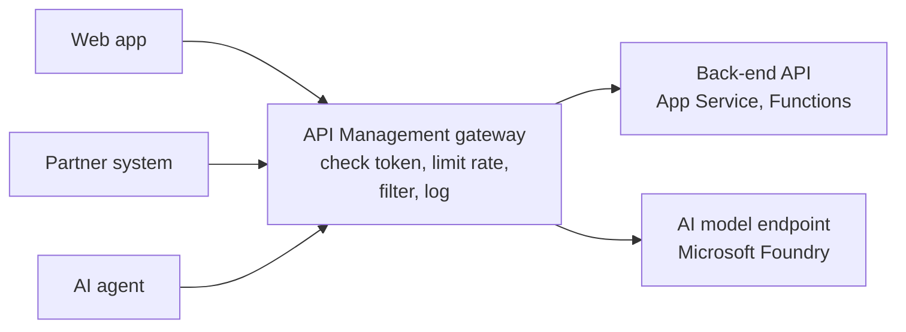

# APIs

> **Foundation primer.** Not exam content. Nearly everything in the Microsoft cloud -
> Azure itself, Microsoft Graph, AI models, your own back ends - is reached through an
> API. This primer explains what an API is and why putting a gateway in front of one is a
> security control.

## Why this matters for security

An API is a door built for software. It does not get tired, it answers as fast as it is
asked, and it often sits directly in front of data. A badly protected API can be called
without authentication, called millions of times, or called with requests designed to
break it. AI models add a twist: they are APIs that cost money per word and can be
abused to run up bills or bypass safety rules. SC-500 asks you to protect back-end APIs
with API Management, and AI model endpoints with an AI gateway built on it.

## In plain English

An **API** (application programming interface) is a menu of requests one program can
make of another. A weather app asks a weather API, "What's the forecast for Paris?" and
gets an answer back in a format it can read.

In the cloud, most APIs are web addresses that accept requests over HTTPS. The caller
usually has to prove who it is - with a token or a key - before the API answers.

## Words you need to know

- **API** - a defined set of requests a program can make of another program.
- **Endpoint** - the address you send API requests to.
- **REST API** - a common style of web API that uses HTTPS and standard verbs such as
  GET (read) and POST (create).
- **Request / response** - what the caller sends, and what the API sends back.
- **API key** - a shared secret string sent with each request. Simple, but it identifies
  an application rather than a person, and it can leak.
- **Bearer token** - a token, such as an Entra access token, that grants access to
  whoever presents it (0A-05).
- **Rate limit / throttling** - capping how many requests a caller may make in a period.
- **API gateway** - a front door that sits in front of one or more APIs and applies the
  same checks to every request.
- **Azure API Management (APIM)** - Microsoft's API gateway and management service.
- **Policy (in API Management)** - a rule the gateway runs on each request or response,
  such as "validate the token" or "limit to 100 calls a minute".

## Mental model

A teaching model: a reception desk in front of many offices.

## Microsoft cloud translation

| The generic idea | Microsoft's implementation | Where SC-500 uses it |
| --- | --- | --- |
| Managing Azure itself | Azure Resource Manager API (what the portal, CLI and PowerShell call) | Every domain |
| Microsoft 365 and Entra data | Microsoft Graph API | 01-01, 03-02 |
| A front door for your own APIs | Azure API Management gateway and policies | 03-06 |
| Checking tokens before the back end sees the request | `validate-jwt` or `validate-azure-ad-token` policies | 03-06 |
| Capping request volume | Rate-limit and quota policies | 03-06 |
| A front door for AI models | AI gateway capabilities in API Management, integrated with Microsoft Foundry | 03-03 |
| Capping AI token use per app or team | Token limit policy (`llm-token-limit`) | 03-03 |
| Filtering web attacks before they reach the app | Azure Web Application Firewall | 03-06 |

## How it works

**Every API call should be authenticated and authorized.** The caller sends a token or a
key. The API checks it and decides what the caller may do. Tokens from Entra ID identify
a specific user or application and expire; API keys are shared secrets that identify
only "someone holding this key".

**A gateway centralises the checks.** Instead of every back-end team writing its own
token validation, throttling and logging, API Management's gateway does it once for all
of them. It accepts the call, verifies keys or tokens, enforces quotas and rate limits,
can transform the request, and emits logs and metrics, then forwards the call to the
right back end.

**Policies are the gateway's rules.** An API Management policy runs on the request or the
response - for example: validate this Entra token and check its audience; allow no more
than this many calls per subscription; reject calls from these IP addresses. API
Management policies are runtime rules inside the gateway; they are not the same thing as
Azure Policy, which governs how resources are configured (01-03).

**The back end must not be reachable around the gateway.** A gateway protects nothing if
callers can go straight to the back end's own public address. Typical designs restrict
the back end so that it accepts traffic only from the gateway - by network rules or by
requiring the gateway's own identity.

**AI models are APIs with extra concerns.** An application talks to a deployed model
through an API. API Management's AI gateway capabilities add model-specific controls,
such as limiting tokens per minute per consumer, and can be associated with a Microsoft
Foundry resource so those limits are set from Foundry. The gateway can authenticate to
the model with its own managed identity, so callers never hold the model's key (03-03).

## Why security cares

**Without the control**

1. A team publishes a back-end API that accepts a static API key
2. The key is embedded in a mobile app and extracted by a curious user
3. Anyone with the key can call the API without limit
4. The API is scraped, and the back end is overloaded

**With the control**

1. Callers reach the API only through API Management
2. The gateway validates an Entra token for each call and enforces per-caller rate limits
3. The back end accepts traffic only from the gateway
4. A leaked key is useless on its own, and abuse is capped and logged

**What it does not solve.** A gateway cannot fix a vulnerability in the back end's own
logic, and an authorized caller can still misuse the access it legitimately has.

**Depends on.** The back end being closed to direct access, and the gateway's own
management access being tightly controlled.

## Common misunderstandings

| What people assume | What is actually true |
| --- | --- |
| "An API key is like a user login." | An API key identifies whoever holds it. It carries no user identity and does not expire unless rotated. |
| "Putting API Management in front makes the back end private." | Only if the back end is also restricted to accept traffic from the gateway. |
| "API Management policies and Azure Policy are the same." | APIM policies run on API requests at runtime. Azure Policy evaluates and enforces resource configuration. |
| "AI models are just a feature, not an API to secure." | Models are reached through API endpoints with keys, tokens and quotas - and need the same protection, plus token limits. |

## Where SC-500 uses this

- API Management policies for back-end APIs, App Service, Functions, WAF:
  [03-06 serverless, web and APIs](../03-secure-compute/03-06-app-platform-serverless-web-and-apis.md).
- AI gateway for Microsoft Foundry:
  [03-03 AI platform and workload protection](../03-secure-compute/03-03-ai-platform-and-workload-protection.md).
- App identities and Microsoft Graph permissions:
  [01-01 Microsoft Entra ID](../01-identity-access-governance/01-01-entra-id-secure-access.md).

## Teach it back

Explain why "we put API Management in front of it" is not, by itself, an answer to "is
the back-end API protected?" Name two things you would check.

A strong answer covers: whether the back end can still be reached directly; whether the
gateway validates tokens rather than only keys; whether rate limits apply per caller;
whether requests are logged.

## Key takeaways

- An API is a door for software. It needs authentication, authorization and limits like
  any other door.
- Tokens identify a caller and expire; API keys identify only whoever holds them.
- API Management centralises token checks, rate limits and logging in one gateway.
- Close the route around the gateway, or it protects nothing.
- AI model endpoints are APIs too; the AI gateway adds token limits and managed-identity
  access to models.

## Sources

- What is Azure API Management: <https://learn.microsoft.com/azure/api-management/api-management-key-concepts>
- Policies in Azure API Management: <https://learn.microsoft.com/azure/api-management/api-management-howto-policies>
- Authentication and authorization to APIs in API Management: <https://learn.microsoft.com/azure/api-management/authentication-authorization-overview>
- AI gateway in Azure API Management: <https://learn.microsoft.com/azure/api-management/genai-gateway-capabilities>
