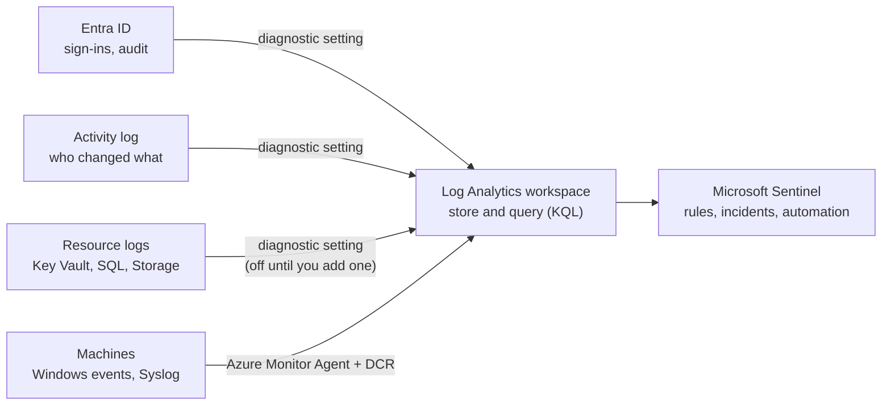

# Logs and Telemetry

> **Foundation primer.** Not exam content. Domain 4 is about seeing what is happening:
> collecting events, storing them, querying them and acting on them. This primer explains
> what Azure records by default, what it does not, and where the records go.

## Why this matters for security

Preventive controls fail. When they do, the only way to know what happened is the
record. The hard lesson most teams learn during their first incident is that **many
important logs are not collected until someone switches them on** - and you cannot switch
them on retroactively. SC-500's Sentinel objectives are, at heart, about making sure the
right records are collected, kept long enough, and turned into alerts and automated
responses.

## In plain English

Systems constantly write down what they do: who signed in, who changed a setting, who
read a file, which connection was blocked. Those notes are **logs**. Measurements such as
"CPU at 80%" are **metrics**. Together they are **telemetry**.

Some telemetry is kept automatically. Much of it is produced but thrown away unless you
tell Azure where to send it. Security teams send it to a central place, query it, and
write rules that raise an alarm when something suspicious appears.

## Words you need to know

- **Log** - a time-stamped record of an event.
- **Metric** - a number measured over time.
- **Telemetry** - logs and metrics together.
- **Activity log** - the Azure subscription's record of control-plane operations: who
  created, changed or deleted which resource.
- **Resource logs** - a resource's record of its own operations, such as each read from a
  key vault or each query on a database.
- **Diagnostic setting** - the instruction that sends a resource's logs (and the activity
  log) somewhere to be kept.
- **Log Analytics workspace** - a store for log data that you query with **KQL** (Kusto
  Query Language).
- **Azure Monitor Agent** - software on a machine that collects logs such as Windows
  events and Syslog.
- **Data collection rule (DCR)** - the definition of what an agent collects and where it
  sends it.
- **SIEM** - security information and event management: a system that collects security
  data, detects threats and supports investigation. **Microsoft Sentinel** is Microsoft's.
- **Retention** - how long data is kept before it is deleted.

## Mental model

A teaching model: sources, pipes, a store, and someone watching.

## Microsoft cloud translation

| The question | Where the answer lives | Where SC-500 uses it |
| --- | --- | --- |
| Who deleted that resource? | Azure activity log (`AzureActivity` table once routed) | 04-03 |
| Who signed in, from where, and did MFA happen? | Entra sign-in logs (`SigninLogs`) | 01-01, 04-03 |
| Who read this secret? | Key Vault resource logs (needs a diagnostic setting) | 01-02 |
| Who queried this database? | Azure SQL auditing | 02-02 |
| What happened on this Windows server? | Windows Security events via Azure Monitor Agent and a DCR (`SecurityEvent`) | 04-03 |
| What did this firewall or appliance see? | Syslog and CEF collection (`Syslog`, `CommonSecurityLog`) | 04-03 |
| Who did what in Microsoft 365? | Microsoft Purview Audit, searchable in Defender XDR | 04-04 |
| Turn events into alerts and responses | Microsoft Sentinel analytics, automation rules, playbooks | 04-02 to 04-04 |

## How it works

**Some data is kept automatically; much is not.** Azure collects platform metrics and
the activity log automatically. The activity log is kept for 90 days. **Resource logs are
not collected or stored until you create a diagnostic setting** that sends them to a
destination - typically a Log Analytics workspace, or a storage account for long-term
archive, or Event Hubs to stream elsewhere. If you have not created one before an
incident, the record of who read that secret does not exist.

**Diagnostic settings route platform logs.** A diagnostic setting on a resource picks
which categories of logs to send and where. The same mechanism routes the activity log
and Entra ID logs to a workspace so they can be kept longer and queried together.

**Agents and data collection rules collect from inside machines.** Logs inside a virtual
machine - Windows Security events, Linux Syslog, firewall appliance messages - need the
Azure Monitor Agent. A data collection rule says which events to collect, how to filter
them, and which workspace to send them to. Collecting less, more precisely, also reduces
cost.

**A workspace is where data is queried.** A Log Analytics workspace stores data in
tables, each with a schema, queried with KQL. Microsoft Sentinel uses a workspace as its
store, adding detections, incidents and automation on top (04-02).

**Retention is a decision, not a default you can ignore.** How long data is kept affects
both cost and whether you can investigate an attack discovered months later. SC-500
covers Sentinel's retention options in 04-04.

**Collection costs money.** Ingesting and keeping logs is billed. The skill is collecting
what a detection or an investigation actually needs, not everything.

## Why security cares

**Without the control**

1. A key vault holds a production database password
2. Nobody created a diagnostic setting for the vault
3. Months later, the password is used by an unknown party
4. There is no record of which identity read the secret, or when

**With the control**

1. Key Vault audit logs are sent to a Log Analytics workspace
2. Retention is set to cover the organisation's investigation window
3. When the password is misused, the team queries who read it
4. The over-privileged identity is found and its access removed

**What it does not solve.** Logs record; they do not prevent. Without detection rules or
someone looking, a perfect log is a perfect record of an attack nobody noticed.

**Depends on.** Collection being switched on *before* it is needed, and retention long
enough to cover how late attacks are discovered.

## Common misunderstandings

| What people assume | What is actually true |
| --- | --- |
| "Azure logs everything automatically." | The activity log and metrics are automatic. Resource logs need a diagnostic setting. |
| "The activity log shows who read my data." | It records control-plane operations - changes to resources. Data access appears in resource logs. |
| "We can turn logging on after an incident." | Logging is not retroactive. Events that were not collected are gone. |
| "More logs is always better." | Every log costs money to ingest and keep. Collect what detections and investigations need. |

## Where SC-500 uses this

- Workspaces, roles and content:
  [04-02 Sentinel workspaces](../04-security-posture/04-02-sentinel-workspace-roles-and-content.md).
- Data connectors, DCRs, Syslog, CEF, Windows events, custom tables:
  [04-03 Sentinel data connectors](../04-security-posture/04-03-sentinel-data-connectors-and-collection.md).
- Automation, retention, Purview Audit:
  [04-04 Sentinel automation and retention](../04-security-posture/04-04-sentinel-automation-retention-and-audit.md).
- Database auditing:
  [02-02 database security](../02-storage-databases-networking/02-02-database-security.md).

## Teach it back

Explain the difference between the activity log and resource logs using one key vault as
the example, and say which one you need switched on in advance to investigate a stolen
secret.

A strong answer covers: the activity log records changes to the vault itself and is kept
automatically for 90 days; resource logs record operations such as reading a secret and
need a diagnostic setting; without that setting there is no record of who read the
secret.

## Key takeaways

- Telemetry is logs plus metrics. Security relies mostly on logs.
- The activity log is automatic (90 days); resource logs need a diagnostic setting.
- Machines need the Azure Monitor Agent and a data collection rule.
- A Log Analytics workspace stores and queries the data; Sentinel builds on it.
- Logging is not retroactive. Decide collection and retention before you need them.

## Sources

- Azure activity log: <https://learn.microsoft.com/azure/azure-monitor/platform/activity-log>
- Diagnostic settings in Azure Monitor: <https://learn.microsoft.com/azure/azure-monitor/platform/diagnostic-settings>
- Data collection rules in Azure Monitor: <https://learn.microsoft.com/azure/azure-monitor/data-collection/data-collection-rule-overview>
- Microsoft cloud security benchmark - logging and threat detection: <https://learn.microsoft.com/security/benchmark/azure/mcsb-logging-threat-detection>
