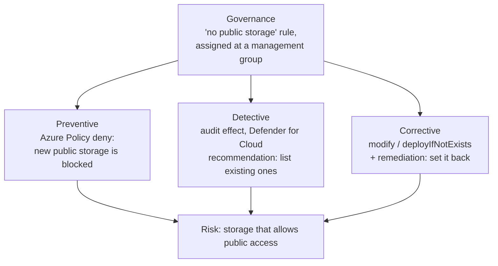

# Preventive, Detective, Corrective, and Governance Controls

> **Foundation primer.** Not exam content. Many exam questions turn on one word: must
> the bad thing be **prevented**, **detected**, or **fixed**? This primer gives you the
> vocabulary for that choice, and maps it onto the Azure controls you will meet.

## Why this matters for security

Controls do different jobs. A rule that **blocks** a public storage account and a report
that **lists** public storage accounts sound similar, but only one stops the exposure.
Exam scenarios hide the required job in the wording - "ensure that no one can", "identify
which", "automatically correct" - and offer controls that do the wrong job. Reading the
verb correctly is half the answer.

## In plain English

- A **preventive** control stops something bad from happening. A lock on the door.
- A **detective** control notices that something bad happened, or is happening. A camera.
- A **corrective** control puts things right after they go wrong. Fixing the window.
- **Governance** is the set of rules, standards and processes that decide which of the
  above you apply, where, and how you prove it. The building's security policy.

Good security uses all four. Prevention will sometimes fail; detection tells you when;
correction limits the damage; governance keeps it consistent.

## Words you need to know

- **Preventive control** - stops an action or condition from occurring.
- **Detective control** - identifies an action or condition after, or while, it happens.
- **Corrective control** - restores a secure state after something went wrong.
- **Governance** - the policies, standards and oversight that direct which controls apply.
- **Compliance** - whether resources meet a defined standard, and the evidence that they
  do.
- **Azure Policy** - a service that evaluates resource configuration against rules and
  can audit, block or fix non-compliant resources.
- **Policy effect** - what Azure Policy does when a rule matches: for example `deny`,
  `audit`, `deployIfNotExists`, `modify`.
- **Initiative** - a group of policy definitions assigned together, such as a regulatory
  standard.
- **Resource lock** - a setting that stops a resource from being deleted (`CanNotDelete`)
  or changed (`ReadOnly`), regardless of anyone's role.
- **Remediation** - bringing a non-compliant resource into compliance.

## Mental model

A teaching model: the same risk, four kinds of response.

## Microsoft cloud translation

| Kind of control | Azure examples | Where SC-500 teaches it |
| --- | --- | --- |
| Preventive | Azure Policy `deny` and `denyAction`; resource locks; Azure RBAC; Conditional Access; NSGs and firewalls; private endpoints; disabling shared key access | 01-01, 01-03, 02-01 to 02-04 |
| Detective | Azure Policy `audit` and `auditIfNotExists`; Defender for Cloud recommendations and alerts; Microsoft Sentinel analytics rules; resource logs | 01-03, 04-01 to 04-03 |
| Corrective | Azure Policy `modify` and `deployIfNotExists` with remediation tasks; Sentinel automation rules and playbooks; backup restore | 01-03, 04-04 |
| Governance | Policy assignments at management groups; security standards and regulatory compliance in Defender for Cloud; role assignment reviews; infrastructure as code | 01-03, 04-01 |

## How it works

**Azure Policy can do three of the four jobs, depending on the effect.** Each policy
definition has one effect:

- `deny` blocks a create or update request that does not comply - preventive. `denyAction`
  blocks specific actions such as deletion.
- `audit` and `auditIfNotExists` mark non-compliant resources and log them - detective.
- `modify` and `deployIfNotExists` change or add configuration - corrective. New and
  updated resources are fixed automatically; **existing** non-compliant resources need a
  **remediation task**, which runs using the assignment's managed identity.

Microsoft recommends starting a new policy with `audit` to see its impact before switching
to an enforcing effect.

**Resource locks prevent accidents, even by Owners.** A `CanNotDelete` lock stops deletion;
a `ReadOnly` lock stops changes too. Locks apply to everyone regardless of role, which is
what makes them different from RBAC. They act on management operations, not on the data
inside a resource: a lock on a storage account does not stop someone deleting the blobs in
it.

**Detection needs someone, or something, to act.** A recommendation or an alert only
reduces risk once it is triaged and fixed. Automation (corrective) closes the loop for
common cases.

**Governance is where scope is decided.** Assigning a policy at a management group makes
it apply to every subscription beneath it, including future ones (0A-03). Defender for
Cloud's security standards and regulatory compliance dashboards are how you measure the
result against a framework.

## Why security cares

**Without the control**

1. The organisation has a rule: "storage accounts must not allow public access"
2. The rule lives in a document, not in Azure
3. A new team creates a storage account with public access enabled
4. Nobody notices until the data is found on the internet

**With the control**

1. The same rule is assigned as Azure Policy at the top management group
2. New public storage accounts are denied at creation
3. Existing ones are reported as non-compliant and remediated
4. The compliance dashboard shows the result to auditors

**What it does not solve.** A policy checks configuration. It does not stop someone with
legitimate access from misusing data, and it cannot evaluate settings it has no rule for.

**Depends on.** The right scope, the right effect, and - for corrective effects - a
managed identity with enough permission to make the change.

## Common misunderstandings

| What people assume | What is actually true |
| --- | --- |
| "Audit and deny are the same, just stricter." | Audit reports; deny blocks. One is detective, the other preventive. |
| "A deployIfNotExists policy fixes everything at once." | New and updated resources are fixed automatically. Existing ones need a remediation task. |
| "Owners can delete anything." | A resource lock blocks deletion for everyone, including Owners, until the lock is removed. |
| "A lock on a storage account protects its data." | Locks act on management operations. Blobs inside can still be deleted by anyone with data access. |
| "If Defender shows a recommendation, we're protected." | A recommendation is detective. Risk drops only once it is remediated. |

## Where SC-500 uses this

- Azure Policy, resource locks, roles and infrastructure as code:
  [01-03 governance and compliance](../01-identity-access-governance/01-03-governance-and-regulatory-compliance.md).
- Recommendations, standards and compliance:
  [04-01 Defender for Cloud](../04-security-posture/04-01-defender-for-cloud-posture.md).
- Automated response:
  [04-04 Sentinel automation](../04-security-posture/04-04-sentinel-automation-retention-and-audit.md).

## Teach it back

A requirement says: "Ensure that no virtual machine can be created without a specific
tag, and add the tag automatically to existing VMs that lack it." Explain which kind of
control each half needs, and which Azure Policy effects fit.

A strong answer covers: the first half is preventive (`deny` on create without the tag);
the second half is corrective (`modify` with a remediation task for existing resources);
`audit` alone would only report the problem.

## Key takeaways

- Preventive stops it; detective notices it; corrective fixes it; governance decides and
  proves it.
- Read the verb in the requirement: "ensure no one can" means preventive.
- Azure Policy effects map to control types: deny (preventive), audit (detective), modify
  and deployIfNotExists (corrective).
- Existing resources need a remediation task.
- Resource locks apply to everyone and protect the resource, not its data.

## Sources

- Azure Policy definitions effect basics: <https://learn.microsoft.com/azure/governance/policy/concepts/effect-basics>
- Azure Policy remediation task structure: <https://learn.microsoft.com/azure/governance/policy/concepts/remediation-structure>
- Lock your Azure resources: <https://learn.microsoft.com/azure/azure-resource-manager/management/lock-resources>
- What is Azure Policy: <https://learn.microsoft.com/azure/governance/policy/overview>
