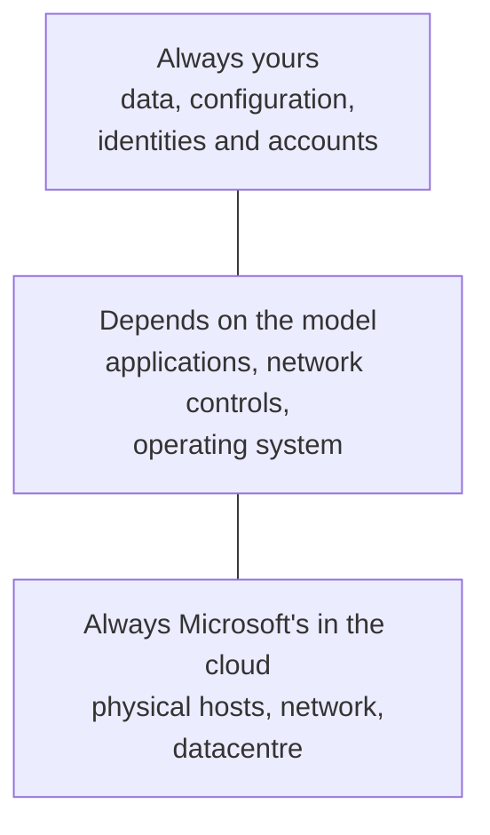

# Shared Responsibility

> **Foundation primer.** Not exam content. Before you choose a control, you need to know
> whether the thing it protects is yours to protect. This primer explains how security
> duties are split between you and Microsoft - for ordinary cloud services, for AI, and
> for AI agents.

## Why this matters for security

"Microsoft secures the cloud" is true and dangerously incomplete. Microsoft secures the
datacentres, the hardware and, depending on the service, much of the software. **You
always secure your data, your identities, your accounts and your configuration.** Most
cloud breaches happen in the customer's half: a public storage account, an
over-privileged identity, an unpatched VM the customer was responsible for. SC-500 is
entirely about the customer's half - which is why knowing where it starts matters.

## In plain English

Renting a flat, a serviced apartment and a hotel room all give you somewhere to live, but
who fixes the boiler, who changes the locks and who keeps track of the keys is different
in each. In every case, though, you decide who you give a key to and you look after your
own belongings.

Cloud services work the same way. The more managed the service, the more Microsoft looks
after. Your data, your accounts and your settings stay yours in every model.

## Words you need to know

- **Shared responsibility model** - the division of security duties between the cloud
  provider and the customer.
- **IaaS / PaaS / SaaS** - infrastructure, platform and software as a service (0A-01).
- **Configuration** - the settings you choose on a service: who can access it, from where,
  with what encryption.
- **AI platform / AI application / AI usage** - the three layers Microsoft uses to divide
  AI responsibilities: the model and its infrastructure, the app built on it, and how
  people use it.
- **SaaS / PaaS / IaaS agent** - a ready-made agent, an agent you build on a managed agent
  platform, or an agent stack you build and host entirely yourself.

## Mental model

A teaching model: what moves to Microsoft, and what never does.

## Microsoft cloud translation

| Responsibility area | IaaS (Virtual Machines) | PaaS (App Service, SQL Database, Storage) | SaaS (Microsoft 365) |
| --- | --- | --- | --- |
| Customer data | You | You | You |
| Configurations and settings | You | You | You |
| Identities and users | You | You | You |
| Client devices | You | You | Shared |
| Applications | You | Shared | Shared |
| Network controls | You | Shared | Microsoft |
| Operating system | You | Microsoft | Microsoft |
| Physical hosts, network, datacentre | Microsoft | Microsoft | Microsoft |

## How it works

**Your duties shrink with each step up - but never disappear.** With a virtual machine
you patch the operating system, configure its firewall and harden its settings. With a
platform service such as Azure SQL Database, Microsoft runs and patches the server, and
you configure authentication, network access, auditing and encryption keys. With
Microsoft 365, Microsoft runs nearly everything, and you still decide who has accounts,
how they sign in, and who can see which files.

**Configuration is always yours.** Every service has settings, and every setting can be
wrong. A storage account that allows public access, a key vault with no firewall, a
database still accepting passwords - all of those are customer-side configuration, in
every model. Defender for Cloud's posture management exists to find them (04-01).

**AI adds three layers.** Microsoft describes AI responsibilities in three layers: the AI
**platform** (model, its infrastructure and safety systems), the AI **application** (the
app or agent built on the model, its grounding data and plugins), and AI **usage** (how
people use it, and what they do with the output). With a SaaS AI such as Microsoft 365
Copilot, Microsoft runs the platform and the application, and you still own identity,
data access, usage policies and output review. With a PaaS service such as Microsoft
Foundry, you also own the application: model choice, prompts, grounding, safety
configuration and integration.

**Agents add more.** Because agents act on their own, call tools and hold an identity,
Microsoft's agent model adds responsibilities for the agent's instructions, tool
selection and permissions, identity and authorization, human approval of high-impact
actions, and action logging. Some of these are always the customer's, whatever the model
- notably accountability for what the agent does, and requiring a human to approve
high-impact actions.

## Why security cares

**Without the control**

1. A team moves an application to Azure App Service
2. They assume "Microsoft handles security now"
3. The app's data lives in a storage account left at defaults, with account keys enabled
   and public network access on
4. A leaked key exposes the data - the customer's half of the model was never done

**With the control**

1. The team maps the app to the shared responsibility model
2. They list what is theirs: data, identities, configuration, application code
3. They harden each item and switch on posture management to keep checking
4. The settings Microsoft does not manage are now managed by someone

**What it does not solve.** Knowing who is responsible does not do the work. It tells you
where the work is.

**Depends on.** Knowing which service model each part of a workload uses - many workloads
mix all three.

## Common misunderstandings

| What people assume | What is actually true |
| --- | --- |
| "Moving to the cloud moves security to Microsoft." | Physical security moves. Data, identities, accounts and configuration always remain yours. |
| "SaaS means nothing to configure." | With SaaS you still own accounts, access, data sharing and device security. |
| "Microsoft's AI safety systems cover our AI app." | The platform has safety systems; in PaaS you configure the application's guardrails, grounding data and permissions. |
| "An agent's actions are the vendor's responsibility." | Accountability for what an agent does, and approval of high-impact actions, stay with the customer in every model. |

## Where SC-500 uses this

- Customer-side configuration posture:
  [04-01 Defender for Cloud](../04-security-posture/04-01-defender-for-cloud-posture.md).
- AI data exposure (SaaS AI, your data):
  [03-01 AI data exposure](../03-secure-compute/03-01-ai-data-exposure-and-purview-dspm.md).
- Agents you govern:
  [03-02 AI agent identity and governance](../03-secure-compute/03-02-ai-agent-identity-and-governance.md).
- AI you build (PaaS):
  [03-03 AI platform and workload protection](../03-secure-compute/03-03-ai-platform-and-workload-protection.md).
- VMs you patch (IaaS):
  [03-04 servers and virtual machines](../03-secure-compute/03-04-servers-and-virtual-machines.md).

## Teach it back

For a single application that runs on a VM, stores files in Azure Storage, and uses
Microsoft 365 Copilot to summarise reports, list one thing **you** must secure in each of
the three service models it uses.

A strong answer covers: VM operating system patching and hardening (IaaS); storage
account configuration, authorization and network access (PaaS); who can see which
Microsoft 365 files, since Copilot uses the user's permissions (SaaS); and in all three,
data, identities and configuration.

## Key takeaways

- Physical security is Microsoft's in every cloud model.
- Data, configuration, identities and accounts are always yours.
- The operating system, applications and network controls shift towards Microsoft as you
  move from IaaS to PaaS to SaaS.
- AI adds platform, application and usage layers; agents add tools, permissions,
  identity and approval duties.
- SC-500 is about the customer's half.

## Sources

- Shared responsibility in the cloud: <https://learn.microsoft.com/azure/security/fundamentals/shared-responsibility>
- AI shared responsibility model: <https://learn.microsoft.com/azure/security/fundamentals/shared-responsibility-ai>
- AI agent shared responsibility model: <https://learn.microsoft.com/azure/security/fundamentals/shared-responsibility-ai-agent>
