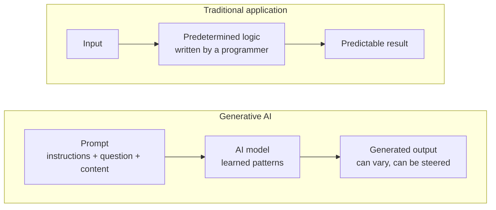

# Generative AI

> **Foundation primer.** Not exam content. A fifth of SC-500 sits in "Implement security
> for AI". You do not need to know how AI models are trained. You do need to know what a
> generative AI system takes in, what it gives out, and why that creates security
> problems ordinary applications did not have.

## Why this matters for security

A traditional application does what its code says. A generative AI system does what its
input **suggests**. That single change creates new risks: sensitive data can be pulled
into answers for people who should not see it; instructions hidden in a document can
change what the system does; and the output can be wrong in ways that look confident.
SC-500's AI objectives exist because these risks need controls the older objectives did
not cover.

## In plain English

A **traditional application** follows fixed rules written by a programmer. Same input,
same output, every time.

A **generative AI** system is built around a **model** that has learned patterns from
very large amounts of text (or images, or code). You give it a request in ordinary
language - a **prompt** - and it **generates** a new answer, one piece at a time, based on
what is most likely to come next. It does not look the answer up in a rulebook. It
produces it.

## Words you need to know

- **Generative AI** - AI that produces new content (text, images, code) rather than only
  classifying or predicting.
- **Model** - the trained component that generates output. A **large language model
  (LLM)** works with text.
- **Prompt** - the input given to a model: instructions, a question, and any supporting
  content.
- **Output (completion, response)** - what the model generates.
- **Token** - the unit a model reads and writes; roughly a word or part of a word. Models
  are priced and limited in tokens.
- **Copilot** - Microsoft's name for AI assistants built into its products, such as
  Microsoft 365 Copilot.
- **Hallucination** - output that is fluent and confident but not true.
- **Prompt injection** - input crafted to make the model ignore its instructions. A
  **jailbreak** is a direct attempt; an **indirect** attack hides instructions in content
  the model reads, such as a document or an email.

## Mental model

A teaching model: fixed rules versus generated output.

## Microsoft cloud translation

| The generic idea | Microsoft's offering | Shared responsibility | Where SC-500 uses it |
| --- | --- | --- | --- |
| An AI assistant over your work data | Microsoft 365 Copilot | SaaS: Microsoft runs the AI; you own data access and usage | 03-01 |
| Building your own AI apps and agents | Microsoft Foundry | PaaS: you own the app, its data, guardrails and identity | 03-03 |
| Low-code agents for business teams | Microsoft Copilot Studio | Varies; you own configuration, data, connectors and identity | 03-02 |
| AI for security analysts | Microsoft Security Copilot | SaaS: you own permissions, plugins and workspace data | 04-05 |
| Seeing AI data risk | Microsoft Purview Data Security Posture Management (DSPM) | Detective control over AI use of your data | 03-01 |
| Detecting threats to AI services | Microsoft Defender for AI Services | Workload protection plan in Defender for Cloud | 03-03 |

## How it works

**The model generates; it does not know.** A language model produces the most likely next
token, again and again, until the answer is complete. It is very good at producing
plausible text. That is why it can also produce plausible text that is wrong.

**The prompt is more than the question.** In practice a prompt usually combines a
**system message** written by the app's builder ("You are a helpful HR assistant; only
answer from the policy documents"), the user's question, and content fetched from
somewhere to help answer it. The model sees all of it together, as text.

**Content can carry instructions.** Because the model reads everything in the prompt as
text, instructions hidden inside a document or email can be treated as if they were
genuine. That is indirect prompt injection, and it is why Microsoft recommends treating
any content an AI reads from outside as untrusted.

**AI uses your data with someone's permissions.** Microsoft 365 Copilot answers using
content the signed-in user can already access. It does not grant new access - but it
makes existing access far easier to use. A file shared with "everyone" five years ago is
suddenly one question away. That is why oversharing in SharePoint is an AI objective
(03-01).

**Security still rests on familiar foundations.** Microsoft's AI shared responsibility
model notes that protecting AI usage relies on the same foundations as any system:
identity and access, device protection, data protection and governance, and monitoring -
plus extra attention to user behaviour, because users steer the output.

## Why security cares

**Without the control**

1. An organisation enables an AI assistant for all staff
2. Years of SharePoint sites are shared far more widely than anyone intended
3. A junior employee asks the assistant about "salary review plans"
4. The answer draws on a document they could technically open but were never meant to
   find

**With the control**

1. Before rollout, the organisation runs oversharing reports and DSPM for AI
2. Overshared sites are restricted and sensitive files are labelled
3. The same question now finds only content the employee is meant to see
4. AI interactions with sensitive data are monitored for risky patterns

**What it does not solve.** Removing oversharing does not stop prompt injection, model
misuse or wrong answers. Those need guardrails on the AI itself and human review of
important output.

**Depends on.** Knowing where sensitive data lives, and who it is shared with - the same
data hygiene as before AI, now with consequences that arrive much faster.

## Common misunderstandings

| What people assume | What is actually true |
| --- | --- |
| "Copilot has its own access to our files." | Microsoft 365 Copilot uses the signed-in user's existing permissions. It exposes oversharing that was already there. |
| "The AI looks answers up, so they're accurate." | A generative model generates likely text. Grounding reduces errors; it does not remove them. |
| "A good system message makes the AI safe." | Instructions can be overridden by crafted input. Guardrails, least privilege and monitoring are still needed. |
| "AI security is a completely new discipline." | Identity, access, data protection and monitoring still do most of the work. AI adds new attack paths on top. |

## Where SC-500 uses this

- AI data exposure and DSPM:
  [03-01 AI data exposure and Purview DSPM](../03-secure-compute/03-01-ai-data-exposure-and-purview-dspm.md).
- Agents and their identities:
  [03-02 AI agent identity and governance](../03-secure-compute/03-02-ai-agent-identity-and-governance.md).
- Building and protecting AI apps:
  [03-03 AI platform and workload protection](../03-secure-compute/03-03-ai-platform-and-workload-protection.md).
- AI used by the security team:
  [04-05 Security Copilot](../04-security-posture/04-05-security-copilot.md).

Next: [0A-15 AI models, prompts and outputs](0A-15-models-prompts-outputs.md) looks inside
the prompt.

## Teach it back

Explain to a colleague why turning on an AI assistant can expose data without changing a
single permission, and name the first thing you would check before a rollout.

A strong answer covers: the assistant uses existing user permissions; it makes
long-forgotten overshared content easy to find; check SharePoint and OneDrive oversharing
and sensitive data with Purview DSPM before enabling it broadly.

## Key takeaways

- Traditional apps follow fixed logic; generative AI produces output steered by its
  input.
- The prompt includes instructions, the question and any content added to it - all read
  as text.
- Content the AI reads can carry hidden instructions. Treat it as untrusted.
- AI assistants use existing permissions, so they surface existing oversharing.
- Identity, access, data protection and monitoring still carry most of the weight.

## Sources

- LLM fundamentals: <https://learn.microsoft.com/agent-framework/journey/llm-fundamentals>
- Prompt engineering techniques: <https://learn.microsoft.com/azure/foundry/openai/concepts/prompt-engineering>
- AI shared responsibility model: <https://learn.microsoft.com/azure/security/fundamentals/shared-responsibility-ai>
- Microsoft Copilot prompt defense in depth: <https://learn.microsoft.com/microsoft-365/copilot/copilot-prompt-defense-in-depth>
