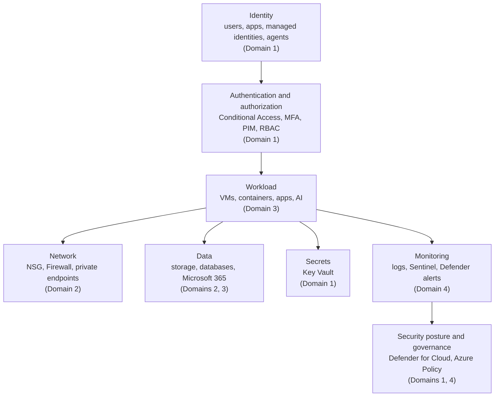
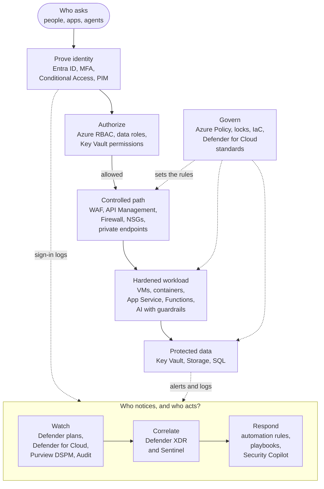

# How Microsoft Cloud Security Fits Together

> **Foundation primer.** Not exam content. The last primer. It puts the previous
> sixteen into one picture, maps each layer to an SC-500 domain, and gives you the
> question to ask before choosing any control. Come back to it whenever a lesson feels
> like a list of unrelated products.

## Why this matters for security

SC-500 names dozens of Microsoft products. Learned one at a time, they blur into each
other. Learned as **layers that each answer a different question**, they make sense -
and so do the exam's "which control should you use?" questions, because the right answer
is usually the control at the layer where the requirement actually sits. No single layer
is enough: each one assumes the others might fail.

## In plain English

Every request in the cloud goes through the same checkpoints:

1. **Who is asking?** (identity)
2. **Have they proved it, and may they do this?** (authentication and authorization)
3. **Can they even reach it?** (network)
4. **What are they reaching, and is it protected?** (data, secrets, workloads, AI)
5. **Would we notice if something went wrong?** (monitoring)
6. **Is everything configured the way we intended - and can we prove it?** (posture and
   governance)

## Words you need to know

- **Layer (of defence)** - one kind of control on the path between a caller and an asset.
- **Defence in depth** - using several layers so one failure is not a breach.
- **Zero Trust** - Microsoft's security model built on three principles: **verify
  explicitly**, **use least privilege access**, **assume breach**.
- **Posture** - how securely everything is configured, measured continuously.
- **CNAPP** - cloud-native application protection platform. Microsoft Defender for Cloud
  is one, combining posture management (CSPM), workload protection (CWPP) and DevOps
  security.

## Mental model

A teaching model: the Academy's map of SC-500. Every exam lesson sits somewhere on it.

## Microsoft cloud translation

| The question | The layer | Main Microsoft controls | SC-500 domain |
| --- | --- | --- | --- |
| Who is asking? | Identity | Microsoft Entra ID users, groups, app registrations, managed identities, Entra Agent ID | 1, 3 |
| Have they proved it, and may they? | Authentication and authorization | Conditional Access, MFA and passwordless, PIM, Azure RBAC, consent settings | 1 |
| Where are the secrets? | Secrets | Azure Key Vault, Defender for Key Vault, secret scanning in Defender CSPM | 1 |
| Can they reach it? | Network | NSG and ASG, Virtual Network Manager, Azure Firewall, private endpoints, VPN, Entra Private Access | 2 |
| Is the data protected? | Data | Storage firewall and authorization, Entra-only SQL, auditing, Defender for Storage and Databases, Purview DSPM | 2, 3 |
| Is the workload hardened? | Workload | VM security features, Bastion, JIT, Defender for Servers and Containers, App Service and Functions controls, WAF, API Management | 3 |
| Is AI controlled? | AI | Entra Agent ID, Conditional Access for agents, Foundry guardrails, AI gateway, Defender for AI Services | 3 |
| Would we notice? | Monitoring | Diagnostic settings, Azure Monitor Agent, Microsoft Sentinel, Purview Audit, Security Copilot | 4 |
| Is it configured as intended? | Posture and governance | Defender for Cloud CSPM, security standards, Azure Policy, resource locks, infrastructure as code | 1, 4 |

## How it works

**Each layer answers one question.** Most exam "which control?" questions become easy
once you ask which question the requirement is really about. "Only from compliant
devices" is an authentication question (Conditional Access). "Only from our network" is
a network question (firewall rules, private endpoints). "Only these people may read the
data" is an authorization question (RBAC). "Find all storage accounts that allow public
access" is a posture question (Defender for Cloud, Azure Policy audit).

**Layers reinforce each other.** A managed identity (identity) with a narrow role
(authorization) reaching a key vault through a private endpoint (network), with access
logged to Sentinel (monitoring) and the vault's settings checked by Defender for Cloud
(posture), has five things standing between an attacker and the secret. Remove any one
and the others still stand.

The same layers as a path. A request starts at the top and works down; the bottom row is
who notices when a layer fails. A teaching model: it shows how the layers relate, not
every control inside them.

**Zero Trust is the logic behind the layers.** Microsoft's three principles map neatly:

- **Verify explicitly** - authenticate and authorize every request using all available
  signals: Entra ID and Conditional Access.
- **Use least privilege access** - narrow roles, just-in-time access, managed identities
  instead of stored credentials: RBAC, PIM, JIT.
- **Assume breach** - segment the network, encrypt, monitor and detect, keep backups you
  can trust: NSGs, private endpoints, Sentinel, Defender, Azure Backup.

**Posture is how you know the layers are really there.** Configurations drift. People
make exceptions. New resources appear. Defender for Cloud continuously assesses posture
against standards and protects workloads with its Defender plans; Azure Policy enforces
the rules you choose. They are how a security team finds the layer that went missing.

**Every control has a limit.** None of these layers is complete on its own. Each lesson
in this Academy has a "What it does not solve" line for that reason. The exam often
tests exactly that limit.

## Why security cares

**Without the control**

1. A team relies on a single layer: "the database has a strong password"
2. The password is reused elsewhere and leaks
3. The database is reachable from the internet, nothing alerts on the unusual sign-in,
   and nobody checked its configuration
4. One failure becomes a breach

**With the control**

1. The database accepts only Entra identities (identity, authentication)
2. The application's managed identity holds a narrow role (authorization)
3. The database is reachable only through a private endpoint (network), with auditing to
   Sentinel (monitoring) and Defender for Databases enabled
4. Defender for Cloud flags any drift from that configuration (posture)

**What it does not solve.** More layers cost more to build and run. The goal is the right
layers for the risk, not every product.

**Depends on.** Every layer being owned by someone - which is where shared responsibility
(0A-13) comes back in.

## Common misunderstandings

| What people assume | What is actually true |
| --- | --- |
| "One strong control is enough." | Each control has limits. Defence in depth assumes any one layer can fail. |
| "Zero Trust is a product." | Zero Trust is a strategy - verify explicitly, least privilege, assume breach - implemented with many products. |
| "Posture management protects my resources." | Posture management finds weaknesses. Something else - a person, a policy, a remediation - has to fix them. |
| "The exam tests products." | The exam tests whether you can pick the control at the layer where the requirement sits. |

## Where SC-500 uses this

Everywhere. In particular:

- Identity and governance:
  [01-01](../01-identity-access-governance/01-01-entra-id-secure-access.md) and
  [01-03](../01-identity-access-governance/01-03-governance-and-regulatory-compliance.md).
- Network layers:
  [02-03](../02-storage-databases-networking/02-03-network-segmentation-and-connectivity.md) and
  [02-04](../02-storage-databases-networking/02-04-private-access-and-perimeter.md).
- Posture:
  [04-01 Defender for Cloud](../04-security-posture/04-01-defender-for-cloud-posture.md).
- Monitoring:
  [04-02 Sentinel](../04-security-posture/04-02-sentinel-workspace-roles-and-content.md).
- Side-by-side choices between controls: the **Compare controls** view in this Academy.

## Teach it back

Take one requirement - "only the payroll application may read the payroll database, and
we must know if anyone else tries" - and name a control at four different layers that
together meet it.

A strong answer covers: a managed identity for the application (identity); a narrow
database role for that identity and Entra-only authentication (authorization); a private
endpoint and closed public access (network); database auditing and Defender for
Databases, with alerts to Sentinel (monitoring); a policy or posture check that keeps it
that way (posture).

## Key takeaways

- Six questions, six layers: identity, authentication and authorization, network,
  protected assets, monitoring, posture.
- Pick the control at the layer where the requirement sits.
- Layers reinforce each other; none is enough alone.
- Zero Trust - verify explicitly, least privilege, assume breach - is the logic that ties
  them together.
- Posture management is how you prove the layers are still there.

## Sources

- Zero Trust security in Azure: <https://learn.microsoft.com/azure/security/fundamentals/zero-trust>
- What is Microsoft Defender for Cloud: <https://learn.microsoft.com/azure/defender-for-cloud/defender-for-cloud-introduction>
- Shared responsibility in the cloud: <https://learn.microsoft.com/azure/security/fundamentals/shared-responsibility>
