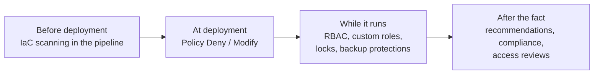
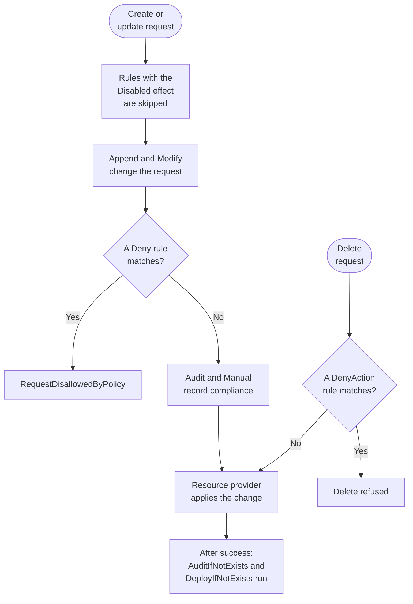
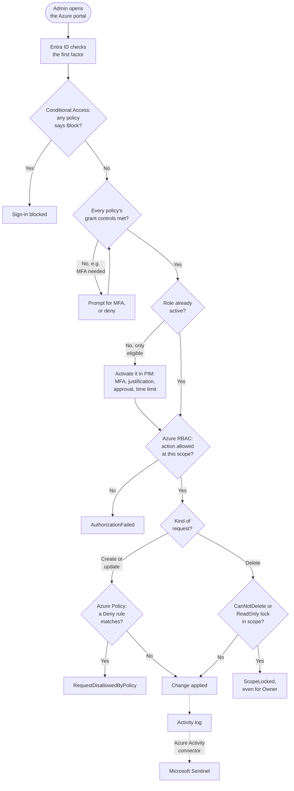

# Governance and Regulatory Compliance

> **Objective:** Implement governance to enforce security and regulatory compliance
> **Domain:** Manage identity, access, and governance (20-25%)

## Sub-objectives covered

- Implement and configure security controls by using Azure Policy, including built-in and custom policy definitions
- Evaluate regulatory compliance by using Microsoft Defender for Cloud
- Implement and configure security controls in Defender for Cloud, including security standards and recommendations
- Implement resource locks
- Manage Azure built-in role assignments
- Manage custom roles, including Azure roles and Microsoft Entra roles
- Evaluate and remediate overprivileged access assignments by using Azure role-based access control (RBAC)
- Configure security controls for backup protection by using Azure Backup security features
- Implement and configure security controls by using infrastructure as code

## The security problem

The first two modules secured things you configured yourself. Governance is the
answer to a harder question: **how do you make a security decision stick across
resources you did not create, will never see, and cannot review one at a time?**

A written standard does not answer it. Neither does a review meeting. Both rely on
the person deploying the resource having read the standard and chosen to follow it,
and at any real scale that assumption fails silently - not through malice, but
through a contractor in a hurry, a copied template, and a Friday deadline.

So governance in Azure is a set of mechanisms that act *without* a human in the
loop, and the useful way to organise all nine bullets is by **when** each mechanism
acts:

| When | Mechanism | Bullets it covers |
| --- | --- | --- |
| Before the resource exists | Azure Policy `Deny`, IaC scanning in the pipeline | Azure Policy, infrastructure as code |
| At creation, invisibly | Azure Policy `Modify` and `Append` | Azure Policy |
| While the resource exists | Azure RBAC, custom roles, resource locks, Azure Backup protections | role assignments, custom roles, locks, backup |
| After the fact, as evidence | Defender for Cloud recommendations, secure score, regulatory compliance dashboard, access reviews | standards, regulatory compliance, overprivileged access |

Read down that column. Everything earlier is cheaper than everything later. A `Deny`
policy costs one blocked deployment; the same misconfiguration found by a compliance
report six months on costs a change window, an exception, and an argument.

And the last row is the one people mistake for the whole subject. A compliance
dashboard is a *measurement*. It changes nothing on its own. If your governance
posture is entirely made of dashboards, you have visibility and no control.

## In plain English

A security rule that lives in a document only works if every person deploying a
resource reads it and follows it. At cloud scale, someone eventually doesn't.

Governance is how you make rules **enforce themselves**. Azure Policy checks every
resource as it is created or changed and can block it, fix it, or flag it. Roles decide
who can change what, and reviews catch access that has grown too broad. Locks stop
accidental deletion. Backup protections stop an attacker destroying your way back.
Defender for Cloud measures the result against security frameworks so you can prove it
to an auditor. And infrastructure as code lets you check a deployment before it ever
reaches Azure.

## Words you need to know

- **Policy definition** - a rule: *if* a resource matches a condition, *then* apply an
  effect.
- **Initiative** - a bundle of policy definitions assigned together.
- **Assignment** - a definition or initiative applied to a scope. This is what actually
  takes effect.
- **Effect** - what a policy does when it matches: `Deny`, `Audit`, `Modify`,
  `DeployIfNotExists` and others (0A-12).
- **Remediation task** - applies a `Modify` or `DeployIfNotExists` fix to resources that
  already exist.
- **Exemption** - a recorded, justified, optionally expiring carve-out from an assignment.
- **Security standard** - a set of controls Defender for Cloud assesses, such as the
  Microsoft cloud security benchmark (MCSB) or a regulatory framework.
- **Secure score** - Defender for Cloud's posture measure, based on MCSB recommendations.
- **Resource lock** - `CanNotDelete` or `ReadOnly`, applied to everyone regardless of role.
- **Role definition / assignment** - a set of permitted operations, and the binding of
  that set to a principal at a scope.
- **Custom role** - a role you define. Azure custom roles govern resources; Entra custom
  roles govern directory objects.
- **Immutable vault / multi-user authorization (MUA)** - Azure Backup protections that
  stop recovery points being destroyed, or require a second party to approve critical
  changes.
- **Infrastructure as code (IaC)** - defining resources in templates (Bicep, ARM,
  Terraform) that can be scanned and reviewed before deployment.

## Mental model

A teaching model: governance controls ordered by **when** they act. Earlier is cheaper.

## How it works under the hood

### Azure Policy

Four objects, and the exam expects you to keep them straight:

| Object | What it is |
| --- | --- |
| **Definition** | The rule. `if` a condition matches, `then` apply an effect. Built-in or custom. |
| **Initiative** (policy set) | A named bundle of definitions, so you assign one thing instead of forty. |
| **Assignment** | A definition or initiative bound to a **scope**, with parameters. This is the object that actually does anything. |
| **Exemption** | A recorded, expiring, justified carve-out for a specific resource from a specific assignment. |

Scope flows down: management group → subscription → resource group → resource.
An assignment at a management group applies to everything beneath it. **Exclusions**
are set on the assignment and remove a sub-scope from it entirely; **exemptions** are
separate objects that leave the assignment in place and record *why* something is
out, with an expiry date. Exclusion is a configuration decision; exemption is an
auditable one. Questions that mention a documented business justification or a time
limit want an exemption.

**Effects**, and the order they are evaluated in, matter more than the list. For a
create or update request, Microsoft documents this order:

1. `Disabled` - checked first; turns the rule off for that assignment
2. `Append` and `Modify` - alter the request before it is evaluated further (a change
   made here can stop a later `Deny` or `Audit` from triggering)
3. `Deny` - block the request (evaluated before `Audit`, so a blocked resource is not
   logged twice)
4. `Audit` - allow, and record non-compliance
5. `Manual` - compliance that cannot be evaluated automatically and is attested to
6. `AuditIfNotExists` - allow, and record non-compliance based on a related resource
7. `DenyAction` - block a specific *operation* rather than a property value, the
   canonical case being resource deletion

Only after the resource provider returns success do `AuditIfNotExists` and
`DeployIfNotExists` run to decide whether more logging or a follow-up deployment is
needed. (Two further effects, `addToNetworkGroup` and `mutate`, serve Virtual Network
Manager and AKS respectively and are not this objective's focus.)

The same order as a flow. Deletes take their own path, through `DenyAction`.

Two mechanical facts people get wrong:

- **`Modify` and `DeployIfNotExists` need an identity.** The assignment carries a
  managed identity with permissions to make the change, and you specify a location
  for it. Without a properly permissioned identity, remediation silently does
  nothing.
- **Existing resources are not fixed by a new `Deny` policy.** `Deny` only acts on
  create and update requests. Pre-existing non-compliant resources show as
  non-compliant and keep running. To change them you need a **remediation task**
  against a `Modify` or `DeployIfNotExists` assignment.

Evaluation happens when a resource is created or updated, when an assignment
changes, and on a periodic compliance scan - roughly every 24 hours. A compliance
state that has not updated is usually a scan that has not run, not a broken policy;
you can trigger one on demand.

### Defender for Cloud: standards, recommendations, compliance

The mechanical insight that ties three bullets together: **for Azure resources,
Defender for Cloud's security standards are implemented as Azure Policy initiatives.**
The recommendations you see are policy evaluations wearing a different UI.

- The **Microsoft cloud security benchmark (MCSB)** is applied by default when you
  enable Defender for Cloud on a subscription, and it is what **secure score** is
  computed from.
- Additional standards - regulatory frameworks such as CIS, PCI-DSS, NIST, ISO - are
  **assigned** per subscription or management group and then appear in the
  **Regulatory compliance** dashboard, which maps each framework control to the
  recommendations that evidence it. Foundational CSPM is free and gives you MCSB and
  secure score. Standards beyond MCSB need a paid plan: Microsoft documents that **any
  Defender for Cloud plan except Defender for Servers Plan 1 or Defender for APIs Plan 1**
  unlocks them, and Defender CSPM - which lists regulatory compliance among its
  capabilities - is the usual choice. Adding a standard needs Owner or Policy Contributor.
- **Custom standards** and custom recommendations let you express an internal
  requirement in the same surface, so one dashboard answers both the auditor and the
  security team.

A recommendation has a severity, a set of affected resources, remediation steps, and
often a **Fix** button - which, for policy-backed recommendations, triggers the
remediation described above. Recommendations can be **exempted** with a justification
that flows into the compliance view rather than disappearing.

### Resource locks

Two levels, and one property that surprises everyone:

| Lock | Blocks |
| --- | --- |
| `CanNotDelete` (shown as **Delete** in the portal) | Deletion. Reads and modifications still work. |
| `ReadOnly` | Deletion and modification. Effectively everyone becomes Reader on that resource. |

Locks are inherited downward from subscription and resource group to resources, and
**they apply to everyone, including the subscription Owner** - the only way past a
lock is to remove it, which requires `Microsoft.Authorization/locks/*`, held by Owner
and User Access Administrator.

The surprise: **locks are a control-plane control.** A `ReadOnly` lock on a storage
account does not stop anyone writing blobs into it, because blob writes are data
plane. `ReadOnly` also breaks operations that *look* like reads but are implemented
as POST requests - listing storage account keys being the standard example - which is
why `ReadOnly` causes more outages than it prevents and `CanNotDelete` is the default
recommendation.

### Azure RBAC and custom roles

An assignment is three things: **a security principal, a role definition, a scope**.
A role definition is a set of operations:

| Field | Meaning |
| --- | --- |
| `Actions` | Control-plane operations allowed |
| `NotActions` | Subtracted from `Actions` - **not a deny**, just a subtraction |
| `DataActions` | Data-plane operations allowed (read a blob, read a secret) |
| `NotDataActions` | Subtracted from `DataActions` |
| `AssignableScopes` | Where this custom role may be assigned |

Effective permission is the **union of every assignment** the principal has at that
scope and above. There is no ordering and no precedence - if any assignment grants
it, it is granted. The one exception is a **deny assignment**, which does take
precedence, and which you cannot create directly; deny assignments come from Azure
managed applications and similar platform features.

`NotActions` being a subtraction rather than a deny is the classic trap, and
`NotDataActions` behaves the same way for data actions. A custom
role with `NotActions: Microsoft.Compute/virtualMachines/delete` does not prevent the
user deleting VMs if they also hold Contributor somewhere above.

**Azure custom roles and Entra custom roles are different systems**, the same way
Azure resource roles and directory roles were different in
[00-02](../00-lab-safety/00-02-pim-just-in-time-lab-access.md). Azure custom roles
govern resources and live in ARM; Entra custom roles govern directory objects, are
built from a different permission catalogue, and require Microsoft Entra ID P1 or
higher. A question that says "custom role" and then names a directory object is
testing whether you noticed.

### Evaluating and remediating overprivileged access

**Read this before you study anything older.** Microsoft Entra Permissions
Management - the standalone CIEM product - **was retired on 1 October 2025, with
support ending 1 November 2025.** Its entitlement capabilities live on inside
**Defender CSPM**. Prep material that tells you to open the Permissions Management
blade is describing a product that no longer exists, and this is one of the sharper
traps in AZ-500-era content.

What you actually use, and what this bullet is pointing at:

- **Azure RBAC itself.** Enumerate assignments at each scope. The findings that
  matter are: assignments at subscription or management group scope that should be
  at resource group scope; Owner where Contributor would do; Contributor where a
  specific built-in role would do; assignments to individual users rather than
  groups; and **orphaned assignments** whose principal no longer resolves - the
  artifact you have been generating since 00-01.
- **PIM.** Converting standing assignments to eligible ones is itself the
  remediation, and PIM's **access reviews** for Azure resource roles and directory
  roles are the recurring control.
- **Defender CSPM.** Identity and permission recommendations, unused-identity
  findings, and attack paths that run through an overprivileged principal.

### Azure Backup security features

Backups are the recovery path, so destroying them is the standard prelude to
extortion. Azure Backup's security features are layered specifically against an
attacker who already holds privilege:

| Feature | What it does |
| --- | --- |
| **Soft delete** | Deleted backup data is retained 14 extra days at no cost, recoverable with no data loss |
| **Enhanced soft delete** | Configurable retention, and the option to make soft delete **always-on** - irreversible, so it cannot be turned off by anyone |
| **Immutable vault** | Blocks operations that would lose recovery points. Can be **locked**, making immutability irreversible |
| **Multi-user authorization (MUA)** | Critical operations require approval through a separate Azure resource, the **Resource Guard** |
| **Private endpoints** | Backup traffic from your virtual network without public exposure |
| **Encryption** | Supports VMs with Azure Disk Encryption and customer-managed-key encrypted disks; MARS agent data is encrypted with a passphrase before upload |

The **Resource Guard** is the idea worth understanding rather than memorising. It is
a separate resource, and the protection only works if it lives where the vault's
administrator cannot reach it - a different subscription, ideally a different
tenant, under different people. If the same admin owns both, MUA is a speed bump.
Critical operations it gates include disabling soft delete, disabling MUA itself,
modifying or deleting backup policy, and stopping backup with data deletion.

Note also that Azure VM backup moves data over the Azure backbone, so a VM in a
locked-down network needs no outbound allowance for backup to work - a question that
appears in network-hardening scenarios.

### Infrastructure as code

Two directions, and the exam cares about both:

**Policy as the guardrail on the deployed state.** An ARM, Bicep, or Terraform
deployment is just a series of ARM requests, so a `Deny` policy blocks a
non-compliant template exactly as it blocks a portal click. This is the strongest
version of "security controls by using infrastructure as code": the control is
enforced by the platform, not by the template's author remembering.

**Scanning the code before it deploys.** Defender for Cloud **DevOps security**
connects Azure DevOps, GitHub, and GitLab environments through **Environment
settings**, and the **Microsoft Security DevOps (MSDO)** extension or GitHub Action
runs a suite of scanners in the pipeline - including IaC analysers for ARM, Bicep,
Terraform, and CloudFormation - normalising results to SARIF. Findings surface in
Defender for Cloud and, with **pull request annotations** enabled, as comments on the
pull request itself, which is where a developer will actually read them.

Two details worth carrying into the exam: **DevOps recommendations do not affect
secure score**, so prioritise them by severity rather than by score impact; and on
Azure DevOps, repository-level findings for secrets, dependencies, and code
vulnerabilities depend on **GitHub Advanced Security for Azure DevOps** being
enabled.

### One change, every check

Everything in this domain meets in a single request. Follow an admin's change from
sign-in to the activity log: the identity controls from 01-01 first, then the checks
Azure Resource Manager runs on the request itself. Each red box is a different control
saying no, with the error it returns.

## Why security cares

**Without the control**

1. A team grants a contractor Owner at subscription scope "for the migration"
2. The migration ends; nobody removes the assignment
3. Months later the contractor's account is phished
4. The attacker deletes production resources and the backups protecting them

**With the control**

1. The contractor receives a narrow built-in role at one resource group, eligible through
   PIM rather than permanent
2. An access review flags the assignment when the project ends, and it is removed
3. Production resources carry `CanNotDelete` locks
4. Backups sit in an immutable vault with multi-user authorization, guarded by a
   Resource Guard the contractor never had access to

**What it does not solve.** Governance controls configuration and access. It does not
stop a legitimately authorized person misusing access they genuinely need - that is what
monitoring is for (Domain 4).

**Depends on.** The right scope (assignments made high enough to cover new subscriptions),
remediation identities with enough permission, and someone acting on what the compliance
dashboard reports.

## Configuration surface

| Control | Default | Set it to | Why |
| --- | --- | --- | --- |
| MCSB standard | Applied on enabling Defender for Cloud | Leave on | It is what secure score is computed from |
| Additional compliance standards | None | Assign only frameworks you are actually held to | Each one adds recommendations and noise |
| Policy assignment scope | none | Highest scope where the rule is universally true | Assigning at resource group scope repeatedly is how gaps appear |
| Policy effect for a new control | varies | `Audit` first, then `Deny` | Same reasoning as Conditional Access report-only |
| Remediation identity | none | System-assigned, with only the role the remediation needs | `Modify` and `DeployIfNotExists` do nothing without it |
| Resource lock level | none | `CanNotDelete` on anything long-lived | `ReadOnly` breaks list-keys style operations |
| Role assignment scope | none | Narrowest that works, to a group not a user | Union semantics mean a broad grant elsewhere silently wins |
| Custom role `AssignableScopes` | none | The specific management group or subscription | A tenant-root assignable scope is a governance smell |
| Backup soft delete | On, 14 days | Enhanced soft delete, always-on where the data matters | Always-on cannot be disabled by a compromised admin |
| Immutable vault lock | Unlocked | Locked in production, **unlocked in a lab** | Locking is irreversible, exactly like Key Vault purge protection |
| MUA Resource Guard | none | A different subscription or tenant, different admins | Same-owner MUA protects against accident, not attack |

## Common failure modes

**Deny assigned to fix an existing estate.** It blocks new deployments and changes
nothing that already exists, and the compliance number does not move. The fix is a
`Modify` or `DeployIfNotExists` assignment plus a remediation task.

**Remediation that silently does nothing.** The assignment has no managed identity,
or the identity lacks the role it needs at the target scope.

**Exclusion used where an exemption was meant.** The carve-out disappears from the
compliance record, has no expiry, and nobody remembers why it exists.

**Compliance mistaken for control.** A regulatory dashboard at 78% tells you what is
measured, not what is enforced, and the 22% keeps running.

**`ReadOnly` lock applied as a hardening measure.** Listing storage account keys
fails, scale operations fail, and the application breaks in a way nobody connects
back to the lock.

**Lock forgotten before teardown.** `Remove-AzResourceGroup` fails against a
`CanNotDelete` lock, which is exactly what it is for - and exactly why the teardown
checklist has a bucket for it.

**`NotActions` believed to be a deny.** It subtracts within one role definition. Any
other assignment granting the same operation still grants it.

**Custom role assignable at tenant root.** Convenient during creation, and now the
role can be assigned anywhere by anyone who can assign roles anywhere.

**Orphaned role assignments.** Generated every time a resource with a system-assigned
identity is deleted. They are also indistinguishable from deliberate persistence when
you come back months later.

**MUA configured with the Resource Guard in the same subscription.** The admin who
can delete the backups can also delete the guard.

**Immutable vault locked in a lab.** Irreversible, same family of mistake as purge
protection in [01-02](./01-02-key-vault-secrets-and-keys.md).

**IaC scanning treated as the control.** Scanners find what they have signatures
for. The policy `Deny` is what actually stops the deployment.

## Hands-on

See [01-03 lab](../../labs/01-identity-access-governance/01-03-lab.md).

## Validate the security outcome

| Control | The outcome to prove | Evidence |
| --- | --- | --- |
| Policy `Deny` | Non-compliant resources cannot be created | A test deployment that breaks the rule fails with a policy violation naming the assignment |
| Remediation | Existing resources are brought into compliance | The remediation task completes, and the compliance state of the targeted resources changes after the next evaluation |
| Exemption | Carve-outs are recorded, not hidden | The exemption appears on the assignment with a category, justification and expiry |
| Regulatory compliance | The framework is assessed | The standard appears in the Regulatory compliance dashboard with controls mapped to recommendations |
| Resource lock | Accidental deletion is blocked | Deleting the locked resource fails until the lock is removed |
| Least privilege | No standing over-broad access remains | Role assignments at subscription and management group scope are listed and justified; no orphaned assignments ("Identity not found") remain |
| Backup protection | Recovery points cannot be destroyed by one admin | Soft delete and immutability settings show as configured; a critical operation prompts for Resource Guard authorization |
| IaC scanning | Template problems surface before deployment | The pipeline run shows scanner results, and findings appear in Defender for Cloud DevOps security |

## How this is tested

| Phrase in the question | What it steers you to |
| --- | --- |
| "prevent creation of non-compliant resources" | Azure Policy `Deny` |
| "bring existing resources into compliance" | `DeployIfNotExists` or `Modify` + remediation task |
| "block deletion of a resource by policy" | `DenyAction` |
| "documented justification, expires in 90 days" | Policy exemption, not exclusion |
| "measure against PCI-DSS / ISO / NIST" | Assign the standard, read the Regulatory compliance dashboard |
| "prevent accidental deletion" of a resource | `CanNotDelete` lock |
| "prevent any change" and you must explain a breakage | `ReadOnly` lock and its POST-operation problem |
| "grant exactly these operations and no more" | Custom Azure role |
| "custom role for a directory role" | Entra custom role, needs P1+ |
| "find assignments nobody uses" | PIM access reviews, Defender CSPM identity findings |
| "backups must not be deletable even by an administrator" | Immutable vault (locked) and/or always-on soft delete |
| "a second person must approve" | Multi-user authorization with a Resource Guard |
| "scan templates before deployment" | Defender for Cloud DevOps security with MSDO |

Scope questions recur throughout: Defender plans and most policy assignments sit at
**subscription** scope or above and survive resource group deletion - the point made
in [00-01](../00-lab-safety/00-01-cost-guardrails-and-budgets.md) and enforced in the
teardown script.

**AZ-500 divergence.** Two things to unlearn. Entra Permissions Management is retired
and its CIEM capability now lives in Defender CSPM - anything routing you to that
blade is dead content. And Defender for Cloud's posture surface has been
reorganised around Defender CSPM as the paid tier, with foundational CSPM free and
limited to MCSB; older material that assumes every compliance standard is available
by default will mislead you on both cost and capability.

### What SC-500 expects you to do

- **Identify** which governance mechanism acts at the moment a requirement describes:
  before, during or after deployment.
- **Distinguish** `Deny` from `Audit` and from `Modify`/`DeployIfNotExists`, exclusions
  from exemptions, `CanNotDelete` from `ReadOnly`, and Azure custom roles from Entra
  custom roles.
- **Select** the policy effect, lock level or backup protection that matches the
  requirement.
- **Implement** policy assignments with remediation identities, regulatory standards,
  locks, custom roles and backup security features.
- **Evaluate** role assignments for over-privilege, including orphaned and over-scoped
  assignments.

## Check yourself

1. You assign a `Deny` policy requiring HTTPS-only on storage accounts at
   subscription scope. Compliance reports 40% and does not improve over a week, with
   no failed deployments. Explain both observations and state what you would assign
   instead to change the number.
2. A `ReadOnly` lock is applied to a storage account "to be safe." An application
   that only reads blobs breaks anyway. Give the mechanism, and name the plane each
   failing operation is on.
3. A custom role has `DataActions: Microsoft.KeyVault/vaults/secrets/*` and
   `NotDataActions: Microsoft.KeyVault/vaults/secrets/getSecret/action`. A user with
   this role reads a secret's value successfully. Give two distinct explanations -
   and say why `NotActions: Microsoft.KeyVault/vaults/secrets/read` would never have
   stopped it.
4. Your MUA Resource Guard lives in the same subscription as the Recovery Services
   vault, owned by the same admin. State precisely what MUA still protects against
   and what it does not.
5. A colleague's study notes tell you to evaluate overprivileged assignments in the
   Permissions Management blade of the Entra admin center. What is wrong, and where
   would you do it now?

## Teach it back

Your manager says: "We assigned a Deny policy for HTTPS-only storage last week, so all
our storage is compliant now." Explain why that is probably not true, and what would
make it true.

A strong answer covers: `Deny` acts only on create and update requests; existing
non-compliant accounts are flagged but keep running; a `Modify` (or
`DeployIfNotExists`) assignment with a remediation task, run by a properly permissioned
managed identity, fixes the existing estate; the compliance dashboard then shows the
result.

## Key takeaways

- Governance makes security decisions enforce themselves, at scale.
- `Deny` prevents, `Audit` detects, `Modify`/`DeployIfNotExists` correct - and existing
  resources need a remediation task.
- Exemptions are auditable; exclusions are not.
- Locks apply to everyone and act on the control plane only.
- Effective Azure permissions are the union of all assignments; `NotActions` is not a
  deny.
- A compliance dashboard measures; it does not enforce.

## Sources

- Microsoft Learn - SC-500 skills measured: <https://learn.microsoft.com/en-us/credentials/certifications/resources/study-guides/sc-500>
- Azure Policy documentation: <https://learn.microsoft.com/azure/governance/policy/>
- Azure Policy definitions effect basics (order of evaluation): <https://learn.microsoft.com/azure/governance/policy/concepts/effect-basics>
- Security policies and standards in Defender for Cloud: <https://learn.microsoft.com/azure/defender-for-cloud/security-policy-concept>
- Cloud security posture management in Defender for Cloud: <https://learn.microsoft.com/azure/defender-for-cloud/concept-cloud-security-posture-management>
- Overview of security features in Azure Backup: <https://learn.microsoft.com/azure/backup/security-overview>
- DevOps security recommendations reference: <https://learn.microsoft.com/azure/defender-for-cloud/recommendations-reference-devops>
- Microsoft Security DevOps GitHub Action: <https://learn.microsoft.com/en-us/azure/defender-for-cloud/github-action>
- Enable pull request annotations: <https://learn.microsoft.com/en-us/azure/defender-for-cloud/enable-pull-request-annotations>
- Offboard Microsoft Entra Permissions Management (retirement): <https://learn.microsoft.com/en-us/entra/permissions-management/how-to-offboard-permissions-management>
- Understand Azure role definitions (NotActions and NotDataActions are not deny rules): <https://learn.microsoft.com/en-us/azure/role-based-access-control/role-definitions>
- Azure built-in roles for Security (Key Vault data actions): <https://learn.microsoft.com/en-us/azure/role-based-access-control/built-in-roles/security>
