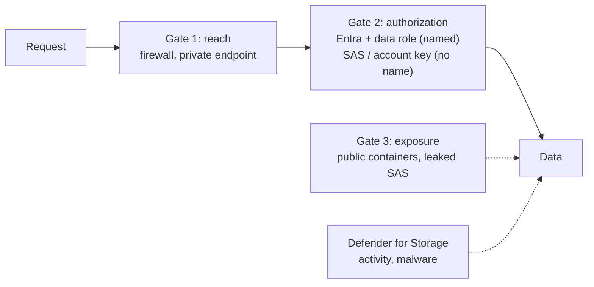
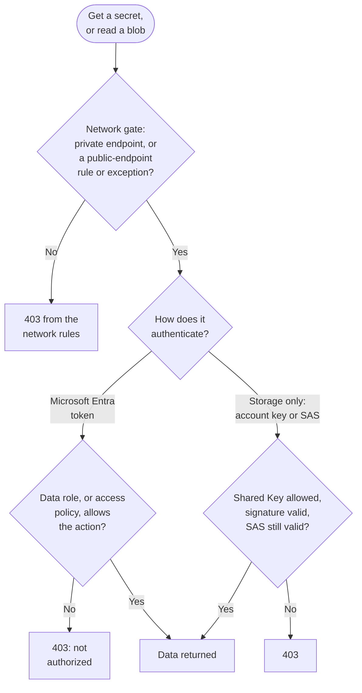

# Storage Account Security

> **Objective:** Implement security for storage accounts
> **Domain:** Secure storage, databases, and networking (25-30%)

## Sub-objectives covered

- Implement and configure security for storage accounts
- Configure Azure Storage firewall rules
- Implement Defender for Storage threat protection configurations
- Manage access to storage, including access policies

## The security problem

Everything in Domain 1 protected a *path* to data. This is the data.

A storage account is unusual among Azure services in one specific way, and that
peculiarity generates most of this objective: **it accepts four completely different
kinds of authorization at once, and three of them are bearer credentials with no
identity attached.**

| | Who is asking? | Can you revoke it for one person? | Expires? |
| --- | --- | --- | --- |
| Anonymous public access | nobody knows | no | no |
| Shared Key (account key) | nobody knows | only by rotating the key, which breaks everyone | no |
| SAS token | nobody knows, unless it is a user delegation SAS | depends entirely on how it was made | if you set one |
| Microsoft Entra ID + RBAC | a named principal | yes | token lifetime |

Read the first column. Three of four rows say *nobody knows*. That is why storage
incidents are hard to investigate and why "who read this container" is so often
unanswerable: the request was authorized, the log has no principal, and the
credential may have been generated eighteen months ago by someone who has since
left.

So the security model has three independent gates, and an attacker needs only one to
fail:

1. **Can you reach it?** - the firewall and private endpoints
2. **Are you allowed?** - which of those four authorization systems is even enabled
3. **Is it already exposed?** - public containers, live SAS tokens, keys in code

Defender for Storage sits behind all three and watches what happens anyway.

## In plain English

A storage account holds files, backups, exports and logs - often exactly what an
attacker wants. Unlike most Azure services, it can be opened in **four different ways**:
with an Entra identity and a role, with the account's master key, with a signed link
(a SAS), or - if allowed - with no credentials at all.

Securing storage means three things. Limit **who can reach it** on the network. Turn off
the **ways in you do not need**, especially the master key, so that every request is
tied to a named identity. And switch on **Defender for Storage** to spot unusual access
and malware in uploads.

## Words you need to know

- **Shared Key (account key)** - one of two master keys with full data access, no
  identity and no expiry.
- **Shared access signature (SAS)** - a signed URL granting limited access for a time.
  **Account SAS** and **service SAS** are signed with the account key; a **user
  delegation SAS** is signed with an Entra-issued key and limited to that user's own
  rights.
- **Stored access policy** - a named policy on a container that a service SAS can
  reference, so the SAS can be revoked by changing the policy.
- **`AllowSharedKeyAccess`** - the setting that turns account-key authorization (and
  every SAS signed with it) on or off.
- **Anonymous (public) access** - reading blobs with no credentials.
- **Storage data roles** - such as Storage Blob Data Reader; separate from Owner and
  Contributor on the account.
- **Storage firewall** - network rules on the account's public endpoint: virtual network
  rules, IP rules, resource instance rules and the trusted services exception.
- **Resource instance rule** - lets one named Azure resource through the firewall.
- **Defender for Storage** - a Defender for Cloud plan for storage threat detection, with
  malware scanning as an add-on.

## Mental model

A teaching model: three gates, and an attacker needs only one to fail.

Disabling shared key removes most of Gate 2's anonymous doors in one switch.

## How it works under the hood

### The four authorization systems

**Shared Key.** Every account is created with two 512-bit keys. A key is not a
credential *for* anything - it is full control of the entire data plane, with no
scoping, no expiry, and no identity. Rotation is the only revocation, and it breaks
every consumer simultaneously.

The compounding problem: **Contributor on the account can list the keys.** Control
plane and data plane are supposed to be separate, and here `listKeys` is a control
plane operation that hands over the data plane. This is the exact shape of the Key
Vault access-policy trap in [01-02](../01-identity-access-governance/01-02-key-vault-secrets-and-keys.md),
and it has the same fix.

**Shared access signatures.** Three kinds, and the differences are heavily tested:

| SAS type | Signed with | Scope | Revoke by |
| --- | --- | --- | --- |
| **Account SAS** | account key | account-level operations across services | rotating the key |
| **Service SAS** | account key | one service, one resource | rotating the key - *or* changing its stored access policy |
| **User delegation SAS** | a key Entra issues on behalf of a principal | Blob only; cannot exceed the principal's own RBAC | revoking the delegation key; max 7-day life |

The user delegation SAS is the only one of the three that has a principal behind it,
cannot grant more than that principal already had, and can be revoked without
detonating every other consumer. When a question describes a SAS that must be
attributable or narrowly revocable, that is the answer.

**Stored access policies** are the revocation mechanism for service SAS. The policy
lives on the container (or share, queue, or table), holds the permissions and expiry,
and the SAS references it by name. Change or delete the policy and every SAS bound to
it dies immediately. You can have up to five per container. A SAS created *without* a
stored access policy carries its permissions inside the signed token, and the only way
to kill it early is to rotate the account key.

**Disabling shared key** (`AllowSharedKeyAccess = false`) is the decisive control.
The property is unset by default, and storage permits shared key when it is null or
true - so "not configured" means "enabled." Turning it off denies every request
authorized with the account key **including account SAS and service SAS**, because
both are signed with that key. What survives: Entra ID authorization, and user
delegation SAS. That single switch collapses the table above from four rows to two,
and it closes the `listKeys` path at the same time.

**Entra ID and RBAC.** Data-plane roles - Storage Blob Data Reader, Contributor,
Owner, and the equivalents for queues, tables, and files - are separate from the
control-plane roles. Owner and Contributor on the resource do **not** grant blob data
access by themselves. Conditions (ABAC) can narrow a data role further by blob path
or index tag, which is the least-privilege answer when a role scoped to a container
is still too broad.

### Network rules

Four rule types, evaluated against the account's **public endpoint**:

| Rule type | What it admits |
| --- | --- |
| **Virtual network rules** | Subnets with a storage service endpoint enabled - `Microsoft.Storage` for accounts in the same region, `Microsoft.Storage.Global` (cross-region) for any region. Up to 400 per account, from any subscription or tenant |
| **IP network rules** | Public IPv4 addresses and CIDR ranges. Private RFC 1918 ranges are not accepted |
| **Resource instance rules** | A named Azure resource and its managed identity |
| **Trusted service exception** | First-party services that operate outside your network boundary |

The default action starts as **Allow**; hardening means setting it to **Deny** and
adding back only what is needed. Anything unmatched gets 403 on the public endpoint,
across Blob, File, Queue, Table, and Data Lake.

Two preferences worth carrying into the exam:

- **Resource instance rules beat the trusted services exception.** The exception
  admits a whole class of first-party services; a resource instance rule admits one
  named resource. Smaller trust surface, same outcome.
- **A private endpoint is not a firewall rule.** It gives the account a private IP in
  your network and traffic to it does not traverse the public endpoint at all, so the
  firewall does not apply to it. The firewall and the private endpoint are solving
  different halves of the problem.

And the sentence people skip: **being on an allowed network does not authorize
anything.** A request from a permitted subnet still has to satisfy one of the four
authorization systems above. Network rules subtract; they never grant.

Storage accounts can also be associated with a **network security perimeter**, which
puts a boundary around the PaaS resource itself - the Domain 2 topic that 02-04
builds out.

Both gates, in the order a request meets them. Key Vault (01-02) works the same way,
without the Shared Key branch.

### Exposure settings that are not about access control

| Setting | What it does | Default |
| --- | --- | --- |
| `AllowBlobPublicAccess` | Account-level kill switch for anonymous container access. When false, container-level public settings have no effect | Disabled for accounts created in recent years - **verify, do not assume** |
| Secure transfer required | Rejects plain HTTP | Enabled |
| Minimum TLS version | Rejects older TLS negotiation | 1.2 |
| SAS expiration policy | Sets a maximum SAS lifetime. **Log** (default) records out-of-policy SAS; **Block** denies them | Not set |
| Blob soft delete / container soft delete | Retains deleted data for a retention window | Off |
| Versioning and point-in-time restore | Recovers overwritten data | Off |
| Immutability policies (WORM) | Time-based retention or legal hold; blocks modification and deletion | Off |
| Infrastructure encryption | A second layer of platform encryption beneath the default | Off, and can only be set at creation |
| Customer-managed keys | Encryption key held in Key Vault | Platform-managed by default |
| `allowedCopyScope` / cross-tenant replication | Restricts where data can be copied to | Permissive by default on older accounts |

The immutability policies are the storage analogue of the immutable vault in
[01-03](../01-identity-access-governance/01-03-governance-and-regulatory-compliance.md):
a locked time-based retention policy cannot be shortened or removed by anyone,
including an attacker with Owner.

### Defender for Storage

There are two plans and the distinction is exam material:

| | Classic | Current plan |
| --- | --- | --- |
| Pricing | per transaction | **per storage account per month** |
| Malware detection | hash reputation analysis | full malware scanning, as a configurable add-on |
| Sensitive data | limited | sensitive data threat detection |
| New features | none - development moved on | all of them |

The current plan's capabilities:

- **Activity monitoring.** Analyses control- and data-plane behaviour for unusual
  access patterns, exfiltration-shaped activity, and known-bad sources. Agentless -
  no diagnostic settings required for the core detections.
- **Detection of entities without identities.** Specifically targets suspicious
  activity arriving through over-permissive or misconfigured SAS tokens. This is the
  detection built for the gap described at the top of this module.
- **Malware scanning**, powered by Microsoft Defender Antivirus, scanning blobs on
  upload. It is an **add-on billed per gigabyte scanned**, with a **monthly cap per
  storage account** - default 10,000 GB. When the cap is reached, uploads stop being
  scanned until the next month, which is a detection gap you configured rather than
  one you were given.
- **Sensitive data threat detection.** An agentless Sensitive Data Discovery engine
  finds storage containing sensitive information, using Microsoft Purview sensitive
  information types. It generates **no new alert types** - it enriches existing alerts
  with classification context so that an alert on a container of customer records
  outranks the same alert on a container of build artifacts. Included in the plan at
  no extra cost.
- **Event-driven response.** Malware findings can be published through Azure Event
  Grid to a Function or Logic App, which is how you get automatic quarantine or
  deletion rather than an email.

Enablement is **agentless** and works at subscription level (covering existing and
future accounts, with named exclusions), at individual resource level, or at scale
through a built-in Azure Policy - which Microsoft recommends, and which is the
governance pattern from 01-03 applied to a workload protection plan.

## Why security cares

**Without the control**

1. A developer generates a year-long account SAS to share an export with a partner
2. The SAS is pasted into an email thread that is later forwarded widely
3. Anyone holding the link can read the container; the logs show valid requests with no
   identity behind them
4. The only way to stop it is to rotate the account key - which breaks every other
   application using that key

**With the control**

1. Shared key authorization is disabled, so account and service SAS stop working
2. Partners get a short-lived user delegation SAS, which cannot exceed the issuing
   user's rights and can be revoked on its own
3. The firewall denies by default and admits only the partner integration's network or
   resource
4. Defender for Storage alerts on suspicious SAS-based activity

**What it does not solve.** A legitimate identity with a data role can still misuse it,
and a private network path still needs authorization. Encryption at rest does not help
against an authorized request.

**Depends on.** Moving every application to Entra authorization before disabling shared
key, and choosing the firewall default action deliberately.

## Configuration surface

| Setting | Default | Set it to | Why |
| --- | --- | --- | --- |
| `AllowSharedKeyAccess` | unset, which means allowed | `false`, after moving clients to Entra | Kills shared key, account SAS, service SAS, and the `listKeys` path at once |
| `AllowBlobPublicAccess` | disabled on recent accounts | `false`, explicitly | Account-level switch overrides every container setting |
| Minimum TLS | 1.2 | 1.2 or higher | Explicit is auditable |
| Network default action | Allow | **Deny**, plus specific rules | Deny-by-default is the only version that scales |
| Trusted service exception | off | Prefer a resource instance rule | One named resource beats a whole service class |
| SAS expiration policy | not set | A lifetime you can defend, Log first, then Block | Log only records long-lived SAS; Block denies them (not service SAS bound to a stored access policy) |
| Blob soft delete | off | On, with a retention window | Ransomware and accidents look identical at 2am |
| Infrastructure encryption | off | On **at creation** if you need it | Cannot be added later |
| Defender for Storage | off | On, subscription scope in production | Per-account monthly billing; scope deliberately |
| Malware scanning cap | 10,000 GB per account per month | Match real upload volume | The cap is where scanning silently stops |

## Common failure modes

**Shared key disabled before clients were migrated.** Everything that used the key,
including any account or service SAS you forgot about, fails with 403 at once. Check
access patterns first; Microsoft's own guidance is to monitor before flipping it.

**Shared key left enabled because "we use RBAC."** Both work simultaneously. Leaving
it enabled means RBAC is an option rather than a requirement, and `listKeys` is
available to every Contributor.

**A SAS with no stored access policy, issued for a year.** Cannot be revoked except
by rotating the account key, which breaks everything else on the account. This is the
most common real-world storage finding there is.

**Firewall set to Deny and the portal stops working.** Your browser is a client on
the public endpoint like any other. The data blades fail while the configuration
blades keep working - control plane versus data plane again.

**Allowed network read as authorized.** Adding a subnet rule does not grant anyone
anything; the request still needs an authorization system to satisfy.

**Trusted services exception used where a resource instance rule would do.** Broad
standing exception, and nobody revisits it.

**Container set to public "temporarily."** With `AllowBlobPublicAccess = false` this
fails, which is the point; with it true, the container stays public until someone
finds it.

**Defender for Storage enabled at subscription scope in a lab.** Billed per account,
per month, for every account in the subscription.

**Malware scanning cap reached mid-month.** Uploads stop being scanned and nothing
about the storage account looks different. The gap is invisible unless you are
watching the plan's own telemetry.

**Classic plan still in place.** Per-transaction pricing, no malware scanning, and no
new capability will ever ship to it.

## Hands-on

See [02-01 lab](../../labs/02-storage-databases-networking/02-01-lab.md).

## Validate the security outcome

| Control | The outcome to prove | Evidence |
| --- | --- | --- |
| Shared key disabled | Account key, account SAS and service SAS no longer work | `AllowSharedKeyAccess` is `false`; a request using the account key returns 403 while an Entra-authorized request succeeds |
| Data roles | Only the intended identity can read data | Owner on the account alone cannot read blobs without a data role (once shared key is off); the app identity holds the narrowest data role |
| Firewall | Unlisted networks cannot reach data | Default action is **Deny**; a data request from an unlisted network returns 403 |
| Anonymous access | No container can be made public | `AllowBlobPublicAccess` is `false`; setting a container to public access fails |
| SAS revocation | A service SAS can be revoked on its own | Deleting or changing the stored access policy makes SAS tokens bound to it fail |
| Defender for Storage | Threat detection and malware scanning are on | The plan shows as **On** for the account or subscription, and a test upload of a harmless test file shows a scan result |

## How this is tested

| Phrase in the question | What it steers you to |
| --- | --- |
| "must be attributable to a user" | Entra ID authorization, or a user delegation SAS |
| "must be revocable without affecting other clients" | Service SAS bound to a stored access policy |
| "cannot exceed the user's own permissions" | User delegation SAS |
| "prevent all access using account keys" | `AllowSharedKeyAccess = false` |
| "Contributor must not be able to read blob data" | Disable shared key; data roles are separate |
| "only from this virtual network" | VNet rule with the service endpoint, or a private endpoint |
| "only this one Azure resource needs access" | Resource instance rule, not the trusted services exception |
| "scan uploaded files for malware" | Defender for Storage malware scanning add-on |
| "prioritise alerts involving customer data" | Sensitive data threat detection |
| "automatically quarantine a malicious upload" | Event Grid + Function or Logic App |
| "detect misuse of a SAS token" | Detection of entities without identities |
| "predictable cost regardless of transaction volume" | The current per-account plan, not classic |

**AZ-500 divergence.** Defender for Storage was re-platformed: the classic
per-transaction plan is legacy, malware scanning and sensitive data threat detection
exist only in the current plan, and pricing moved to per-account. Any material that
describes Defender for Storage purely as per-transaction anomaly detection predates
the change.

### What SC-500 expects you to do

- **Identify** which authorization systems an account accepts and which carry an
  identity.
- **Distinguish** account SAS, service SAS and user delegation SAS; network rules from
  authorization; the classic Defender for Storage plan from the current one.
- **Select** the revocation mechanism, firewall rule type or Defender capability that a
  scenario requires.
- **Implement** shared key disablement, firewall rules, stored access policies and
  Defender for Storage with malware scanning.
- **Evaluate** an account's exposure: public access, long-lived SAS, keys in use.

## Check yourself

1. A contractor has a SAS URL that still works six months after their engagement
   ended. Describe every way to revoke it, and explain which of those you would
   actually be able to use if the SAS had no stored access policy.
2. You disable shared key on an account. A colleague's application, which uses a
   service SAS generated last year, breaks. A second application using a user
   delegation SAS keeps working. Explain both outcomes with one mechanism.
3. A storage account has the firewall set to Deny with one subnet rule. A VM in that
   subnet with no role assignment and no key gets 403. Is the firewall working?
   Explain what each layer contributed.
4. Malware scanning is enabled with the default cap on an account that receives 40 TB
   of uploads a month. Describe what happens and when, and what the security team
   sees.
5. Your organisation wants Defender for Storage on every account, including ones not
   created yet, with two accounts excluded. What scope do you enable at, and what
   mechanism from 01-03 would you use to keep it that way?

## Teach it back

Explain to a colleague why "we use RBAC for storage" is not the same as "storage access
is always tied to an identity", and what single setting changes that.

A strong answer covers: shared key, account SAS and service SAS still work alongside
RBAC and carry no identity; Contributors can list the keys; setting
`AllowSharedKeyAccess` to false removes all key-signed access, leaving Entra
authorization and user delegation SAS.

## Key takeaways

- Storage accepts four authorization systems; three carry no identity.
- Disabling shared key removes the account key, account SAS and service SAS in one step.
- User delegation SAS is the attributable, narrowly revocable SAS.
- Network rules subtract reach; they never grant access.
- Owner and Contributor are not data roles - but Contributors can list keys while shared
  key is on.
- Defender for Storage adds activity monitoring, SAS-misuse detection and malware
  scanning (billed per GB, with a monthly cap).

## Sources

- Microsoft Learn - SC-500 skills measured: <https://learn.microsoft.com/en-us/credentials/certifications/resources/study-guides/sc-500>
- Security recommendations for Blob storage: <https://learn.microsoft.com/en-us/azure/storage/common/secure-storage>
- Configure Azure Storage firewalls and virtual networks: <https://learn.microsoft.com/azure/storage/common/storage-network-security>
- Prevent Shared Key authorization: <https://learn.microsoft.com/en-us/azure/storage/common/shared-key-authorization-prevent>
- Overview of Microsoft Defender for Storage: <https://learn.microsoft.com/en-us/azure/defender-for-cloud/defender-for-storage-introduction>
- Enable and configure the Defender for Storage plan: <https://learn.microsoft.com/azure/defender-for-cloud/tutorial-enable-storage-plan>
- Defender for Storage (classic): <https://learn.microsoft.com/en-us/azure/defender-for-cloud/defender-for-storage-classic>
