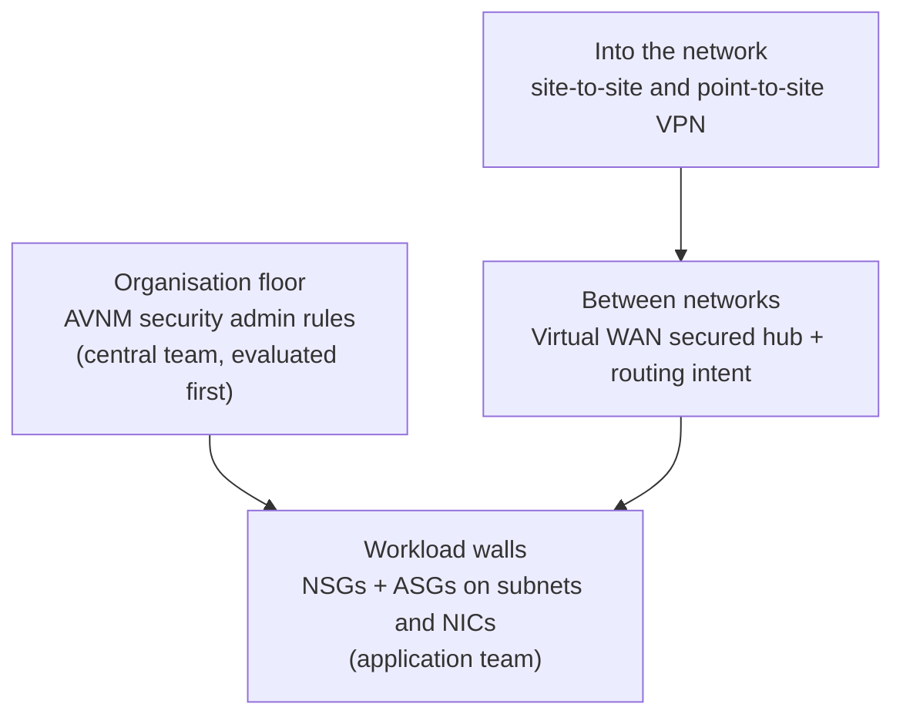
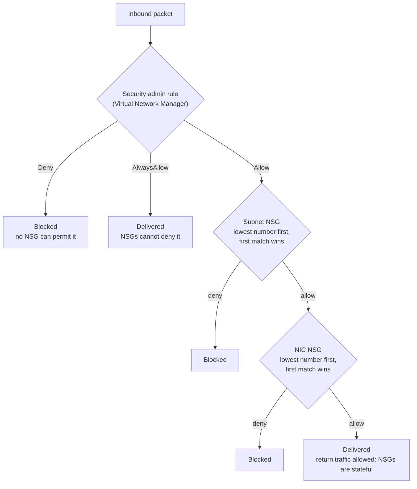
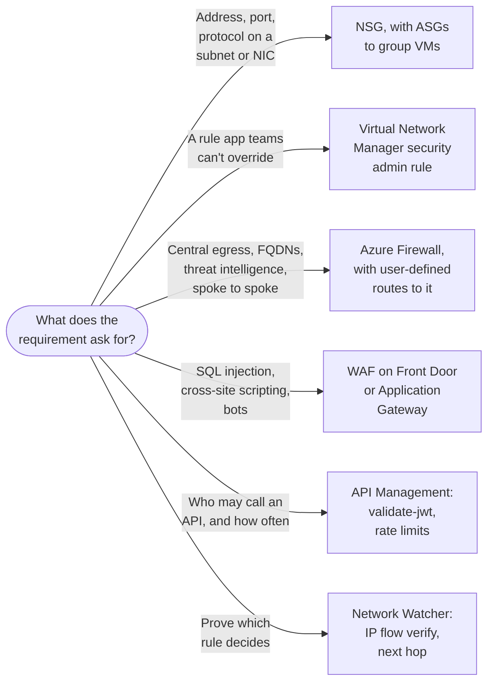

# Network Segmentation and Connectivity

> **Objective:** Implement security for Azure network services
> **Domain:** Secure storage, databases, and networking (25-30%)

## Sub-objectives covered

- Implement and manage network security groups (NSGs) and application security groups (ASGs)
- Implement and configure network access policies by using Azure Virtual Network Manager
- Configure security for an Azure Virtual WAN
- Implement and configure security for virtual private network (VPN) connections

> This objective is split across two modules. **02-03** covers segmentation and
> connectivity - what may talk to what, and how remote networks join. **02-04** covers
> the perimeter - private endpoints, Azure Firewall, Entra Private Access, and
> Network Watcher diagnostics.

## The security problem

Identity decides *whether* a request is allowed. The network decides *how far an
intruder gets once one host is already theirs.*

That second sentence is the entire justification for segmentation, and it is worth
being precise about, because "zero trust means the network doesn't matter" is a
common misreading. The network still matters - not as the thing that authenticates,
but as the thing that bounds blast radius. A compromised web server that can reach
only its own database is an incident. The same server able to reach every subnet is a
breach.

Azure's defaults push toward the second outcome. **Inside a virtual network,
everything can reach everything by default.** The platform ships a default rule
allowing all traffic within the VNet, and unless you put something in the way, a
workload in subnet A can open a socket to a workload in subnet D. Nobody decided
that; it is simply what "no configuration" means.

So the four bullets are four answers at four scales:

| Scale | Mechanism | Who owns it |
| --- | --- | --- |
| One NIC or subnet | NSG, with ASGs as the grouping abstraction | The application team |
| Every VNet in an organisation | Virtual Network Manager security admin rules | The central network team |
| A global WAN of hubs and branches | Virtual WAN with a secured hub | The network architecture team |
| Networks that are not in Azure at all | VPN gateways | Both |

And note the governance shape of the second row: it exists because the first row is
owned by people who can turn it off.

## In plain English

Identity decides whether a request is allowed. The network decides **how far an
attacker can move once they control one machine**. By default, everything inside an
Azure virtual network can talk to everything else - so one compromised server can reach
every other server.

This lesson is about drawing walls inside and around your networks. **NSGs** are rule
lists on subnets and network cards. **Application security groups** let those rules
name groups of servers ("web servers") instead of addresses. **Azure Virtual Network
Manager** lets a central team set rules that application teams cannot override.
**Virtual WAN** connects many sites and networks through managed hubs that can inspect
traffic. **VPNs** connect offices and remote users securely.

## Words you need to know

- **Network security group (NSG)** - an ordered list of allow/deny rules on address, port
  and protocol, attached to a subnet or a network interface (0A-07).
- **Stateful** - return traffic for an allowed connection is allowed automatically.
- **Service tag** - a Microsoft-maintained name for a set of Azure IP ranges, such as
  `Storage` or `Internet`.
- **Application security group (ASG)** - a named group of network interfaces that NSG
  rules can reference.
- **Effective security rules** - the combined result of every NSG that applies to a
  network interface.
- **Virtual network flow logs** - records of traffic flows through a virtual network; the
  replacement for NSG flow logs.
- **Azure Virtual Network Manager (AVNM)** - central management of many virtual networks,
  including **security admin rules** evaluated before NSGs.
- **Network group** - the set of virtual networks a configuration applies to; membership
  can be static or dynamic through Azure Policy.
- **Virtual WAN / virtual hub** - Microsoft-managed hubs connecting virtual networks,
  branches and users. A **secured hub** includes a firewall.
- **Routing intent** - a hub setting that sends private or internet traffic through the
  hub's firewall for inspection.
- **Site-to-site / point-to-site VPN** - an encrypted tunnel for a whole network, or for
  one device (0A-08).

## Mental model

A teaching model: four scales of the same idea - limit what can reach what.

## How it works under the hood

### NSGs: stateful, prioritised, and evaluated twice

An NSG is an ordered list of allow/deny rules matched on a five-tuple - source,
source port, destination, destination port, protocol - with a priority from 100 to
4096. Lowest number wins, and **evaluation stops at the first match.**

NSGs are **stateful**: allow an inbound flow and the response is permitted
automatically. You do not write a matching outbound rule, and a question that implies
you do is testing this.

Every NSG carries default rules you cannot delete, only override with a
lower-numbered rule:

| Direction | Default rules, in order |
| --- | --- |
| Inbound | Allow VNet inbound → Allow Azure Load Balancer inbound → **Deny all inbound** |
| Outbound | Allow VNet outbound → Allow internet outbound → **Deny all outbound** |

Two defaults do most of the damage in practice. *Allow VNet inbound* is the flat
network described above. *Allow internet outbound* means any compromised host can
reach a command-and-control endpoint unless you say otherwise.

An NSG can be associated with a **subnet**, a **NIC**, or both - and if both, **both
are evaluated**:

- **Inbound**: subnet NSG first, then NIC NSG. Traffic must pass both.
- **Outbound**: NIC NSG first, then subnet NSG. Traffic must pass both.

This is why `Get-AzEffectiveNetworkSecurityGroup` exists and why reading one NSG in
the portal is not the same as knowing what a NIC allows.

**Service tags** replace maintaining IP lists for Azure services - `Storage`,
`Sql`, `AzureActiveDirectory`, `Internet`, `VirtualNetwork`, and regional variants
like `Storage.CanadaCentral`. Microsoft maintains the addresses behind them.

**Application security groups** let you write rules against a *logical group of NICs*
rather than an address range. Put every web server NIC in `asg-web` and every database
NIC in `asg-db`, then write one rule: from `asg-web` to `asg-db` on 1433, deny
everything else. Machines can be added or re-addressed without touching a rule. Both
ASGs in a rule must be in the same virtual network.

**Flow logs - read this before you plan anything.** NSG flow logs are being retired on
**30 September 2027**, and **you have not been able to create new ones since 30 June
2025**. After retirement, traffic analytics on NSG flow logs stops working and
existing NSG flow log resources are deleted, though records already written to storage
remain under their retention policy. **Virtual network flow logs** are the
replacement, they are enabled at the virtual network level, and they are also the only
place where traffic allowed or denied by Virtual Network Manager security admin rules
is visible. Any guide that opens with "create an NSG flow log" is describing an
operation the platform will refuse.

### Azure Virtual Network Manager

The problem AVNM solves is organisational, not technical: NSGs are owned by the teams
whose workloads they constrain, so a central security requirement expressed as an NSG
rule lasts until someone needs it gone at 2am.

The building blocks:

- **Scope** - a management group or subscription. The manager can only act on virtual
  networks inside its scope.
- **Network groups** - collections of virtual networks, defined **statically** by hand
  or **dynamically** through Azure Policy, so a VNet joins the group automatically
  when it matches a condition. The dynamic option is the governance pattern from
  [01-03](../01-identity-access-governance/01-03-governance-and-regulatory-compliance.md)
  applied to network membership.
- **Connectivity configurations** - hub-and-spoke or mesh. A mesh is regional by
  default and can be made global; using a Virtual WAN hub as the hub of an AVNM
  hub-and-spoke configuration is in preview.
- **Security configurations** containing **rule collections** of **security admin
  rules**.
- **Deployment** - nothing takes effect until you deploy the configuration to specific
  regions. A saved configuration that was never deployed is the classic
  "why isn't my rule working" answer.

**Security admin rules have three actions, and the third is the interesting one:**

| Action | Effect |
| --- | --- |
| `Allow` | Permit, and let NSGs evaluate afterwards - an NSG can still deny it |
| `AlwaysAllow` | Permit, and **stop evaluation** - NSGs cannot deny it |
| `Deny` | Block, and stop evaluation - **no NSG can permit it** |

**Security admin rules are evaluated before NSGs.** That ordering is the whole point:
a central team writes `Deny` on SSH and RDP from the internet across every VNet in the
organisation, and no application team can override it with an NSG rule, because the
NSG never gets to run. `AlwaysAllow` is the escape hatch for traffic that must survive
a local team's over-broad deny - health probes, management traffic.

Inbound traffic to a VM, end to end. Every decision is one stated above: security admin
rules first, then the subnet NSG, then the NIC NSG, first match wins within each NSG.

Outbound runs the NSGs in the opposite order - NIC first, then subnet - and still must
pass both.

Three constraints worth memorising: rules apply at the **virtual network** level (NSGs
apply at subnet and NIC level); you can have only **one active security admin
configuration per region** per network manager - if you need more, add more rule
collections inside that one configuration rather than more configurations; and some
subnets are **exempt** from security admin rules, including the Azure Firewall, Azure
Bastion, VPN and ExpressRoute gateway, Application Gateway, Route Server and Virtual WAN
subnets. Security admin rules use priorities from 1 to 4096 and apply with eventual
consistency, so newly created resources take a short time to pick them up.

### Virtual WAN security

Virtual WAN is a managed hub-and-spoke backbone: you create a **virtual WAN**, one or
more **virtual hubs** (one per region), and connect virtual networks, VPN branches,
ExpressRoute circuits, and remote users to them. Microsoft manages the routing between
them.

A **secured virtual hub** is a hub with a security solution deployed inside it -
Azure Firewall, a firewall network virtual appliance, or a SaaS firewall - managed
through **Azure Firewall Manager**.

**Routing intent and routing policies** are how you express what gets inspected,
declaratively, instead of hand-maintaining route tables:

- A **private routing policy** sends traffic between virtual networks, branches, and
  ExpressRoute through the hub's security solution. Note that a secured hub advertises
  the RFC 1918 ranges by default, which is the source of a good deal of surprise
  routing.
- An **internet routing policy** sends internet-bound traffic through the security
  solution and then straight out to the internet.

Where internet traffic goes after inspection is one of two modes, and they are
configured differently:

| Mode | How it is configured | Where internet traffic goes after inspection |
| --- | --- | --- |
| **Direct Access** | An **internet** routing policy (a private policy is optional) | Straight out to the internet |
| **Forced Tunnel** | A **private** routing policy, `0.0.0.0/0` added to its **additional prefixes**, and **no** internet routing policy | Via the `0.0.0.0/0` route the hub learns from on-premises, an NVA, or a static route on a virtual network connection |

An internet routing policy always means Direct Access: the portal will not add one to
a hub that is in Forced Tunnel mode. In Forced Tunnel mode with no `0.0.0.0/0` route
learnt, internet traffic never reaches on-premises - Azure Firewall with no public IP
drops it, and Azure Firewall with a public IP sends it out through that address.

Routing intent also covers hub-to-hub and branch-to-branch inspection, which is what
makes "traffic between two on-premises sites must be inspected" a configuration rather
than a project.

### VPN connections

Two shapes, and the exam tests the authentication options far more than the tunnels.

**Site-to-site** joins a whole remote network over IPsec/IKE. The security surface is
the **IPsec/IKE policy**: by default Azure negotiates from a list of supported
combinations, and you can pin a **custom policy** specifying exact encryption,
integrity, DH group, PFS group, SA lifetimes, and force IKEv2. A question that says
"must use AES-256 and PFS group 14" is asking for a custom IPsec/IKE policy. The
tunnel itself authenticates with a pre-shared key or, for some configurations,
certificates.

**Point-to-site** connects individual devices. Here the choices matter more:

| Tunnel type | Authentication supported |
| --- | --- |
| **OpenVPN** | Certificate, RADIUS, **Microsoft Entra ID** |
| **IKEv2** | Certificate, RADIUS |
| **SSTP** (Windows only) | Certificate, RADIUS |

**Microsoft Entra ID authentication for point-to-site requires the OpenVPN tunnel
type.** That single dependency is a reliable exam question, and it is also the only
configuration that brings a VPN connection under Conditional Access - which is the
link back to 01-01 and the reason to prefer it.

Other properties worth knowing: gateway **SKU** determines throughput, tunnel count,
and whether zone redundancy and active-active are available; **active-active** gives
two gateway instances with two public IPs for resilience; **forced tunnelling**
redirects all internet-bound traffic from the VNet back through on-premises. Virtual
WAN has its own VPN gateways, configured through the hub rather than as standalone
resources.

## Why security cares

**Without the control**

1. A web server is compromised through an application vulnerability
2. The virtual network is flat: the default rule lets every subnet reach every other
3. The attacker scans and reaches the database and management servers directly
4. One compromised host becomes a whole-environment breach

**With the control**

1. A security admin rule denies inbound RDP and SSH from the internet across every
   virtual network, and no local NSG can re-open it
2. NSGs with ASGs allow only web → database on the database port, and deny the rest
3. The compromised web server can reach the database port and nothing else
4. Virtual network flow logs record the attempted connections for investigation

**What it does not solve.** Segmentation limits movement; it does not stop an attacker
using the connections that are allowed (web → database). Database authentication and
monitoring still matter.

**Depends on.** NSGs actually being associated, security admin configurations actually
being deployed to each region, and flow logging being enabled before you need it.

## Configuration surface

| Control | Default | Set it to | Why |
| --- | --- | --- | --- |
| NSG on a subnet | none | One per subnet, deny-by-default beyond what is needed | "No NSG" means the VNet default: everything talks to everything |
| Allow internet outbound | allowed by default | Restrict to what the workload needs | Otherwise every compromised host has an egress path |
| ASGs | none | Group NICs by role, write rules against the group | Rules stop depending on addressing |
| NSG associations | none | Subnet, or subnet plus NIC deliberately | Both are evaluated; effective rules are what matter |
| Flow logging | none | **Virtual network flow logs** | NSG flow logs cannot be created and are being retired |
| AVNM network group membership | static | Dynamic via Azure Policy | New VNets inherit policy without anyone remembering |
| Security admin rule action | - | `Deny` for the organisational floor, `AlwaysAllow` sparingly | `Allow` still lets an NSG deny it |
| Security admin configuration | not deployed | **Deployed** to each region in use | Saving is not deploying |
| Virtual WAN hub | unsecured | Secured hub with routing intent | Otherwise the hub routes without inspecting |
| Internet egress mode | - | Direct Access (internet routing policy) unless egress must go through on-premises | Forced Tunnel is a private policy plus `0.0.0.0/0`, never an internet policy; with no learnt default route, egress fails or skips on-premises |
| P2S tunnel type | - | OpenVPN, if you want Entra authentication | Entra ID authentication requires it |
| IPsec/IKE policy | negotiated defaults | Custom policy where a standard demands it | Defaults accept weaker combinations than some policies allow |

## Common failure modes

**NSG written, not associated.** It exists, it has perfect rules, and it is attached
to nothing.

**Reading one NSG instead of the effective rules.** With NSGs on both the subnet and
the NIC, traffic must pass both, in different orders per direction. Use effective
security rules and IP flow verify; do not reason from one rule list.

**Outbound rules written for inbound flows.** NSGs are stateful. Adding a matching
outbound rule for return traffic is a symptom that someone is reasoning from a
traditional firewall model.

**Deny rule at priority 4000 below an allow at 300.** First match wins and the allow
was first. Priority confusion is the single most common NSG error.

**ASG rule failing across virtual networks.** Both ASGs in a rule must belong to the
same virtual network.

**Planning around NSG flow logs.** They cannot be created any more. Build on virtual
network flow logs.

**AVNM configuration saved but never deployed.** No enforcement, no error, no clue in
the rule view.

**Security admin `Allow` used where `AlwaysAllow` was meant.** A local NSG can still
deny the traffic, so the central guarantee does not hold.

**Second security admin configuration created for a region.** Only one is permitted;
use extra rule collections instead.

**Building Forced Tunnel with an internet routing policy.** An internet policy always
means Direct Access. Forced Tunnel is a private routing policy with `0.0.0.0/0` in
additional prefixes, and no internet policy.

**Forced Tunnel with no `0.0.0.0/0` route learnt.** Internet traffic never reaches
on-premises: a firewall with no public IP drops it, one with a public IP sends it
straight out. Nothing about the routing intent configuration looks wrong.

**Entra authentication attempted on an IKEv2 point-to-site gateway.** Not supported;
OpenVPN is required.

**A VPN gateway left running after a lab.** It bills hourly from the moment
provisioning finishes, independent of traffic, and it takes long enough to deploy that
people leave it up "for next time."

## Hands-on

See [02-03 lab](../../labs/02-storage-databases-networking/02-03-lab.md).

## Validate the security outcome

| Control | The outcome to prove | Evidence |
| --- | --- | --- |
| NSG / ASG | Only intended flows are allowed | **Effective security rules** on the NIC show the combined result; **IP flow verify** reports allow or deny, and which rule decided, for a specific flow |
| Security admin rule | The organisational floor cannot be overridden | The configuration shows as deployed to the region; an NSG rule allowing the blocked traffic has no effect |
| Dynamic network groups | New virtual networks inherit the rules | A newly created virtual network that matches the policy condition appears as a group member |
| Flow logging | Traffic decisions are recorded | Virtual network flow logs exist for the network and records appear in storage or traffic analytics |
| Virtual WAN routing intent | Traffic between networks is inspected | Effective routes on the hub point private (and, if configured, internet) traffic to the hub firewall; firewall logs show the flows |
| Point-to-site VPN | Users are subject to Conditional Access | The gateway uses OpenVPN with Microsoft Entra ID authentication; VPN sign-ins appear in Entra sign-in logs |

## How this is tested

| Phrase in the question | What it steers you to |
| --- | --- |
| "group of servers, addresses change" | Application security group |
| "traffic to Azure Storage without an IP list" | Service tag |
| "application team must not be able to override" | AVNM security admin rule, `Deny` |
| "must be permitted regardless of local NSGs" | `AlwaysAllow` |
| "apply to all current and future virtual networks" | Network group with dynamic membership via Azure Policy |
| "rule is configured but has no effect" | The configuration was never deployed |
| "inspect traffic between two branches" | Virtual WAN routing intent, private routing policy |
| "internet traffic must exit through on-premises" | Forced Tunnel: private routing policy, `0.0.0.0/0` in additional prefixes, no internet policy |
| "VPN users must satisfy Conditional Access" | Point-to-site, OpenVPN, Entra ID authentication |
| "must use a specific cipher and DH group" | Custom IPsec/IKE policy |
| "log every allowed and denied flow" | Virtual network flow logs |

**AZ-500 divergence.** Two things have moved. NSG flow logs are retired-in-progress
and can no longer be created, so every AZ-500-era flow logging walkthrough is dead on
arrival; virtual network flow logs replace them. And Azure Virtual Network Manager has
gone from a curiosity to a first-class exam topic, with security admin rules GA and
explicitly evaluated ahead of NSGs - there is no AZ-500 equivalent of that control.

### Choosing a network control

A requirement usually names the layer it cares about. Match its words to the control
that works at that layer. Azure Firewall and Network Watcher are covered in 02-04; WAF
and API Management in 03-06.

### What SC-500 expects you to do

- **Identify** the scale a requirement belongs to: one workload, the whole organisation,
  between networks, or into the network.
- **Distinguish** NSG rules from security admin rules (and `Allow` from `AlwaysAllow`),
  NSG flow logs from virtual network flow logs, and the point-to-site tunnel types.
- **Select** ASGs, service tags, routing intent modes or VPN authentication methods for a
  scenario.
- **Implement** NSGs and ASGs, AVNM security configurations with dynamic groups, secured
  Virtual WAN hubs and VPN security settings.
- **Evaluate** why traffic is allowed or blocked, using effective rules and IP flow verify.

## Check yourself

1. A NIC has an NSG allowing 443 inbound at priority 200 and denying 443 inbound at
   priority 150. The subnet NSG allows 443 at priority 100. Does traffic on 443 reach
   the VM? Walk the evaluation.
2. A central team deploys a security admin rule with action `Allow` for 443 and
   expects it to guarantee availability of a web tier. An application team's NSG
   blocks 443 anyway. Explain, and give the one-word fix.
3. Your organisation wants every virtual network created next year to inherit a deny
   on inbound RDP, with no per-VNet work. Describe the mechanism end to end, including
   the step people forget.
4. You configure a secured hub for Forced Tunnel: a private routing policy with
   `0.0.0.0/0` in additional prefixes. Its Azure Firewall has no public IP. All
   internet access from the spokes stops. Give the most likely cause and how you would
   confirm it.
5. A requirement says VPN users must be subject to Conditional Access and MFA. State
   the tunnel type, the authentication method, and why the other two tunnel types
   cannot satisfy it.

## Teach it back

Explain to an application team why the central security team's "deny inbound RDP from
the internet" rule still blocks RDP even though their NSG has an allow rule at priority
100.

A strong answer covers: security admin rules in Virtual Network Manager are evaluated
before NSGs; a `Deny` security admin rule stops evaluation, so the NSG never runs; only
the central team can change it; `AlwaysAllow` is the opposite guarantee.

## Key takeaways

- By default, everything in a virtual network can reach everything else. Segmentation
  limits blast radius.
- NSGs: lowest priority number wins, first match stops, stateful, and subnet + NIC must
  both allow.
- ASGs let rules follow roles instead of addresses.
- AVNM security admin rules are evaluated before NSGs; `Deny` and `AlwaysAllow` cannot be
  overridden locally - and nothing applies until the configuration is deployed.
- NSG flow logs can no longer be created; use virtual network flow logs.
- Entra ID authentication for point-to-site VPN requires OpenVPN.

## Sources

- Microsoft Learn - SC-500 skills measured: <https://learn.microsoft.com/en-us/credentials/certifications/resources/study-guides/sc-500>
- Security admin rules in Azure Virtual Network Manager: <https://learn.microsoft.com/azure/virtual-network-manager/concept-security-admins>
- Connectivity configurations in Azure Virtual Network Manager: <https://learn.microsoft.com/azure/virtual-network-manager/concept-connectivity-configuration>
- Network security groups overview: <https://learn.microsoft.com/azure/virtual-network/network-security-groups-overview>
- NSG flow logs (retirement notice): <https://learn.microsoft.com/azure/network-watcher/nsg-flow-logging>
- Migrate from NSG flow logs to virtual network flow logs: <https://learn.microsoft.com/azure/network-watcher/nsg-flow-logs-migrate>
- Securing internet access with Virtual WAN routing intent: <https://learn.microsoft.com/azure/virtual-wan/about-internet-routing>
