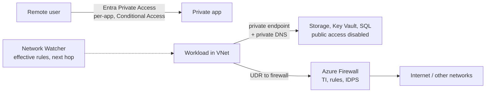
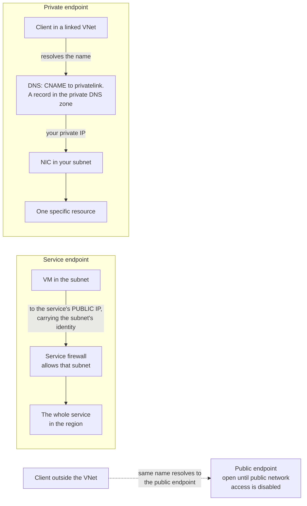
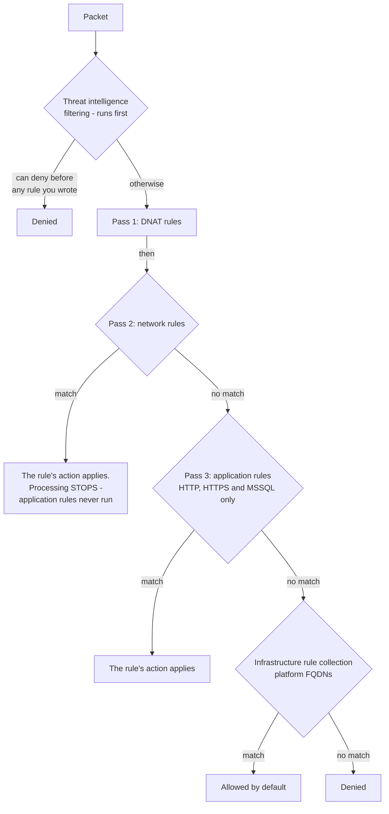
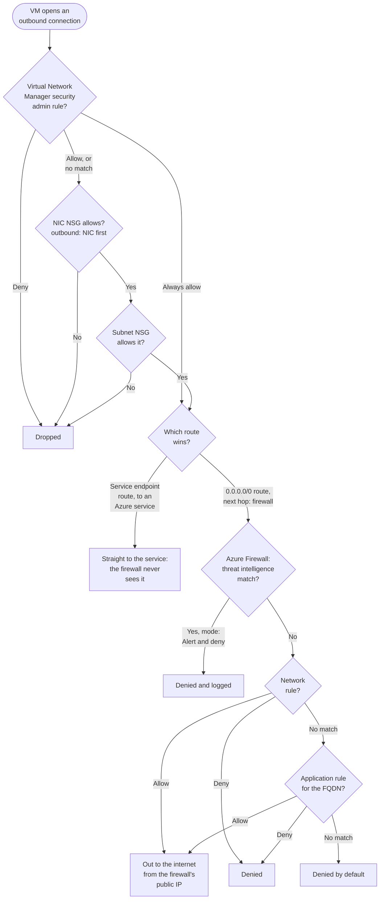
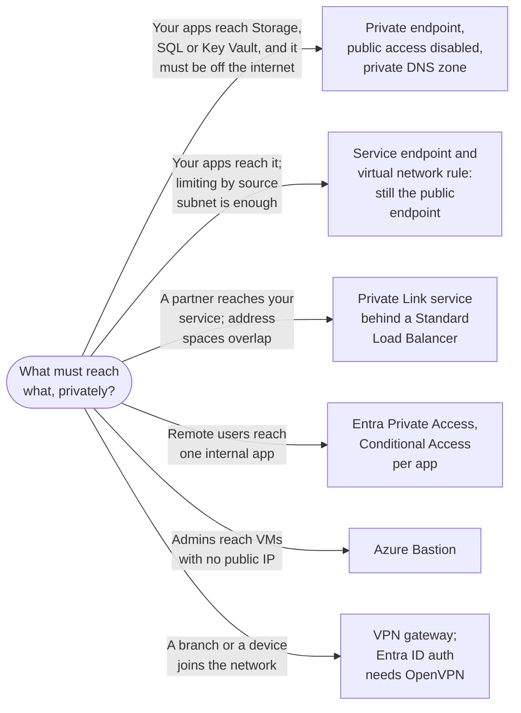

# Private Access and Network Perimeter

> **Objective:** Implement security for Azure network services
> **Domain:** Secure storage, databases, and networking (25-30%)

## Sub-objectives covered

- Implement and configure Microsoft Entra Private Access
- Configure Azure private endpoints to secure access to Azure platform as a service (PaaS) resources
- Configure Azure Private Link services to secure access to network resources
- Implement and configure Azure Firewall
- Evaluate effective security rules by using Azure Network Watcher diagnostics

> **Licensing gap, stated plainly.** Microsoft Entra Private Access is part of Global
> Secure Access. It needs a Microsoft Entra Private Access licence (standalone) or the
> Microsoft Entra Suite - which Microsoft 365 E7 includes - on top of Entra ID P1 or P2.
> **Microsoft 365 E5 does not include it.** If your tenant has no trial available, that
> bullet is study-and-walkthrough only, and the lab marks it as such rather than
> pretending otherwise.

## The security problem

[02-03](./02-03-network-segmentation-and-connectivity.md) decided what may talk to
what *inside* your networks. Two problems are left over, and they point in opposite
directions.

**Your PaaS services are not in your network.** A storage account, a key vault, a SQL
server - none of them live in a virtual network. They live on the public internet with
a public DNS name, and everything you did in 02-01 and 02-02 was building fences
around a door that faces the street. Private Link moves the door inside.

**Your users are not in your network either.** The remote worker, the branch office,
the contractor. The traditional answer was a VPN, which grants network-level access to
a whole subnet and then hopes. Microsoft Entra Private Access replaces that with
per-application access that runs through the identity control plane from Domain 1.

Whatever is left - the traffic that genuinely must cross a boundary - gets inspected.
That is Azure Firewall. And because every one of these controls is a rule someone
wrote about something they could not see, Network Watcher exists to tell you what the
rules actually do rather than what they were meant to do.

## In plain English

Azure platform services - storage, key vaults, databases - start life on the public
internet. Your users increasingly work from anywhere. This lesson deals with both.

**Private endpoints** give a platform service a private address inside your network,
so it can be reached privately and its public door can be closed. **Private Link
service** does the reverse: it lets *you* publish your own application privately to
partners. **Azure Firewall** inspects the traffic that genuinely has to cross a
boundary. **Microsoft Entra Private Access** replaces the traditional VPN with
per-application access governed by Conditional Access. And **Network Watcher** tells
you what all those rules actually do, rather than what you meant them to do.

## Words you need to know

- **Private endpoint** - a network interface with a private IP in your subnet, connected
  to one specific resource through Azure Private Link (0A-08).
- **Private DNS zone** - makes the service's name resolve to the private IP for linked
  virtual networks.
- **Public network access** - the resource setting that decides whether its public
  endpoint accepts traffic at all.
- **Private Link service** - your own service, behind a Standard Load Balancer, published
  for others to reach through their private endpoints.
- **Azure Firewall** - a managed, stateful firewall; **Basic**, **Standard** and
  **Premium** tiers.
- **Firewall Policy** - the configuration object holding rule collection groups,
  collections and rules; policies can inherit from a parent.
- **DNAT / network / application rules** - inbound address translation, address-and-port
  rules, and FQDN-based rules for HTTP, HTTPS and MSSQL.
- **Threat intelligence filtering** - alerts on, or denies, traffic to and from known
  malicious addresses and domains.
- **IDPS / TLS inspection** - Premium features: signature-based intrusion detection and
  prevention, and decrypting HTTPS to inspect it.
- **Microsoft Entra Private Access** - Zero Trust network access to private apps through
  Global Secure Access, with **Quick Access** (broad, transitional) and **per-app
  access**.
- **Network Watcher** - diagnostics such as **effective security rules**, **IP flow
  verify**, **next hop** and **connection troubleshoot**.

## Mental model

A teaching model: three directions of travel, three controls - and one tool to check
them.

## How it works under the hood

### Service endpoints versus private endpoints

Both restrict PaaS access to a virtual network. They are not the same mechanism and
the exam tests the difference.

| | Service endpoint | Private endpoint |
| --- | --- | --- |
| What it is | A route: traffic to the service leaves your VNet with its VNet source identity | A **network interface in your subnet** with a private IP from your range |
| The service's address | Still its public IP | Your private IP |
| Reachable from on-premises over VPN/ExpressRoute | No | **Yes** |
| Granularity | The whole service in a region | **One specific resource instance** |
| Cost | Free | Hourly, plus data |
| Guards against exfiltration to *someone else's* storage account | No | Yes, in combination with policy |

The private endpoint's decisive property is the last two rows: it points at **one
named resource**, so a rule that permits `storage` does not implicitly permit every
storage account in Azure.

**Three things about private endpoints that catch people:**

1. **Creating a private endpoint does not close the public door.** The service's public
   endpoint stays reachable until you separately set that service's firewall to deny -
   the `publicNetworkAccess` and network-rule settings from 02-01 and 02-02. A private
   endpoint plus an open public endpoint is a more expensive version of no change.
2. **DNS is the whole implementation.** Creating the endpoint updates the service's
   public DNS record to a CNAME pointing at a `privatelink.` subdomain, and a private
   DNS zone holds the A record mapping that name to your private IP. Link that zone to
   every virtual network that needs to resolve it. Get this wrong and clients resolve
   the public address and go out over the internet - a working connection that quietly
   defeats the control. **Resolving the name from outside the virtual network still
   returns the public endpoint**, by design.
3. **Private endpoint traffic can be inspected.** Put a user-defined route on the
   private endpoint subnet pointing at Azure Firewall. Microsoft's guidance is to use
   **application rules rather than network rules** for this, so flow symmetry is
   maintained with SNAT.

The two mechanisms side by side, with the DNS step that makes a private endpoint work
and the public endpoint that neither of them closes.

### Private Link service - the provider side

Private endpoints consume a service privately. **Private Link service** is how you
*publish* one: your own application behind a **Standard Load Balancer** becomes
available to other virtual networks - other subscriptions, other tenants - through
their own private endpoints, without peering, without exposed public IPs, and with no
address space overlap problem.

The mechanics worth knowing: the service gets an **alias**, which is what consumers
reference; consumer connections arrive as **connection requests you approve or
reject**; and NAT configuration on the service side means the provider does not need
routable access back to the consumer's network.

"Expose an internal application to a partner without peering or public IPs" is the
question shape that wants this answer.

### Azure Firewall

A managed, stateful, scaled-out network firewall with three SKUs:

| SKU | Adds |
| --- | --- |
| **Basic** | Small environments; threat intelligence in **alert mode only** |
| **Standard** | Full threat intelligence alert-and-deny, FQDN filtering, network and application rules |
| **Premium** | **TLS inspection**, **IDPS**, URL filtering, web categories |

**Firewall Policy** is the configuration object, and it is hierarchical: a child policy
inherits from a parent. Inside a policy are **rule collection groups**, each holding
**rule collections**, each holding **rules**. Priorities run 100 (highest) to 65,000.

**The processing order is the single most testable thing in this module**, and it is
not simply "by priority":

1. **Threat intelligence filtering runs first**, above everything. It can deny traffic
   before any rule you wrote is considered.
2. **DNAT rules**, then **network rules**, then **application rules** - *always*, in
   that order, **regardless of rule collection group priority or policy inheritance.*
3. Within each of those three passes: parent policy before child policy, then rule
   collection groups in priority order, then rule collections in priority order.
4. If no application rule matches, the built-in **infrastructure rule collection** is
   evaluated - platform FQDNs allowed by default.
5. If nothing matches, the packet is **denied**.

So the firewall iterates the whole policy three times, once per rule type. A network
rule at priority 65,000 in a low-priority child group still beats an application rule
at priority 100 in the parent, because type order outranks everything.

The same order as a flow. Every box restates one of the five steps above.

Within every pass: parent policy before child policy, then rule collection groups, then
rule collections, each in priority order (100 first). IDPS, on Premium, runs alongside
rule processing and is not part of this order.

Three consequences that produce real outages:

- **A network rule match stops processing.** If a network rule allows 443 to a
  destination, application rules never run for that flow - so your FQDN filtering is
  silently bypassed by an over-broad network rule. This is the most common Azure
  Firewall misconfiguration there is.
- **Application rules only apply to HTTP, HTTPS, and MSSQL**, and only when no network
  rule matched.
- **Matching is on names, not addresses.** For HTTP the firewall matches the **Host
  header**; for HTTPS it matches **SNI only** - unless TLS inspection is on, in which
  case it matches SNI, Host header, and the full URL. The firewall ignores the packet's
  destination IP and uses the address it resolved from the Host header itself; a
  mismatch between the TCP port and the port in the Host header drops the traffic.

**IDPS** (Premium) runs in **Alert** mode in parallel with rule processing, logging
signature matches, or in **Alert and deny** mode, blocking them. **TLS inspection**
(Premium) requires an intermediate CA certificate, which the firewall uses to decrypt,
inspect, and re-encrypt - and which every client must trust. Azure Firewall also always
sets the **X-Forwarded-For** header to the original source address, which matters when
a downstream service logs the caller.

Those rules only apply if a route sends the traffic to the firewall. Follow one outbound
connection from a VM, from the security admin rules and NSGs in 02-03 to the internet,
and notice the branch where a service endpoint route skips the firewall entirely.

### Microsoft Entra Private Access

Part of **Global Secure Access**, Microsoft's security service edge. The shape:

- A **private network connector** installed on a machine inside your private network
  brokers connections outward - nothing inbound is exposed.
- The **Private Access traffic forwarding profile** is enabled in the tenant.
- The **Global Secure Access client** on the user's device tunnels the selected traffic.
- Resources are published in one of two ways:

| Model | What it is | When |
| --- | --- | --- |
| **Quick Access** | One app containing a broad set of FQDNs, IP addresses, and ranges, always tunnelled | Transitional - replace the VPN first |
| **Per-app access** | A Global Secure Access app per private resource, TCP and UDP | The destination: segmentation and per-app control |

**Both models create an enterprise application.** That is the crucial mechanism, not a
detail: because the resource is an enterprise app, users and groups are assigned to it
and access is governed by **Conditional Access** - so a private server behind a
connector inherits MFA, device compliance, risk conditions, and everything else from
[01-01](../01-identity-access-governance/01-01-entra-id-secure-access.md). A VPN
cannot do that; it authenticates once at the tunnel and then routes.

It also brings private DNS resolution and single sign-on across private apps, and it
builds on Microsoft Entra application proxy - extended from web apps to any port and
protocol. Administration needs the **Global Secure Access Administrator** role, plus
**Application Administrator** for connector groups.

### Network Watcher diagnostics

Four tools, four different questions:

| Tool | Answers |
| --- | --- |
| **Effective security rules** | What does this NIC *actually* permit, combining subnet NSG, NIC NSG, defaults, and Virtual Network Manager security admin rules |
| **IP flow verify** | Would this specific five-tuple be allowed or denied, and by which rule |
| **Next hop** | Where does a packet to this address actually go - internet, VNet, virtual appliance, or nowhere |
| **Connection troubleshoot** | Does an end-to-end connection succeed, and where does it fail |

**Effective security rules is the answer to "evaluate effective security rules," which
is the objective's own wording** - and since Virtual Network Manager arrived, it is the
only view that shows admin rules and NSG rules together in evaluation order. **Next
hop** is how you prove a user-defined route is actually sending spoke traffic to the
firewall rather than straight out.

## Why security cares

**Without the control**

1. A key vault and a storage account keep their public endpoints "because the app needs
   them"
2. Remote staff use a VPN that drops them onto a whole subnet
3. A contractor's laptop is compromised; the attacker rides the VPN onto the network and
   reaches management ports directly
4. A leaked SAS token works from anywhere because storage is public

**With the control**

1. Platform services are reached through private endpoints, and public network access is
   disabled
2. Remote staff reach only the specific apps assigned to them through Entra Private
   Access, each with Conditional Access requiring MFA and a compliant device
3. Outbound traffic from workloads is routed through Azure Firewall, with threat
   intelligence set to alert and deny
4. The leaked token is useless outside the private network, and the compromised laptop
   reaches only what its user was assigned

**What it does not solve.** Private paths and per-app access do not check what an
authorized user does once connected. The data services still need their own
authorization and auditing.

**Depends on.** Private DNS linked to every network that needs it, public access actually
disabled, routes actually sending traffic through the firewall, and the right licensing
for Private Access.

## Configuration surface

| Control | Default | Set it to | Why |
| --- | --- | --- | --- |
| PaaS public endpoint | Enabled | Disabled, once the private endpoint works | A private endpoint does not close the public door |
| Private DNS zone | auto-created for the VNet | Linked to **every** VNet that must resolve it | Unlinked zones send clients to the public endpoint |
| Private endpoint subnet | no route table | UDR to Azure Firewall where inspection is required | Application rules, not network rules, for flow symmetry |
| Private Link service connections | - | Manual approval | The approval is the access control |
| Firewall SKU | - | Standard; Premium only if IDPS or TLS inspection is required | Premium costs materially more |
| Threat intelligence mode | Alert | **Alert and deny** (Standard and Premium) | Basic cannot deny |
| Network rules | - | As narrow as possible | A broad network allow silently disables FQDN filtering |
| IDPS mode | Alert | Alert and deny, after a tuning period | Same report-only-first logic as Conditional Access |
| Firewall diagnostic settings | none | Resource-specific tables to Log Analytics | Otherwise there is no record of what was blocked |
| Private Access model | - | Per-app; Quick Access as a transition | Quick Access is broad by design |
| Conditional Access on Private Access apps | none | Policies on the enterprise app | The entire point of the architecture |

## Common failure modes

**Private endpoint created, public endpoint still open.** Very common, and the whole
control is notional until the service firewall is set separately.

**Private DNS zone not linked to the consuming virtual network.** The name resolves
publicly, traffic goes over the internet, and everything works - which is why nobody
notices.

**On-premises clients resolving the public name.** Resolution from outside the VNet
returns the public endpoint by design; hybrid DNS forwarding is a separate piece of
work.

**A network rule that allows 443 broadly.** Application rules never run, FQDN filtering
never applies, and the firewall is doing far less than the rule list suggests.

**Assuming priority alone determines Azure Firewall evaluation.** Type order - DNAT,
network, application - outranks every priority number and every inheritance
relationship.

**Threat intelligence left in Alert mode on a Standard or Premium firewall.** It logs
the connection to a known-malicious address and permits it.

**TLS inspection enabled without distributing the CA certificate.** Every client sees
certificate errors.

**Forgetting Azure Firewall SNATs.** Backend logs show the firewall's address unless
you use the X-Forwarded-For header.

**Expecting Entra Private Access in an E5-only tenant.** It needs a Private Access or
Entra Suite licence. Check before planning a project around it.

**Quick Access treated as the destination.** It is explicitly a transition state -
broad tunnelled ranges, minimal segmentation.

**Reading one NSG instead of effective security rules.** Since Virtual Network Manager,
a NIC can be governed by a rule that appears in no NSG at all.

**An Azure Firewall left running after a lab.** It bills hourly from deployment, plus
per gigabyte processed, whether or not anything flows through it.

## Hands-on

See [02-04 lab](../../labs/02-storage-databases-networking/02-04-lab.md).

## Validate the security outcome

| Control | The outcome to prove | Evidence |
| --- | --- | --- |
| Private endpoint | Clients in the network use the private path | The service name resolves to the private IP from inside the virtual network |
| Public access closed | The service is unreachable from the internet | Public network access is Disabled; a request from outside fails |
| Private Link service | Only approved consumers connect | Consumer connections appear as requests that you approve or reject |
| Firewall routing | Traffic actually reaches the firewall | **Next hop** for a destination shows the firewall as a virtual appliance next hop |
| Firewall rules | Filtering works as intended | Firewall logs show allowed and denied flows; a test to a non-allowed FQDN is denied |
| Threat intelligence | Known-bad destinations are blocked | Threat intelligence mode shows **Alert and deny** (Standard or Premium) |
| Private Access | Each private app is gated by Conditional Access | The app appears as an enterprise application with assignments and a Conditional Access policy targeting it; sign-ins show the policy result |
| Effective rules | You know what a NIC really allows | **Effective security rules** combines NSGs and security admin rules; **IP flow verify** names the deciding rule |

## How this is tested

| Phrase in the question | What it steers you to |
| --- | --- |
| "access one specific storage account privately" | Private endpoint |
| "reachable from on-premises over ExpressRoute" | Private endpoint, not a service endpoint |
| "prevent exfiltration to another tenant's storage account" | Private endpoint plus policy |
| "publish our service to a partner without peering" | Private Link service |
| "connection must be approved" | Private Link service connection approval |
| "filter outbound traffic by FQDN" | Azure Firewall application rules |
| "decrypt and inspect outbound HTTPS" | Azure Firewall Premium, TLS inspection |
| "detect known exploit signatures" | IDPS, Premium |
| "block traffic to known malicious IPs" | Threat intelligence, alert and deny |
| "rule is configured but never matches" | Type order, or a network rule matching first |
| "replace the VPN with per-application access" | Microsoft Entra Private Access, per-app |
| "VPN users must satisfy Conditional Access" | Private Access - the app is an enterprise application |
| "determine why traffic is blocked" | Effective security rules; IP flow verify for one flow |
| "confirm traffic goes to the firewall" | Next hop |

**AZ-500 divergence.** Azure Firewall Manager and Firewall Policy have replaced classic
rules as the assumed configuration model, and Premium features - IDPS, TLS inspection,
URL filtering - carry far more weight than in AZ-500-era material. Microsoft Entra
Private Access has no AZ-500 precedent at all: it is an identity-layer answer to a
problem AZ-500 only ever solved with a VPN gateway.

### Choosing a private path

"Private" means five different things in SC-500 questions. Find the one the requirement
describes.

### What SC-500 expects you to do

- **Identify** whether a requirement is about reaching a platform service privately,
  publishing a service privately, inspecting traffic, or remote user access.
- **Distinguish** service endpoints from private endpoints, private endpoints from
  Private Link service, the Azure Firewall tiers, and Quick Access from per-app access.
- **Select** the Network Watcher tool that answers a diagnostic question.
- **Implement** private endpoints with DNS, Private Link services, Azure Firewall with
  policy and threat intelligence, and Entra Private Access.
- **Evaluate** effective security rules and routes to explain why traffic is allowed or
  blocked.

## Check yourself

1. You create a private endpoint for a storage account and confirm a VM in the VNet
   resolves it to a private IP. A colleague on a laptop at home still reaches the same
   storage account over the internet. Explain both observations, then list every change
   needed so that only the VNet can reach it.
2. An Azure Firewall policy has an application rule allowing only `*.contoso.com` and a
   network rule allowing TCP 443 to any destination, in a lower-priority rule collection
   group. A VM reaches `evil.example`. Explain exactly why, and give the fix.
3. A private endpoint works from the virtual network but not from an on-premises host
   connected by ExpressRoute, and `nslookup` from on-premises returns a public address.
   What is missing?
4. Your organisation wants a legacy internal application, reachable over TCP 8443,
   available to remote staff with MFA and device compliance enforced, and no VPN.
   Describe the components in order and say which one makes the Conditional Access
   requirement possible.
5. Traffic from a spoke VM is not reaching the firewall even though the rules are
   correct. Name the Network Watcher tool you would use first and what result would
   confirm your hypothesis.

## Teach it back

A colleague says: "We added a private endpoint to the storage account, so it's private
now." Explain the two other things that must be true before that statement holds.

A strong answer covers: public network access must be disabled (the endpoint does not
close the public door); private DNS must resolve the name to the private IP for every
client network that should use it, including on-premises if needed.

## Key takeaways

- A private endpoint adds a private path to one resource; it does not close the public
  endpoint.
- DNS decides whether the private path is used.
- Private Link service publishes your own service privately; connections are approved.
- Azure Firewall processes threat intelligence first, then DNAT, network, application
  rules - type order beats priority, and a broad network rule bypasses FQDN filtering.
- Entra Private Access makes each private app an enterprise app under Conditional Access.
- Network Watcher shows what the rules really do: effective rules, IP flow verify, next
  hop.

## Sources

- Microsoft Learn - SC-500 skills measured: <https://learn.microsoft.com/en-us/credentials/certifications/resources/study-guides/sc-500>
- Azure Firewall rule processing logic: <https://learn.microsoft.com/azure/firewall/rule-processing>
- What is a private endpoint: <https://learn.microsoft.com/azure/private-link/private-endpoint-overview>
- Global Secure Access licensing overview: <https://learn.microsoft.com/entra/global-secure-access/overview-what-is-global-secure-access>
- Microsoft Entra licensing: <https://learn.microsoft.com/entra/fundamentals/licensing>
- Secure your Azure Private Link deployment: <https://learn.microsoft.com/azure/private-link/secure-private-link>
- Configure Quick Access for Microsoft Entra Private Access: <https://learn.microsoft.com/en-us/entra/global-secure-access/how-to-configure-quick-access>
- Quickstart: per-app access to private resources: <https://learn.microsoft.com/entra/global-secure-access/quickstart-per-app-access>
- Migrate to virtual network flow logs: <https://learn.microsoft.com/azure/network-watcher/nsg-flow-logs-migrate>
