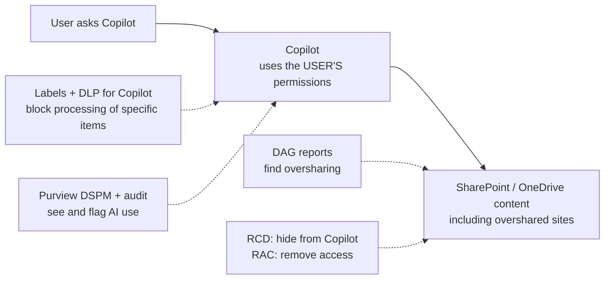
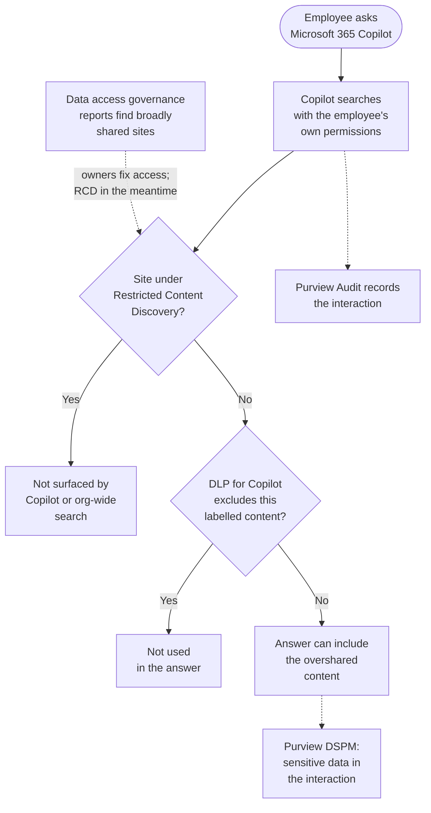

# AI Data Exposure and Purview DSPM

> **Objective:** Implement security for AI
> **Domain:** Secure compute (20-25%)

## Sub-objectives covered

- Identify overexposure of data in SharePoint
- Identify risks related to Microsoft Copilot and AI apps by using Microsoft Purview Data Security Posture Management (DSPM)

> **This objective has no AZ-500 ancestor.** Nothing in the retiring exam covers it,
> which means there is no pool of second-hand prep material to lean on and no
> accumulated folklore to unlearn. Build it from the product documentation.

## The security problem

Start with the sentence that explains the entire AI security domain:

**Copilot does not grant access to anything. It surfaces what the user could already
reach.**

That is Microsoft's design and it is genuinely true, and it is also why organisations
that deploy Copilot discover data problems within a week. Consider what "could already
reach" has meant in practice for a decade of SharePoint:

- A site shared with **Everyone Except External Users** in 2019 for a project that
  ended in 2020.
- An "Anyone with the link" file from a vendor negotiation, still live.
- Broken permission inheritance on a library nobody has opened since a reorganisation.
- A departed employee's OneDrive, shared broadly during handover.

Every one of those was technically discoverable before. In practice it was protected
by **obscurity through friction** - you would have had to know the site existed, know
roughly what was in it, and go looking. Search was bad enough that nobody found things
by accident.

Copilot removes the friction. "Summarise what we know about the Henderson
acquisition" traverses everything the user can read, at once, with no knowledge of
where anything lives. The permission model did not change. The *reachability* of the
permission model changed completely.

So this objective has two halves, in this order:

1. **Find the exposure that already exists** - SharePoint oversharing discovery
2. **See what AI is actually doing with your data** - Purview DSPM for AI

And a point of sequence worth holding onto: fixing oversharing is a permissions
project, not an AI project. The AI tooling tells you where to look and limits the
damage while you work, but nothing in DSPM for AI repairs a badly shared site.

## In plain English

Microsoft 365 Copilot answers questions using whatever the person asking is already
allowed to open. It does not get special access. But it makes everything they *could*
open instantly findable - including files that were shared too widely years ago and
forgotten.

So securing AI over Microsoft 365 data starts with **finding and fixing oversharing** in
SharePoint and OneDrive. SharePoint's reports show where content is shared too broadly;
SharePoint Advanced Management can hide sites from Copilot while you fix them, or lock
them down. **Microsoft Purview Data Security Posture Management (DSPM)** then shows how
people use Copilot and other AI apps with your data, flags risky use, and creates
policies to protect it.

## Words you need to know

- **Oversharing** - content accessible to far more people than need it, for example
  sites shared with "Everyone except external users" or "Anyone" links.
- **Data access governance (DAG) reports** - SharePoint admin center reports on sharing
  activity and permission state.
- **SharePoint Advanced Management (SAM)** - a SharePoint add-on with snapshot reports and
  remediation controls; included for tenants licensed for Microsoft 365 Copilot.
- **Restricted Content Discovery (RCD)** - stops a site's content surfacing in Copilot and
  organisation-wide search; permissions do not change.
- **Restricted Access Control (RAC)** - limits a site to members of specified groups,
  overriding existing permissions and links.
- **Site access review** - asks a site owner to review and correct the sharing a report
  found.
- **Data Security Posture Management (DSPM)** - Purview's solution for seeing and
  reducing data risk, including AI apps and agents. The older **DSPM for AI** is now
  labelled classic.
- **One-click policy** - a policy DSPM creates for you in another Purview solution, such
  as Insider Risk Management or Communication Compliance.
- **Collection policy** - captures AI interactions (optionally including prompt and
  response content) for apps that are not captured by default.
- **Sensitivity label with encryption** - a label that restricts what people, and Copilot,
  can do with content; Copilot needs the EXTRACT and VIEW rights to summarise it.
- **DLP for Microsoft 365 Copilot** - a data loss prevention policy that blocks Copilot
  from processing items with specified sensitivity labels.

## Mental model

A teaching model: Copilot sees what the user can see - so the controls act on what the
user can see.

## How it works under the hood

### What Copilot can actually see

Microsoft 365 Copilot reasons over content through the Microsoft Graph, honouring the
signed-in user's existing permissions. Three consequences:

- Anything the user can open, Copilot can read and summarise.
- Anything the user cannot open, Copilot cannot reach - there is no privileged index.
- **Sensitivity labels with encryption are enforced.** For Copilot to summarise
  labelled content, the user must hold the **EXTRACT and VIEW usage rights** granted by
  that label. A label that grants VIEW but not EXTRACT blocks summarisation while still
  allowing the person to open the file.

That last one is the cleanest control in the module: label-based encryption is the only
mechanism here that constrains Copilot at the *content* level rather than the site
level.

### Finding oversharing in SharePoint

The discovery surface is **Data Access Governance (DAG)** reports in the SharePoint
admin center, and the licensing split matters:

| Report type | What it gives | Licence |
| --- | --- | --- |
| **Activity reports** | Sharing activity over a recent window - "Everyone Except External Users" sharing, "Anyone" links, sharing with external users | **Microsoft 365 E5**, capped at 10,000 sites, and data collection must be enabled first |
| **Snapshot / permission state reports** | A point-in-time view of the whole permission structure across sites, OneDrive, and files | **SharePoint Advanced Management** |

**SharePoint Advanced Management (SAM)** - branded Microsoft SharePoint Premium - is an
add-on, and the licensing detail people miss: **it is unlocked automatically for all
SharePoint admins if anyone in the tenant holds a Microsoft 365 Copilot licence.** It
is also sold standalone. Many organisations already have it and do not know.

SAM provides the remediation tools as well, and the distinction between the two main
ones is exam-shaped:

| Control | What it does | Does it change permissions? |
| --- | --- | --- |
| **Restricted Content Discovery (RCD)** | Stops a site's content surfacing in Microsoft 365 Copilot and organisation-wide search | **No.** Anyone with access can still browse the site and open the files |
| **Restricted Access Control (RAC)** | Limits a site to members of specified Entra or Microsoft 365 groups | **Yes.** It overrides existing permissions *and* sharing links for everyone outside the group |

RCD is the containment measure: it reduces reachability while an access review runs,
without breaking anyone's work. RAC is the remediation: it genuinely locks the site
down. Choosing RCD when the question demands that unauthorised users lose access - or
RAC when the question says existing users must not be disrupted - is the trap.

Two operational notes worth carrying: **RCD takes time to propagate** - it is a
site-level property applied through the search index, and Microsoft notes that a site
with more than 500,000 items can take over a week - and it applies to SharePoint sites
only, not OneDrive. RCD also removes AI entry points (the Copilot button, AI actions)
from the restricted site. And it is not total invisibility: people can still find content
they own or have recently interacted with, and a search started from inside the site
still works.

**Restricted SharePoint Search** - the tenant-wide allow-list of up to 100 sites - is
being retired, with new enablement blocked from **31 July 2026**. It was always a blunt
instrument. Plan around Restricted Content Discovery.

Beyond SAM, the built-in SharePoint controls still do real work:

- Default sharing links set to **Specific people** rather than organisation-wide
- **Hiding the Everyone Except External Users claim** from the sharing picker
- Site-level restrictions on member sharing, so owners handle access requests
- **Site access reviews**, initiated by the admin from a DAG report, where the site
  owner reviews SharePoint groups and individual items and decides what was genuinely
  oversharing
- **Inactive site policies**, because every abandoned site is both storage cost and
  another source Copilot has to reason through

### Purview DSPM for AI

DSPM for AI is the discovery and posture surface for AI usage across the tenant. It
does not introduce new enforcement; it uses existing Purview controls - sensitivity
labels, data classification, auditing, communication compliance, retention, eDiscovery -
and puts reports, recommendations, and **one-click policies** in front of them.

> **Naming, as of this writing:** Microsoft has replaced **DSPM for AI** with a new,
> unified **Data Security Posture Management** (Purview portal > **Solutions** >
> **DSPM**), which covers AI apps and agents alongside other data risks. Its key pages
> are **Posture**, **Objectives** and **AI observability** (an inventory of AI apps and
> agents). The previous experiences are still reachable as **DSPM for AI (classic)** and
> **DSPM (classic)**, and the one-click policies below originate there - Microsoft adds
> new features to the current version only. Verify which your tenant shows before
> following any walkthrough, including this one.

What it reports on, in two categories:

- **Microsoft Copilot experiences** - Microsoft 365 Copilot, Copilot Chat, and related
  first-party experiences
- **Enterprise AI apps and other AI apps** - third-party generative AI reached from
  managed devices and browsers

The one-click policies are named objects you should recognise on sight:

| Policy | Created from | Owning solution |
| --- | --- | --- |
| **DSPM for AI - Capture interactions for Copilot experiences** | *Secure interactions in Microsoft Copilot experiences* | Collection policy (captures prompts and responses from Copilot in Fabric and Security Copilot) |
| **DSPM for AI - Detect risky AI usage** | *Detect risky interactions in AI apps* | Insider Risk Management |
| **DSPM for AI - Unethical behavior in AI apps** | *Detect unethical behavior in AI apps* | Communication Compliance |

Two mechanical facts that generate exam questions:

1. **Where prompt and response content comes from depends on the AI app.**
   - **Microsoft 365 Copilot and Copilot Chat:** every interaction generates an audit
     record (`CopilotInteraction`) automatically, showing when it happened and which
     resources were accessed. The prompt and response themselves are stored in the
     user's mailbox and are found with **eDiscovery** (the *Copilot activity* type) or
     the **AI interaction** event in activity explorer, which requires auditing to be on.
     They persist only as long as retention allows - and users can delete their own
     Copilot activity history unless a retention policy holds it.
   - **Copilot in Fabric and Security Copilot:** prompts and responses are captured only
     with a **collection policy** - the *Capture interactions for Copilot experiences*
     one-click policy.
   - **Third-party and enterprise AI apps:** a collection policy **with content capture
     selected** is needed; some one-click collection policies leave content capture off
     until you edit them.
2. **Reports need at least a day to populate.** An empty DSPM report on the afternoon
   you enabled it means nothing.

The policies are created from DSPM but **edited in their owning solution** - you tune
the unethical-behaviour policy in Communication Compliance, not in DSPM. And
recommendations disappear from the Overview page once completed or dismissed, so
"dismissed" is a decision, not a deferral.

Alongside DSPM, two Purview controls act directly on Copilot:

- **Sensitivity labels with encryption**, via the EXTRACT/VIEW rights described above
- **DLP for Microsoft 365 Copilot**, which prevents Copilot from accessing content
  carrying specified sensitivity labels - a label-driven exclusion rather than a
  site-driven one

### One Copilot question, end to end

The controls in this lesson act at different points of one question. Copilot only ever
sees what the user can open, so each control either hides content, holds it back, or
shows you that it happened.

## Why security cares

**Without the control**

1. A site holding salary review documents was shared with "Everyone except external
   users" years ago
2. Copilot is rolled out to the whole organisation
3. A curious employee asks Copilot about "next year's salary bands"
4. Copilot summarises the documents - the employee always had access, they just never
   knew where to look

**With the control**

1. Before rollout, DAG reports flag sites shared with Everyone except external users
2. RCD hides the HR site from Copilot immediately, while a site access review runs
3. The site owner removes the broad sharing; sensitive files carry a label with
   encryption that withholds EXTRACT from most staff
4. DSPM and audit show Copilot interactions touching sensitive content, so any remaining
   exposure is noticed

**What it does not solve.** RCD changes discoverability, not access: anyone with
permission can still open the files directly. Only fixing the permissions (or RAC)
removes access.

**Depends on.** Running the reports before the rollout, licensing for SharePoint Advanced
Management, and retention policies if interaction history must survive for
investigations.

## Configuration surface

| Setting | Default | Set it to | Why |
| --- | --- | --- | --- |
| DAG data collection | off | On, before you need a report | Activity reports have nothing to show until collection has been running |
| Default sharing link | often organisation-wide | **Specific people** | Changes the shape of every future share |
| Everyone Except External Users claim | visible | Hidden | Removes the one-click path to tenant-wide exposure |
| Restricted Content Discovery | off | On for known-overshared sites during review | Reduces reachability without breaking access |
| Restricted Access Control | off | On where access genuinely must be revoked | Overrides existing permissions and links |
| Restricted SharePoint Search | legacy | Do not build on it | New enablement blocked from 31 July 2026 |
| Site access reviews | not initiated | Initiated from DAG findings | Puts the decision with the site owner who knows the content |
| Retention policy for Copilot and AI apps | none | Retain for your investigation window | Without one, users can delete their Copilot history and content ages out |
| Collection policies | **not created** | *Capture interactions for Copilot experiences*, and content capture for third-party AI apps | Prompts and responses from Copilot in Fabric, Security Copilot and other AI apps are not captured without them |
| DSPM recommendations | pending | Actioned, then dismissed deliberately | Dismissed recommendations vanish from the Overview |
| Sensitivity labels on sensitive content | none | Labels with encryption; withhold EXTRACT where summarisation must be blocked | The only content-level control over Copilot |
| DLP for Microsoft 365 Copilot | none | Exclude labelled content from Copilot | Label-driven rather than site-driven |

## Common failure modes

**Treating oversharing as a Copilot problem.** It is a permissions problem that Copilot
made visible. Turning Copilot off does not fix it; it restores the friction that was
hiding it.

**Using RCD when access must actually be revoked.** RCD hides content from Copilot and
org-wide search and changes no permission. Every person who could open the file still
can.

**Using RAC when the requirement was "do not disrupt existing users."** RAC overrides
existing permissions and sharing links for anyone outside the group. That is its
purpose and it will break things.

**Enabling RCD the morning of a demonstration.** It propagates through the search index
and can take a long time on large sites.

**Assuming E5 provides the permission snapshot reports.** E5 gives activity reports,
capped and requiring collection to be enabled. The snapshot and permission state
reports need SharePoint Advanced Management.

**Not realising SAM is already unlocked.** A single Microsoft 365 Copilot licence in
the tenant enables it for all SharePoint admins.

**Reading an empty DSPM report as a clean result.** Reports need at least 24 hours, and
third-party AI app discovery depends on managed devices reporting in.

**Assuming every AI interaction is recorded the same way.** Microsoft 365 Copilot
interactions are audited and stored by default; Security Copilot, Copilot in Fabric and
third-party AI apps need a collection policy before any prompt or response content
exists. And without a retention policy, even Microsoft 365 Copilot history can be
deleted by the user or age out before anyone investigates.

**Editing a one-click policy in DSPM.** They are created there and managed in
Communication Compliance, Insider Risk Management, or Audit.

**Labelling content and expecting Copilot to be blocked.** A label without encryption
does not restrict Copilot. Encryption plus the withholding of EXTRACT does.

## Hands-on

See [03-01 lab](../../labs/03-secure-compute/03-01-lab.md).

## Validate the security outcome

| Control | The outcome to prove | Evidence |
| --- | --- | --- |
| Oversharing discovery | You know which sites are overshared | DAG reports (and, with SAM, the site permissions snapshot) list the sites and sharing counts |
| RCD | The site no longer surfaces in Copilot or org-wide search | After propagation, a Copilot query that previously returned the site's content no longer does - but the user can still open the site directly |
| RAC | Only the named group can open the site | A user outside the group is denied, even with an old sharing link |
| Label-based control | Copilot cannot summarise protected content | A user who can open a labelled file without EXTRACT rights gets no Copilot summary of it |
| AI interaction evidence | Interactions can be investigated | `CopilotInteraction` audit records appear in Purview Audit; an eDiscovery search on the user's mailbox returns *Copilot activity* items |
| Collection policy (other AI apps) | Prompts are captured where they would not be by default | The collection policy exists with content capture selected, and AI interaction events show prompt text |

## How this is tested

| Phrase in the question | What it steers you to |
| --- | --- |
| "stop content appearing in Copilot results without removing access" | Restricted Content Discovery |
| "only members of this group may access the site, overriding existing links" | Restricted Access Control |
| "identify sites shared with Everyone Except External Users" | DAG activity report |
| "point-in-time view of the permission structure" | DAG snapshot / permission state report, requires SAM |
| "site owner should confirm whether sharing is appropriate" | Site access review |
| "find what a user asked Microsoft 365 Copilot" | eDiscovery search of the user's mailbox (*Copilot activity*), or the AI interaction event in activity explorer |
| "keep Copilot prompts and responses for seven years" | Retention policy for Microsoft Copilot experiences |
| "capture prompts in Security Copilot or third-party AI apps" | Collection policy (with content capture) |
| "detect risky AI usage" | DSPM one-click policy, managed in Insider Risk Management |
| "detect inappropriate prompts" | DSPM one-click policy, managed in Communication Compliance |
| "prevent Copilot summarising a document the user can still open" | Sensitivity label with encryption, withholding EXTRACT |
| "exclude labelled content from Copilot entirely" | DLP for Microsoft 365 Copilot |
| "discover third-party AI apps in use" | DSPM for AI, Enterprise AI apps / other AI apps |

**AZ-500 divergence.** Total. There is no AZ-500 equivalent for any of this, and that
cuts both ways: no outdated material to unlearn, but also no cross-check. Where a
third-party summary conflicts with the Microsoft documentation here, the documentation
wins - and both the DSPM naming and the Restricted SharePoint Search retirement moved
recently enough that even recent blog posts are unreliable.

### What SC-500 expects you to do

- **Identify** overexposure in SharePoint and OneDrive with the right report for the
  licence available.
- **Distinguish** RCD from RAC, activity reports from snapshot reports, and default
  Microsoft 365 Copilot auditing from collection policies.
- **Select** the control that meets a requirement: reduce discoverability, remove access,
  block processing of labelled content, or capture interactions.
- **Implement** DSPM recommendations and one-click policies, and know which solution owns
  each policy.
- **Evaluate** AI-related risk from DSPM reports, audit records and activity explorer.

## Check yourself

1. Your organisation has not deployed Copilot. A colleague argues there is therefore no
   AI data exposure risk to address. Give the strongest version of their argument, then
   the rebuttal.
2. A site contains a confidential acquisition folder shared five years ago with Everyone
   Except External Users. Legal says nobody outside the deal team should be able to find
   it in Copilot, and the deal team must not be disrupted today. Name the control, and
   state precisely what risk remains after you apply it.
3. Same scenario, but Legal now says unauthorised users must lose access entirely.
   Which control, and what will break?
4. DSPM shows 400 Microsoft 365 Copilot interactions last week. Your incident response
   team asks what a specific user asked on Tuesday. Where do you find it, and what
   could have made it unavailable? How would your answer change if the question were
   about Security Copilot?
5. A file carries a sensitivity label with encryption. A user can open it but Copilot
   refuses to summarise it. Explain the mechanism, and name the usage right involved.

## Teach it back

Explain to a business leader why turning on Microsoft 365 Copilot can expose data
without anyone changing a permission, and the difference between "hiding a site from
Copilot" and "fixing who can access it".

A strong answer covers: Copilot uses each user's existing permissions; it makes
long-forgotten oversharing easy to find; RCD hides a site from Copilot and search without
changing access; fixing the sharing (or RAC) actually removes access.

## Key takeaways

- Copilot surfaces what users can already reach; oversharing is a permissions problem it
  makes visible.
- DAG activity reports come with E5; snapshot reports and RCD/RAC need SharePoint
  Advanced Management.
- RCD reduces discoverability without changing access; RAC changes access.
- Microsoft 365 Copilot interactions are audited and stored by default; other Copilots
  and third-party AI apps need a collection policy. Retention decides how long any of it
  lasts.
- DSPM creates policies; their owning solutions manage them.
- Labels with encryption (EXTRACT right) and DLP for Copilot are content-level controls.

## Sources

- Microsoft Learn - SC-500 skills measured: <https://learn.microsoft.com/en-us/credentials/certifications/resources/study-guides/sc-500>
- Microsoft Purview data security and compliance protections for generative AI apps: <https://learn.microsoft.com/en-us/purview/ai-microsoft-purview>
- Microsoft Purview protections for Copilot and AI apps: <https://learn.microsoft.com/en-us/purview/ai-security-copilot>
- SharePoint Advanced Management overview: <https://learn.microsoft.com/en-us/sharepoint/advanced-management>
- Use SharePoint Advanced Management to get ready for Copilot: <https://learn.microsoft.com/sharepoint/get-ready-copilot-sharepoint-advanced-management>
- Microsoft 365 Copilot architecture, data protection, and auditing: <https://learn.microsoft.com/en-us/copilot/microsoft-365/microsoft-365-copilot-architecture-data-protection-auditing>
- Learn about Data Security Posture Management (current version): <https://learn.microsoft.com/purview/data-security-posture-management-learn-about>
- DSPM for AI considerations and one-click policies (classic): <https://learn.microsoft.com/purview/dspm-for-ai-considerations>
- Audit logs for Copilot and AI applications: <https://learn.microsoft.com/purview/audit-copilot>
- Restrict discovery of SharePoint sites and content (RCD): <https://learn.microsoft.com/sharepoint/restricted-content-discovery>
- Data access governance reports: <https://learn.microsoft.com/sharepoint/data-access-governance-reports>
