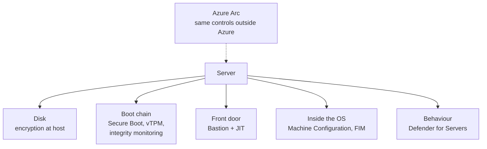
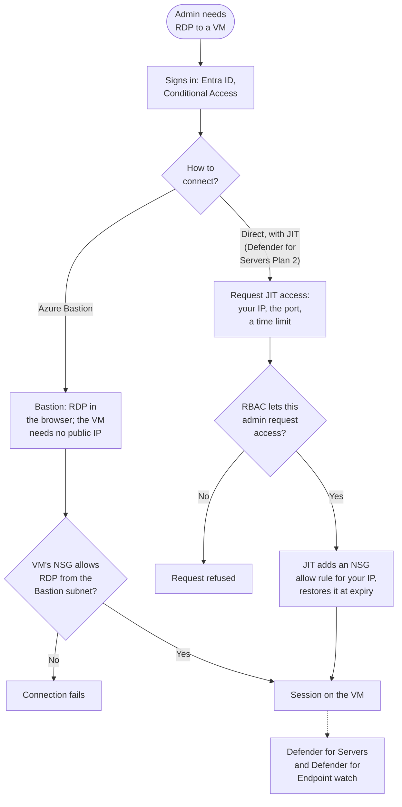

# Server and Virtual Machine Security

> **Objective:** Implement security for servers and virtual machines (VMs)
> **Domain:** Secure compute (20-25%)

## Sub-objectives covered

- Implement and configure disk encryption
- Plan and implement Azure Bastion
- Enable and enforce use of just-in-time (JIT) VM access
- Extend security controls to hybrid and multicloud servers by using Azure Arc
- Onboard servers to Defender for Servers in Defender for Cloud, including hybrid and multicloud scenarios
- Configure Defender for Servers settings, including vulnerability scanning, and endpoint detection and response (EDR)
- Implement and manage agentless scanning for VMs in Defender for Servers
- Configure security features on a VM, including secure boot, virtual Trusted Platform Module (vTPM), integrity monitoring, and security type
- Enforce security configuration of Azure-managed servers by using Azure Machine Configuration

## The security problem

A virtual machine is the one resource in Azure where you own the whole stack. Storage,
SQL, and Foundry are services with a configuration surface; a VM is a computer, and
everything that has ever been true of computers is still true of it.

That makes the objective large, but it organises cleanly if you sort the nine bullets by
**where the control acts**:

| Layer | Question it answers | Bullets |
| --- | --- | --- |
| **The disk** | Is data at rest protected, and who holds the key? | Disk encryption |
| **The boot chain** | Did this machine start as the machine we think it is? | Secure boot, vTPM, integrity monitoring, security type |
| **The front door** | How does an administrator get in, and is the door shut when nobody is? | Bastion, JIT |
| **Inside the OS** | Is it configured the way policy requires, and is it drifting? | Machine Configuration, file integrity monitoring |
| **Behaviour** | Is something happening that should not be? | Defender for Servers, EDR, vulnerability assessment, agentless scanning |
| **Reach** | Do all of the above apply to machines that are not in Azure? | Azure Arc |

The framing that ties them together: **a management port open to the internet is the most
reliably exploited misconfiguration in cloud computing.** Not a subtle one, not a novel
one - RDP and SSH exposed to the world, brute-forced or hit with a known CVE. Bastion and
JIT exist because of that single fact, and if you only implement two things from this
module, they are the two.

## In plain English

A virtual machine is a whole computer that you rent. Microsoft runs the hardware; you run
everything from the operating system up - so you also own its security.

This lesson covers the controls for each part of that computer: **encrypting its disks**,
proving it **booted cleanly** (Trusted Launch), letting administrators in **without leaving
a door open to the internet** (Azure Bastion and just-in-time access), **watching it for
attacks and weaknesses** (Defender for Servers), keeping its **settings correct** (Azure
Machine Configuration), and applying all of that to servers that **are not in Azure**
(Azure Arc).

## Words you need to know

- **Virtual machine (VM)** - a computer running as software on Microsoft's hardware
  (0A-06).
- **Managed disk** - the VM's virtual hard disk, stored by Azure.
- **Server-side encryption (SSE)** - Azure Storage encrypting disk data at rest; always on.
- **Encryption at host** - encryption on the physical host, which also covers temporary
  disks and caches.
- **Azure Disk Encryption (ADE)** - BitLocker or DM-Crypt inside the guest OS, with keys in
  Key Vault. Being retired on 15 September 2028.
- **Trusted Launch / security type** - the VM setting that turns on **Secure Boot** and a
  **virtual TPM (vTPM)**, enabling **boot integrity monitoring**.
- **Azure Bastion** - a managed service that lets administrators use RDP or SSH to VMs
  through the Azure portal or native client, with no public IP on the VM.
- **Just-in-time (JIT) VM access** - management ports stay closed and are opened on request
  for a limited time.
- **Defender for Servers** - the Defender for Cloud plan (Plan 1 or Plan 2) for servers.
- **EDR (endpoint detection and response)** - monitoring for attacker behaviour on the
  machine, delivered through Microsoft Defender for Endpoint.
- **Agentless scanning** - scanning a snapshot of the VM's disks with no agent installed.
- **Azure Machine Configuration** - Azure Policy checking (and optionally setting)
  configuration inside the operating system.
- **Azure Arc** - gives servers outside Azure an Azure resource identity so Azure
  management and security apply to them.

## Mental model

A teaching model: one server, six places to protect it.

## How it works under the hood

### Disk encryption: four mechanisms, not one

The exam expects you to distinguish them by **where the encryption happens** and **who
holds the key**.

| | Where it runs | Key custody | Notes |
| --- | --- | --- | --- |
| **Server-side encryption (SSE)** | Storage platform, always on | Platform-managed by default; **customer-managed key** via a disk encryption set and Key Vault | The default; you cannot turn it off. It does **not** encrypt temp disks or disk caches |
| **Encryption at host** | The **host**, before data reaches storage | Platform or CMK | Adds temp disks and caches, end to end; no in-guest agent and no CPU cost in the VM; the VM must be **deallocated** to enable it on an existing VM |
| **Azure Disk Encryption (ADE)** | **Inside the guest** - BitLocker on Windows, DM-Crypt on Linux | Key Vault, always | Needs a Key Vault and an in-guest extension. **Scheduled for retirement on 15 September 2028** |
| **Confidential disk encryption** | Confidential VM, keys bound to the VM's **vTPM** | Platform or CMK | Optional at deployment, **cannot be changed afterwards** |

> **ADE is retiring.** Microsoft's guidance is to use **encryption at host** for new VMs (or
> confidential VMs with OS disk encryption for confidential workloads). After 15 September
> 2028, ADE-encrypted disks will fail to unlock after a reboot. Migration needs new disks
> and VMs - there is no in-place conversion.

Two things to carry: **encryption at host covers the temp disk and host cache, which SSE
does not**, and Defender for Cloud raises a recommendation specifically for it. And
**confidential OS disk encryption is a deployment-time decision** - like infrastructure
encryption on a storage account in 02-01, and like purge protection in 01-02, it is one of
the small set of settings you cannot retrofit.

CMK anywhere here creates the same dependency chain as TDE in 02-02: the key lives in Key
Vault, the vault needs soft delete and purge protection, and losing the key loses the
disk.

### Trusted launch: secure boot, vTPM, integrity monitoring

**Trusted launch is the default for new Generation 2 VMs and scale sets.** VMs created in
the Azure portal, PowerShell or the Azure CLI get it automatically; templates and SDKs get
it when they use Compute API version 2025-11-01 or later and the image, disk and VM size
support it. If any of those conditions is not met, the VM is created **without** it - so
verify rather than assume.

The three components, which together are what the **security type** setting on the VM
selects:

- **Secure Boot** - platform firmware ensures only signed OS boot components load: boot
  loader, kernel, kernel drivers must be signed by trusted publishers. If authentication
  fails, **the VM does not boot.** This is the root of trust.
- **vTPM** - a dedicated, TPM 2.0-compliant virtual TPM instance per VM, running outside
  the reach of the VM itself. It is a vault for keys and measurements, and it measures the
  entire boot chain: UEFI, OS, system, drivers.
- **Boot integrity monitoring** - remote attestation using those vTPM measurements. If the
  boot chain fails to attest, **Microsoft Defender for Cloud issues an integrity alert**
  naming the components that failed.

Secure Boot prevents; the vTPM measures; integrity monitoring reports. A question that
asks how you would *detect* boot-level tampering wants attestation, not Secure Boot.

Trusted launch can be enabled on existing Gen2 VMs, and Gen1 VMs can be upgraded to
Gen2-Trusted launch. It is not compatible with everything - managed images, for instance,
push you toward the Azure Compute Gallery instead.

**Confidential VMs** are the next tier up: hardware-based trusted execution environments
protecting data **in use**, with a dedicated vTPM, Secure Boot, and disk keys bound to
attestation. If the platform cannot attest, the VM will not start.

### Getting in: Bastion and JIT

**Azure Bastion** is a managed jump host. Administrators connect through the Azure portal
over TLS (port 443), or with a native client on higher SKUs, and Bastion opens the RDP or
SSH session from inside the virtual network to the VM's **private** address. The VMs need
no public IP and no inbound management port open to the internet.

| SKU | What it adds | Cost |
| --- | --- | --- |
| **Developer** | Shared infrastructure, one VM at a time, no peering; dev/test only, select regions | Free |
| **Basic** | Dedicated host in `AzureBastionSubnet` (/26 or larger), peered networks, fixed capacity | Hourly |
| **Standard** | Native client, shareable links, IP-based connections, custom ports, file transfer, host scaling (2-50 instances) | Hourly |
| **Premium** | Everything in Standard plus **session recording** and **private-only deployment** (no public IP on Bastion itself) | Hourly |

Pick the lowest SKU that meets the requirement: session recording or no public IP at all
means Premium; native client means Standard or above.

**Just-in-time VM access** is a Defender for Servers Plan 2 feature and solves a different
half of the same problem. Management ports stay closed by NSG rule; an administrator
**requests access** for a specific port, source range, and duration; Defender for Cloud
opens the rule and closes it automatically when the window expires. Every request is
audited - who, when, from where, for how long.

Bastion removes the public IP. JIT ensures the port is shut when nobody is using it. They
are complementary, and the strongest answer usually uses both - which is also the shape of
the PIM argument from 00-02, applied to network reachability instead of roles.

The two routes side by side, from sign-in to the session:

### Defender for Servers

Two paid plans, and the split is heavily tested:

| | Plan 1 | Plan 2 |
| --- | --- | --- |
| Defender for Endpoint integration and **EDR** | Yes | Yes |
| Vulnerability assessment (Defender Vulnerability Management) | Yes (agent-based) | Yes, plus **premium** Defender Vulnerability Management |
| **Agentless scanning** (vulnerabilities, software inventory, secrets) | No | **Yes** (also with Defender CSPM) |
| **Agentless malware scanning** | No | **Yes** (Plan 2 only) |
| **File integrity monitoring** | No | Yes |
| **OS configuration assessment** against MCSB compute baselines | No | Yes |
| OS updates assessment, network map, regulatory compliance assessment | No | Yes |
| **Just-in-time VM access** | No | Yes |
| Free data ingestion benefit | No | 500 MB per machine per day, pooled across the machines (not enforced per machine), for eligible security tables; Plan 2 must be on for the Log Analytics workspace |
| Enable at | Subscription **or individual resource** | Subscription (can be disabled per resource) |

Plan 1 is described as entry-level because it is essentially the Defender for Endpoint EDR
integration.

What is on by default when you enable a plan, and what is not, is the detail that makes or
breaks a configuration question:

- **Endpoint protection** - the Defender for Endpoint integration is on and the agent is
  **automatically provisioned** on supported connected machines. You can turn automatic
  provisioning off.
- **Vulnerability assessment** - **enabled by default** with either plan.
- **Agentless scanning** - **enabled by default** with Plan 2, and also with the Defender
  CSPM plan.
- **OS configuration assessment** - assesses settings against the Microsoft cloud security
  benchmark compute baselines, and **requires the Azure Machine Configuration extension**
  on the machine.
- **File integrity monitoring** - **not enabled by default.** You turn it on after
  enabling Plan 2, and it needs a Log Analytics workspace.

**Agentless scanning** takes a snapshot of the disk through cloud APIs and analyses it out
of band: software inventory, vulnerability assessment, **secrets scanning** (the same
engine as 01-02), and - with Plan 2 - malware detection. It runs about **once every 24
hours** and only scans machines that are **running** at scan time. No agent, no inbound
connectivity, no performance impact - and equally, no real-time behavioural signal, which
is what the agent provides. Agentless and agent-based are complementary, not alternatives.
Disks encrypted with customer-managed keys need extra Key Vault permissions for the scanner.

**File integrity monitoring** moved. It previously collected data through the Log
Analytics agent (MMA) or the Azure Monitor agent; it now uses **Defender for Endpoint**
(events in near real time) and agentless scanning (events on a **24-hour cadence**), and
existing deployments on the legacy agents must be migrated. The data counts against the
Plan 2 ingestion benefit. FIM records the source of the change, the account, and the
initiating process - which is what makes it evidence rather than an alert.

### Azure Arc

Arc projects the Azure control plane onto machines that are not in Azure - on-premises
servers, VMs in other clouds. The Connected Machine agent registers the machine as an
Azure resource, and once it is one, it can carry Azure RBAC, Azure Policy, Azure Machine
Configuration, extensions, and **Defender for Servers**.

The important mental model: **Arc does not move the machine.** It gives it an ARM resource
ID so that every governance mechanism you built in Domain 1 applies to it. For multicloud,
Defender for Cloud's AWS and GCP connectors handle onboarding at scale rather than
per-machine registration.

### Azure Machine Configuration

Formerly Guest Configuration. It is **Azure Policy reaching inside the operating system**:
define a desired configuration - password policy, TLS version, a service state, a file
permission - and Azure audits machines against it, or **enforces** it.

Mechanically, on **Azure VMs** it needs the **machine configuration extension** and a
**system-assigned managed identity** - the built-in initiative *Deploy prerequisites to
enable Guest Configuration policies on virtual machines* adds both at scale. That is why
it appears in the Defender for Servers prerequisites for OS configuration assessment. On
**Arc-enabled servers** no extension is needed: the capability is built into the Connected
Machine agent. The same definition covering both is the payoff for the Arc work.

Audit versus enforce is the same distinction as `Audit` versus `DeployIfNotExists` in
01-03, applied inside the guest.

## Why security cares

**Without the control**

1. A VM is created with a public IP and RDP open to the internet
2. Automated scanners find the port within hours and start guessing passwords
3. One weak local account falls; the attacker installs tooling and moves on
4. Nobody sees it - there is no EDR, and the disk was never scanned for the malware left
   behind

**With the control**

1. The VM has no public IP; administrators connect through Azure Bastion
2. Where a port must open, JIT opens it for one source address for one hour and logs who
   asked
3. Defender for Servers provisions Defender for Endpoint for EDR, and agentless scanning
   checks the disk for vulnerabilities, secrets and malware
4. Machine Configuration reports any drift from the required OS settings

**What it does not solve.** These controls protect the machine. They do not fix a
vulnerable application running on it, or an over-privileged managed identity the VM can
use to reach other resources.

**Depends on.** Defender for Servers Plan 2 for JIT, agentless malware scanning and FIM;
the machine configuration extension and a system-assigned managed identity on Azure VMs;
and the VM actually running when agentless scans happen.

## Configuration surface

| Control | Default | Set it to | Why |
| --- | --- | --- | --- |
| Server-side encryption | On, platform key | CMK where key custody is required | Creates a Key Vault dependency |
| Encryption at host | **Off** | On | Covers temp disk and host cache; needs deallocation to enable |
| Azure Disk Encryption | - | Not for new VMs; plan migration | Retires 15 September 2028 |
| Confidential OS disk encryption | Off | Decide **at deployment** | Cannot be changed later |
| Security type / trusted launch | **Default for new Gen2 VMs** (portal, PowerShell, CLI; API 2025-11-01+ when supported) | Confirm it is on; enable on existing Gen2 | Unsupported images or sizes silently fall back to Standard |
| Boot integrity monitoring | part of trusted launch | On | The only detection for boot-chain tampering |
| Public IP on a VM | often created by default | **None** | The single most exploited misconfiguration |
| Management port NSG rules | open when created by the portal wizard | Closed, with **JIT** | JIT opens them on request and closes them automatically |
| Bastion SKU | - | Lowest that meets the requirement; Premium for session recording or private-only | Developer is free but one VM at a time, no peering |
| Defender for Servers | Off | Plan 2 where agentless scanning, FIM and JIT are needed | Plan 1 is EDR only |
| Defender for Endpoint provisioning | **On** with either plan | Leave on | Turning it off removes EDR |
| Agentless scanning | **On** with Plan 2 | Leave on | No agent, no performance cost |
| File integrity monitoring | **Off** | On, after enabling Plan 2 | Not enabled by default; now uses Defender for Endpoint |
| Machine configuration extension | not installed | Installed, with a system-assigned managed identity (Azure VMs) | Required for OS configuration assessment; built into the Arc agent |
| Machine configuration assignment | Audit | Audit, then enforce | Same discipline as policy in 01-03 |

## Common failure modes

**A public IP and an open management port, created by the deployment wizard.** Nobody
chose it; the default did. This is still the most common way cloud VMs are compromised.

**Bastion deployed while VMs keep their public IPs.** The secure path exists and the
insecure one was never removed.

**JIT configured but not enforced.** Somebody adds a standing NSG allow rule for
convenience and the just-in-time property silently stops being true.

**Assuming Plan 1 includes agentless scanning, FIM, or JIT.** It does not. Plan 1 is EDR.

**Expecting file integrity monitoring to be on because Plan 2 is on.** It is not enabled by
default, and it is the one Plan 2 feature that requires a deliberate step.

**Running FIM on a legacy agent.** It moved to Defender for Endpoint; MMA and AMA-based
configurations need migrating.

**Treating agentless scanning as a replacement for the agent.** It has no real-time
behavioural signal. A machine with only agentless coverage has no EDR.

**OS configuration assessment reporting nothing.** The machine configuration extension is
missing, or the managed identity is not there.

**Trying to enable encryption at host on a running VM.** It must be deallocated.

**Building new VMs on Azure Disk Encryption.** It retires on 15 September 2028, and
migration needs new disks and VMs.

**Expecting agentless results for a stopped VM.** Agentless scanning only covers machines
that are running when the scan runs.

**Assuming Defender CSPM alone gives agentless malware scanning.** It gives agentless
vulnerability and secrets scanning; malware scanning needs Defender for Servers Plan 2.

**Deciding on confidential OS disk encryption after deployment.** You cannot; redeploy.

**Arc agent installed, nothing governing the machine.** Registration is step one. Policy
assignments, Defender plan coverage, and machine configuration assignments are what make
it worth having.

**A VM left running after a lab.** Compute, Bastion, and the Defender plan all bill
independently, and the Defender plan survives resource group deletion.

## Hands-on

See [03-04 lab](../../labs/03-secure-compute/03-04-lab.md).

## Validate the security outcome

| Control | The outcome to prove | Evidence |
| --- | --- | --- |
| No public exposure | The VM cannot be reached directly from the internet | No public IP on the NIC; effective security rules show no inbound allow from Internet on 3389 or 22 |
| Bastion | Administrators can still connect | A Bastion session to the private IP succeeds |
| JIT | The port is closed until requested | The JIT policy shows the port; NSG rules show a deny until a request creates a time-bound allow |
| Encryption at host | Temp disks and caches are encrypted | The VM's `securityProfile.encryptionAtHost` is `true` |
| Trusted Launch | The VM booted with Secure Boot and vTPM | Security type **Trusted launch** with Secure Boot and vTPM enabled; no boot integrity alert |
| Defender for Servers | EDR and vulnerability assessment are active | The machine appears in Defender for Endpoint; vulnerability findings appear for it |
| Agentless scanning | Disks are scanned without an agent | Software inventory or vulnerability results appear within 24 hours |
| Machine Configuration | OS settings match policy | The guest assignment reports **Compliant**, or names the failing setting |
| Arc | A non-Azure server is governed | The machine appears as a `Microsoft.HybridCompute/machines` resource with policy compliance and Defender coverage |

## How this is tested

| Phrase in the question | What it steers you to |
| --- | --- |
| "encrypt temp disks and caches too" | Encryption at host |
| "encryption inside the guest OS" | Azure Disk Encryption (retiring - prefer encryption at host for new VMs) |
| "keys bound to the VM, cannot be changed later" | Confidential OS disk encryption |
| "only signed boot components may load" | Secure Boot |
| "attest that the VM booted correctly" | vTPM plus boot integrity monitoring |
| "detect boot-level tampering" | Integrity monitoring, not Secure Boot |
| "RDP without a public IP" | Azure Bastion |
| "record administrator sessions" or "no public IP even on the jump host" | Azure Bastion **Premium** |
| "connect with the native RDP/SSH client" | Bastion Standard or Premium |
| "port open only when an admin needs it" | Just-in-time VM access, Plan 2 |
| "EDR only, lowest cost" | Defender for Servers Plan 1 |
| "scan for secrets and malware without an agent" | Agentless scanning, Plan 2 |
| "who changed this file and with what process" | File integrity monitoring |
| "on-premises and AWS servers, same controls" | Azure Arc + Defender for Cloud connectors |
| "enforce a setting inside the operating system" | Azure Machine Configuration |
| "assess against the security benchmark baseline" | OS configuration assessment, needs the machine configuration extension |

**AZ-500 divergence.** Two defaults moved and one feature relocated. **Trusted launch is
now the default for new Gen2 VMs**, so secure boot and vTPM are a baseline to verify rather
than a feature to add. **File integrity monitoring now runs on Defender for Endpoint**, not
the Log Analytics or Azure Monitor agent - and the Log Analytics agent itself is retired,
so any walkthrough that provisions MMA is describing a dead path. Agentless scanning also
did not exist in the AZ-500 blueprint. And **Azure Disk Encryption**, a staple of AZ-500
material, is now scheduled for retirement in favour of encryption at host.

### What SC-500 expects you to do

- **Identify** which layer a requirement belongs to: disk, boot chain, access path, OS
  configuration, behaviour or reach.
- **Distinguish** SSE, encryption at host, ADE and confidential disk encryption; Secure
  Boot from boot integrity monitoring; Bastion from JIT; Defender for Servers Plan 1 from
  Plan 2; agentless from agent-based scanning.
- **Select** the Bastion SKU, Defender plan or encryption option that meets a requirement.
- **Implement** Bastion, JIT, Defender for Servers settings, agentless scanning, Trusted
  Launch, Machine Configuration and Arc onboarding.
- **Evaluate** coverage gaps - for example, a server with agentless scanning only has no
  EDR.

## Check yourself

1. A VM has server-side encryption with a platform-managed key. Defender for Cloud still
   recommends enabling encryption at host. Explain what the recommendation adds, and what
   you must do to the VM to apply it.
2. You enable Defender for Servers Plan 2 on a subscription. Three days later, an auditor
   asks for a record of changes to `/etc/passwd` on a Linux VM. Can you produce one?
   Explain.
3. A VM fails to boot after a patch. Distinguish what Secure Boot, the vTPM, and integrity
   monitoring would each have contributed to understanding why.
4. Your organisation deploys Bastion and mandates its use. An engineer reports they can
   still RDP directly to a VM from home. Describe what is misconfigured and the two
   controls that would close it.
5. An Arc-enabled on-premises server appears in Defender for Cloud but has no
   recommendations and no OS configuration assessment results. List the possible causes in
   the order you would check them.

## Teach it back

A colleague says: "We use Azure Bastion, so we don't need just-in-time access." Explain what
each control does and when you would still want both.

A strong answer covers: Bastion removes the need for a public IP and gives a managed
connection path; JIT keeps management ports closed until someone requests them for a
limited time and logs the request; if any VM still has a public IP or another path to its
ports, JIT shrinks that exposure; together they remove the standing open door.

## Key takeaways

- An internet-exposed management port is the classic VM compromise. Bastion and JIT exist
  for it.
- SSE is always on but does not cover temp disks or caches; encryption at host does. ADE
  retires on 15 September 2028 - use encryption at host for new VMs.
- Trusted Launch (Secure Boot + vTPM) is the default for new Gen2 VMs created in the portal,
  PowerShell or CLI. Secure Boot prevents; integrity monitoring detects.
- Defender for Servers Plan 1 is EDR plus core vulnerability assessment; Plan 2 adds
  agentless scanning, FIM, JIT, OS configuration assessment and more.
- FIM is not on by default, even with Plan 2.
- Machine Configuration needs the extension and a system-assigned managed identity on Azure
  VMs; Arc-enabled servers have it built in.

## Sources

- Microsoft Learn - SC-500 skills measured: <https://learn.microsoft.com/en-us/credentials/certifications/resources/study-guides/sc-500>
- Overview of Defender for Servers: <https://learn.microsoft.com/en-us/azure/defender-for-cloud/defender-for-servers-overview>
- Select a Defender for Servers plan: <https://learn.microsoft.com/azure/defender-for-cloud/plan-defender-for-servers-select-plan>
- File integrity monitoring overview: <https://learn.microsoft.com/azure/defender-for-cloud/file-integrity-monitoring-overview>
- Trusted launch for Azure virtual machines: <https://learn.microsoft.com/azure/virtual-machines/trusted-launch>
- Migrate from Azure Disk Encryption to encryption at host: <https://learn.microsoft.com/azure/virtual-machines/disk-encryption-migrate>
- Choose the right Azure Bastion SKU: <https://learn.microsoft.com/azure/bastion/bastion-sku-comparison>
- Review and modify Defender for Servers settings: <https://learn.microsoft.com/azure/defender-for-cloud/configure-servers-coverage>
- Enable agentless machine scanning: <https://learn.microsoft.com/azure/defender-for-cloud/enable-agentless-scanning-vms>
- Azure Machine Configuration prerequisites: <https://learn.microsoft.com/azure/governance/machine-configuration/overview/02-setup-prerequisites>
- Azure virtual machine security overview: <https://learn.microsoft.com/azure/security/fundamentals/virtual-machines-overview>
