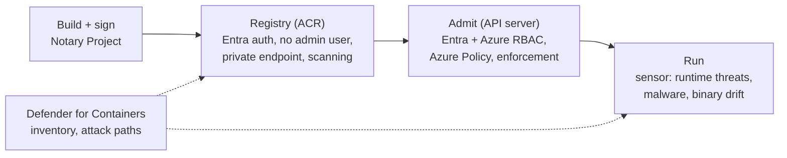

# Container Platform Security

> **Objective:** Implement security for application platform services
> **Domain:** Secure compute (20-25%)

## Sub-objectives covered

- Detect misconfigurations and runtime risks in container workloads by using Defender for Containers
- Implement and configure security controls for Azure Kubernetes Service (AKS)
- Implement and configure security controls for Azure Container Registry
- Implement and configure security controls for Azure Container Instances and Azure Container Apps

## The security problem

A container changes two assumptions that every control in Domain 2 and 3 quietly relied on.

**First, the unit of deployment is an artifact, not a machine.** You do not patch a
container; you rebuild the image and redeploy. So vulnerability management moves upstream
into the registry, and "this running workload is vulnerable" and "the image it came from is
vulnerable" become the same finding reached from two directions.

**Second, the thing that decides what runs is an API, not a person.** A Kubernetes cluster
accepts declarative requests and makes them true. Whoever can post to the API server can
create a privileged pod, mount the host filesystem, or run as root - not by exploiting
anything, but by asking. Which means the security question for Kubernetes is not "is the
node hardened" but **"who may ask the API server for what, and what is it willing to
accept?"**

Those two shifts produce the shape of this objective:

| Lifecycle phase | Control |
| --- | --- |
| **Build and store** | Registry authentication, image scanning, signing |
| **Admit** | Admission control - what the API server will accept |
| **Authorise** | Entra integration and Azure RBAC for Kubernetes |
| **Run** | Runtime threat detection, drift detection, network policy |
| **Observe** | Inventory, attack paths, Defender XDR |

And a structural point worth stating once: a container's security is mostly decided before
it ever runs. By the time you are detecting at runtime, you are catching what the earlier
stages missed.

## In plain English

A **container** packages an application with everything it needs to run, so it behaves the
same everywhere. The package is called an **image**; images are stored in a **registry**
(Azure Container Registry); and something has to run them - a **Kubernetes** cluster (Azure
Kubernetes Service), or a simpler service such as Azure Container Instances or Azure
Container Apps.

Securing containers therefore means securing four things: the **images** (are they free of
known vulnerabilities and from a trusted build?), the **registry** (who can push and pull?),
the **cluster** (who can tell Kubernetes what to run, and what will it refuse?), and the
**running containers** (is anything happening that the image never contained?).
**Microsoft Defender for Containers** finds weaknesses and attacks across all four.

## Words you need to know

- **Container / image** - a packaged application; the image is the template a container
  runs from (0A-06).
- **Registry** - where images are stored and pulled from; in Azure, **Azure Container
  Registry (ACR)**.
- **Kubernetes / AKS** - a system that runs containers across a pool of machines (nodes);
  **Azure Kubernetes Service** is Microsoft's managed version.
- **API server** - the Kubernetes front door; every change to the cluster is a request to it.
- **Pod** - the smallest thing Kubernetes runs: one or more containers together.
- **Admission control** - checks the API server runs before accepting a request, such as
  Azure Policy for Kubernetes.
- **Kubernetes RBAC vs Azure RBAC for Kubernetes** - permissions defined inside the cluster,
  versus permissions defined as Azure role assignments.
- **Kubelet identity** - the managed identity AKS nodes use, for example to pull from ACR.
- **Workload identity** - lets a pod use a Microsoft Entra identity to reach Azure
  resources without a stored secret.
- **Defender sensor** - the Defender for Containers component on each node that collects
  runtime signals using eBPF.
- **Binary drift** - a process running in a container that was not in its image.
- **Image signing** - attaching a verifiable signature to an image (Notary Project) so a
  cluster can refuse unsigned ones.

## Mental model

A teaching model: the container lifecycle, with a control at each stage.

## How it works under the hood

### Defender for Containers

The plan splits cleanly into **agentless** and **sensor-based** capabilities, and knowing
which is which is exam-relevant because they answer different questions and have different
prerequisites.

**Agentless capabilities:**

- **Agentless discovery for Kubernetes** - API-based, zero-footprint discovery of clusters,
  configurations, and deployments.
- **Agentless vulnerability assessment** - scans **registry images, running containers, and
  cluster nodes**. Zero configuration, daily rescans, OS **and language package** coverage,
  exploitability insights. The engine is **Microsoft Defender Vulnerability Management** -
  the same one behind Defender for Servers in 03-04, so findings are consistent. The
  vulnerability findings artifact is **signed with a Microsoft certificate** and associated
  with the image in the registry.
- **Inventory and risk hunting** through **Security Explorer** - resources, pods, services,
  repositories, images, and configurations, with findings fed into the **cloud security
  graph** so container vulnerabilities participate in **attack paths**.
- **Control plane hardening** - continuous assessment of cluster configuration against the
  initiatives applied to your subscriptions.

**Sensor-based capabilities** (the **Defender sensor**, which collects process, network, and
Kubernetes event data per node using **eBPF**):

- **Runtime threat protection** for clusters, nodes, and workloads, mapped to the **MITRE
  ATT&CK framework for Containers**, investigable in **Microsoft Defender XDR**.
- **Anti-malware detection and blocking** inside containers (generally available for AKS,
  EKS and GKE), governed by anti-malware policies.
- **Binary drift detection** - alerts on **unauthorised external processes running inside a
  container**, meaning binaries that did not come from the image. You define drift policies
  to separate legitimate activity from suspicious. **Binary drift blocking** (preview) goes
  further and stops them.

Binary drift deserves a moment. In a VM, "a new binary appeared" is ambiguous - administrators
install things. In a container, it is close to definitional evidence of compromise, because a
container is supposed to be exactly its image and nothing else. This is the clearest example in
the whole guide of a detection that works because the platform's constraints are tighter.

**Kubernetes data plane hardening** is the admission-control half, delivered by the **Azure
Policy for Kubernetes** add-on. With it installed, **every request to the Kubernetes API server
is evaluated against your policies before it is persisted to the cluster** - so you can mandate
that privileged containers are never created, and future requests to create one are rejected.
This is Azure Policy from 01-03 reaching into the cluster, in the same way Machine
Configuration reached into the guest OS in 03-04.

Defender for Containers adds its own admission-time check: **Kubernetes misconfiguration
enforcement** (generally available since July 2026) evaluates resource configurations
against Microsoft security best-practice rules and can **audit or block** deployments that
fail. On AKS and Arc-enabled Kubernetes it is provisioned automatically when Defender for
Containers has **Kubernetes API access** enabled.

One detail about what enables what: vulnerability assessment of **registry** images requires
**registry access** to be enabled on the Defender CSPM or Defender for Containers plan;
vulnerability assessment of **running** images requires **agentless scanning for machines**
plus either **K8s API access** or the **Defender sensor**.

### AKS

**Authentication and authorisation - the single most important control.**

There are three models, in increasing order of what you want:

| Model | What it means |
| --- | --- |
| Local accounts with Kubernetes RBAC | Cluster-local certificates, invisible to Entra |
| Microsoft Entra authentication with Kubernetes RBAC | Entra identity, permissions defined in cluster YAML |
| **Microsoft Entra authentication with Azure RBAC for Kubernetes authorization** | Entra identity, permissions as **Azure role assignments** |

The third puts cluster access under the same system as everything else in this guide -
PIM-eligible, Conditional Access-governed, auditable in one place.

**And the fact the exam will use:** local accounts are **enabled by default**, and `--admin`
access remains a **non-auditable backdoor even when Entra integration and RBAC are enabled.**
Disabling them is an explicit step - `--disable-local-accounts`, surfacing as
`properties.disableLocalAccounts`. There is a critical operational rider: if users may already
have authenticated with local accounts, **you must rotate the cluster certificates** after
disabling, or the credentials they hold remain valid.

The rest of the AKS baseline, which shows up as recommendations and as exam distractors:

- **Private cluster** or **API server authorised IP ranges** - the API server is the control
  plane; exposing it publicly is the AKS version of an open management port
- **Managed identities** for the cluster and kubelet identities, not service principals
- **Azure Workload Identity** for pods needing Azure resources - the successor to the retired
  pod identity approach, and the container version of 01-01's "no secrets in code"
- **Secrets Store CSI driver** to mount Key Vault secrets rather than baking them into images
  or Kubernetes secrets
- **Network policies** to constrain pod-to-pod traffic - the 02-03 segmentation argument
  applied inside the cluster
- **System and user node pool separation**, so workloads do not share nodes with cluster
  components
- **ImageCleaner** to remove stale, vulnerable images from nodes
- **Host-based encryption** on node VMs, which is 03-04's encryption at host
- Managed egress through **Azure Firewall**, and ingress through **Application Gateway with
  WAF** - covered in 02-04 and 03-06 respectively

### Azure Container Registry

The registry is the supply chain. Two recommendations recur in Defender for Cloud and are
worth memorising as a pair:

- **Anonymous authentication disabled**
- **Local admin account disabled**

The admin account is a single shared credential with push and pull rights and no identity
behind it - the storage account key problem from 02-01, wearing a different hat. It is
**disabled by default**, but people switch it on because some portal flows (deploying an
image straight to Container Instances or Container Apps) ask for it. Anonymous pull is also
off by default. Both recommendations exist because those defaults get changed. The
alternative is Entra authentication with `AcrPull` and `AcrPush` role assignments, and for
AKS specifically, granting `AcrPull` to the cluster's **kubelet identity** so no registry
credential exists anywhere.

Beyond authentication:

- **Private endpoints** and disabled public network access, per 02-04
- **Vulnerability scanning** of images through Defender for Containers registry access
- **Image signing** so a cluster can require that images come from your build system. Use
  **Notary Project** signatures (the Notation tool, keys in Key Vault), verified on AKS by
  **Ratify** with Azure Policy. **Docker Content Trust is deprecated and will be removed from
  ACR on 31 March 2028.**
- **Retention and cleanup**, because an unscanned five-year-old image is still deployable
- **Dedicated data endpoints** where data exfiltration paths matter

### Container Instances and Container Apps

Both run containers without a cluster, and both are tested lightly relative to AKS - but the
controls follow the same pattern you already know:

- **Managed identity** rather than credentials, for pulling from ACR and for reaching Azure
  resources
- **Virtual network integration**, and ingress restricted to internal only where the workload
  is not public
- **Secrets from Key Vault** rather than environment variables in the deployment definition
- **Confidential containers** on ACI, for hardware-isolated execution - the container analogue
  of confidential VMs in 03-04

Container Apps adds an environment as the isolation boundary, with ingress controls, IP
restrictions, and authentication that can be delegated to Entra rather than implemented in the
application.

**Posture for serverless containers.** Defender CSPM's **serverless containers** component
(generally available since July 2026, billed from 1 July 2026) gives Container Apps and
Container Instances inventory, misconfiguration and vulnerability recommendations, and attack
path analysis. Turn on **Registry access** too for full coverage.

## Why security cares

**Without the control**

1. An AKS cluster keeps local accounts and a public API server
2. A developer laptop holding the cluster admin kubeconfig is compromised
3. The attacker deploys a privileged pod that mounts the node's filesystem, and runs a
   crypto miner downloaded at runtime
4. Nothing is audited to a person, because `--admin` is not tied to an identity

**With the control**

1. Local accounts are disabled (and certificates rotated); access requires Entra sign-in
   and Azure RBAC, so PIM and Conditional Access apply
2. The API server is private or limited to authorised IP ranges
3. Azure Policy for Kubernetes denies privileged pods at admission
4. The Defender sensor flags the downloaded miner as binary drift and anti-malware blocks
   it

**What it does not solve.** These controls stop unsafe configuration and detect unexpected
behaviour. They do not fix a vulnerable application inside a correctly configured
container - that is what image vulnerability findings and rebuilding are for.

**Depends on.** Defender for Containers with the right components (registry access,
agentless scanning, Kubernetes API access, the sensor), policy assignments in deny rather
than audit, and the cluster using Entra integration.

## Configuration surface

| Control | Default | Set it to | Why |
| --- | --- | --- | --- |
| AKS local accounts | **Enabled** | **Disabled**, then rotate certificates | `--admin` is a non-auditable backdoor |
| AKS authorisation | Kubernetes RBAC | Entra authentication + **Azure RBAC for Kubernetes** | Puts cluster access under PIM and Conditional Access |
| API server exposure | Public | Private cluster, or authorised IP ranges | It is the control plane |
| Cluster and kubelet identity | service principal in older clusters | **Managed identities** | No credential to rotate or leak |
| Pod access to Azure resources | app-held secrets | **Workload identity** | Same argument as 01-01 |
| Azure Policy for Kubernetes add-on | not installed | Installed, audit then deny | Admission control is the only place to stop a privileged pod |
| Network policy | none | Enabled, default-deny between namespaces | Flat pod networking otherwise |
| ACR admin account | Disabled | **Keep disabled** (audit or deny with built-in policy) | Shared credential with push rights; portal deploy flows tempt people to enable it |
| ACR anonymous pull | disabled | Keep disabled | Recommendation exists because people enable it |
| ACR public network access | Enabled | Private endpoint | Per 02-04 |
| Defender for Containers | Off | On, with registry access and the sensor | Agentless alone gives no runtime detection |
| Binary drift | detection off | Detection, then blocking (preview) | Near-definitional signal in a container |
| Kubernetes misconfiguration enforcement | depends on K8s API access | Audit, then block | Admission-time check against Microsoft rules |
| Image signing | Docker Content Trust (deprecated) | Notary Project + Ratify | DCT is removed from ACR on 31 March 2028 |
| Serverless containers (Defender CSPM) | off | On, with registry access | Brings ACA and ACI into posture and attack paths |
| Container Apps ingress | often external | Internal unless it must be public | The default is convenience |

## Common failure modes

**Entra integration enabled, local accounts left on.** The cluster looks governed and the
`--admin` path still works, unaudited.

**Local accounts disabled without rotating certificates.** Anyone who already pulled local
credentials keeps them.

**Kubernetes RBAC used where Azure RBAC was intended.** Permissions live in cluster manifests,
disconnected from Entra, and survive an employee's departure.

**Public API server with no authorised IP ranges.** The most consequential AKS
misconfiguration, and the direct analogue of the open RDP port from 03-04.

**Azure Policy add-on installed and left entirely in audit.** You have a report of privileged
pods, and privileged pods.

**Registry scanning enabled, runtime not.** Registry access covers images at rest; running
containers need agentless machine scanning plus K8s API access or the sensor. A clean registry
does not mean a clean cluster - images can be pulled from anywhere.

**ACR admin account used by a pipeline.** One shared credential, push rights, no identity,
usually in a variable group.

**AcrPull granted to a service principal with a secret instead of the kubelet identity.** A
credential where none was needed.

**Secrets in Kubernetes secrets, treated as encrypted.** They are base64-encoded, not
encrypted, and readable by anyone with the right API permission. Use the CSI driver with Key
Vault.

**Node pool left running.** The AKS control plane may be free on your tier; the node VMs are
not, and they bill continuously.

## Hands-on

See [03-05 lab](../../labs/03-secure-compute/03-05-lab.md).

## Validate the security outcome

| Control | The outcome to prove | Evidence |
| --- | --- | --- |
| Local accounts disabled | No identity-less admin path | `disableLocalAccounts` is `true`; `az aks get-credentials --admin` fails |
| Azure RBAC for Kubernetes | Cluster access follows Entra and Azure role assignments | A user with no Azure Kubernetes role is refused; adding the role grants access |
| API server exposure | The control plane is not open to the internet | The cluster is private, or authorised IP ranges are set |
| Admission control | Unsafe pods are refused | Creating a privileged pod is denied with a policy message |
| ACR authentication | No shared registry credential | `adminUserEnabled` is `false` and `anonymousPullEnabled` is `false`; AKS pulls through `AcrPull` on the kubelet identity |
| Registry scanning | Images are assessed | Vulnerability findings appear for images in the registry |
| Runtime protection | Unexpected processes are caught | A test binary not in the image raises a binary drift alert (or is blocked by policy) |
| Serverless containers | ACA and ACI workloads are in scope | They appear in inventory with recommendations once the Defender CSPM serverless containers component is on |

## How this is tested

| Phrase in the question | What it steers you to |
| --- | --- |
| "cluster access must be revoked when the user leaves Entra" | Azure RBAC for Kubernetes authorization |
| "remove the non-auditable backdoor" | Disable local accounts, then rotate certificates |
| "API server must not be reachable from the internet" | Private cluster or authorised IP ranges |
| "prevent privileged containers from ever being created" | Azure Policy for Kubernetes, deny effect |
| "pod must access a key vault without a stored secret" | Workload identity, Secrets Store CSI driver |
| "detect a process that is not part of the image" | Binary drift detection |
| "block that process" | Binary drift blocking |
| "scan images in the registry" | Defender for Containers, registry access |
| "scan containers that are actually running" | Agentless machine scanning + K8s API access or sensor |
| "no shared credential for the registry" | Disable the ACR admin account, use `AcrPull`/`AcrPush` |
| "AKS must pull images with no credential" | `AcrPull` on the kubelet identity |
| "hardware-isolated container execution" | Confidential containers on ACI |
| "only signed images may be deployed" | Notary Project signatures verified by Ratify and Azure Policy |
| "posture and attack paths for Container Apps" | Defender CSPM serverless containers component |
| "internal-only container app" | Container Apps ingress restricted to internal |

**AZ-500 divergence.** Container vulnerability assessment now runs on **Microsoft Defender
Vulnerability Management** rather than the earlier third-party engine, so findings, scoring, and
the portal experience all differ from older material. The Defender **sensor** with eBPF and
binary drift detection and blocking are new capability classes. And pod identity has been
superseded by **workload identity** - a walkthrough that configures the former is configuring a
retired feature.

### What SC-500 expects you to do

- **Identify** the lifecycle stage a requirement belongs to: build, store, admit, authorise,
  run or observe.
- **Distinguish** Kubernetes RBAC from Azure RBAC for Kubernetes, admission control from
  runtime detection, registry scanning from running-container scanning, and binary drift
  detection from blocking.
- **Select** the AKS, ACR, ACI or Container Apps control that meets a scenario.
- **Implement** Defender for Containers components, Entra integration with local accounts
  disabled, Azure Policy for Kubernetes, ACR authentication and network restrictions.
- **Evaluate** Defender for Containers findings and attack paths.

## Check yourself

1. A cluster has Microsoft Entra integration and Kubernetes RBAC configured. An engineer who
   left the company last month runs `kubectl get pods` successfully. Give two distinct
   explanations, and the remediation for each.
2. Defender for Containers reports no vulnerabilities for a running workload, while the registry
   shows the source image as clean. Name every reason the running container could still be
   vulnerable.
3. Explain why binary drift detection is a stronger signal in a container than the equivalent
   would be on a virtual machine. What property of containers makes it work?
4. Your organisation wants to guarantee that no privileged container can be created in any
   cluster, regardless of what a developer submits. Describe the mechanism, where it sits in the
   request path, and the one configuration choice that determines whether it reports or prevents.
5. A pipeline authenticates to ACR with the admin account. Describe what is wrong in terms of
   the storage account discussion from 02-01, and give the replacement for both the pipeline and
   the AKS cluster.

## Teach it back

Explain to an application team why "we use Microsoft Entra sign-in for our AKS cluster" does
not, on its own, mean every cluster action is tied to a person.

A strong answer covers: local accounts are enabled by default and `--admin` credentials
bypass Entra; they must be disabled explicitly and the cluster certificates rotated if local
credentials were ever issued; Azure RBAC for Kubernetes then puts permissions in Azure role
assignments, which PIM, Conditional Access and access reviews can govern.

## Key takeaways

- Container security is decided mostly before runtime: image, registry, admission.
- AKS local accounts are on by default; disable them and rotate certificates. Prefer Entra
  authentication with Azure RBAC for Kubernetes.
- Azure Policy for Kubernetes (and Defender's misconfiguration enforcement) decide what the
  API server accepts - deny, not just audit.
- ACR: admin account and anonymous pull are off by default - keep them off; use `AcrPull`
  on the kubelet identity.
- Registry scanning does not cover running containers; that needs agentless scanning plus
  Kubernetes API access or the sensor.
- Binary drift is a strong signal because a container should be exactly its image.
- Docker Content Trust retires on 31 March 2028; use Notary Project signatures.

## Sources

- Microsoft Learn - SC-500 skills measured: <https://learn.microsoft.com/en-us/credentials/certifications/resources/study-guides/sc-500>
- Overview of Defender for Containers: <https://learn.microsoft.com/en-us/azure/defender-for-cloud/defender-for-containers-introduction>
- Container security in Defender for Cloud: <https://learn.microsoft.com/azure/defender-for-cloud/container-security>
- Vulnerability assessment usage in Defender for Containers: <https://learn.microsoft.com/en-us/azure/defender-for-cloud/defender-for-containers-usage>
- Manage local accounts with Microsoft Entra integration (AKS): <https://learn.microsoft.com/azure/aks/local-accounts>
- Secure your Azure Container Registry deployment: <https://learn.microsoft.com/azure/container-registry/secure-container-registry>
- Transition from Docker Content Trust to Notary Project: <https://learn.microsoft.com/azure/container-registry/container-registry-content-trust-deprecation>
- Verify container image signatures by using Ratify and Azure Policy: <https://learn.microsoft.com/azure/container-registry/container-registry-tutorial-verify-with-ratify-aks>
- What's new in Defender for Cloud (container capabilities, July 2026): <https://learn.microsoft.com/azure/defender-for-cloud/release-notes>
