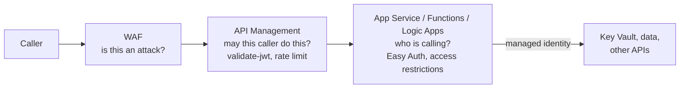
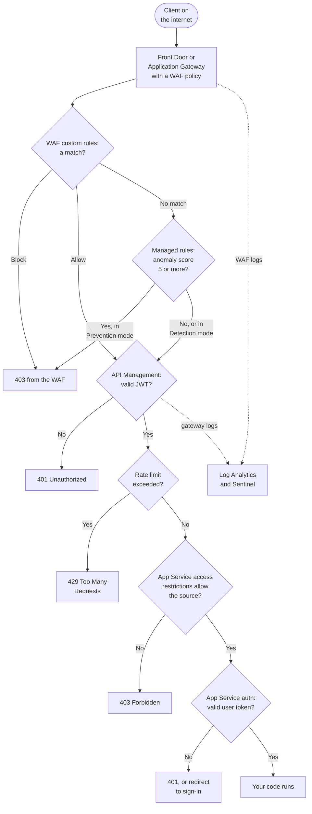

# Serverless, Web, and API Security

> **Objective:** Implement security for application platform services
> **Domain:** Secure compute (20-25%)

## Sub-objectives covered

- Implement and configure security controls for Azure Functions, including authentication and network access
- Implement and configure security controls for Azure Logic Apps
- Implement and configure security controls for Azure App Service
- Implement and configure Azure Web Application Firewall
- Implement security policies for back-end API protection by using API Management

## The security problem

Platform as a service removes the machine. There is no OS to patch, no port to close, no
agent to install - and that genuinely removes a whole category of risk from 03-04.

What it does not remove is the application, and it introduces a problem that a VM never had:
**a PaaS application is publicly addressable the moment it exists.** An App Service gets a
DNS name on the internet before you deploy any code to it. A Function gets an HTTP trigger
endpoint. A Logic App gets a callback URL. None of that required a decision, a public IP, or
a network security group.

So the questions change:

| On a VM | On PaaS |
| --- | --- |
| Which ports are open? | Who is allowed to call this endpoint? |
| Is the OS patched? | Is the request itself malicious? |
| Who can log in? | What is the app's own identity when it calls something else? |

Which gives the five bullets their structure:

- **Who may call it** - access restrictions, private endpoints, App Service authentication
- **Is the call itself an attack** - Web Application Firewall
- **Is the API being used the way it was intended** - API Management policies
- **What does the app use to call other things** - managed identity, Key Vault references
- **What about workflows specifically** - Logic Apps, where the trigger *is* the endpoint

## In plain English

**Platform as a service (PaaS)** means Microsoft runs the servers and you only bring the
application: a website on **App Service**, a small piece of code that runs on demand in
**Azure Functions**, an automated workflow in **Logic Apps**. There is no operating system
for you to patch - but each of these gets a **public web address the moment it is created**.

So the security questions become: **who is allowed to call it** (authentication, access
restrictions, private endpoints), **is the request itself an attack** (a **Web Application
Firewall** inspects HTTP traffic for things like SQL injection), **is the API being used as
intended** (**API Management** checks tokens and limits how often each caller can call), and
**what does the app use when it calls other services** (a managed identity instead of a
stored password).

## Words you need to know

- **PaaS** - a service where Microsoft runs the platform and you deploy only the app
  (0A-01).
- **App Service / Functions / Logic Apps** - web apps and APIs; event-driven code; and
  automated workflows (0A-06).
- **App Service authentication ("Easy Auth")** - sign-in enforced by the platform in front
  of your code.
- **Access restrictions** - allow/deny rules for inbound requests by IP, service tag or
  virtual network.
- **SCM (Kudu) site** - the separate deployment and management endpoint of an App Service
  app.
- **Private endpoint vs VNet integration** - private *inbound* access to the app, versus
  the app's *outbound* traffic into your network (0A-08).
- **Function key** - a shared key that satisfies a function's authorization level; it
  carries no identity.
- **Key Vault reference** - an app setting that points to a secret in Key Vault instead of
  containing it.
- **WAF (Web Application Firewall)** - rules that inspect HTTP requests for attacks; on
  Application Gateway (regional) or Front Door (global edge).
- **Detection vs Prevention mode** - log what would be blocked, versus actually block.
- **Managed rule set (DRS)** - Microsoft-maintained WAF rules; **custom rules** are yours.
- **API Management policy** - a rule the gateway runs on each call, such as `validate-jwt`
  or a rate limit (0A-10).

## Mental model

A teaching model: four questions every request to a PaaS app has to pass.

## How it works under the hood

### App Service and Functions

They share a platform, so they share controls. The ones that matter:

**App Service authentication ("Easy Auth")** is a platform feature that sits in front of your
code. Enable it and the platform validates tokens - from Microsoft Entra ID or another
provider - before the request reaches the application. Unauthenticated requests can be
redirected to sign in or rejected outright. The important property: **the application does not
implement this and cannot accidentally bypass it**, because it runs in the platform's request
pipeline, not in your process.

**Access restrictions** are an allow/deny list evaluated on the inbound request: IP ranges,
service tags, and rules based on the virtual network. There are **two separate sites** to
protect and this is a favourite exam trap - the application itself, and the **SCM/Kudu
advanced tools site** that carries deployment and console access. Restricting one does not
restrict the other; the SCM site has its own rule set, with an option to inherit the main
site's rules.

**Private endpoints** remove public reachability entirely, as in 02-04. **Virtual network
integration** is the opposite direction - it governs the app's *outbound* traffic into your
network. People conflate them constantly: inbound is the private endpoint, outbound is VNet
integration.

**Transport and deployment hardening**: HTTPS-only, a minimum TLS version, **FTPS-only or FTP
disabled entirely**, and client certificate requirements where mutual TLS is wanted.

**Identity**: the app should hold a **managed identity** and read secrets through **Key Vault
references**, so configuration contains a reference rather than a value - the 01-01 and 01-02
argument, applied to app settings.

**Functions adds one thing of its own: access keys.** An HTTP-triggered function has an
authorization level - anonymous, function, or admin - and the non-anonymous levels are
satisfied by a **key in the query string or a header**. A function key is a bearer credential
with no identity attached, no expiry, and it frequently ends up in a URL, in a log, in a
browser history. It is the SAS token problem from 02-01 in a new place. Where the caller can
hold an Entra identity, use Easy Auth or API Management in front instead, and reserve keys for
cases with no alternative.

**Defender for App Service** is the workload protection plan covering this family, detecting
attacks against the app and suspicious behaviour on the underlying compute. For posture,
Defender CSPM's **serverless protection** component discovers Web Apps and Function Apps,
flags misconfigurations (public endpoints, weak authentication), scans function packages
for vulnerable dependencies and maps attack paths; it bills per app since April 2026. Its
**API security posture** feature does the same for APIs in API Management, Function Apps and
Logic Apps.

### Logic Apps

A workflow's trigger is its attack surface, and the request trigger is the sharp case: it
produces a **callback URL containing a shared access signature**. Anyone with the URL can fire
the workflow. Mitigations, in increasing strength: IP range restrictions on the trigger,
**Microsoft Entra OAuth validation** on request triggers, and putting **API Management or a
gateway in front** so the callback URL is never the public entry point.

Beyond the trigger:

- **Managed identity** for connections to Azure resources, instead of connection strings stored
  in the workflow's API connections
- **Secure inputs and outputs**, which suppress sensitive parameter values from run history -
  worth knowing because run history is otherwise readable by anyone who can view the workflow
- **Standard** workflows run on the App Service platform, which means every App Service control
  above applies to them, including private endpoints and VNet integration

### Web Application Firewall

The WAF is a set of rules evaluated against HTTP requests, and it exists in two places:

| | Application Gateway WAF | Front Door WAF |
| --- | --- | --- |
| Scope | Regional, in your virtual network | Global, at the edge |
| Managed rules | **DRS 2.2** (recommended), DRS 2.1, legacy **CRS 3.2** | **DRS 2.2**, 2.1, 2.0 |
| Bot protection | Bot Manager rule set | Bot Manager rule set (**Premium**) |
| Tier requirement | WAF v2 | **Premium** for managed rules and bot protection; Standard has custom rules only |
| Rate limiting, geo-filtering | Custom rules | Custom rules |

**Modes, and the sentence that decides exam answers:** a WAF policy **starts in Detection
mode**, which logs what it would have done and **blocks nothing**. Managed rules use
**anomaly scoring**: each matching rule adds to a score (Critical 5, Error 4, Warning 3,
Notice 2), and in Prevention mode a score of **5 or more** blocks the request. You tune in detection mode -
adding exclusions, disabling rules that fire on legitimate traffic - and then switch to
**Prevention mode**. Microsoft's own guidance is blunt: detection mode provides no protection.
A question describing a WAF that "is configured but attacks are still succeeding" is usually
describing detection mode.

**Managed rule sets** are Azure-maintained and updated as new attack signatures appear. The
Default Rule Set covers cross-site scripting, SQL injection, remote command execution, remote
and local file inclusion, PHP and Java attacks, session fixation, and protocol attacks - and
includes the **Microsoft Threat Intelligence Collection** rules written with the threat
intelligence team for additional coverage and fewer false positives.

**Tuning** has three tools and you should be able to pick between them:

- **Exclusions** - omit specific request attributes from evaluation. The canonical example is
  an authentication token in a header, which looks like an injection payload to a generic rule.
  Exclusions can apply to one rule, a rule group, or the whole rule set.
- **Disabling individual rules** - blunter; the rule stops applying to everything.
- **Custom rules** - your own conditions and actions, evaluated by priority **before the
  managed rules**, including IP allow and deny lists, geo-filtering and rate limiting. A
  matching custom rule ends evaluation.

One operational trap worth memorising: **changing the rule set version in the portal resets
your rule-state overrides, action overrides and rule-level exclusions** to the new version's
defaults (custom rules, policy settings and global exclusions are kept). To keep the tuning,
make the change with PowerShell, the Azure CLI, the REST API or a template and carry the
overrides across - dropping any for rules the new version no longer has. Either way, re-test.

**Bot protection** categorises traffic as good, bad, or unknown bots, with signatures managed
and updated by the platform - so search engine crawlers pass while bad bots are blocked.

### API Management for back-end protection

API Management is the same chokepoint idea as the AI gateway in 03-03, applied to ordinary
APIs. The policies that matter for this objective:

| Policy area | What it does |
| --- | --- |
| **Subscription keys** | Per-consumer identification, revocable independently |
| **`validate-jwt`** | Verify an Entra (or other) token at the gateway - issuer, audience, claims, required scopes - **before** the request reaches the backend |
| **Rate limiting and quotas** | Per consumer, by calls or bandwidth, over a period |
| **IP filtering** | Allow or deny by address at the gateway |
| **Mutual TLS** | Client certificate validation |
| **Backend credentials and named values** | The gateway holds the backend credential, backed by **Key Vault**; consumers never see it |
| **CORS, header and payload policies** | Remove backend-revealing headers, enforce schemas |

The architectural point: **the backend should accept traffic only from API Management.** If the
backend is directly reachable, every policy above is optional from an attacker's point of
view. Private endpoints, network access restrictions, an internal-mode gateway, or requiring
the gateway's own identity (the `authentication-managed-identity` policy plus App Service
authentication that accepts only that identity) are what make the gateway the only path.
Restricting by IP needs a gateway with a fixed outbound address; the v2 and Consumption tiers
have none, and the `ApiManagement` service tag lists control-plane addresses, not the gateway's.

And note how APIM and WAF layer: **WAF inspects the request for attacks; API Management
decides whether this caller is allowed to make this call at this rate.** They are commonly
deployed together, with the WAF in front.

### One request through every layer

One request from the internet to your code. Each layer answers a different question and
refuses in its own way, which is often how a scenario tells you which layer stopped it.

## Why security cares

**Without the control**

1. A Function app exposes an HTTP trigger protected only by a function key
2. The key is pasted into a support ticket and a browser bookmark
3. Anyone holding it calls the function, which reads customer records with a connection
   string stored in app settings
4. The WAF in front of the website is in Detection mode, so injection attempts against the
   web app are logged and succeed

**With the control**

1. The function requires Entra sign-in through App Service authentication, or sits behind
   API Management with `validate-jwt`
2. The app's own data access uses a managed identity and Key Vault references - no
   connection string to leak
3. The backend accepts traffic only from API Management (private endpoint, network access
   restriction, or the gateway's managed identity)
4. The WAF runs in Prevention mode after tuning, so injection attempts are blocked

**What it does not solve.** A WAF and a gateway filter requests; they do not fix insecure
code or business-logic flaws that look like normal traffic.

**Depends on.** The backend being reachable only through the gateway, the SCM site being
restricted as well as the main site, and the WAF actually being switched to Prevention.

## Configuration surface

| Control | Default | Set it to | Why |
| --- | --- | --- | --- |
| HTTPS only | Off on older apps | On | Explicit and auditable |
| Minimum TLS version | varies | 1.2 or higher | Same |
| FTP/FTPS deployment | FTP allowed | Disabled, or FTPS only | A credentialled write path to your app |
| App Service authentication | Off | On, with Entra | Platform-enforced, cannot be bypassed by the app |
| Access restrictions - main site | Allow all | Explicit allow list | Publicly addressable by default |
| Access restrictions - **SCM site** | inherits or allows all | **Restricted separately** | Deployment and console access |
| Private endpoint | none | Where the app should not be public | Inbound |
| VNet integration | none | Where the app calls private resources | **Outbound** - not the same control |
| App identity | connection strings | Managed identity + Key Vault references | No secrets in app settings |
| Function authorization level | function key | Entra via Easy Auth or APIM | Keys carry no identity |
| Logic App request trigger | SAS callback URL | IP restriction, Entra OAuth, or a gateway in front | The URL is the credential |
| Logic App secure inputs/outputs | Off | On for sensitive parameters | Run history is readable |
| WAF mode | **Detection** | **Prevention**, after tuning | Detection blocks nothing |
| WAF rule set | chosen at creation | **DRS 2.2**; change versions by script or template to carry tuning across | The portal resets rule overrides and rule-level exclusions |
| Front Door tier for WAF | Standard (custom rules only) | **Premium** where managed rules or bot protection are needed | Standard has no managed rules |
| Bot protection | available | Enabled | Large share of traffic |
| APIM backend reachability | public | **Only from APIM** | Otherwise policies are bypassable |
| `validate-jwt` | not applied | Applied on protected APIs | Rejects bad tokens at the edge |

## Common failure modes

**Main site locked down, SCM site wide open.** The application refuses your test traffic and
the Kudu console answers from anywhere.

**Private endpoint created, public access left enabled.** Exactly as in 02-04 - the private
path exists alongside the public one.

**VNet integration mistaken for a private endpoint.** Outbound configured, inbound unchanged.

**Function key shared as the API credential.** It is in a URL, in browser history, in a
ticket, and it identifies nobody.

**Anonymous authorization level "for testing."** It stays.

**Logic App callback URL circulated as though it were an address.** It is a credential.

**WAF left in detection mode.** The dashboard shows attacks detected, and they all succeeded.

**Tuning by disabling rules instead of adding exclusions.** The rule stops protecting
everything, when an exclusion would have protected everything except one header.

**Rule set upgraded, tuning lost.** Rule overrides and exclusions are not carried across to
the new version, and false positives return in production.

**Front Door WAF on a non-Premium tier.** Managed rules are not available.

**API Management deployed with a directly reachable backend.** The gateway becomes advisory.

**Secrets in app settings rather than Key Vault references.** Readable by anyone with
Contributor - and Contributor is not a data-plane role anywhere else in this guide either.

## Hands-on

See [03-06 lab](../../labs/03-secure-compute/03-06-lab.md).

## Validate the security outcome

| Control | The outcome to prove | Evidence |
| --- | --- | --- |
| App Service authentication | Unauthenticated requests never reach the code | An anonymous request is redirected to sign in or receives `401` |
| Access restrictions | Only allowed sources reach the app **and** the SCM site | A request from a non-allowed IP gets `403` on both the main and `.scm.` hostnames |
| Private endpoint | The app is not publicly reachable | Public network access is disabled; the hostname resolves privately inside the network |
| Managed identity + Key Vault references | No secrets in configuration | App settings show `@Microsoft.KeyVault(...)` references, resolved successfully |
| Logic App trigger | The callback URL alone is not enough | A call without a valid Entra token (or from a non-allowed IP) is rejected |
| WAF | Attacks are blocked, not just logged | Policy mode is **Prevention**; a test SQL injection string returns `403`; WAF logs show the blocking rule |
| API Management | Only valid callers reach the backend, at the agreed rate | A request with an invalid token is rejected by `validate-jwt`; exceeding the limit returns `429`; a direct call to the backend fails |

## How this is tested

| Phrase in the question | What it steers you to |
| --- | --- |
| "authentication without changing application code" | App Service authentication (Easy Auth) |
| "restrict deployment and console access" | SCM site access restrictions |
| "app must not be reachable from the internet" | Private endpoint + disable public access |
| "app must reach resources in the virtual network" | VNet integration |
| "no credentials in configuration" | Managed identity + Key Vault references |
| "caller must present a valid Entra token" | Easy Auth, or `validate-jwt` in APIM |
| "each consumer limited independently" | APIM subscription keys + rate-limit policy |
| "backend must only accept gateway traffic" | Private endpoint / access restriction on the backend |
| "block SQL injection and XSS" | WAF managed rule set |
| "evaluate impact before blocking" | **Detection mode** |
| "attacks are logged but not blocked" | Still in detection mode - switch to prevention |
| "false positive on an auth header" | WAF exclusion, not rule disablement |
| "block bad bots, allow crawlers" | Bot Manager rule set |
| "limit requests per client IP" | Custom rate-limit rule (Front Door or Application Gateway WAF) |
| "managed rules on Front Door" | Front Door **Premium** |
| "workflow trigger must not be callable by anyone with the URL" | Entra OAuth on the request trigger, or a gateway |

**AZ-500 divergence.** The controls are broadly continuous, but the WAF rule set landscape has
moved - DRS 2.2 is now the recommended rule set with CRS 3.2 legacy, Bot Manager is a
separate managed rule set, and managed rules are gated behind Front Door Premium. Logic Apps Standard running on the App Service platform
also changes which controls apply, which older material predating that model gets wrong.

### What SC-500 expects you to do

- **Identify** which question a requirement is about: who may call, is it an attack, may
  this caller make this call, or what does the app use to call others.
- **Distinguish** private endpoints from VNet integration, the main site from the SCM site,
  function keys from Entra authentication, Detection from Prevention mode, exclusions from
  disabling rules, and WAF from API Management.
- **Select** Application Gateway WAF or Front Door WAF (and its tier), the right tuning tool,
  and the right API Management policy.
- **Implement** App Service authentication, access restrictions, managed identity with Key
  Vault references, Logic App trigger protection, WAF policies and API Management policies.
- **Evaluate** why a configured control is not protecting the app (detection mode, open
  SCM site, reachable backend).

## Check yourself

1. An App Service has access restrictions allowing only your office range, and HTTPS-only is
   on. A penetration tester reaches a deployment console from a coffee shop. Explain, and give
   the fix.
2. Distinguish a private endpoint from virtual network integration for an App Service in one
   sentence each, then describe a scenario needing both.
3. A WAF has been in place for three months, the managed rule set is current, and the
   application was successfully exploited by SQL injection that the WAF logged. Give the most
   likely cause and how you would confirm it in under a minute.
4. Your WAF blocks legitimate requests carrying an authentication token in a header. Compare
   the three tuning options and say which you would choose and why.
5. A Function uses the `function` authorization level, and the key is embedded in a partner's
   integration URL. Describe every problem with that arrangement using the vocabulary from
   02-01, and give the replacement.

## Teach it back

A team says: "We put a WAF in front of the API, so we don't need API Management." Explain
what each layer decides, and when you need both.

A strong answer covers: the WAF inspects each request for attack patterns (injection,
cross-site scripting, bad bots) and blocks in Prevention mode; API Management decides
whether this caller may make this call - validating tokens, applying per-consumer rate
limits and quotas, holding backend credentials; a well-formed request from an unauthorised
caller passes a WAF; they are usually deployed together with the WAF in front.

## Key takeaways

- PaaS apps are publicly addressable by default; decide who may call them.
- Restrict the SCM site as well as the main site.
- Private endpoint = inbound; VNet integration = outbound.
- Function keys and Logic App callback URLs are credentials without an identity.
- WAF policies start in Detection mode - nothing is blocked until you switch to Prevention.
- Front Door WAF managed rules and bot protection need the Premium tier; DRS 2.2 is the
  recommended rule set.
- API Management only protects a backend that cannot be reached any other way.

## Sources

- Microsoft Learn - SC-500 skills measured: <https://learn.microsoft.com/en-us/credentials/certifications/resources/study-guides/sc-500>
- Azure Web Application Firewall on Azure Front Door: <https://learn.microsoft.com/azure/frontdoor/web-application-firewall>
- Application Gateway WAF FAQ (modes and supported rule sets): <https://learn.microsoft.com/en-us/azure/web-application-firewall/ag/application-gateway-waf-faq>
- WAF DRS and CRS rule groups and rules: <https://learn.microsoft.com/azure/web-application-firewall/ag/application-gateway-crs-rulegroups-rules>
- API Management gateway capabilities: <https://learn.microsoft.com/azure/api-management/genai-gateway-capabilities>
- Upgrade CRS or DRS ruleset version: <https://learn.microsoft.com/azure/web-application-firewall/ag/upgrade-ruleset-version>
- Web Application Firewall design guide (platform comparison): <https://learn.microsoft.com/azure/networking/design-guide/web-application-firewall>
- What is Serverless protection: <https://learn.microsoft.com/azure/defender-for-cloud/serverless-protection>
- Enable API security posture with Defender CSPM: <https://learn.microsoft.com/azure/defender-for-cloud/enable-api-security-posture>
