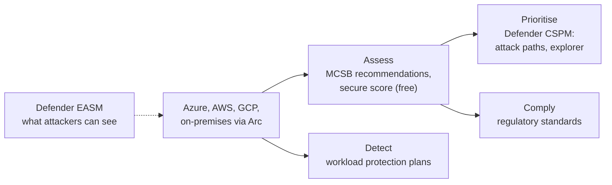
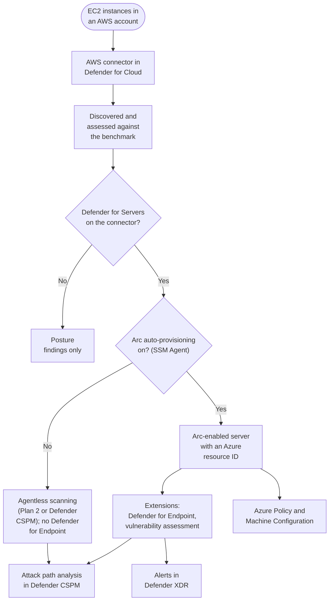

# Security Posture with Defender for Cloud

> **Objective:** Manage security posture by using Defender for Cloud
> **Domain:** Manage and monitor security posture (20-25%)

## Sub-objectives covered

- Identify security risks by using Defender CSPM
- Evaluate compliance against security frameworks by using Defender for Cloud
- Enable and configure Defender for Cloud workload protection plans
- Connect hybrid cloud and multicloud environments to Defender for Cloud, including Amazon Web Services (AWS) and Google Cloud Platform (GCP)
- Configure Microsoft Defender Vulnerability Management settings for Azure VMs
- Discover unprotected assets and vulnerabilities by using Microsoft Defender External Attack Surface Management (EASM)

## The security problem

You have spent three domains enabling individual controls. This module is about the
question that only appears once you have a lot of them: **which of the thousands of things
that are wrong actually matter?**

A mature Azure estate generates an enormous number of true findings. Every one is real.
Almost none of them are urgent. A storage account without soft delete, a VM missing a patch,
an over-broad role assignment - individually these are items on a list, and a list of
four thousand items is functionally the same as no list at all.

Defender for Cloud's answer has three layers, and they are the three things this objective
tests:

1. **Assess everything** - continuous evaluation against a benchmark, expressed as
   recommendations and a secure score. This is the list.
2. **Find the chains** - attack path analysis and the security graph, which connect findings
   into the routes an attacker could actually walk. This is what turns a list into a
   priority.
3. **Protect and detect** - workload protection plans, the per-service Defender plans you
   have been enabling and disabling since 01-02.

The distinction between layers 1 and 2 is the conceptual core. "This VM has a critical CVE"
is a finding. "This VM has a critical CVE, is reachable from the internet, and holds a
managed identity with Contributor on the subscription" is an **attack path** - and it is the
same three facts, assembled.

## In plain English

Once you have many cloud resources, you will always have many things slightly wrong. The
hard part is knowing **which few actually matter**.

**Microsoft Defender for Cloud** answers that in layers. Its free tier checks your resources
against Microsoft's security benchmark and gives you a list of **recommendations** and a
**secure score**. The paid **Defender CSPM** plan connects those findings into **attack
paths** - the chains an attacker could actually follow - so you fix what matters first. Its
**workload protection plans** (for servers, storage, databases, containers and more) detect
attacks as they happen. It can bring **AWS and Google Cloud** into the same view, and
**Defender External Attack Surface Management (EASM)** finds internet-facing assets your
organisation did not know it had.

## Words you need to know

- **Security posture** - how exposed your environment is, based on its configuration
  (0A-12).
- **CSPM (cloud security posture management)** - continuously assessing configuration and
  reporting risk. **Foundational CSPM** is free; **Defender CSPM** is the paid plan.
- **Recommendation** - one finding with remediation steps.
- **Secure score** - one number summarising your open findings. There are two models: the
  **classic secure score** in the Azure portal counts the Microsoft cloud security benchmark
  recommendations you meet, and risk prioritisation doesn't change it; the **Cloud Secure
  Score** in the Defender portal weights open recommendations by risk level, asset risk factors
  and asset criticality. Neither one chains findings into attack paths.
- **Microsoft cloud security benchmark (MCSB)** - Microsoft's default security standard,
  applied automatically.
- **Regulatory compliance standard** - an external framework (for example PCI DSS or ISO
  27001) mapped to assessments; implemented in Azure as Azure Policy initiatives.
- **Security graph / attack path** - a map of resources and their relationships, and a
  chain through it that leads to something valuable.
- **Cloud security explorer** - queries against that graph.
- **Workload protection plan** - a per-service Defender plan that detects threats (for
  example Defender for Servers or Defender for Storage).
- **Security connector** - how an AWS account or GCP project is connected to Defender for
  Cloud.
- **Microsoft Defender Vulnerability Management (MDVM)** - the vulnerability assessment
  engine for machines.
- **Defender EASM** - discovers your organisation's internet-facing assets from seeds such
  as domains and IP ranges.

## Mental model

A teaching model: from a long list to the few things that matter.

## How it works under the hood

### Two CSPM plans, and what each one buys

| Capability | Foundational CSPM (free) | Defender CSPM (paid) |
| --- | --- | --- |
| Continuous assessment of configuration | Yes | Yes |
| Security recommendations | Yes | Yes |
| Secure score | Yes | Yes |
| Asset inventory | Yes | Yes |
| Microsoft cloud security benchmark | Yes | Yes |
| **Regulatory compliance standards** beyond MCSB | No - needs a paid plan | **Yes** (as does any other paid plan except Servers Plan 1 and APIs Plan 1) |
| **Governance rules** | No | **Yes** |
| **Cloud security explorer** | No | **Yes** |
| **Attack path analysis** | No | **Yes** |
| **Agentless scanning for machines** | No | **Yes** |
| **Risk prioritisation**, AI security posture | No | **Yes** |
| Advanced DevOps posture (PR annotations, code-to-cloud mapping) | Basic recommendations only | **Yes** |

Coverage spans **Azure, AWS, and GCP**, plus on-premises through **Azure Arc**. Billing is
based on specific billable resources rather than a flat rate.

**The gotcha that produces silent failure:** agentless scanning requires the **Subscription
Owner** to enable the Defender CSPM plan. Someone with lower authorisation *can* enable the
plan, but the agentless scanner will not turn on, because the permissions it needs are only
available to an Owner. And because the scanner is off, **attack path analysis and cloud
security explorer do not populate with vulnerabilities.** The plan shows as enabled, the
features exist, and the most valuable thing about them is missing. If your attack paths are
empty, check who enabled the plan.

### The security graph, attack paths, and the explorer

Defender CSPM builds a graph of your cloud: resources, their configurations, their network
exposure, their identities and permissions, and their vulnerabilities - from agentless
scanning, from MDVM, from container image scanning, from secrets scanning.

**Attack path analysis** walks that graph looking for chains that lead somewhere: an
internet-exposed resource, with a vulnerability, holding an identity, with permissions on
something sensitive. Each path is a single prioritised item that replaces several
unprioritised findings.

**Cloud security explorer** queries the same graph directly. It is the difference between
reading a report and hunting: "show me internet-facing VMs with a critical vulnerability that
have a managed identity with write access to a storage account containing sensitive data" is
one query. The building blocks come from work you did earlier in the guide - agentless
machine scanning from 03-04, container findings from 03-05, secrets from 01-02, data
classification from 02-01.

**Risk prioritisation** orders recommendations by the risk they actually represent - the
exploitability and business impact of what they sit on - rather than by a flat severity. This
is the answer to the four-thousand-item list.

### Compliance standards

Covered mechanically in
[01-03](../01-identity-access-governance/01-03-governance-and-regulatory-compliance.md), and
worth restating in one line because it is the thing people forget: **for Azure, the standards
are Azure Policy initiatives**, so a compliance control maps to recommendations, which map to
policy definitions. MCSB is applied by default and drives the secure score. **Additional
frameworks need a paid plan:** Microsoft documents that you can access compliance standards
by onboarding **any Defender for Cloud plan except Defender for Servers Plan 1 or Defender
for APIs Plan 1** - Defender CSPM is the usual one. Adding a standard needs Owner or Policy
Contributor; a standard with no relevant assessed resources does not appear on the dashboard,
and controls that cannot be assessed automatically show greyed out.

Custom standards and custom recommendations let internal requirements live in the same
dashboard as the regulatory ones.

### Workload protection plans

These are the per-service plans you have been switching on and off throughout the guide:

| Plan | Covered in |
| --- | --- |
| Key Vault | 01-02 |
| Storage | 02-01 |
| Databases (Azure SQL, SQL servers on machines, open-source relational, Cosmos DB) | 02-02 |
| AI services | 03-03 |
| Servers, Plan 1 and Plan 2 | 03-04 |
| Containers | 03-05 |
| App Service, APIs | 03-06 |
| Resource Manager | posture (control-plane operations) |

Older plans have been folded into these: Defender for Kubernetes and Defender for Container
Registries into **Defender for Containers**, and Defender for DNS into **Defender for
Servers**. The legacy per-transaction pricing for Key Vault and Resource Manager has given way
to fixed per-resource pricing, and new onboarding to the deprecated plans is blocked.

Three properties they all share, and all three are exam-relevant:

- **Enabled at subscription scope** (with some resource-level overrides), which is why they
  survive resource group deletion - the point made in 00-01 and enforced by every teardown in
  this guide.
- **Off by default.** Enabling Defender for Cloud does not enable them.
- **Best deployed by policy**, not by hand, so new subscriptions inherit them - the 01-03
  governance pattern.

CSPM tells you what is wrong; workload protection plans tell you what is happening. An
organisation with excellent CSPM and no workload plans has good hygiene and no detection.

### Multicloud and hybrid

**AWS and GCP** connect through **security connectors** created in Environment settings. The
connector establishes read access to the cloud account, discovers resources, and applies the
equivalent assessments - and it can auto-provision **Azure Arc** onto discovered machines.
Arc gives each machine an Azure resource and an extension host, which is how Defender for
Cloud deploys Defender for Endpoint and vulnerability assessment to it. Without Arc,
agentless scanning (Defender for Servers Plan 2 or Defender CSPM) still assesses the
machines through the connector, but the agent-based protection does not reach them.

**On-premises** machines arrive through Arc directly, as in 03-04.

The conceptual point: once connected, an AWS EC2 instance and an Azure VM appear in the same
inventory, the same recommendations list, the same secure score, and the same **attack
paths** - including paths that cross cloud boundaries. That last capability is most of the
argument for multicloud CSPM.

What the connector gives you on its own, and what Arc adds:

### Microsoft Defender Vulnerability Management for Azure VMs

MDVM is the vulnerability assessment engine across this guide - Defender for Servers in
03-04, container images in 03-05, and here. For Azure VMs it arrives two ways:

- **With the Defender for Endpoint extension**, enabled by default on machines carrying it
  when a Servers plan is on
- **Agentlessly**, through disk snapshot scanning with Defender for Servers Plan 2 or Defender
  CSPM

Settings worth knowing: vulnerability assessment is **on by default** when either Defender
for Servers plan is enabled; you can turn it off or exclude machines; agentless scanning can
exclude machines by tag; and **premium** Defender Vulnerability Management capabilities come
with Defender for Servers Plan 2. Disks encrypted with customer-managed keys need extra Key
Vault permissions before agentless scanning can read them. Findings feed the security graph, so a vulnerability
becomes part of an attack path rather than a standalone row.

### Defender EASM

Everything above assesses resources **you know about**. EASM assesses what an attacker sees,
which is not the same set.

It works from **seeds** - domains, IP blocks, hosts, email contacts, ASNs, WHOIS
organisations - and runs recursive discovery from them, using Microsoft's own crawling
infrastructure and threat intelligence, to build an inventory of internet-facing assets
associated with your organisation. The output includes assets nobody in the organisation
remembers: a marketing microsite, a forgotten test environment, a subsidiary's infrastructure,
an expired-but-still-resolving hostname.

Discovered assets land in **states** you triage. Strongly connected assets go straight to
**Approved Inventory**; weaker connections become **Candidate** or **Requires
Investigation** for manual review; and you can mark third-party infrastructure as
**Dependency** or related assets as **Monitor Only**. Approved Inventory assets are scanned
daily; candidates only during discovery. EASM surfaces vulnerabilities and misconfigurations
on them, including things no internal scanner would see because nobody knew to point it
there.

Two practical notes. EASM is **deployed as its own Azure resource** and **billed separately
from Defender for Cloud**, after a 30-day free trial, by the number of **billable assets** -
approved hosts (host:IP pairs), domains and IP addresses in the **Approved Inventory** state.
Other states are not billed, but discovery approves strongly connected assets automatically,
so a broad seed still grows the bill. And the honest framing: EASM finds shadow
IT, which is the category of asset most likely to be unpatched, unmonitored, and unowned.

## Why security cares

**Without the control**

1. Defender for Cloud lists 4,000 recommendations across 30 subscriptions
2. The team works through them by severity, fixing storage soft delete and tagging
3. Meanwhile one VM is internet-exposed, has a critical vulnerability, and has a managed
   identity with write access to a storage account holding customer data
4. Nothing marks that combination as special, and it is exploited first

**With the control**

1. Defender CSPM is enabled by a subscription Owner, so agentless scanning feeds
   vulnerabilities into the security graph
2. Attack path analysis surfaces that VM-to-customer-data chain as one high-risk path
3. Governance rules assign it an owner and due date; breaking one link (removing the public
   exposure or narrowing the identity) breaks the path
4. Defender for Servers and Defender for Storage watch for the attack in the meantime

**What it does not solve.** Posture management reports and prioritises; it does not fix
anything by itself, and a secure score is not an attack path analysis: the classic score ignores
risk, and even the risk-based Cloud Secure Score grades findings one asset at a time. Assets nobody connected
are invisible to it - which is the gap EASM addresses.

**Depends on.** Who enabled Defender CSPM (Owner), connectors for every cloud you use,
workload plans actually enabled (ideally by Azure Policy), and owners for the findings.

## Configuration surface

| Control | Default | Set it to | Why |
| --- | --- | --- | --- |
| Foundational CSPM | Enabled when Defender for Cloud is enabled | Enabled | Free, and everything else assumes it |
| Defender CSPM | Off | On where attack paths and agentless scanning are needed | The paid capabilities are the prioritisation ones |
| Who enables Defender CSPM | anyone with rights | **Subscription Owner** | Otherwise agentless scanning silently does not start |
| MCSB | Applied | Leave applied | Drives the secure score |
| Additional standards | none (needs a paid plan other than Servers P1 / APIs P1) | Only frameworks you are held to | Each adds recommendations and noise |
| Workload protection plans | **Off** | On per service in use, enforced by Azure Policy | Off by default, subscription-scoped, survives RG deletion |
| MDVM scope | all supported machines | Confirm, with deliberate exclusions | Silence is not coverage |
| AWS / GCP connectors | none | One per account or organisation, with Arc auto-provisioning | Cross-cloud attack paths |
| Governance rules | none | Owner and due date per recommendation set | Findings without owners do not get fixed |
| EASM | not deployed | Narrow seeds first, then review candidates | Billed per Approved Inventory asset after the trial |

## Common failure modes

**Secure score treated as the goal.** The classic score measures MCSB compliance, not risk,
and even the Defender portal's risk-based Cloud Secure Score grades findings one asset at a
time instead of chaining them. A high score with an unaddressed attack path is worse than the
reverse.

**Attack paths empty, plan enabled.** Almost always the Owner-permission problem above - the
agentless scanner never started.

**Defender CSPM enabled, workload plans left off.** Excellent posture reporting, no detection.
The two halves are sold separately for a reason and neither substitutes for the other.

**Compliance dashboard read as remediation.** A percentage is evidence. The 22% keeps running -
the point made in 01-03 and worth repeating here.

**Every available standard assigned.** The dashboard becomes unreadable and nobody can tell
which findings are contractually required.

**Plans enabled by hand, subscription by subscription.** The next subscription somebody creates
has none of them. Use policy.

**Multicloud connector created, Arc auto-provisioning declined.** AWS instances appear in
inventory and agentless scanning still assesses them, but Defender for Cloud cannot deploy
Defender for Endpoint or vulnerability assessment extensions to them: no agent-based
protection.

**MDVM assumed to cover machines it does not.** Check scope and exclusions rather than reading
an empty result as clean - the same error as the empty secret-scanning result in 01-02.

**EASM run against a broad seed on a real organisation.** Discovery auto-approves strongly
connected assets, and every Approved Inventory asset is billable. Start narrow.

**EASM findings not routed anywhere.** Discovery without an owner produces a list of things
nobody has authority over - which is the same problem EASM was bought to solve, one level up.

## Hands-on

See [04-01 lab](../../labs/04-security-posture/04-01-lab.md).

## Validate the security outcome

| Control | The outcome to prove | Evidence |
| --- | --- | --- |
| Defender CSPM | Findings are connected into attack paths | Attack path analysis lists paths; cloud security explorer returns vulnerability data for machines |
| Agentless scanner | The graph has vulnerability data | Agentless scanning for machines shows **On** in the plan settings, and machines show software inventory |
| Compliance standards | You can show status against the frameworks you are held to | The standard appears in the Regulatory compliance dashboard with assessed controls |
| Workload plans | Every subscription has the plans it needs, including new ones | Defender plans show **On**; an Azure Policy assignment at management group scope reports compliant |
| Multicloud | AWS and GCP resources are assessed alongside Azure | Connected accounts appear in Environment settings; their resources appear in inventory and recommendations |
| MDVM | Machines report vulnerabilities | Vulnerability findings appear for in-scope VMs; exclusions are deliberate and documented |
| Governance rules | Findings have owners and due dates | Recommendations show an owner and due date; overdue items are visible |
| EASM | Unknown internet-facing assets are found and triaged | Inventory shows Approved Inventory and Candidate assets; candidates are reviewed |

## How this is tested

| Phrase in the question | What it steers you to |
| --- | --- |
| "prioritise which findings matter" | Attack path analysis / risk prioritisation, Defender CSPM |
| "query relationships across resources" | Cloud security explorer |
| "free, out of the box" | Foundational CSPM |
| "assess against PCI-DSS / ISO" | Additional standards - needs a paid plan (typically Defender CSPM; not Servers P1 or APIs P1 alone) |
| "measure against Microsoft's own benchmark" | MCSB, foundational |
| "detect attacks against storage / SQL / servers" | The relevant workload protection plan |
| "the plan must apply to future subscriptions" | Azure Policy assignment at management group scope |
| "AWS EC2 instances in the same inventory" | AWS security connector, with Arc auto-provisioning |
| "vulnerability findings without installing an agent" | Agentless scanning, Defender CSPM or Servers Plan 2 |
| "assets we do not know we own" | Defender EASM |
| "assign an owner and due date to a recommendation" | Governance rules, Defender CSPM |
| "attack paths are empty" | Agentless scanner not enabled - check who enabled the plan |

**AZ-500 divergence.** Defender for Cloud has reorganised around the CSPM plan split, with the
prioritisation features - attack paths, security explorer, risk-based ordering - behind the
paid tier and the free tier reduced to assessment and secure score. Older material that treats
"Defender for Cloud is enabled" as meaning all of this is available will mislead you on both
capability and cost.

### What SC-500 expects you to do

- **Identify** whether a requirement is about assessment, prioritisation, compliance,
  detection, multicloud coverage, vulnerability management or external discovery.
- **Distinguish** Foundational CSPM from Defender CSPM, recommendations from attack paths,
  posture from workload protection, and internal inventory from EASM's external view.
- **Select** the plan, standard, connector or EASM configuration that meets a scenario.
- **Implement** Defender CSPM (as Owner), compliance standards, workload plans by policy,
  AWS/GCP connectors, MDVM settings and EASM discovery.
- **Evaluate** risk using attack paths, cloud security explorer and the compliance dashboard.

## Check yourself

1. Your organisation enables Defender CSPM. Two weeks later, attack path analysis shows
   nothing and cloud security explorer returns resources but no vulnerabilities. Give the most
   likely cause and the remediation.
2. Distinguish a recommendation from an attack path using one VM as the example. What
   additional facts turn the first into the second, and where does each fact come from?
3. Your classic secure score is 82% and an internet-facing VM with a critical CVE holds a managed
   identity with Contributor at subscription scope. Explain what secure score is actually
   measuring and why it did not capture this.
4. A colleague argues that with Defender CSPM enabled there is no need for the individual
   workload protection plans. State the strongest version of their argument, then the rebuttal.
5. You run an EASM discovery with your organisation's primary domain as the seed and it returns
   4,000 assets. Describe the cost consequence, the triage approach, and what you would have
   done differently.

## Teach it back

Your manager says: "Our secure score is 85%, so we're in good shape." Explain why that
statement could be wrong, and what you would look at instead.

A strong answer covers: the classic secure score measures how many benchmark recommendations
you meet, not how exploitable you are (the Defender portal's Cloud Secure Score is
risk-weighted, but still grades findings one asset at a time); a single attack path can matter more than hundreds of
low-impact findings; attack path analysis and cloud security explorer (Defender CSPM) show
the chains that lead to critical assets; and assets outside Defender for Cloud's view (shadow
IT) need EASM.

## Key takeaways

- Foundational CSPM (free): recommendations, secure score, MCSB. Defender CSPM (paid): attack
  paths, cloud security explorer, governance rules, agentless scanning, risk prioritisation.
- Have a **subscription Owner** enable Defender CSPM, or agentless scanning (and the
  vulnerability data in attack paths) never starts.
- Additional compliance standards need **any paid Defender plan except Defender for Servers
  Plan 1 or Defender for APIs Plan 1**.
- Workload protection plans are off by default and subscription-scoped - deploy them with
  Azure Policy.
- AWS and GCP connect through security connectors; Arc auto-provisioning extends Defender for
  Servers' agent-based protection to their machines (agentless scanning works without it).
- EASM finds what you did not know you owned; only Approved Inventory assets are billed.

## Sources

- Microsoft Learn - SC-500 skills measured: <https://learn.microsoft.com/en-us/credentials/certifications/resources/study-guides/sc-500>
- Cloud security posture management in Defender for Cloud: <https://learn.microsoft.com/azure/defender-for-cloud/concept-cloud-security-posture-management>
- Enable the Defender CSPM plan: <https://learn.microsoft.com/en-us/azure/defender-for-cloud/tutorial-enable-cspm-plan>
- Defender External Attack Surface Management: <https://learn.microsoft.com/azure/external-attack-surface-management>
- Overview of Defender for Servers: <https://learn.microsoft.com/en-us/azure/defender-for-cloud/defender-for-servers-overview>
- Assign regulatory compliance standards: <https://learn.microsoft.com/azure/defender-for-cloud/assign-regulatory-compliance-standards>
- Understand billable assets in Defender EASM: <https://learn.microsoft.com/azure/external-attack-surface-management/understanding-billable-assets>
- Defender EASM discovery and asset states: <https://learn.microsoft.com/azure/external-attack-surface-management/what-is-discovery>
- Review and modify Defender for Servers settings: <https://learn.microsoft.com/azure/defender-for-cloud/configure-servers-coverage>
