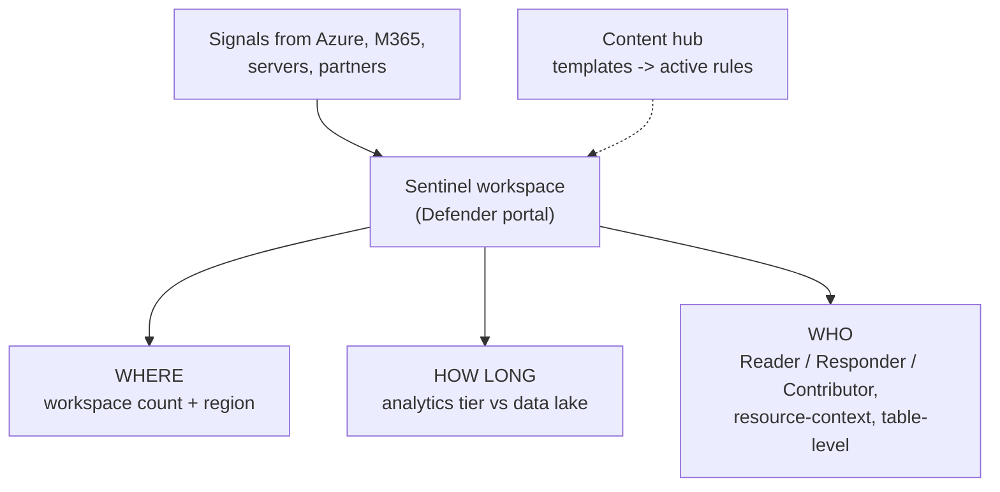
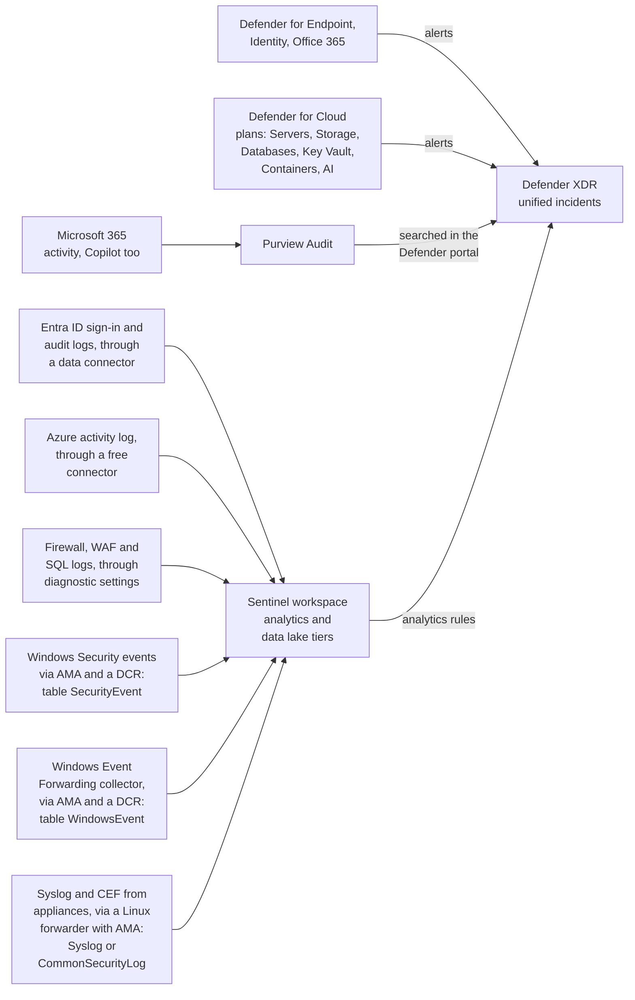

# Sentinel Workspace, Roles, and Content Hub

> **Objective:** Implement activity and event collection in Microsoft Sentinel
> **Domain:** Manage and monitor security posture (20-25%)

## Sub-objectives covered

- Create and connect workspaces in Microsoft Sentinel
- Assign roles in Microsoft Sentinel
- Implement and use content hub solutions

> **Portal transition, with a moving date.** Microsoft Sentinel is generally available in the
> **Microsoft Defender portal**, including for customers without Defender XDR or an E5
> licence, and new tenants have been onboarded there by default since July 2025. The Azure
> portal experience for Sentinel is being **retired on 31 March 2027** - a date that was
> **extended from the originally announced 1 July 2026**. Some Microsoft Learn pages still
> carry the older July 2026 wording. Assume the Defender portal for anything you build now,
> and check the retirement timeline page before the exam.

## The security problem

Three domains of controls have been generating signal. This one is about where it goes and
who may look at it - and the decisions here are unusually hard to reverse.

A SIEM is not primarily an analytics problem. It is a **design** problem with three questions
that each cost real money to get wrong:

1. **How many workspaces, and where?** A workspace is a data boundary. Data in two workspaces
   can be queried together, but not by default, not as conveniently, and not by every feature.
2. **How long do you keep what?** Retention is the difference between an investigation and an
   apology. It is also the second-largest line on the bill.
3. **Who can see and do what?** A SOC analyst, a workload owner, and an auditor need different
   access to the same table.

And underneath all three is the constraint that shapes every Sentinel decision: **you pay by
the gigabyte.** Ingest everything and the bill is unmanageable. Ingest too little and the
investigation fails. Nearly every design pattern in Sentinel exists to resolve that tension.

## In plain English

Every control in this Academy produces records - sign-ins, alerts, configuration changes,
network flows. **Microsoft Sentinel** is where those records are collected, kept, searched
and turned into detections. It is a **SIEM** (security information and event management).

Before anything is collected, three decisions have to be made, and they are hard to undo:
**where the data lives** (a Log Analytics **workspace**, in a region), **how long it is kept
and at what price** (the **analytics tier** for fast, frequent use; the cheaper **data lake
tier** for long-term storage), and **who can see and do what** (Sentinel roles, plus
finer-grained access to particular tables or resources). Then **content hub** supplies
ready-made connectors, detections and workbooks.

## Words you need to know

- **SIEM** - a system that collects security records from many sources so they can be
  searched, correlated and alerted on (0A-11).
- **Log Analytics workspace** - the Azure resource that stores the data Sentinel uses; it
  has a region and a retention configuration.
- **Microsoft Defender portal** - where Sentinel is now used, alongside Defender XDR; the
  Azure portal experience retires on 31 March 2027.
- **Primary / secondary workspace** - in the Defender portal, one workspace is primary
  (its data correlates with Defender XDR incidents); others can be secondary.
- **Analytics tier** - fast, fully featured storage for detections and hunting.
- **Data lake tier** - low-cost long-term storage, queried with KQL jobs or notebooks rather
  than real-time rules.
- **Commitment tier** - a pre-purchased daily ingestion volume at a lower price.
- **Microsoft Sentinel Reader / Responder / Contributor** - read; read and manage incidents;
  and create detections and other content.
- **Resource-context RBAC** - users see log rows about the Azure resources they can access,
  without workspace-wide access.
- **Table-level RBAC** - access to specific tables only.
- **Content hub / solution** - the catalogue of packaged Sentinel content; a solution
  bundles connectors, analytics rule templates, workbooks and more.

## Mental model

A teaching model: three design decisions before the first log arrives.

## How it works under the hood

### Where the signals come from

Before the workspace design, the whole route. Defender products send alerts to Defender
XDR; logs reach the Sentinel workspace through connectors, diagnostic settings or the
Azure Monitor Agent, and each route lands in its own table. 04-03 takes the routes one
at a time.

### Workspaces

Microsoft Sentinel is a solution **on top of a Log Analytics workspace**. That remains true
after the Defender portal transition: **Log Analytics workspaces are still the primary data
store** for ingestion, KQL, analytics rules, retention, and billing. The Defender portal
changes where you work, not where the data lives.

The workspace decision:

| Approach | Advantages | Costs |
| --- | --- | --- |
| **Single workspace** | One query surface, one set of analytics rules, incidents that correlate across everything | Coarse access control, all data in one region |
| **Multiple workspaces** | Data residency, per-tenant or per-business-unit separation, delegated ownership | Cross-workspace queries, duplicated rules, more to manage |

Drivers for multiple workspaces are usually **regulatory** (data must stay in a region),
**organisational** (an MSSP serving many tenants, or a group with genuinely separate SOCs), or
**contractual**. Drivers for a single workspace are analytical: correlation is easy inside a
workspace and awkward across them.

Where multiple workspaces are unavoidable, the tools are **cross-workspace queries**, the
**workspace manager** for pushing content centrally from one workspace to members, and - for
other tenants - **Azure Lighthouse** in the Azure portal or **Defender multitenant management**
in the Defender portal.

**Retention and tiers** are where cost design happens. Each table lives in one of two tiers:

| | Analytics tier | Data lake tier |
| --- | --- | --- |
| Use | Analytics rules, hunting, workbooks, every real-time feature | Compliance retention, historical investigation, high-volume low-value logs |
| Ingestion cost | Standard | Minimal |
| Querying | Fast, included in price | Slower; KQL jobs, Spark jobs, notebooks, search jobs; charged by data scanned |
| Retention | 30 days by default; Sentinel solution tables extend to **90 days** at no extra storage charge, any table to 2 years | Up to **12 years** total |

Data in the analytics tier is **mirrored to the data lake** by default, and **total
retention** can run past analytics retention so older data stays queryable in the lake at
low cost. Shortening total retention has a 30-day grace period before data is removed.
Configure all of it per table under **Microsoft Sentinel → Configuration → Tables**. (Defender XDR advanced
hunting data is separate: 30 days in the XDR default tier, which you can extend into the
Sentinel tiers.)

> **Watch the default.** Microsoft's pages describe the analytics-tier default both as 30
> days and as 90 days. What is consistent is that **Microsoft Sentinel solution tables can
> keep 90 days of analytics retention at no extra storage charge** - so check each important
> table actually has it.

**Pricing** is pay-as-you-go or **commitment tiers**, billed daily. The asymmetry matters
operationally: you can **increase** a commitment tier at any time, which **restarts the 31-day
commitment period**, but to move down a tier or back to pay-as-you-go you must **wait out the
31 days** - the one exception is a 6-hour window after a change, to undo a mistake. Commit
cautiously in a lab and in a new deployment.

One more, which appears as a scenario: the **Defender XDR connector** (turned on
automatically when you onboard Sentinel to the Defender portal) replaces the individual
Defender product alert connectors. Microsoft disconnects those for you - they can still look
connected, but no data flows through them. Alerts and incidents from Defender XDR are ingested
**at no charge**; the raw advanced hunting tables (`DeviceEvents`, `EmailEvents` and so on) are
billed if you choose to stream them. The real trap is **duplicate incidents**: turn off the
**Microsoft incident creation rules** for those products (the connector page offers it),
because Defender XDR now groups their alerts into incidents itself.

**In the Defender portal**, one workspace is the **primary** workspace - its data is correlated
with Defender XDR into unified incidents - and others can be added as **secondary**. Onboarding
(**System → Settings → Microsoft Sentinel → Connect a workspace**) needs **Security
Administrator** in Microsoft Entra ID plus, in Azure, either **Owner** - an unconditional
assignment at subscription scope - or **User Access Administrator** with **Microsoft Sentinel
Contributor**. Cross-tenant management in the Defender portal uses **Microsoft Entra B2B**
and Defender multitenant management; GDAP with Azure Lighthouse is not supported for
Sentinel data there, although Lighthouse still lets advanced hunting and analytics rules
query another tenant's workspace with `workspace()`.

### Roles

Sentinel uses Azure RBAC, and the built-in roles are scoped to the workspace's resource group
in practice:

| Role | Can |
| --- | --- |
| **Microsoft Sentinel Reader** | View data, incidents, workbooks, and other resources |
| **Microsoft Sentinel Responder** | Everything Reader can, plus manage incidents - assign, change severity, close |
| **Microsoft Sentinel Contributor** | Everything Responder can, plus create and edit analytics rules, workbooks, and other content |
| **Microsoft Sentinel Playbook Operator** | List, view, and manually run playbooks |
| **Microsoft Sentinel Automation Contributor** | Allows Sentinel itself to add playbooks to automation rules - assigned to the service, **not to people** |
| **Microsoft Sentinel Workbook Contributor** | Save and edit workbooks |

**Unified RBAC in the Defender portal.** Once Sentinel is onboarded, you can manage its access
through **Microsoft Defender unified RBAC**, where Reader, Responder and Contributor map to
unified roles and **scoping** gives row-level access by scope tags. When it is activated,
unified RBAC becomes the source of permissions (Azure RBAC still applies in parallel). Playbook
Operator, Automation Contributor and Workbook Contributor are not available there and stay in
Azure RBAC. Data lake access uses Microsoft Entra roles and unified RBAC permissions rather than
the workspace roles.

Two things these roles do **not** cover, and both are exam-relevant:

- **Playbooks are Logic Apps.** Creating and editing them needs Logic App permissions, not
  Sentinel ones. Playbook Operator lets someone *run* a playbook; it does not let them build
  one.
- **Data access is layered.** Log Analytics roles govern the workspace's data plane, and
  finer-grained control is available through **table-level RBAC** (access to specific tables)
  and **resource-context RBAC** (a workload owner sees rows about their own resources without
  seeing the rest of the workspace). Resource-context is the right answer when the question
  says an application team should investigate their own servers without SOC-level access.

The least-privilege pattern is straightforward once you see the shape: analysts get
**Responder**, engineers who write detections get **Contributor**, workload owners get
**resource-context** access, and auditors get **Reader**.

The **content hub** has its own requirement worth memorising: installing, updating, and
deleting solutions or standalone content needs **Microsoft Sentinel Contributor at the
resource group level** (some solution packages also need **Template Spec Contributor**).
Configuring a data connector needs read and write on the workspace.

### Content hub

Content hub is the single catalogue of packaged content. A **solution** is a bundle for a
product or scenario, typically containing some mixture of:

- Data connectors
- Analytics rule templates
- Workbooks
- Hunting queries
- Playbooks
- Parsers and watchlists

The mechanic people get wrong: **installing a solution does not enable its content.** Installing
puts analytics rule *templates* in your workspace; you then create **active rules** from those
templates, tuning thresholds and entity mappings as you go. A tenant with forty solutions
installed and no active rules has a full catalogue and no detections.

Solutions are **versioned and updated** independently, and an update does not silently overwrite
the rules you created from a template - which is good, and also means your active rules do not
automatically benefit from an improved template. Reviewing updates is a periodic task, not a
one-off.

The **deployment order** that avoids wasted effort: create the workspace → onboard Sentinel →
connect Sentinel to the Defender portal → install content hub solutions → configure their data
connectors → enable analytics rules from the templates. Installing solutions before deciding
what you will ingest produces a catalogue matched to nothing.

## Why security cares

**Without the control**

1. Each subscription gets its own workspace "to keep things tidy"
2. Retention is left at the default; nobody checks whether the free 90 days are being used
3. Every analyst is given Contributor
4. An intrusion is discovered four months after it began: the early sign-ins have aged out,
   and the evidence is spread across six workspaces; meanwhile an analyst has accidentally
   disabled a detection rule

**With the control**

1. One workspace (plus a second only where data must stay in another region), onboarded to
   the Defender portal
2. Detection and hunting tables kept in the analytics tier; long-term evidence retained
   cheaply in the data lake for the period the organisation needs
3. Analysts get Responder, detection engineers get Contributor, workload owners get
   resource-context access
4. The investigation queries one place, across the whole timeline, and nobody without the
   right role can change detection logic

**What it does not solve.** A well-designed workspace only holds what you connect to it (04-03)
and only alerts on rules you actually enable.

**Depends on.** Data residency requirements, a daily cap or cost alerts before connecting
sources, and role assignments reviewed like any other privileged access.

## Configuration surface

| Setting | Default | Set it to | Why |
| --- | --- | --- | --- |
| Portal | Azure portal for older deployments | **Defender portal** | Azure portal retires 31 March 2027 |
| Workspace count | one | One, unless residency or tenancy forces more | Correlation is easy inside a workspace |
| Workspace region | your choice | Where the data is required to live | Not changeable afterwards |
| Daily cap | none | **Set one before connecting anything** | The only hard stop on ingestion spend |
| Pricing tier | pay-as-you-go | Commitment tier once volume is known | Increases restart the 31-day period; decreases must wait it out (except within 6 hours of a change) |
| Retention | check per table | At least the included 90 days in the analytics tier for key tables; total retention in the data lake for the rest | Retention is the second-largest bill line |
| Defender XDR connector | on after Defender portal onboarding | On - **with Microsoft incident creation rules for its products turned off** | Otherwise the same alerts raise duplicate incidents. The per-product alert connectors are disconnected for you |
| Access management | Azure RBAC | Azure RBAC, or Defender unified RBAC once activated | Unified RBAC adds scoping by tag |
| Analyst access | none | Microsoft Sentinel **Responder** | Read plus incident management |
| Detection engineer access | none | Microsoft Sentinel **Contributor** | Create and edit rules |
| Workload owner access | none | **Resource-context RBAC** | Their own resources, not the whole workspace |
| Playbook authors | none | Logic App permissions, not a Sentinel role | Playbooks are Logic Apps |
| Content hub installation rights | none | Sentinel Contributor at **resource group** scope | Documented requirement |

## Common failure modes

**A workspace per subscription, because it seemed tidy.** Every cross-subscription
investigation now requires cross-workspace queries, and analytics rules must be duplicated and
maintained in each.

**Region chosen without thinking.** Workspace region is not changeable after creation; moving
means a new workspace and a migration.

**No daily cap.** A misconfigured syslog or WEF collector - the exact scenario in 04-03 - can
ingest far more than intended before anyone notices, and the cost pipeline lag from 00-01 means
you learn about it late.

**Commitment tier raised to "save money" in a new deployment.** The 31-day period restarts on
every increase and you cannot come back down until it completes.

**Microsoft incident creation rules left on beside the Defender XDR connector.** The same
alerts raise two incidents. (The per-product connectors are not the problem: enabling the XDR
connector disconnects them.)

**Solutions installed, no active rules created.** Templates are not detections.

**Contributor handed to analysts.** They can edit and delete detection logic. Responder is the
analyst role.

**Playbook Operator granted to someone expected to build playbooks.** They can run them and not
create them.

**Retention left at 30 days on key tables.** Ninety days are included for Sentinel-enabled
workspaces, and attacker dwell time is often longer than 30 days, so the earliest evidence
expires before the investigation starts. Use total retention in the data lake for longer.

**Building in the Azure portal now.** It works until it does not, and the deadline is fixed.

## Hands-on

See [04-02 lab](../../labs/04-security-posture/04-02-lab.md).

## Validate the security outcome

| Control | The outcome to prove | Evidence |
| --- | --- | --- |
| Workspace design | Data lives where it must, in as few workspaces as possible | Workspace region matches the residency requirement; the Defender portal shows the primary (and any secondary) workspace |
| Defender portal onboarding | Sentinel and Defender XDR incidents correlate | Sentinel incidents appear in the Defender portal incident queue; the Defender XDR connector shows connected |
| Retention | Evidence is kept as long as required | **Microsoft Sentinel → Configuration → Tables** shows analytics and total retention per table; long-term tables use the data lake |
| Cost guardrails | Ingestion cannot run away silently | A daily cap or cost alert exists; commitment tier matches observed volume |
| Least-privilege roles | Analysts can triage but not change detections | An analyst with Responder can close an incident but cannot edit an analytics rule |
| Workload owner access | Owners see only their resources' logs | A user with resource-context access sees rows for their resources and nothing else |
| Content hub | Installed content is actually detecting | Analytics rules created from solution templates appear as **enabled** active rules |

## How this is tested

| Phrase in the question | What it steers you to |
| --- | --- |
| "analyst must triage and close incidents, not edit rules" | Microsoft Sentinel Responder |
| "must create and modify analytics rules" | Microsoft Sentinel Contributor |
| "run a playbook manually, nothing else" | Microsoft Sentinel Playbook Operator |
| "Sentinel must attach playbooks to automation rules" | Microsoft Sentinel Automation Contributor, assigned to the service |
| "team sees only logs from their own servers" | Resource-context RBAC |
| "restrict access to one table" | Table-level RBAC |
| "data must remain in a specific country" | Separate workspace in that region |
| "manage workspaces in a customer tenant" | Azure Lighthouse (Azure portal) or Defender multitenant management with B2B (Defender portal) |
| "push content to multiple workspaces centrally" | Workspace manager |
| "install a vendor's connectors, rules and workbooks together" | Content hub solution |
| "install solutions" | Sentinel Contributor at resource group scope |
| "reduce cost for high-volume, rarely queried logs" | Data lake tier for that table |
| "keep logs for seven years for compliance at low cost" | Total retention in the data lake |
| "avoid duplicate incidents for Defender alerts" | Turn off Microsoft incident creation rules when you connect Defender XDR |

**AZ-500 divergence.** The portal moved. Sentinel is GA in the Defender portal and the Azure
portal experience retires on **31 March 2027** - extended from 1 July 2026, and some
documentation still shows the old date. Content hub also replaced the older per-item galleries
as the way content is delivered, and the data lake is new as a cost-management answer. An
AZ-500-era walkthrough will navigate a portal that is on a countdown.

### What SC-500 expects you to do

- **Identify** whether a requirement is about workspace placement, retention and cost, or
  access.
- **Distinguish** the analytics tier from the data lake tier, Responder from Contributor,
  Playbook Operator from Logic Apps permissions, resource-context from table-level access,
  and an installed solution from an active rule.
- **Select** the workspace design, retention configuration or role that meets a scenario.
- **Implement** a workspace onboarded to Sentinel and the Defender portal, role assignments,
  and content hub solutions with active rules.
- **Evaluate** whether a design will keep the evidence an investigation needs.

## Check yourself

1. Your organisation has 12 subscriptions in one tenant, all in one country, one SOC. A
   colleague proposes a workspace per subscription for "isolation." Give the strongest argument
   for their design and then the case against it, in operational terms.
2. An analyst says they cannot close an incident. They hold Microsoft Sentinel Reader. Name the
   role they need and one role you would **not** give them, with the reason.
3. A team installs 40 content hub solutions in an afternoon and reports that Sentinel is
   "deployed." What is missing, and what would you check first to confirm?
4. You enable the Defender XDR connector. What happens to the individual Defender product
   connectors, what does the alert data cost, and what do you still have to turn off?
5. You set a commitment tier too high in week one. Describe precisely what you can and cannot
   do about it, and when.

## Teach it back

A SOC lead asks why you won't give every analyst Microsoft Sentinel Contributor "so they
aren't blocked". Explain the difference between Responder and Contributor, and who else needs
what.

A strong answer covers: Responder can view data and manage incidents (assign, change
severity, close); Contributor can also create, edit and delete analytics rules and other
content; analysts need Responder, detection engineers Contributor; building playbooks needs
Logic Apps permissions; workload owners need resource-context access; installing content hub
solutions needs Contributor at resource group scope.

## Key takeaways

- Sentinel sits on a Log Analytics workspace; use it in the Defender portal - the Azure portal
  experience retires on 31 March 2027.
- Fewer workspaces correlate better; split only for residency, tenancy or genuinely separate
  SOCs. Region cannot be changed later.
- Analytics tier for detections and hunting; data lake tier for cheap long-term retention (up
  to 12 years total).
- Responder = triage; Contributor = detection engineering; Playbook Operator = run playbooks
  only.
- Resource-context RBAC for workload owners; table-level RBAC for specific tables.
- Installing a solution adds templates - you still create active rules.

## Sources

- Microsoft Learn - SC-500 skills measured: <https://learn.microsoft.com/en-us/credentials/certifications/resources/study-guides/sc-500>
- Best practices for Microsoft Sentinel: <https://learn.microsoft.com/azure/sentinel/best-practices>
- What's new in Microsoft Sentinel: <https://learn.microsoft.com/azure/sentinel/whats-new>
- What's new in unified security operations: <https://learn.microsoft.com/unified-secops/whats-new>
- Reduce costs for Microsoft Sentinel: <https://learn.microsoft.com/azure/sentinel/billing-reduce-costs>
- Manage data tiers and retention in Microsoft Sentinel: <https://learn.microsoft.com/azure/sentinel/manage-data-overview>
- Connect Microsoft Sentinel to the Microsoft Defender portal: <https://learn.microsoft.com/azure/sentinel/microsoft-sentinel-onboard>
- Map existing RBAC permissions to Microsoft Defender unified RBAC: <https://learn.microsoft.com/defender-xdr/compare-rbac-roles>
- Discover and manage Microsoft Sentinel out-of-the-box content: <https://learn.microsoft.com/azure/sentinel/sentinel-solutions-deploy>
