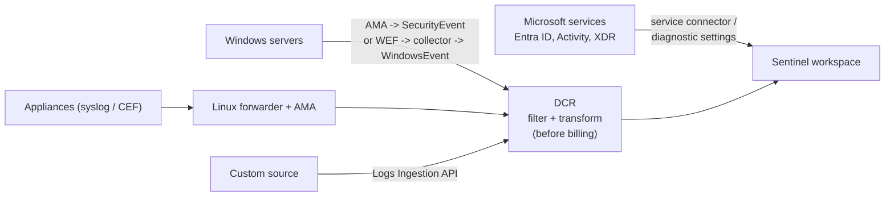
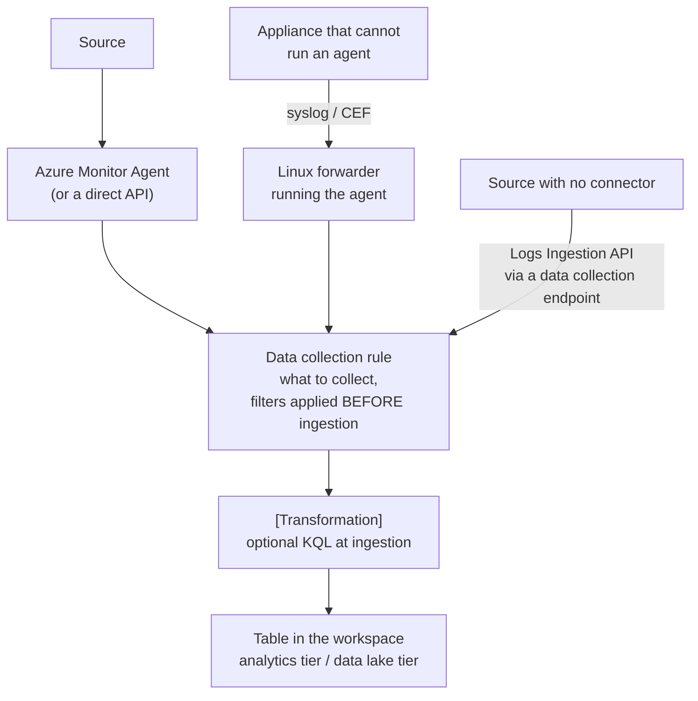

# Sentinel Data Connectors and Event Collection

> **Objective:** Implement activity and event collection in Microsoft Sentinel
> **Domain:** Manage and monitor security posture (20-25%)

## Sub-objectives covered

- Configure and use Microsoft data connectors for Azure resources
- Implement and configure syslog and Common Event Format (CEF) event collections
- Implement and configure collection of Windows Security events by using data collection rules, including Windows Event Forwarding (WEF)
- Create custom log tables in the workspace to store ingested data

## The security problem

Every previous module produced signal. This one decides which of it you keep.

That framing matters because collection decisions are **asymmetric in a way almost nothing else
in this guide is**. Turn off a Defender plan and you can turn it back on. Get a firewall rule
wrong and you fix it. But data you chose not to collect on Tuesday does not exist on Friday,
and no amount of budget or privilege recovers it. The table is simply empty, and nothing about
the query result tells you whether that means "nothing happened" or "we never collected this."

Against that sits the constraint from 04-02: you pay by the gigabyte, and the highest-volume
sources are frequently the lowest-value ones. Full Windows Security event collection from a
few hundred servers will dwarf everything else in the workspace and consist mostly of events
nobody will ever query.

So this objective is one engineering problem stated four ways: **collect what an investigation
will actually need, filter as early as possible, and know which of the two failure modes you
are risking.**

## In plain English

Sentinel can only detect what it receives. This lesson is about getting the right records in
- and keeping the wrong ones out, because you pay for every gigabyte.

Microsoft services (Microsoft Entra ID, Azure Activity, Defender XDR) connect with a few
clicks. Servers and network devices need more work: the **Azure Monitor Agent** runs on a
machine and a **data collection rule (DCR)** tells it exactly what to collect. Firewalls and
other appliances that cannot run an agent send **syslog** or **CEF** messages to a Linux
**forwarder** that does. Windows servers send their Security log directly, or forward events
to a **collector** first (Windows Event Forwarding). Anything without a connector can be sent
into a **custom table** through an API.

## Words you need to know

- **Data connector** - the Sentinel component that brings one source's data in (0A-11).
- **Azure Monitor Agent (AMA)** - the agent that collects logs from machines; the older Log
  Analytics agent is retired.
- **Data collection rule (DCR)** - an Azure resource that says what to collect, how to filter
  or transform it, and which table it goes to.
- **Transformation** - a KQL query in a DCR applied at ingestion, to drop, filter or reshape
  data before it is stored.
- **Syslog** - the standard log message format for Linux and network devices.
- **CEF (Common Event Format)** - a structured syslog format used by security vendors; lands
  in `CommonSecurityLog`.
- **Forwarder** - a Linux machine running AMA that receives syslog/CEF from devices that
  cannot run an agent.
- **XPath query** - a filter that selects specific Windows events, such as particular event
  IDs.
- **Windows Event Forwarding (WEF) / collector (WEC)** - Windows machines forward events to a
  collector server, which runs the agent.
- **Custom table (`_CL`)** - a table you define for a source with no built-in connector.
- **Logs Ingestion API** - the API that sends custom data through a DCR into a table.

## Mental model

A teaching model: every source takes one of four routes into the workspace.

## How it works under the hood

### One agent, and the shape of modern collection

The Log Analytics agent (MMA) is retired. Everything agent-based now runs on the **Azure
Monitor Agent (AMA)**, and AMA is configured entirely by **data collection rules**. For
machines outside Azure - physical servers, on-premises VMs, other clouds - **Azure Arc must be
installed first**, because AMA is deployed to them as an Arc extension.

The pipeline is the same for every source:

The same pipeline for every source, with the two routes this module covers below: the
forwarder for appliances (lands in `Syslog` or `CommonSecurityLog`) and the Logs Ingestion
API for custom tables (`_CL`).

Two properties of that diagram do most of the work:

- **Filtering happens in the DCR, before ingestion.** Events the agent never collects
  (facilities, severities, XPath) are never sent or billed. This is the difference between an
  affordable Sentinel and an unaffordable one. Transformations are subtler: in a workspace with
  Sentinel enabled, transformations into Analytics tables carry no filtering charge, but Basic
  tables are charged when a transformation drops more than half the data, and data lake-only
  tables are charged data processing on everything that arrives.
- **A DCR is a resource, associated with machines.** Change the DCR and collection changes
  everywhere it is associated - which is the good and the dangerous property at once.

**Data collection endpoints (DCEs)** provide the ingestion endpoint some scenarios require -
custom logs and certain network configurations in particular.

### Microsoft connectors for Azure resources

The straightforward half. Azure Activity, Microsoft Entra ID logs, Defender XDR, Azure
resource diagnostics - all connect through the Content hub solution's connector page with no
agent involved.

Three things worth carrying:

- **Check what is free.** A subset of sources carry no ingestion charge. Most do. Check before
  connecting rather than after.
- **The Defender XDR connector replaces the individual product alert connectors.** Microsoft
  disconnects them when you enable it, its alerts and incidents are free, and the trap is
  duplicate incidents - turn off the Microsoft incident creation rules, the point made in
  04-02. Raw advanced hunting tables are billed, so stream only the ones your rules use.
- **Azure resource logs arrive through diagnostic settings**, which is the mechanism you met in
  02-02 with SQL audit and again with Azure Firewall in 02-04. Sentinel does not collect them;
  the resource sends them.

### Syslog and CEF

The **Syslog via AMA** and **Common Event Format (CEF) via AMA** connectors ingest messages
from Linux machines and from network and security appliances. They install the Azure Monitor
Agent on **any Linux machine** - which may be the originator of the messages, or a **forwarder**
collecting from other devices that cannot run an agent themselves. A firewall, a switch, and an
appliance all speak syslog and none of them will ever run AMA; the forwarder pattern is how
they reach Sentinel.

The connector sends the agent instructions based on **DCRs you define**, specifying which
systems to monitor, which facilities and severities to collect, and **filters applied before
ingestion**.

Two facts and two tables:

| | Format | Lands in |
| --- | --- | --- |
| **Syslog** | RFC 3164 (BSD) and RFC 5424 (IETF), over UDP, TCP or TLS | `Syslog` |
| **CEF** | A structured, key-value extension of syslog used by security vendors | `CommonSecurityLog` |

CEF is the richer of the two because it is structured - vendor, product, event class, and
named fields - which is why security appliances use it and why `CommonSecurityLog` is worth
parsing properly.

The facility and severity filters in the DCR are the cost control here. Collecting every
facility at every severity from a busy forwarder is one of the two ways to exhaust a budget
overnight.

### Windows Security events, and WEF

The **Windows Security Events via AMA** connector collects the Security log, and the DCR offers
**predefined event sets** plus custom filtering:

| Set | What it collects |
| --- | --- |
| **All events** | Everything in the Security log. Enormous |
| **Common** | A standard subset covering most detection needs |
| **Minimal** | A small set for the highest-value events only |
| **Custom** | Your own **XPath** queries against the event log |

**Custom XPath filtering is the exam-relevant option** because it is how you express "collect
these specific event IDs and nothing else." It is also where the asymmetry bites: filter to
save money and you may remove the event IDs that reconstruct a logon chain, and nobody
discovers that until the investigation.

**Windows Event Forwarding** is the other half. Rather than putting an agent on every endpoint,
Windows machines forward events to a **Windows Event Collector (WEC)** using WEF, and the events
land in the collector's **ForwardedEvents** channel. AMA on the collector then ships them with
the **Windows Forwarded Events** connector. The design argument is the same as the syslog
forwarder: one machine carries the agent, many machines contribute events, and the endpoints
need no Azure connectivity.

**The table difference is the exam trap.** Windows Security Events via AMA writes to
**`SecurityEvent`**. Windows Forwarded Events writes to **`WindowsEvent`** - *including*
Security log events forwarded from other machines. Many built-in Windows analytics rules
query `SecurityEvent` only, so forwarded events can silently miss them. Either use the
Security Events connector where those rules are needed unchanged, or adapt the rules to
`WindowsEvent` (Microsoft recommends the ASIM parsers). And collecting the same machine both
ways ingests the same events twice, into two tables.

### Custom log tables

For anything without a connector - a line-of-business application, an appliance with a text
log, an API - you create a **custom table**.

The current mechanism is DCR-based: define the table and its schema, define a DCR (with a data
collection endpoint) that describes the incoming format, and send data either with AMA reading
a text file or by posting to the **Logs Ingestion API**. Custom table names carry the **`_CL`**
suffix.

**Transformations** are the capability worth understanding. A DCR can carry a KQL
transformation applied **at ingestion time**: drop columns you do not need, filter rows below a
threshold, normalise a field, or split one stream into two tables. The data is reshaped before
it is stored, so you pay for what you keep rather than what arrived - and, symmetrically, what
the transformation drops is gone.

**Table plans and tiers** decide cost and capability, and the exam tests the trade-off:

| Plan / tier | Query and features | Typical use |
| --- | --- | --- |
| **Analytics** | Full KQL, full speed, analytics rules and every Sentinel feature | Detection-relevant data |
| **Basic** (Azure Monitor plan) | Full KQL at reduced performance, per-query cost, simple log alerts only | Medium-touch troubleshooting data |
| **Data lake** (Sentinel; Auxiliary in Azure Monitor terms) | Minimal ingestion cost; KQL jobs, notebooks, search jobs; no real-time rules | High-volume, low-value telemetry and long-term compliance retention |

In Sentinel the practical choice is **analytics tier or data lake tier**, set per table in the
Defender portal (**Microsoft Sentinel → Configuration → Tables**), with ingestion-time **filter and split**
transformations available there to send part of a stream to each tier. DCR-based custom tables
created with the Logs Ingestion API or AMA are mirrored to the data lake; legacy MMA custom
tables are not.

The pattern that works: detection-grade data in the analytics tier, verbose supporting
telemetry in the data lake. The pattern that does not: everything in Analytics because it was
the default.

## Why security cares

**Without the control**

1. A firewall's logs are never connected because "it can't run an agent"
2. Windows servers send **All events**, and the bill triples in a week, so someone disables
   the connector
3. Endpoint events are collected through WEF, but the team does not realise they land in
   `WindowsEvent`, so the built-in rules that query `SecurityEvent` never fire
4. During an incident, the firewall and logon evidence simply is not there

**With the control**

1. A Linux forwarder with Syslog/CEF via AMA brings the firewall in, filtered to the
   facilities and severities that matter
2. Windows servers use the **Common** event set, or custom XPath for specific event IDs
3. Where WEF is used, rules are adapted to `WindowsEvent` (or ASIM parsers), or the Security
   Events connector is used where built-in rules are needed unchanged
4. DCR transformations drop noisy fields before ingestion, so the budget holds and the
   evidence exists

**What it does not solve.** Data you filtered out is gone - collection decisions cannot be
undone after the fact. Check what your detections need before filtering.

**Depends on.** AMA on every source machine (Azure Arc first for non-Azure Windows servers),
forwarders that are monitored and not single points of failure, and a daily cap or cost
alert before connecting high-volume sources.

## Configuration surface

| Control | Default | Set it to | Why |
| --- | --- | --- | --- |
| Daily cap | none | **Set before the first connector** | The only hard stop on ingestion spend |
| Defender XDR connector | off | On, **with Microsoft incident creation rules off** | Otherwise duplicate incidents. Per-product alert connectors are disconnected for you |
| Syslog facilities and severities | broad | The narrowest set that supports your detections | Not collected by the agent, so never sent or billed |
| CEF forwarder | none | One or more Linux forwarders | Appliances cannot run an agent |
| Windows Security events | none | **Common**, or custom XPath | "All events" is rarely defensible |
| WEF collection | separate connector (`WindowsEvent`) | Use where endpoints cannot reach Azure; adapt rules that query `SecurityEvent` | Different table from the Security Events connector |
| Non-Azure Windows servers | no agent | Azure Arc, then AMA | AMA-based connectors require Arc outside Azure |
| DCR transformations | none | Drop and filter at ingestion | Pay for what you keep |
| Table tier | Analytics | Data lake tier for high-volume, low-value data | Large cost difference |
| Data collection endpoint | none | Where custom logs or network constraints require one | Ingestion will fail without it |

## Common failure modes

**No daily cap, and a misconfigured collector.** A forwarder pointed at the wrong facility set,
or "All events" on a fleet of Windows servers, can ingest orders of magnitude more than
intended. Cost data lags by hours, so you find out the next day.

**Filtering to save money, without checking what the detections need.** The analytics rules you
enabled in 04-02 depend on specific event IDs. Removing them makes the rules silently produce
nothing.

**"All events" chosen because it feels safer.** It is the most expensive option and it makes the
table slower to query, so it degrades investigations as well as budgets.

**Both the Security log connector and WEF collection, unreviewed.** Duplicate events in two
tables, duplicate cost, and every count in every query is wrong.

**WEF data in `WindowsEvent`, detections reading `SecurityEvent`.** The events are collected
and the built-in rules never see them.

**Assuming AMA on an appliance.** Network devices do not run agents. The forwarder pattern is
mandatory, not stylistic.

**One forwarder as a single point of failure.** Everything through one VM that nobody monitors.

**Custom table created without a data collection endpoint** where one is required. Ingestion
fails quietly.

**Everything in the Analytics plan.** The most common cost mistake after over-collection.

**A transformation written and never reviewed.** It drops a field a future detection needs, and
the gap is invisible because the column simply does not exist.

**No usage monitoring.** The `Usage` table answers "what is costing me money" in one query, and
almost nobody runs it until the invoice arrives.

## Hands-on

See [04-03 lab](../../labs/04-security-posture/04-03-lab.md).

## Validate the security outcome

| Control | The outcome to prove | Evidence |
| --- | --- | --- |
| Microsoft connectors | Identity and Azure activity data arrive | `SigninLogs` and `AzureActivity` contain recent rows |
| No duplicate incidents | Each Defender alert raises one incident | The Defender XDR connector is connected and Microsoft incident creation rules for its products are off |
| Syslog/CEF | Appliance logs arrive, filtered | `Syslog` or `CommonSecurityLog` has rows from the appliance; the DCR lists only the intended facilities and severities |
| Windows Security events | The right events, at a sensible volume | `SecurityEvent` has the expected event IDs (for example 4624, 4625, 4688); the DCR uses Common or custom XPath |
| WEF | Forwarded events are collected and used | `WindowsEvent` has rows from the collector; detections that need them query `WindowsEvent` or ASIM |
| Custom table | Custom data lands in the intended shape | The `_CL` table exists with the defined columns and receives rows through the DCR |
| Transformations | Unneeded data is dropped before billing | The DCR contains the transformation; the dropped column or rows are absent |
| Cost visibility | You know what is driving ingestion | A `Usage` query by `DataType` shows volume per table |

## How this is tested

| Phrase in the question | What it steers you to |
| --- | --- |
| "network appliance cannot run an agent" | Linux forwarder with Syslog/CEF via AMA |
| "structured vendor security events" | CEF, `CommonSecurityLog` |
| "collect only these event IDs" | Custom **XPath** in the Windows Security Events DCR |
| "endpoints must not connect to Azure directly" | Windows Event Forwarding to a collector, AMA on the collector (Windows Forwarded Events -> `WindowsEvent`) |
| "built-in rules don't fire on forwarded events" | They query `SecurityEvent`; adapt them to `WindowsEvent` or ASIM |
| "on-premises Windows servers, AMA-based connector" | Azure Arc first |
| "reduce cost before data is stored" | DCR filtering and transformations |
| "drop a column at ingestion" | DCR transformation |
| "high volume, rarely queried, must be retained" | Data lake tier (Auxiliary/Lake plan) |
| "must be usable by analytics rules" | Analytics plan |
| "application with no connector" | Custom table + DCR + Logs Ingestion API |
| "avoid duplicate incidents for Defender alerts" | Microsoft incident creation rules off |
| "stop runaway ingestion" | Daily cap |
| "find what is driving cost" | `Usage` table |

**AZ-500 divergence.** The Log Analytics agent is retired, so every AZ-500-era walkthrough that
installs MMA or configures collection in workspace **Agents configuration** is describing a path
that no longer exists. Collection is DCR-based on AMA, filtering moved into the DCR, and
transformations and table plans are new cost levers with no older equivalent.

### What SC-500 expects you to do

- **Identify** the right route for a source: service connector, diagnostic settings, AMA,
  forwarder, WEF collector, or Logs Ingestion API.
- **Distinguish** Syslog from CEF, the Windows event sets, `SecurityEvent` from
  `WindowsEvent`, DCR filtering from transformations, and the table plans.
- **Select** the connector, event set, XPath filter, transformation or table plan for a
  scenario.
- **Implement** Microsoft connectors, Syslog/CEF via AMA with a forwarder, Windows Security
  Events via AMA, Windows Forwarded Events, and custom tables with a DCR.
- **Evaluate** collection gaps and cost drivers.

## Check yourself

1. Your analytics rule for suspicious logons returns nothing for three weeks. The rule is
   enabled and the query is correct. Give the collection-side explanations, in the order you
   would check them.
2. A firewall vendor asks how to send logs to Sentinel. Describe the architecture, name the
   table the data lands in, and explain why the appliance itself is not the thing that gets an
   agent.
3. Compare filtering in a DCR against filtering in a KQL query at analysis time, in terms of
   cost, recoverability, and risk. When is each correct?
4. You need to keep twelve months of verbose application logs for compliance, and to run
   detections against a small subset. Describe the table and plan design.
5. An engineer enables both the Windows Security Events connector and WEF collection on the same
   collector. Describe every consequence, including for a query that counts failed logons.

## Teach it back

A network engineer says: "Our firewalls can't run your agent, so they can't send logs to
Sentinel." Explain how they can, and what you would configure.

A strong answer covers: the firewall sends syslog or CEF to a Linux forwarder; the forwarder
runs Azure Monitor Agent; the Syslog via AMA or CEF via AMA connector's DCR specifies which
facilities and severities to collect, filtering before ingestion; CEF lands in
`CommonSecurityLog`; use more than one forwarder to avoid a single point of failure.

## Key takeaways

- Collection is AMA plus DCRs; the Log Analytics agent is retired.
- Filter at the source in the DCR - what the agent never collects is never billed (and never
  recoverable). Transformation filtering is free only for Analytics tables in a Sentinel workspace.
- Appliances reach Sentinel through a Linux forwarder: Syslog -> `Syslog`, CEF ->
  `CommonSecurityLog`.
- Windows Security Events via AMA -> `SecurityEvent` (All, Common, Minimal or custom XPath).
  Windows Forwarded Events -> `WindowsEvent`, which many built-in rules do not query.
- Non-Azure Windows servers need Azure Arc before the AMA-based connector.
- Custom sources: a DCR-based `_CL` table fed by the Logs Ingestion API (or AMA reading a text
  file).

## Sources

- Microsoft Learn - SC-500 skills measured: <https://learn.microsoft.com/en-us/credentials/certifications/resources/study-guides/sc-500>
- Syslog and CEF via AMA connectors: <https://learn.microsoft.com/azure/sentinel/cef-syslog-ama-overview>
- Best practices for Microsoft Sentinel: <https://learn.microsoft.com/azure/sentinel/best-practices>
- Reduce costs for Microsoft Sentinel: <https://learn.microsoft.com/azure/sentinel/billing-reduce-costs>
- Windows agent-based data connectors (Security Events, Forwarded Events): <https://learn.microsoft.com/azure/sentinel/connect-services-windows-based>
- Windows security event sets: <https://learn.microsoft.com/azure/sentinel/windows-security-event-id-reference>
- Custom data ingestion and transformation in Microsoft Sentinel: <https://learn.microsoft.com/azure/sentinel/data-transformation>
- Set up connectors for the Microsoft Sentinel data lake: <https://learn.microsoft.com/azure/sentinel/datalake/sentinel-lake-connectors>
