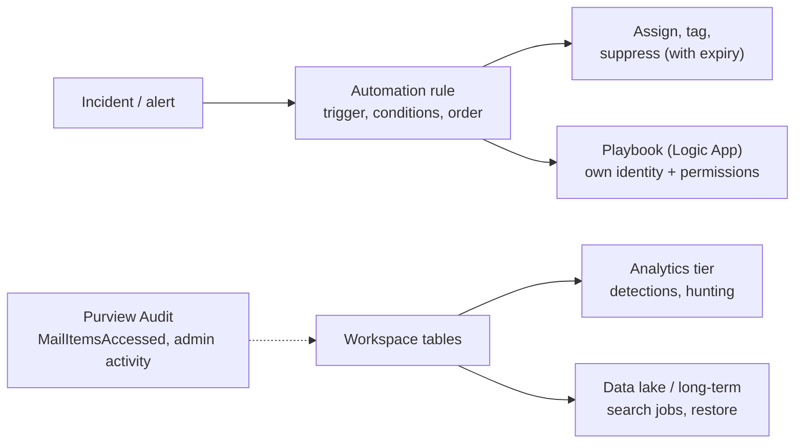
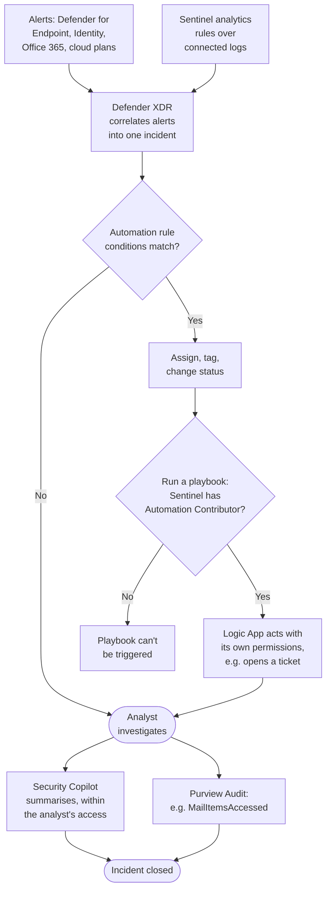

# Sentinel Automation, Retention, and Purview Audit

> **Objective:** Implement activity and event collection in Microsoft Sentinel
> **Domain:** Manage and monitor security posture (20-25%)

## Sub-objectives covered

- Implement automation rules and playbooks in Microsoft Sentinel
- Implement data retention in Microsoft Sentinel data stores
- Query Microsoft Purview Audit in Defender XDR

## The security problem

Three loosely-related bullets, joined by one idea: **a SOC is constrained by analyst time and
by what it can still see.**

Automation addresses the first. An analyst who spends the first eight minutes of every incident
assigning it, tagging it, and looking up whether the user is in the finance group is spending
most of their day on work that is entirely mechanical.

Retention and audit address the second. An investigation that starts today asks questions about
last month, and the answer is decided by decisions made before anyone knew there would be an
investigation - what you retained, in which tier, and whether the right audit events were being
generated at all.

## In plain English

A security team has two scarce things: **analyst time** and **evidence**.

**Automation** saves time. An **automation rule** in Sentinel reacts when an incident or alert
appears - assigning it, tagging it, closing known noise, or starting a **playbook** (a Logic
Apps workflow that can do almost anything: open a ticket, post to Teams, disable an account).

**Retention** decides whether evidence still exists when an investigation needs it - how long
each table is kept, and in which tier.

**Microsoft Purview Audit** is the record of who did what across Microsoft 365 - mailbox
access, file activity, admin changes - searchable from the Microsoft Defender portal. It
answers questions such as "which emails did the attacker open?"

## Words you need to know

- **Incident / alert** - an alert is one detection; an incident groups related alerts into
  one case.
- **Automation rule** - a Sentinel rule with a trigger (incident created or updated, alert
  created), conditions and actions, run in a defined order.
- **Playbook** - an Azure Logic Apps workflow that Sentinel runs for complex actions.
- **Suppression** - an automation rule that closes matching incidents, ideally with an
  expiration date.
- **Microsoft Sentinel Automation Contributor** - the role that lets Sentinel run playbooks in
  a resource group; granted to the Sentinel service.
- **Analytics retention / total retention** - how long data stays in the fast analytics tier,
  and how long it is kept at all (the rest in the data lake or long-term retention).
- **Search job / restore** - ways to bring older data back into reach for analysis.
- **Unified audit log** - Microsoft 365's activity record, searched in Microsoft Purview Audit
  (also from the Defender portal **Audit** page).
- **Audit (Standard) / Audit (Premium)** - the base audit capability, and the E5-level
  capability with longer retention, retention policies and intelligent insights.
- **MailItemsAccessed** - the mailbox audit event recording that mail was read or synced.
- **SearchQueryInitiated** - an Audit (Premium) insight recording what a user searched for in
  Exchange or SharePoint.

## Mental model

A teaching model: save analyst time on one side, keep the evidence on the other.

## How it works under the hood

### Automation rules versus playbooks

These are separate objects and the exam tests the boundary.

| | Automation rule | Playbook |
| --- | --- | --- |
| What it is | A rule in Sentinel: trigger, conditions, actions | A **Logic App** workflow |
| Lives in | Microsoft Sentinel | Azure Logic Apps |
| Can do | Change status, severity, owner; add tags; **suppress**; run a playbook | Anything Logic Apps can reach - ticketing, Teams, Entra, third-party APIs |
| Ordering | Rules run in a defined **order**, and can have an **expiration date** | Called by a rule, or run manually |
| Who can author | Microsoft Sentinel Contributor | **Logic App permissions**, not a Sentinel role |

The relationship in one sentence: **automation rules are the routing layer, playbooks are the
action layer.** The rule decides *whether* and *when*; the playbook does the work.

**Triggers** are incident created, incident updated, and alert created. A playbook's own trigger
type must match how it will be invoked - an incident-trigger playbook cannot be attached to an
alert-created rule. Alert-trigger rules can only run a playbook; the other actions are for
incidents.

**In the Defender portal** a few things change, and they are testable:

- Incidents are created by the Defender correlation engine, so **alert-trigger automation rules
  act only on Microsoft Sentinel alerts** (from Scheduled or NRT analytics rules). To automate on
  Defender XDR alerts too, use the **Enhanced Alert Trigger** in a playbook.
- Incident-trigger rules run on all incidents, Sentinel and Defender XDR alike; use the
  **Analytic rule name** condition rather than incident titles (which the correlation engine can
  change) to narrow them.
- An automation rule can take **up to about 10 minutes** to run after an incident is created,
  because the incident is created in the Defender portal and then forwarded to Sentinel.
- **Simple Flows** (preview) add prebuilt case actions without a playbook.

Two permission facts that cause real deployments to fail:

- **Sentinel needs permission to run your playbook.** The **Microsoft Sentinel Automation
  Contributor** role is granted on the playbook's resource group, to the Sentinel service - in
  the portal, through **Manage playbook permissions**. If a playbook does not appear in an
  automation rule's list, this is why. It is the role from 04-02 that is assigned to a service
  rather than to a person.
- **A playbook authenticates as itself.** It uses a managed identity or a connection, and it
  needs its own permissions on whatever it touches. A playbook that disables a user account
  needs directory permissions - and that makes it a privileged object worth protecting, because
  anything that can trigger it inherits that reach.

The most underused automation rule action is **suppression**: closing incidents matching a
condition, with an expiration date. It handles known-benign noise without deleting a detection,
and the expiry means the suppression gets revisited rather than becoming permanent.

One alert, from detection to a closed incident, with both permissions a playbook needs.
Security Copilot is covered in 04-05.

### Retention in Sentinel's data stores

Retention has two numbers and they are frequently confused:

- **Analytics retention** - data in the analytics tier, queryable at full speed and available to
  analytics rules. Microsoft Sentinel solution tables can keep **90 days** at no extra storage
  charge (check the table: the default may be 30); any table can extend to two years.
- **Total retention** - how long data is kept at all. The part beyond analytics retention lives
  in the **data lake tier** (up to 12 years) - or, for workspaces not yet on the data lake, in
  long-term retention.

Data past analytics retention is **not available to analytics rules or interactive hunting**.
To use it you run a **search job** (a background query that writes results into a new table), a
**KQL job** or notebook against the data lake, or **restore** a time range back into the
analytics tier (restore applies to long-term retention; data lake jobs can promote results
instead). All of these are deliberate, take time, and **carry their own charges**. This is the
difference between "we have the data" and "we can query the data," and the exam tests that you
know it.

Retention is configurable **per table** in **Microsoft Sentinel → Configuration → Tables**, which is the lever that
makes cost manageable: detection tables kept long in the analytics tier, verbose supporting
tables short in analytics and long in the data lake. Shortening total retention waits 30 days
before deleting data, as a safety net.

The framing to carry: retention is not a storage decision, it is a decision about **which
questions you will be able to answer**, made in advance of knowing the questions.

### Microsoft Purview Audit in the Defender portal

The unified audit log records activity across Microsoft 365 - Exchange, SharePoint, Teams,
Entra ID, Defender and more. You can search it from the Microsoft Defender portal **Audit** page
(`security.microsoft.com/auditlogsearch`), which is identical to Audit search in the Microsoft
Purview portal, through the Audit Search Graph API, and with `Search-UnifiedAuditLog` in Exchange
Online PowerShell. Searching needs the **Audit Logs** or **View-Only Audit Logs** role (for
example through Organization Management or Compliance Management), or the Compliance
Administrator role.

**Two tiers, and the difference is investigative, not cosmetic:**

| Capability | Audit (Standard) | Audit (Premium) |
| --- | --- | --- |
| Thousands of searchable events, export, Graph API, `Search-UnifiedAuditLog` | Yes | Yes |
| Mailbox auditing including **MailItemsAccessed** (E3/E5 users, on by default) | Yes | Yes |
| Default retention | **180 days** | **1 year** for Entra ID, Exchange, OneDrive and SharePoint; 180 days for other services |
| **Audit log retention policies** (up to 1 year; 10 years with add-on) | No | **Yes** |
| **Intelligent insights** - for example `SearchQueryInitiated`, and the sensitivity label of accessed mail items | No | **Yes** |
| Higher bandwidth to the Management Activity API | No | Yes (about double) |

Note the retention history, because it is a plausible exam detail: **the Audit (Standard)
default changed from 90 days to 180 days.** Records generated before 17 October 2023 are kept
90 days; records generated on or after that date follow the 180-day default.

**The mailbox events are the reason this bullet is in a security exam:**

- **MailItemsAccessed** - recorded when mail is accessed by any protocol or client (POP, IMAP,
  MAPI, EWS, ActiveSync, REST). **Bind** records list each message's InternetMessageId
  (aggregated in two-minute windows); **sync** records cover a whole folder downloaded by
  desktop Outlook, and every item in it is treated as exposed. This is what lets an
  investigator determine the **scope of a mailbox compromise** - not merely that an account was
  signed into, but which messages were exposed. It is part of **Audit (Standard)** mailbox
  auditing for users with E3/E5 licences.
- **SearchQueryInitiated** for Exchange and SharePoint - what someone searched for inside a
  compromised account, which is often the clearest statement of what they were after. This is
  an **Audit (Premium)** insight.

Three configuration facts:

- **Audit (Premium) needs licensing per user** - an E5-level licence (or an add-on) **and** the
  *Microsoft 365 Advanced Auditing* service plan enabled - before its insights are generated
  for that user, starting within 24 hours.
- **Customised mailbox audit settings stop new events.** If someone changed the actions audited
  on a mailbox, new audit events Microsoft releases are not added to it automatically; restore
  the defaults.
- The default Audit (Premium) policy keeps Exchange, SharePoint, OneDrive and Entra records for
  **one year**, with custom retention policies available for specific workloads, record types
  and users.

And one that belongs in every teardown-minded engineer's memory: unified audit log ingestion can
be turned **off** tenant-wide with `Set-AdminAuditLogConfig -UnifiedAuditLogIngestionEnabled
$false`. If audit search returns nothing for everything, check that before anything else -
including whether an attacker ran it.

**How this connects to Sentinel:** audit data reaches the workspace through connectors -
`OfficeActivity`, `AuditLogs`, `CloudAppEvents` - so the same events are queryable in KQL
alongside everything else. Audit search in the Defender portal is the investigative surface;
Sentinel is the correlation and detection surface. Knowing which to reach for is the practical
skill.

## Why security cares

**Without the control**

1. Every incident waits in a queue until an analyst manually assigns and tags it
2. A known-benign scanner generates 200 incidents a week that analysts close by hand
3. A playbook to disable compromised accounts was built, but never runs, because Sentinel
   cannot access its resource group
4. Months later, a mailbox compromise is investigated - the relevant tables were kept for 30
   days, and nobody checked that mailbox auditing was capturing access events

**With the control**

1. An automation rule assigns and tags incidents on creation, in a deliberate order
2. A suppression rule closes the scanner's incidents, with an expiration date so it is
   revisited
3. Sentinel has Automation Contributor on the playbook's resource group, and the playbook runs
   with a least-privilege managed identity
4. Key tables keep 90+ days in the analytics tier and longer in the data lake; Audit records
   show MailItemsAccessed for the compromised mailbox, so the exposed messages can be listed

**What it does not solve.** Automation acts on what detections produce; it cannot respond to
something nothing detected. Retention cannot recover data that was never collected.

**Depends on.** Correct playbook permissions both ways (Sentinel to run it; the playbook to act),
mailbox auditing left at its defaults, and Audit (Premium) licences for the users whose
activity you may need to reconstruct in depth.

## Configuration surface

| Control | Default | Set it to | Why |
| --- | --- | --- | --- |
| Automation rule order | creation order | Deliberate - suppression before enrichment | Rules run in order |
| Suppression rules | none | With an **expiration date** | Otherwise noise suppression becomes permanent and invisible |
| Sentinel Automation Contributor | not granted | Granted on the playbook's resource group | Sentinel cannot run playbooks without it |
| Playbook identity | connection | Managed identity, least privilege | The playbook is a privileged object |
| Analytics retention | check per table | At least the included 90 days for detection tables | Per-table configuration is the cost lever |
| Total retention | equals analytics retention | Longer, in the data lake | Keeping is cheap; querying is not |
| Audit log search | on | Confirm it is on | Can be disabled tenant-wide |
| Mailbox audit actions | Microsoft defaults | Leave at defaults (restore if customised) | Customised mailboxes miss new events |
| Audit (Premium) licences | not assigned | E5-level licence plus the Advanced Auditing service plan for users you may need to investigate in depth | Per-user; no licence, no insights such as SearchQueryInitiated |
| Audit retention policies | one-year default with Premium | Per workload and record type as required | Standard cannot be extended |

## Common failure modes

**A playbook that never runs.** Sentinel lacks Automation Contributor on the playbook's resource
group. The rule looks correct and does nothing.

**Trigger mismatch.** An incident-trigger playbook attached to an alert-created rule.

**Automation rule ordering ignored.** An enrichment rule runs after a closing rule, so the
enrichment never happens.

**Suppression without an expiry.** A year later, a real detection is being closed automatically
and nobody knows why.

**Playbook over-permissioned.** Given Global Administrator "so it works," it becomes the most
privileged object in the tenant, invokable by a rule.

**Retention set once at the workspace and never per table.** Either you pay analytics-tier prices
for verbose telemetry, or you lose detection data early. Per-table configuration avoids both.

**Long-term data treated as queryable by rules.** It is not. A search job, KQL job or restore is
required, all take time and all cost money.

**Discovering at incident time that the compromised user had no Audit (Premium) licence.** You
may still have MailItemsAccessed (Audit Standard, E3/E5), but not what the attacker searched
for (SearchQueryInitiated) or a year of retention.

**Mailbox audit actions customised years ago.** New audit events never reached those mailboxes.

**Alert-trigger automation expected to fire on Defender XDR alerts.** In the Defender portal it
acts only on Sentinel alerts; use the Enhanced Alert Trigger.

**Assuming 90-day audit retention.** The Standard default is 180 days for records generated on
or after 17 October 2023.

**Audit search returning nothing and being read as "no activity."** Check that unified audit log
ingestion is enabled.

## Hands-on

See [04-04 lab](../../labs/04-security-posture/04-04-lab.md).

## Validate the security outcome

| Control | The outcome to prove | Evidence |
| --- | --- | --- |
| Automation rule | New incidents are handled consistently | A test incident is assigned and tagged within minutes (allow up to ~10 minutes in the Defender portal) |
| Suppression | Known noise is closed, not forgotten | The rule closes the matching test incident and shows an expiration date |
| Playbook permissions | Sentinel can run the playbook | The playbook appears in the automation rule's playbook list; its run history shows a successful run |
| Playbook identity | The playbook has only what it needs | Its managed identity holds a narrow role, not Global Administrator |
| Retention | Evidence exists for the required period | **Microsoft Sentinel → Configuration → Tables** shows analytics and total retention per table |
| Older data | You can reach data past analytics retention | A search job (or KQL job) returns results from the data lake / long-term retention |
| Audit enabled | The tenant is recording activity | An audit search returns recent events; unified audit log ingestion is enabled |
| Mailbox evidence | Mailbox access can be reconstructed | An audit search for `MailItemsAccessed` on a test mailbox returns records |

## How this is tested

| Phrase in the question | What it steers you to |
| --- | --- |
| "automatically assign and tag new incidents" | Automation rule |
| "post to Teams / create a ticket / disable an account" | Playbook, called by an automation rule |
| "close known-benign incidents for 30 days" | Suppression with an expiration date |
| "playbook does not run" | Microsoft Sentinel Automation Contributor on the playbook's resource group |
| "keep data two years, query the last 90 days" | Analytics retention 90 days, total retention two years |
| "query data past analytics retention" | Search job, KQL job, or restore |
| "different retention per data type" | Table-level retention |
| "which emails did the attacker read" | **MailItemsAccessed** (mailbox auditing, Audit Standard for E3/E5) |
| "what did they search for in the mailbox" | `SearchQueryInitiated`, Audit (Premium) |
| "audit records for one year" | Audit (Premium) |
| "ten-year retention" | Audit (Premium) plus the add-on |
| "only some users produce these insights" | Audit (Premium) is per-user, licence plus service plan |
| "automate on Defender XDR alerts in the Defender portal" | Enhanced Alert Trigger (alert-trigger rules see only Sentinel alerts) |
| "audit search returns nothing at all" | Unified audit log ingestion disabled |

**AZ-500 divergence.** Audit search lives in the Defender portal alongside Sentinel rather than
in a separate compliance portal, and the Audit (Standard) retention default moved from 90 to 180
days. Sentinel's retention model has also gained the cheaper tiers and the data lake, so "set
retention on the workspace" is no longer the whole answer.

### What SC-500 expects you to do

- **Identify** whether a requirement is routing (automation rule), an action (playbook), a
  retention decision, or an audit question.
- **Distinguish** automation rules from playbooks, incident from alert triggers, analytics from
  total retention, search jobs from restore, and Audit (Standard) from Audit (Premium).
- **Select** the trigger, action, retention configuration or audit capability for a scenario.
- **Implement** automation rules (with order and expiry), playbooks with the right permissions,
  per-table retention, and audit log searches.
- **Evaluate** whether the evidence an investigation needs will exist.

## Check yourself

1. An automation rule is configured to run a playbook on incident creation. Incidents are
   created and the playbook never runs, with no error in the rule. Give the most likely cause
   and where you would look.
2. Distinguish an automation rule from a playbook by describing one task that only a rule can do
   and one that only a playbook can do.
3. Your workspace has 90-day analytics retention and two-year total retention. An investigation
   needs data from 14 months ago. Describe exactly what you do, what it costs you, and how long
   it takes.
4. An account is compromised. You need to know which emails were accessed. Describe what you can
   determine if the user held an Audit (Premium) licence, and what you can determine if they did
   not.
5. A suppression rule was created 18 months ago with no expiry. Describe the failure mode, how
   you would detect it, and what you would change.

## Teach it back

A SOC manager asks why the "disable compromised user" playbook isn't running even though the
automation rule fires. Explain the two permission relationships involved.

A strong answer covers: Sentinel must be allowed to run playbooks in that resource group
(Microsoft Sentinel Automation Contributor, granted through **Manage playbook permissions**);
the playbook itself authenticates with its own managed identity or connection and needs
directory permissions to disable users; also check the trigger types match (incident-trigger
playbook on an incident-trigger rule).

## Key takeaways

- Automation rules route (assign, tag, suppress, run a playbook); playbooks act (Logic Apps).
- Rules run in order; give suppression rules an expiration date.
- Sentinel needs Automation Contributor on the playbook's resource group; the playbook needs its
  own least-privilege identity.
- In the Defender portal, alert-trigger rules act only on Sentinel alerts, and only the run
  playbook action is available for alert triggers.
- Analytics retention for real-time use; total retention in the data lake for history.
- MailItemsAccessed is part of Audit (Standard) mailbox auditing; Audit (Premium) adds one-year
  default retention for key workloads, retention policies, and insights such as
  SearchQueryInitiated.

## Sources

- Microsoft Learn - SC-500 skills measured: <https://learn.microsoft.com/en-us/credentials/certifications/resources/study-guides/sc-500>
- Search the audit log: <https://learn.microsoft.com/purview/audit-search>
- Microsoft Purview Audit (Premium): <https://learn.microsoft.com/purview/audit-premium>
- Reduce costs for Microsoft Sentinel: <https://learn.microsoft.com/azure/sentinel/billing-reduce-costs>
- Best practices for Microsoft Sentinel: <https://learn.microsoft.com/azure/sentinel/best-practices>
- Automation in Microsoft Sentinel (Defender portal differences): <https://learn.microsoft.com/azure/sentinel/automation/automation>
- Automate threat response with automation rules: <https://learn.microsoft.com/azure/sentinel/automate-incident-handling-with-automation-rules>
- Use MailItemsAccessed to investigate compromised accounts: <https://learn.microsoft.com/purview/audit-log-investigate-accounts>
- Learn about auditing solutions in Microsoft Purview: <https://learn.microsoft.com/purview/audit-solutions-overview>
- Audit log search in the Microsoft Defender portal: <https://learn.microsoft.com/defender-office-365/audit-log-search-defender-portal>
