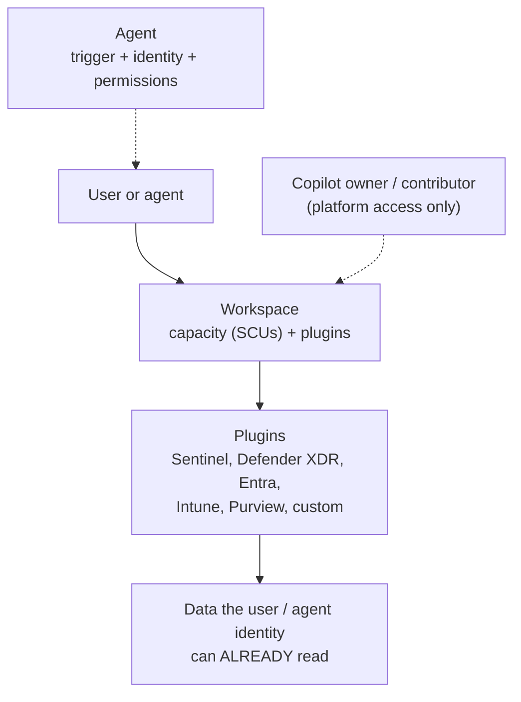

# Microsoft Security Copilot

> **Objective:** Implement Microsoft Security Copilot
> **Domain:** Manage and monitor security posture (20-25%)

## Sub-objectives covered

- Configure workspaces for Security Copilot
- Manage permissions and roles in Security Copilot
- Enable and configure plugins
- Enable and configure Microsoft agents and Security Store agents

> **Cost warning, before anything else.** Provisioned Security Compute Units bill **hourly from
> the moment capacity is provisioned**, used or not. (Microsoft 365 E5/E7 tenants get a monthly
> SCU allocation instead - check which model you are on before provisioning anything.) This is the single largest spend risk in the guide by
> a wide margin - larger than Azure Firewall, larger than an AKS node pool. Read
> [00-01](../00-lab-safety/00-01-cost-guardrails-and-budgets.md) again before the lab.

## The security problem

Domain 3 was about protecting AI workloads. This module is AI as the security tool, and it
closes the loop the guide opened in 03-01.

The problem it addresses is the one every SOC has: **the work is bounded by analyst time, and
most of that time goes on translation.** Translating an incident into a KQL query. Translating a
malware sample's behaviour into a written summary. Translating a script into an explanation of
what it does. Translating four consoles' worth of context into one sentence a manager can act
on. None of that is judgement; all of it is expensive.

But there is a security property that matters more than the productivity claim, and it is what
the exam tests: **Security Copilot does not have its own access to your data.** It reasons over
what the signed-in user could already reach, through plugins the organisation enabled, within a
workspace an owner configured. Every one of the four bullets is a control over that sentence.

So the objective is not "how do I use it." It is: **who may use it, over which data, with whose
permissions, at what capacity, and which autonomous agents are allowed to act.**

## In plain English

**Microsoft Security Copilot** is a generative AI assistant for security work. Analysts ask
it questions in plain language - "summarise this incident", "explain this script", "write a
query for these sign-ins" - and it answers using data from Microsoft security products.
**Agents** go further: they do recurring work, such as triaging phishing reports, on their own.

The security question is not how to use it but **how to control it**: who may use it, which
data sources (**plugins**) it can reach, whose permissions it uses, how much compute capacity
it can consume, and which agents are allowed to act. The single most important fact: Security
Copilot **does not have its own access to your data** - it works with what the person (or the
agent's identity) is already allowed to see.

## Words you need to know

- **Security Compute Unit (SCU)** - the unit of capacity Security Copilot consumes.
- **Capacity** - SCUs available to a workspace: provisioned (billed hourly), overage (billed
  on use), or the monthly allocation included with Microsoft 365 E5/E7.
- **Workspace** - a container with its own capacity, plugin settings, role assignments and
  session history, and a data storage location.
- **Copilot owner / Copilot contributor** - Security Copilot's own roles (not Entra roles):
  administer the platform, or use it.
- **Plugin** - a connection that lets Security Copilot reach a data source: Microsoft,
  non-Microsoft, or custom.
- **Promptbook** - a saved sequence of prompts that can be rerun.
- **Embedded experience** - Security Copilot inside another portal, such as Defender, Entra,
  Intune or Purview.
- **Agent** - Security Copilot working autonomously on a task, with a trigger, an identity,
  permissions and plugins.
- **Agent identity** - a Microsoft Entra identity created for an agent to run as (recommended
  over a user account; currently offered for Microsoft-built agents only).
- **Microsoft Security Store** - the storefront for Microsoft and partner security agents and
  solutions.

## Mental model

A teaching model: what bounds every Security Copilot answer.

## How it works under the hood

### Workspaces and capacity

A **workspace** is the unit of segmentation, and it holds four things:

- **Capacity**, measured in **Security Compute Units (SCUs)**
- **Plugin configuration** - which data sources are available in that workspace
- **Role assignments** - who has owner and contributor access there
- **Session history and promptbooks** - what has been asked, reusable

Workspaces exist so that a large organisation can segment: different teams, different capacity
budgets, different plugin sets, and **different data storage locations for compliance** - the
geo selection is made at workspace creation and is a data residency decision, not a performance
one. **SCUs are not shared between workspaces**: if one workspace exhausts its capacity, it
cannot borrow another's.

**Three capacity models**, and which one applies depends on licensing:

| Model | How it works | Billing |
| --- | --- | --- |
| **Provisioned** | Minimum 1 SCU (up to 100), refreshed every clock hour; unused SCUs do not roll over | **Hourly**, in full clock-hour blocks, whether used or not |
| **Overage** | Extra SCUs used when provisioned capacity runs out; set a limit (0-999) or unlimited | On use, to one decimal place |
| **Microsoft 365 E5 / E7 inclusion** | Auto-provisioned **Default Security Copilot Capacity** with a default workspace; **400 SCUs a month per 1,000 paid licences, up to 10,000**; resets monthly | Not billed hourly; the default capacity cannot be modified |

For non-E5/E7 tenants, capacity is an Azure resource (`Microsoft.SecurityCopilot/capacities`)
provisioned through the Security Copilot portal or Azure, and it **needs two separate
permissions** - a favourite exam detail:

- **Azure Contributor or Owner** on the subscription or resource group - because the capacity is
  an Azure resource
- **Security Administrator or higher** in the tenant you are onboarding

Neither alone is sufficient. Owners manage capacity settings and see the **usage dashboard**;
contributors do not. Monitoring usage is an ongoing task rather than a setup step, because
consumption varies with what people ask and which agents run.

### Roles and permissions

This is the part most worth getting exactly right.

Security Copilot has **two roles that are not Microsoft Entra ID roles.** They function like
access groups, control access only to the Security Copilot platform, and **provide no access by
themselves to security data**:

| Role | Grants |
| --- | --- |
| **Copilot owner** | Platform administration - owner settings, plugin governance, capacity management, usage dashboard, role assignment |
| **Copilot contributor** | Use of the platform - sessions, promptbooks, file upload (by default) |

**Who gets contributor by default has changed.** New Security Copilot instances assign
contributor to the **Recommended Microsoft Security roles** group - users who already hold
security roles. Older tenants may still have the **Everyone** group assigned (originally the
default, and still described that way on some Microsoft pages); if you remove Everyone, it
cannot be assigned again. Roles can only be assigned to users and **role-assignable groups**.

**Entra and Purview roles that inherit Copilot owner** include **Global Administrator, Security
Administrator, Billing Administrator, Entra Compliance Administrator and Intune Administrator**,
plus Purview Compliance Administrator, Purview Data Governance Administrator and Purview
Organization Management. The set of owner roles is configurable, and **only the roles you select
inherit owner on that workspace**. Security Copilot always retains **two owners** so it cannot be
left unmanaged. With E5/E7 auto-provisioning, Defender, Purview and Intune roles that include the
Security Copilot permission inherit contributor.

**And now the mechanism that matters most.** A Copilot role does **not** grant access to the
underlying security data. If a plugin needs a service role to read its data, the **user** must
hold that role.

Microsoft's own example is worth internalising: an analyst with **Compliance Administrator**
can use the Microsoft Purview plugin, because that role gives them Purview data access. **That
same analyst needs additional role assignments - such as Microsoft Sentinel Reader - to reach
Microsoft Sentinel data.** Copilot did not elevate them; it inherited what they had. And don't
assign Security Administrator purely so someone can use Copilot - add a security group to the
Copilot role instead.

Two consequences:

1. Two analysts running the same prompt can get different answers, legitimately.
2. An empty result means "no data" **or** "no access," and telling those apart is a permissions
   question, not a prompt question.

Beyond Copilot's own roles, you can layer **Conditional Access** on access to the Security
Copilot app itself.

### Plugins

Plugins are how Copilot reaches data. Three categories:

- **Microsoft plugins** - Defender XDR, Sentinel, Entra, Intune, Purview, Defender Threat
  Intelligence, Defender EASM and others
- **Third-party plugins** - security vendors' own integrations
- **Custom plugins** - your own, built against KQL, APIs, or GPT-based definitions

**Plugin governance is an owner-level setting**, and it controls **who may add and publish
custom plugins**. By default contributors cannot manage custom plugins; owners can allow them to
manage personal plugins, and separately allow them to **publish plugins for the whole tenant**.
Owners also change the availability of preinstalled plugins. Opened up carelessly - especially
where contributor still means Everyone - any user can introduce a plugin that reaches an external
API with credentials it holds. That is
the plugin equivalent of the consent problem from
[01-01](../01-identity-access-governance/01-01-entra-id-secure-access.md), and it deserves the
same treatment: restrict who can publish, and review what exists.

Plugin settings are **workspace-scoped**, so different teams can have different data reach
within the same tenant.

### Agents

Agents are the autonomous layer: they run defined security work rather than answering a prompt.

**Microsoft-built agents** span the security portfolio - for example triaging phishing
submissions and alerts, optimising Conditional Access policies, prioritising vulnerability
remediation, and producing threat intelligence briefings - and appear in the **Agents** library
in Security Copilot and inside the relevant product portals. **Microsoft Security Store**
supplies partner-built (and Microsoft) agents and solutions: you buy them through an Azure
billing subscription, then configure and run them in Security Copilot.

> The agent catalogue is expanding quickly. Verify the current list before the exam rather than
> memorising this one.

**Setting up an agent** means choosing four things, and each is a control:

| Setting | What it decides |
| --- | --- |
| **Identity** | What the agent runs as - **create an agent identity** (recommended; Microsoft-built agents only, for now) or assign an existing user account |
| **Permissions** | What the agent may read and do in each product |
| **Trigger** | When it runs - on a schedule or event, or manually ("One time"); you can pause it |
| **Plugins and products** | Which services it reaches |

Setting up needs a Copilot owner or contributor role; granting the agent its permissions may need
a Global Administrator; buying from Security Store needs Contributor or Owner on the Azure billing
subscription.

Three governance points that matter more than the catalogue:

- **Agents consume SCUs.** An agent running on a schedule consumes capacity continuously, and an
  agent enabled and forgotten is a recurring charge with no one watching the output.
- **Agents act with an identity.** Running an agent as a privileged person's account gives it
  everything that person can do. An agent identity can be scoped - and it is the same object
  you governed with Entra Agent ID in
  [03-02](../03-secure-compute/03-02-ai-agent-identity-and-governance.md). The two modules are
  the same governance problem from two directions: 03-02 governs agents you build, this one
  governs agents you enable.
- **Agents are reviewed, not trusted.** They surface their reasoning so analysts can review,
  validate or override it; pause agents you are not using.

**Agent lifecycle management** - enabling, assigning, monitoring, pausing, retiring - is the
administrative work this bullet is really about.

## Why security cares

**Without the control**

1. Security Copilot is onboarded and contributor access is left open to the whole directory
2. Contributors are allowed to publish custom plugins; one calls an external API with a stored
   key
3. An agent is set up running as a highly privileged user account and left on a schedule
4. Capacity is provisioned at 10 SCUs and forgotten, billing every hour

**With the control**

1. Contributor access uses the **Recommended Microsoft Security roles** group (or named
   security groups), so only people who already work with security data get in
2. Only owners can publish custom plugins; preinstalled plugins are reviewed per workspace
3. The agent runs as its own **agent identity** with only the permissions it needs, and its
   runs are reviewed
4. Capacity matches observed usage (or the E5/E7 monthly allocation), with an overage limit

**What it does not solve.** Security Copilot summarises and correlates; it does not verify.
Analysts own conclusions. It also cannot see data the user has no right to - an empty answer
may mean "no access".

**Depends on.** Least-privilege roles in each underlying service, owner settings reviewed
regularly, and usage monitoring.

## Configuration surface

| Control | Default | Set it to | Why |
| --- | --- | --- | --- |
| Capacity model | depends on licence | E5/E7 default capacity, or the minimum provisioned SCUs that work, with an overage limit | **Provisioned SCUs bill hourly** |
| Workspace geo | chosen at creation | Where data residency requires | Not a performance setting |
| Copilot contributor | Recommended security roles group (new); Everyone (some older tenants) | Recommended roles or named role-assignable groups | Everyone cannot be re-added once removed |
| Owner roles | a default set | Only the roles that need administration | Only selected roles inherit owner |
| Underlying data access | the user's existing roles | Assigned per service, per analyst | A Copilot role grants no data access |
| Custom plugin management and publishing | contributors cannot | Owners only, unless deliberately delegated | A plugin can reach an external API |
| Preinstalled plugins | available | Reviewed per workspace | Workspace-scoped by design |
| Agent identity | chosen at setup | Agent identity with least privilege | Not a personal privileged account |
| Agent trigger | chosen at setup | Scheduled only where output is used; pause the rest | Agents consume SCUs |
| Capacity monitoring | none | Usage dashboard reviewed regularly | Consumption varies with usage and agents |

## Common failure modes

**Capacity provisioned and left running.** The defining cost mistake of this module. Provisioned
SCUs bill by the hour whether or not anyone submits a prompt.

**Provisioning capacity in an E5/E7 tenant that already has the included default capacity.**
Check the licensing model first.

**Only one of the two provisioning permissions.** Security Administrator without Azure rights,
or Azure Owner without a tenant security role. Provisioning fails and the cause is not obvious.

**Assuming the old default still applies - or no longer applies.** Some tenants still grant
contributor to Everyone; new ones use the recommended security roles group. Check **Role
assignment**.

**Expecting a Copilot role to grant data access.** It does not. The analyst needs the service
role for each plugin's data - Purview access does not confer Sentinel access.

**Granting Security Administrator just so someone can use Copilot.** Use a security group in the
Copilot role instead.

**Reading an empty answer as "nothing found."** It may be "nothing you are allowed to see."

**Custom plugin publishing opened to contributors.** Any contributor can introduce a plugin that
reaches an external endpoint.

**Expecting one workspace to borrow another's SCUs.** Capacity is per workspace.

**Agents set up as a privileged user and forgotten.** They act with that user's reach and
consume capacity on a schedule.

**Treating output as verified.** It summarises and correlates; it does not vouch. The analyst
owns the conclusion.

## Hands-on

See [04-05 lab](../../labs/04-security-posture/04-05-lab.md).

## Validate the security outcome

| Control | The outcome to prove | Evidence |
| --- | --- | --- |
| Platform access | Only intended people can use Security Copilot | **Role assignment** shows contributors as the recommended security roles group or named groups - not Everyone |
| Owner set | Administration is limited | Owner list contains only the intended roles and groups (two owners are always retained) |
| Data boundary | Copilot answers only from data the user can read | A user without Microsoft Sentinel Reader gets no Sentinel incident data through Copilot |
| Plugin governance | Contributors cannot publish tenant-wide plugins | Owner settings show custom plugin publishing restricted to owners |
| Capacity | Spend matches use | The usage dashboard shows SCU consumption; provisioned SCUs and overage limit match it (or the E5/E7 default capacity is in use) |
| Agent identity | Agents run with least privilege | Each agent shows an agent identity (not a personal account) with only the listed permissions |
| Agent schedule | Agents run only when intended | Agents not in use are paused; run history is reviewed |

## How this is tested

| Phrase in the question | What it steers you to |
| --- | --- |
| "different teams, different capacity and plugins" | Separate workspaces |
| "data must stay in a region" | Workspace geo selection at creation |
| "who can provision capacity" | Azure Contributor/Owner **plus** Security Administrator or higher |
| "E5 customer, no capacity purchased" | Auto-provisioned default capacity from the E5/E7 inclusion |
| "absorb usage spikes without more hourly cost" | Overage capacity with a limit |
| "restrict who can administer Security Copilot" | Owner roles - only selected roles inherit |
| "all users can access Copilot" | The **Everyone** group is assigned to contributor (older default) - replace it with the recommended security roles group |
| "analyst can query Purview but not Sentinel" | Underlying service roles, not Copilot roles |
| "prevent users adding their own plugins" | Owner-level plugin governance setting |
| "extend Copilot to a non-Microsoft data source" | Custom or third-party plugin |
| "automate phishing submission triage" | A Microsoft agent |
| "partner-built agents" | Microsoft Security Store |
| "agent must not run with an admin's personal account" | Create an **agent identity** for it |
| "buy a partner agent" | Microsoft Security Store, billed to an Azure subscription |
| "reduce Security Copilot cost" | Reduce provisioned SCUs; review scheduled agents |

**AZ-500 divergence.** Nothing here has an AZ-500 ancestor. The more useful warning is recency:
workspaces, the owner-role selection model, and Security Store agents are all recent additions,
and material written even a few months ago describes a smaller product. Check the documentation
rather than trusting a walkthrough.

### What SC-500 expects you to do

- **Identify** which control a requirement is about: workspace and capacity, platform roles,
  data permissions, plugins, or agents.
- **Distinguish** Copilot roles from Entra and service roles, provisioned from overage from
  included capacity, and Microsoft agents from Security Store agents.
- **Select** the workspace design, role assignment, plugin setting or agent configuration for a
  scenario.
- **Implement** workspaces and capacity, owner and contributor assignments, plugin governance,
  and agent setup with an agent identity.
- **Evaluate** why a user gets an empty or partial answer, and what an agent can reach.

## Check yourself

1. Your organisation onboards Security Copilot. A finance user discovers they can open the
   portal. Explain why, and describe what you would change.
2. An analyst holding Compliance Administrator reports that Copilot answers Purview questions
   well but returns nothing for Sentinel. Give the mechanism and the fix, and explain why this
   is the correct design rather than a bug.
3. Provisioning capacity fails for an administrator who holds Global Administrator in the
   tenant. Give the most likely cause.
4. Compare the governance question in this module with the one in 03-02. What is the same about
   an Entra Agent ID and a Security Copilot agent, and what is different?
5. Your SCU bill is three times last month's and analyst usage is unchanged. List what you would
   check, in order.

## Teach it back

A manager asks: "If we give the whole SOC Copilot contributor, can they now see everything in
Sentinel and Purview?" Explain.

A strong answer covers: Copilot roles only grant access to the Security Copilot platform, not
to security data; each plugin respects the user's existing role in that service (for example
Microsoft Sentinel Reader for Sentinel, a Purview role for Purview); so two analysts can get
different answers to the same prompt, and an empty answer may mean no access.

## Key takeaways

- Security Copilot inherits the user's (or agent identity's) permissions; Copilot roles grant
  platform access only.
- New instances default contributor access to the **Recommended Microsoft Security roles**
  group; older tenants may still have **Everyone** - and once removed, it cannot be re-added.
- Entra roles such as Global Administrator and Security Administrator inherit Copilot owner;
  you choose which roles do.
- Provisioning capacity needs Azure Contributor/Owner **and** Security Administrator or higher.
- Provisioned SCUs bill hourly (minimum 1); overage bills on use; Microsoft 365 E5/E7 includes
  400 SCUs a month per 1,000 licences (up to 10,000) in an auto-provisioned default capacity.
- SCUs are not shared between workspaces.
- Agents run on a trigger with an identity - prefer an agent identity where offered (Microsoft-built agents) - and consume SCUs.

## Sources

- Microsoft Learn - SC-500 skills measured: <https://learn.microsoft.com/en-us/credentials/certifications/resources/study-guides/sc-500>
- Manage Security Copilot workspaces: <https://learn.microsoft.com/copilot/security/manage-workspaces>
- Security Copilot authentication and roles: <https://learn.microsoft.com/copilot/security/authentication>
- Deploy and operate Microsoft Security Copilot (learning path): <https://learn.microsoft.com/training/paths/deploy-operate-security-copilot/>
- Configure Security Copilot workspaces (module): <https://learn.microsoft.com/training/modules/configure-security-copilot-workspaces/1-introduction>
- Security Copilot Security Compute Units and capacity: <https://learn.microsoft.com/copilot/security/security-compute-units-capacity>
- Security Copilot for Microsoft 365 E5 and E7 included customers: <https://learn.microsoft.com/copilot/security/security-copilot-inclusion>
- Set up and manage Security Copilot agents: <https://learn.microsoft.com/copilot/security/agents-manage>
- Get agents in Microsoft Security Store: <https://learn.microsoft.com/security/store/customers/get-agents-in-security-store>
